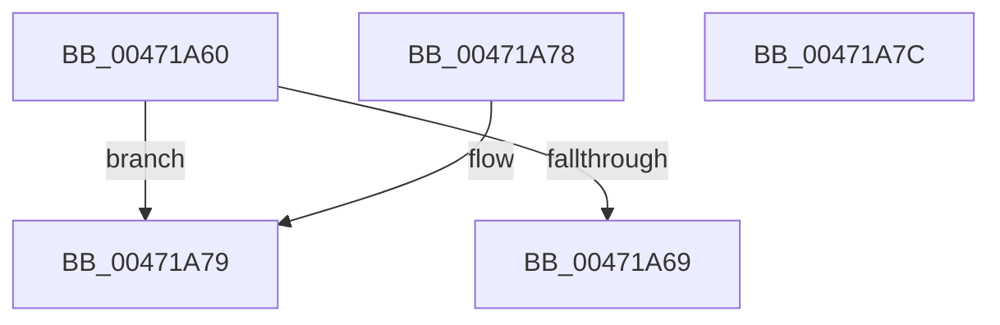

# KeQueryGroupAffinity

- RVA: `0x00471A60`–`0x00471A7D` (길이 `29` bytes)
- VA: `0x0000000140471A60`
- 실행 섹션: `.text`
- PDB 이름 있음: `예`; PDB Function 태그: `아니요`
- unwind 정보 RVA: `0x000DB714`
- 디코드: `10`개 명령, `29/29` bytes 표시
- 미해석 바이트: `0` (있으면 어셈블리에 `.byte`로 보존)

> 이 문서는 커널 이미지의 기계어와 PDB 기호를 분석해 생성했습니다. 4번과 5번은 함수 원형과 자료형을 바이너리 사용 방식에서 추정한 C 해석이며 원본 소스 복구 결과는 아닙니다.

## 1. Dependencies

- 직접 호출 지점: **0**; 고유 호출 대상: **0**
- 직접 호출자로 확인된 함수: **8**
- RIP 상대 이미지 참조: **2**

### Outgoing calls
- 직접 디코드된 call 명령이 없습니다.

### Direct callers
- [PpmEnableWmiInterface](../../page/76/PpmEnableWmiInterface_function_00768604.md) at `0x00768615`
- [EtwpProcessorRundown](../../page/7C/EtwpProcessorRundown_function_007C0868.md) at `0x007C0991`
- [NtCreateProfile](../../page/7D/NtCreateProfile_function_007D2040.md) at `0x007D209D`
- [MmCreatePeb](../../page/98/MmCreatePeb_function_00980FB4.md) at `0x009815DD`
- [PopProcessorInformation](../../page/A1/PopProcessorInformation_function_00A11CA0.md) at `0x00A11CC7`
- [ExpQuerySystemInformation](../../page/A5/ExpQuerySystemInformation_function_00A57858.md) at `0x00A5947B`
- [PpmEventTraceProcessorPerformanceDomainRundown](../../page/A8/PpmEventTraceProcessorPerformanceDomainRundown_function_00A8FCC4.md) at `0x00A8FD5C`
- [sub_00B2A6DE](../../page/B2/Unknown_function_00B2A6DE.md) at `0x00B2A6F6`

### Static image references
- `0x00471A60` → RVA `0x00FC7120` (`ALMOSTRO`; read)
- `0x00471A6C` → RVA `0x00FC7128` (`ALMOSTRO`; read)

## 2. Other-region calls and transfers

- 다른 실행 섹션으로 향하는 call: **0**
- 별도 외부 분기/꼬리 이동을 확인하지 못했습니다.

## 3. Assembly (complete function range)

```asm
00471A60  66 3B 0D B9 56 B5 00            cmp cx, word ptr [rip + 0xb556b9]
00471A67  73 10                           jae 0x140471a79
00471A69  0F B7 C1                        movzx eax, cx
00471A6C  48 8D 0D B5 56 B5 00            lea rcx, [rip + 0xb556b5]
00471A73  48 8B 04 C1                     mov rax, qword ptr [rcx + rax*8]
00471A77  C3                              ret
00471A78  CC                              int3
00471A79  33 C0                           xor eax, eax
00471A7B  C3                              ret
00471A7C  CC                              int3
```

## 4. C-style interpretation (structured pseudocode)

```c
__int64 __fastcall KeQueryGroupAffinity(unsigned __int16 a1)
{
    __int64 result;

    if (a1 >= (*(unsigned __int16 *)(v_rip + 11884217))) goto loc_00471A79;
    return *(unsigned __int64 *)(v_rip + 11884213 + a1 * 8);
loc_00471A79:
    result = 0;
    return result;
}
```

## 5. (Beta) C Style

```c
int64_t KeQueryGroupAffinity(uint16_t Arg1)
{
    int64_t result;

    if (Arg1 >= (*(uint16_t *)(v_rip + 0xB556B9))) goto loc_00471A79;
    return *(uint64_t *)(v_rip + 0xB556B5 + Arg1 * 8);
loc_00471A79:
    result = 0;
    return result;
}
```

## 6. Execution-region graph

[열기: 2D/3D 그래프와 함수 탐색 컨트롤 패널](../../../control-panel.html?section=text&rva=0x00471A60&view=graph)

- 2D 그래프는 위에서 아래로 흐르고, 3D 그래프는 빈 공간을 드래그해 회전합니다. Shift+드래그는 이동, 휠은 확대·축소, 함수 노드 선택은 대상 보고서 이동입니다.

### Static fallback


