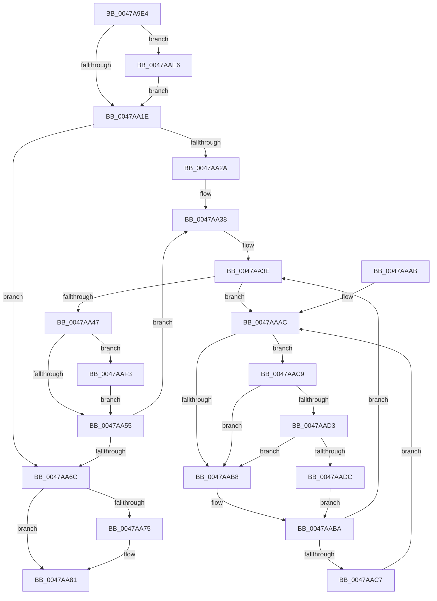

# KeQuerySchedulingGroupReadyTime

- RVA: `0x0047A9E4`–`0x0047AB0C` (길이 `296` bytes)
- VA: `0x000000014047A9E4`
- 실행 섹션: `.text`
- PDB 이름 있음: `예`; PDB Function 태그: `아니요`
- unwind 정보 RVA: `0x000AD358`
- 디코드: `77`개 명령, `296/296` bytes 표시
- 미해석 바이트: `0` (있으면 어셈블리에 `.byte`로 보존)

> 이 문서는 커널 이미지의 기계어와 PDB 기호를 분석해 생성했습니다. 4번과 5번은 함수 원형과 자료형을 바이너리 사용 방식에서 추정한 C 해석이며 원본 소스 복구 결과는 아닙니다.

## 1. Dependencies

- 직접 호출 지점: **4**; 고유 호출 대상: **4**
- 직접 호출자로 확인된 함수: **2**
- RIP 상대 이미지 참조: **5**

### Outgoing calls
- `0x0047AA7C` → [KiLowerIrqlProcessIrqlFlags](../4F/KiLowerIrqlProcessIrqlFlags_function_004F5698.md) (function, `0x004F5698`)
- `0x0047AAD3` → [KiCheckVpBackingLongSpinWaitHypercall](../30/KiCheckVpBackingLongSpinWaitHypercall_function_0030F490.md) (function, `0x0030F490`)
- `0x0047AADF` → [HvlNotifyLongSpinWait](../30/HvlNotifyLongSpinWait_function_0030F460.md) (function, `0x0030F460`)
- `0x0047AAE9` → [KiRaiseIrqlProcessIrqlFlags](../4F/KiRaiseIrqlProcessIrqlFlags_function_004F56FC.md) (function, `0x004F56FC`)

### Direct callers
- [PspQueryJobHierarchyAccountingInformation](../../page/91/PspQueryJobHierarchyAccountingInformation_function_0091864C.md) at `0x00918893`
- [NtSetInformationJobObject](../../page/9F/NtSetInformationJobObject_function_009F84C0.md) at `0x009FA07C`

### Static image references
- `0x0047AA11` → RVA `0x00FC6D20` (`ALMOSTRO`; read)
- `0x0047AA1E` → RVA `0x00FC6A80` (`ALMOSTRO`; read)
- `0x0047AA2A` → RVA `0x00FC8C40` (`ALMOSTRO`; read)
- `0x0047AAAF` → RVA `0x00FC52AC` (`ALMOSTRO`; reference)
- `0x0047AAC9` → RVA `0x00FC6AB8` (`ALMOSTRO`; read)

## 2. Other-region calls and transfers

- 다른 실행 섹션으로 향하는 call: **0**
- 별도 외부 분기/꼬리 이동을 확인하지 못했습니다.

## 3. Assembly (complete function range)

```asm
0047A9E4  48 8B C4                        mov rax, rsp
0047A9E7  48 89 58 08                     mov qword ptr [rax + 8], rbx
0047A9EB  48 89 68 10                     mov qword ptr [rax + 0x10], rbp
0047A9EF  48 89 70 18                     mov qword ptr [rax + 0x18], rsi
0047A9F3  48 89 78 20                     mov qword ptr [rax + 0x20], rdi
0047A9F7  41 54                           push r12
0047A9F9  41 56                           push r14
0047A9FB  41 57                           push r15
0047A9FD  48 83 EC 20                     sub rsp, 0x20
0047AA01  48 8B F9                        mov rdi, rcx
0047AA04  44 0F 20 C6                     mov rsi, cr8
0047AA08  BA 02 00 00 00                  mov edx, 2
0047AA0D  44 0F 22 C2                     mov cr8, rdx
0047AA11  83 3D 08 C3 B4 00 00            cmp dword ptr [rip + 0xb4c308], 0
0047AA18  0F 85 C8 00 00 00               jne 0x14047aae6
0047AA1E  8B 05 5C C0 B4 00               mov eax, dword ptr [rip + 0xb4c05c]
0047AA24  33 DB                           xor ebx, ebx
0047AA26  85 C0                           test eax, eax
0047AA28  74 42                           je 0x14047aa6c
0047AA2A  4C 8D 3D 0F E2 B4 00            lea r15, [rip + 0xb4e20f]
0047AA31  48 83 EF 80                     sub rdi, -0x80
0047AA35  44 8B E0                        mov r12d, eax
0047AA38  49 8B 2F                        mov rbp, qword ptr [r15]
0047AA3B  45 33 F6                        xor r14d, r14d
0047AA3E  F0 48 0F BA 6D 30 00            lock bts qword ptr [rbp + 0x30], 0
0047AA45  72 65                           jb 0x14047aaac
0047AA47  48 03 5F 38                     add rbx, qword ptr [rdi + 0x38]
0047AA4B  F6 47 70 01                     test byte ptr [rdi + 0x70], 1
0047AA4F  0F 85 9E 00 00 00               jne 0x14047aaf3
0047AA55  F0 48 83 65 30 00               lock and qword ptr [rbp + 0x30], 0
0047AA5B  49 83 C7 08                     add r15, 8
0047AA5F  48 81 C7 B8 01 00 00            add rdi, 0x1b8
0047AA66  49 83 EC 01                     sub r12, 1
0047AA6A  75 CC                           jne 0x14047aa38
0047AA6C  83 3D AD C2 B4 00 00            cmp dword ptr [rip + 0xb4c2ad], 0
0047AA73  74 0C                           je 0x14047aa81
0047AA75  44 0F 20 C1                     mov rcx, cr8
0047AA79  40 8A D6                        mov dl, sil
0047AA7C  E8 17 AC 07 00                  call 0x1404f5698
0047AA81  40 0F B6 CE                     movzx ecx, sil
0047AA85  44 0F 22 C1                     mov cr8, rcx
0047AA89  48 8B 6C 24 48                  mov rbp, qword ptr [rsp + 0x48]
0047AA8E  48 8B C3                        mov rax, rbx
0047AA91  48 8B 5C 24 40                  mov rbx, qword ptr [rsp + 0x40]
0047AA96  48 8B 74 24 50                  mov rsi, qword ptr [rsp + 0x50]
0047AA9B  48 8B 7C 24 58                  mov rdi, qword ptr [rsp + 0x58]
0047AAA0  48 83 C4 20                     add rsp, 0x20
0047AAA4  41 5F                           pop r15
0047AAA6  41 5E                           pop r14
0047AAA8  41 5C                           pop r12
0047AAAA  C3                              ret
0047AAAB  CC                              int3
0047AAAC  41 FF C6                        inc r14d
0047AAAF  44 85 35 F6 A7 B4 00            test dword ptr [rip + 0xb4a7f6], r14d
0047AAB6  74 11                           je 0x14047aac9
0047AAB8  F3 90                           pause
0047AABA  48 8B 45 30                     mov rax, qword ptr [rbp + 0x30]
0047AABE  48 85 C0                        test rax, rax
0047AAC1  0F 84 77 FF FF FF               je 0x14047aa3e
0047AAC7  EB E3                           jmp 0x14047aaac
0047AAC9  8B 05 E9 BF B4 00               mov eax, dword ptr [rip + 0xb4bfe9]
0047AACF  A8 40                           test al, 0x40
0047AAD1  74 E5                           je 0x14047aab8
0047AAD3  E8 B8 49 E9 FF                  call 0x14030f490
0047AAD8  84 C0                           test al, al
0047AADA  74 DC                           je 0x14047aab8
0047AADC  41 8B CE                        mov ecx, r14d
0047AADF  E8 7C 49 E9 FF                  call 0x14030f460
0047AAE4  EB D4                           jmp 0x14047aaba
0047AAE6  40 8A CE                        mov cl, sil
0047AAE9  E8 0E AC 07 00                  call 0x1404f56fc
0047AAEE  E9 2B FF FF FF                  jmp 0x14047aa1e
0047AAF3  48 B8 08 00 00 00 80 F7 FF FF   movabs rax, 0xfffff78000000008
0047AAFD  48 8B 00                        mov rax, qword ptr [rax]
0047AB00  48 2B 47 40                     sub rax, qword ptr [rdi + 0x40]
0047AB04  48 03 D8                        add rbx, rax
0047AB07  E9 49 FF FF FF                  jmp 0x14047aa55
```

## 4. C-style interpretation (structured pseudocode)

```c
__int64 __fastcall KeQuerySchedulingGroupReadyTime(__int64 a1)
{
    __int64 result;
    __int64 v_r12;
    __int64 v_r14;
    __int64 v_r15;
    __int64 v_rbx;
    __int64 v_rdi;
    __int64 v_rsp;
    unsigned __int64 v_stack_p10;
    unsigned __int64 v_stack_p18;
    unsigned __int64 v_stack_p20;
    unsigned __int64 v_stack_p8;

    *(unsigned __int64 *)(v_rsp + 8) = v_rbx;
    *(unsigned __int64 *)(v_rsp + 16) = v_rbp;
    *(unsigned __int64 *)(v_rsp + 24) = v_rsi;
    *(unsigned __int64 *)(v_rsp + 32) = v_rdi;
    v_rsp = (v_rsp) - (32);
    if ((*(unsigned int *)(v_rip + 11846408)) != 0) goto loc_0047AAE6;
loc_0047AA1E:
    v_rbx = 0;
    if ((unsigned int)((unsigned int)(*(unsigned int *)(v_rip + 11845724))) == 0) goto loc_0047AA6C;
    v_rdi = (a1) - (-128);
loc_0047AA38:
    v_r14 = 0;
loc_0047AA3E:
    if (condition_is_below) goto loc_0047AAAC;
    v_rbx = (v_rbx) + (*(unsigned __int64 *)(v_rdi + 56));
    if (((*(unsigned __int8 *)(v_rdi + 112)) & (1)) != 0) goto loc_0047AAF3;
loc_0047AA55:
    v_r15 = (v_rip + 11854351) + (8);
    v_rdi = (v_rdi) + (440);
    v_r12 = ((unsigned int)((unsigned int)((unsigned int)(*(unsigned int *)(v_rip + 11845724))))) - (1);
    if (condition_is_not_equal) goto loc_0047AA38;
loc_0047AA6C:
    result = (unsigned int)(*(unsigned int *)(v_rip + 11845724));
    if ((*(unsigned int *)(v_rip + 11846317)) != 0) {
        a1 = 2;
        a2 = (unsigned __int8)(v_cr8);
        result = KiLowerIrqlProcessIrqlFlags(a1, a2, a3, a4);
    }
    v_rsp = (v_rsp) + (32);
    return v_rbx;
loc_0047AAAC:
    v_r14 = (unsigned int)((v_r14) + 1);
    if (((*(unsigned int *)(v_rip + 11839478)) & ((unsigned int)(v_r14))) == 0) goto loc_0047AAC9;
loc_0047AAB8:
loc_0047AABA:
    if (*(unsigned __int64 *)(v_stack_p10 + 48) == 0) goto loc_0047AA3E;
    goto loc_0047AAAC;
loc_0047AAC9:
    if ((((unsigned __int8)((unsigned int)(*(unsigned int *)(v_rip + 11845609)))) & (64)) == 0) goto loc_0047AAB8;
    result = KiCheckVpBackingLongSpinWaitHypercall((unsigned __int8)(v_cr8), a2, a3, a4);
    if ((unsigned __int8)(result) == 0) goto loc_0047AAB8;
    result = HvlNotifyLongSpinWait((unsigned int)((unsigned int)(v_r14)), a2, a3, a4);
    goto loc_0047AABA;
loc_0047AAE6:
    result = KiRaiseIrqlProcessIrqlFlags((unsigned __int8)(v_stack_p18), a2, a3, a4);
    goto loc_0047AA1E;
loc_0047AAF3:
    result = (*(unsigned __int64 *)(result)) - (*(unsigned __int64 *)(v_stack_p20 + 64));
    v_rbx = (v_stack_p8) + (result);
    goto loc_0047AA55;
}
```

## 5. (Beta) C Style

```c
int64_t KeQuerySchedulingGroupReadyTime(void *Arg1)
{
    uint8_t *arg1 = (uint8_t *)Arg1;

    int64_t result;
    int64_t local_r12;
    int64_t local_r14;
    int64_t local_r15;
    int64_t local_rbx;
    int64_t local_rdi;
    int64_t local_rsp;
    uint64_t v_stack_p10;
    uint64_t v_stack_p18;
    uint64_t v_stack_p20;
    uint64_t v_stack_p8;

    *(uint64_t *)(local_rsp + 0x8) = local_rbx;
    *(uint64_t *)(local_rsp + 0x10) = local_rbp;
    *(uint64_t *)(local_rsp + 0x18) = local_rsi;
    *(uint64_t *)(local_rsp + 0x20) = local_rdi;
    local_rsp = (local_rsp) - (32);
    if ((*(uint32_t *)(v_rip + 0xB4C308)) != 0) goto loc_0047AAE6;
loc_0047AA1E:
    local_rbx = 0;
    if ((uint32_t)((uint32_t)(*(uint32_t *)(v_rip + 0xB4C05C))) == 0) goto loc_0047AA6C;
    local_rdi = (Arg1) - (-128);
loc_0047AA38:
    local_r14 = 0;
loc_0047AA3E:
    if (condition_is_below) goto loc_0047AAAC;
    local_rbx = (local_rbx) + (*(uint64_t *)(local_rdi + 0x38));
    if (((*(uint8_t *)(local_rdi + 0x70)) & (1)) != 0) goto loc_0047AAF3;
loc_0047AA55:
    local_r15 = (v_rip + 11854351) + (8);
    local_rdi = (local_rdi) + (440);
    local_r12 = ((uint32_t)((uint32_t)((uint32_t)(*(uint32_t *)(v_rip + 0xB4C05C))))) - (1);
    if (condition_is_not_equal) goto loc_0047AA38;
loc_0047AA6C:
    result = (uint32_t)(*(uint32_t *)(v_rip + 0xB4C05C));
    if ((*(uint32_t *)(v_rip + 0xB4C2AD)) != 0) {
        Arg1 = 2;
        a2 = (uint8_t)(v_cr8);
        result = KiLowerIrqlProcessIrqlFlags(Arg1, a2, a3, a4);
    }
    local_rsp = (local_rsp) + (32);
    return local_rbx;
loc_0047AAAC:
    local_r14 = (uint32_t)((local_r14) + 1);
    if (((*(uint32_t *)(v_rip + 0xB4A7F6)) & ((uint32_t)(local_r14))) == 0) goto loc_0047AAC9;
loc_0047AAB8:
loc_0047AABA:
    if (*(uint64_t *)(v_stack_p10 + 0x30) == 0) goto loc_0047AA3E;
    goto loc_0047AAAC;
loc_0047AAC9:
    if ((((uint8_t)((uint32_t)(*(uint32_t *)(v_rip + 0xB4BFE9)))) & (64)) == 0) goto loc_0047AAB8;
    result = KiCheckVpBackingLongSpinWaitHypercall((uint8_t)(v_cr8), a2, a3, a4);
    if ((uint8_t)(result) == 0) goto loc_0047AAB8;
    result = HvlNotifyLongSpinWait((uint32_t)((uint32_t)(local_r14)), a2, a3, a4);
    goto loc_0047AABA;
loc_0047AAE6:
    result = KiRaiseIrqlProcessIrqlFlags((uint8_t)(v_stack_p18), a2, a3, a4);
    goto loc_0047AA1E;
loc_0047AAF3:
    result = (*(uint64_t *)(result)) - (*(uint64_t *)(v_stack_p20 + 0x40));
    local_rbx = (v_stack_p8) + (result);
    goto loc_0047AA55;
}
```

### 관측된 메모리 오프셋

구조체 형식이 확인되지 않은 접근은 인자 기준의 오프셋으로만 기록했습니다.

| 기준 인자 | 오프셋 표현 | 폭 (bit) | 접근 |
|---|---:|---:|---|
| `Arg1` | `+ 0x38` | `64` | `R` |
| `Arg1` | `+ 0x40` | `64` | `R` |
| `Arg1` | `+ 0x70` | `8` | `R` |

## 6. Execution-region graph

[열기: 2D/3D 그래프와 함수 탐색 컨트롤 패널](../../../control-panel.html?section=text&rva=0x0047A9E4&view=graph)

- 2D 그래프는 위에서 아래로 흐르고, 3D 그래프는 빈 공간을 드래그해 회전합니다. Shift+드래그는 이동, 휠은 확대·축소, 함수 노드 선택은 대상 보고서 이동입니다.

### Static fallback


