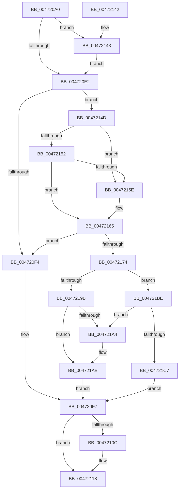

# KeRegisterBugCheckReasonCallback

- RVA: `0x004720A0`–`0x004721DA` (길이 `314` bytes)
- VA: `0x00000001404720A0`
- 실행 섹션: `.text`
- PDB 이름 있음: `예`; PDB Function 태그: `아니요`
- unwind 정보 RVA: `0x000AC484`
- 디코드: `87`개 명령, `314/314` bytes 표시
- 미해석 바이트: `0` (있으면 어셈블리에 `.byte`로 보존)

> 이 문서는 커널 이미지의 기계어와 PDB 기호를 분석해 생성했습니다. 4번과 5번은 함수 원형과 자료형을 바이너리 사용 방식에서 추정한 C 해석이며 원본 소스 복구 결과는 아닙니다.

## 1. Dependencies

- 직접 호출 지점: **6**; 고유 호출 대상: **6**
- 직접 호출자로 확인된 함수: **15**
- RIP 상대 이미지 참조: **4**

### Outgoing calls
- `0x004720E9` → [KeAcquireSpinLockAtDpcLevel](../20/KeAcquireSpinLockAtDpcLevel_function_00208430.md) (function, `0x00208430`)
- `0x004720FE` → [KxReleaseSpinLock](../20/KxReleaseSpinLock_function_00206670.md) (function, `0x00206670`)
- `0x00472113` → [KiLowerIrqlProcessIrqlFlags](../4F/KiLowerIrqlProcessIrqlFlags_function_004F5698.md) (function, `0x004F5698`)
- `0x00472146` → [KiRaiseIrqlProcessIrqlFlags](../4F/KiRaiseIrqlProcessIrqlFlags_function_004F56FC.md) (function, `0x004F56FC`)
- `0x0047216B` → [KiCheckForDuplicateBugCheckCallback](KiCheckForDuplicateBugCheckCallback_function_004721E0.md) (function, `0x004721E0`)
- `0x00472191` → [KiRegisterBugcheckRecoveryCallback](KiRegisterBugcheckRecoveryCallback_function_00472214.md) (function, `0x00472214`)

### Direct callers
- [SmPrepareForFatalHeapCorruption](../26/SmPrepareForFatalHeapCorruption_function_00267AC0.md) at `0x00267B77`
- [HvlPhase1Initialize](../58/HvlPhase1Initialize_function_00583D80.md) at `0x00583DC4`
- [HvlpInitializeHvCrashdump](../58/HvlpInitializeHvCrashdump_function_0058BCCC.md) at `0x0058BE17`
- [HvlpInitializeHvCrashdump](../58/HvlpInitializeHvCrashdump_function_0058BCCC.md) at `0x0058BE46`
- [HvlpInitializeHvCrashdump](../58/HvlpInitializeHvCrashdump_function_0058BCCC.md) at `0x0058BF04`
- [HvlpInitializeHvCrashdump](../58/HvlpInitializeHvCrashdump_function_0058BCCC.md) at `0x0058BF3D`
- [HvlpInitializeHvCrashdump](../58/HvlpInitializeHvCrashdump_function_0058BCCC.md) at `0x0058BF6C`
- [CarInit](../61/CarInit_function_006189FC.md) at `0x00618B42`
- [IopInitializeBugCheckDriverData](../../page/71/IopInitializeBugCheckDriverData_function_0071A238.md) at `0x0071A25E`
- [IopInitializeTriageDumpData](../../page/71/IopInitializeTriageDumpData_function_0071A740.md) at `0x0071A7E5`
- [KiCompleteKernelInit](../../pagelk/B6/KiCompleteKernelInit_function_00B66090.md) at `0x00B66220`
- [KiCompleteKernelInit](../../pagelk/B6/KiCompleteKernelInit_function_00B66090.md) at `0x00B6624E`
- [HalpEfiInitialization](../../init/C1/HalpEfiInitialization_function_00C1F644.md) at `0x00C1F785`
- [HalpMiscInitDiscard](../../init/C2/HalpMiscInitDiscard_function_00C20104.md) at `0x00C20175`
- [PopRecorderInit](../../init/C4/PopRecorderInit_function_00C42820.md) at `0x00C42870`
- [PopWatchdogInit](../../init/C4/PopWatchdogInit_function_00C43330.md) at `0x00C43409`
- [PspIumInitialize](../../init/C4/PspIumInitialize_function_00C467A8.md) at `0x00C46885`
- [EtwpInitialize](../../init/C4/EtwpInitialize_function_00C4DBCC.md) at `0x00C4DEAB`
- [CmInitSystem0](../../init/C5/CmInitSystem0_function_00C58E88.md) at `0x00C58F41`
- [SmInitSystem](../../init/C7/SmInitSystem_function_00C7673C.md) at `0x00C7681B`

### Static image references
- `0x004720D9` → RVA `0x00FC6D20` (`ALMOSTRO`; read)
- `0x004720E2` → RVA `0x00F231A0` (`.data`; read)
- `0x00472152` → RVA `0x00F234A0` (`.data`; read)
- `0x0047215E` → RVA `0x00F23480` (`.data`; read)

## 2. Other-region calls and transfers

- 다른 실행 섹션으로 향하는 call: **0**
- 별도 외부 분기/꼬리 이동을 확인하지 못했습니다.

## 3. Assembly (complete function range)

```asm
004720A0  48 8B C4                        mov rax, rsp
004720A3  48 89 58 08                     mov qword ptr [rax + 8], rbx
004720A7  48 89 68 10                     mov qword ptr [rax + 0x10], rbp
004720AB  48 89 70 18                     mov qword ptr [rax + 0x18], rsi
004720AF  48 89 78 20                     mov qword ptr [rax + 0x20], rdi
004720B3  41 54                           push r12
004720B5  41 56                           push r14
004720B7  41 57                           push r15
004720B9  48 83 EC 20                     sub rsp, 0x20
004720BD  4D 8B F9                        mov r15, r9
004720C0  49 63 E8                        movsxd rbp, r8d
004720C3  4C 8B E2                        mov r12, rdx
004720C6  48 8B D9                        mov rbx, rcx
004720C9  40 B6 01                        mov sil, 1
004720CC  45 0F 20 C6                     mov r14, cr8
004720D0  BA 0F 00 00 00                  mov edx, 0xf
004720D5  44 0F 22 C2                     mov cr8, rdx
004720D9  83 3D 40 4C B5 00 00            cmp dword ptr [rip + 0xb54c40], 0
004720E0  75 61                           jne 0x140472143
004720E2  48 8D 0D B7 10 AB 00            lea rcx, [rip + 0xab10b7]
004720E9  E8 42 63 D9 FF                  call 0x140208430
004720EE  80 7B 2C 00                     cmp byte ptr [rbx + 0x2c], 0
004720F2  74 59                           je 0x14047214d
004720F4  40 32 F6                        xor sil, sil
004720F7  48 8D 0D A2 10 AB 00            lea rcx, [rip + 0xab10a2]
004720FE  E8 6D 45 D9 FF                  call 0x140206670
00472103  83 3D 16 4C B5 00 00            cmp dword ptr [rip + 0xb54c16], 0
0047210A  74 0C                           je 0x140472118
0047210C  44 0F 20 C1                     mov rcx, cr8
00472110  41 8A D6                        mov dl, r14b
00472113  E8 80 35 08 00                  call 0x1404f5698
00472118  41 0F B6 CE                     movzx ecx, r14b
0047211C  44 0F 22 C1                     mov cr8, rcx
00472120  48 8B 5C 24 40                  mov rbx, qword ptr [rsp + 0x40]
00472125  40 8A C6                        mov al, sil
00472128  48 8B 74 24 50                  mov rsi, qword ptr [rsp + 0x50]
0047212D  48 8B 6C 24 48                  mov rbp, qword ptr [rsp + 0x48]
00472132  48 8B 7C 24 58                  mov rdi, qword ptr [rsp + 0x58]
00472137  48 83 C4 20                     add rsp, 0x20
0047213B  41 5F                           pop r15
0047213D  41 5E                           pop r14
0047213F  41 5C                           pop r12
00472141  C3                              ret
00472142  CC                              int3
00472143  41 8A CE                        mov cl, r14b
00472146  E8 B1 35 08 00                  call 0x1404f56fc
0047214B  EB 95                           jmp 0x1404720e2
0047214D  83 FD 04                        cmp ebp, 4
00472150  74 0C                           je 0x14047215e
00472152  48 8D 3D 47 13 AB 00            lea rdi, [rip + 0xab1347]
00472159  83 FD 06                        cmp ebp, 6
0047215C  75 07                           jne 0x140472165
0047215E  48 8D 3D 1B 13 AB 00            lea rdi, [rip + 0xab131b]
00472165  48 8B D3                        mov rdx, rbx
00472168  48 8B CF                        mov rcx, rdi
0047216B  E8 70 00 00 00                  call 0x1404721e0
00472170  84 C0                           test al, al
00472172  75 80                           jne 0x1404720f4
00472174  49 8D 04 2C                     lea rax, [r12 + rbp]
00472178  4C 89 63 10                     mov qword ptr [rbx + 0x10], r12
0047217C  49 03 C7                        add rax, r15
0047217F  89 6B 28                        mov dword ptr [rbx + 0x28], ebp
00472182  48 8B CB                        mov rcx, rbx
00472185  48 89 43 20                     mov qword ptr [rbx + 0x20], rax
00472189  4C 89 7B 18                     mov qword ptr [rbx + 0x18], r15
0047218D  40 88 73 2C                     mov byte ptr [rbx + 0x2c], sil
00472191  E8 7E 00 00 00                  call 0x140472214
00472196  83 FD 07                        cmp ebp, 7
00472199  74 23                           je 0x1404721be
0047219B  48 8B 07                        mov rax, qword ptr [rdi]
0047219E  48 39 78 08                     cmp qword ptr [rax + 8], rdi
004721A2  74 07                           je 0x1404721ab
004721A4  B9 03 00 00 00                  mov ecx, 3
004721A9  CD 29                           int 0x29
004721AB  48 89 03                        mov qword ptr [rbx], rax
004721AE  48 89 7B 08                     mov qword ptr [rbx + 8], rdi
004721B2  48 89 58 08                     mov qword ptr [rax + 8], rbx
004721B6  48 89 1F                        mov qword ptr [rdi], rbx
004721B9  E9 39 FF FF FF                  jmp 0x1404720f7
004721BE  48 8B 47 08                     mov rax, qword ptr [rdi + 8]
004721C2  48 39 38                        cmp qword ptr [rax], rdi
004721C5  75 DD                           jne 0x1404721a4
004721C7  48 89 3B                        mov qword ptr [rbx], rdi
004721CA  48 89 43 08                     mov qword ptr [rbx + 8], rax
004721CE  48 89 18                        mov qword ptr [rax], rbx
004721D1  48 89 5F 08                     mov qword ptr [rdi + 8], rbx
004721D5  E9 1D FF FF FF                  jmp 0x1404720f7
```

## 4. C-style interpretation (structured pseudocode)

```c
__int64 __fastcall KeRegisterBugCheckReasonCallback(__int64 a1, __int64 a2, int a3, __int64 a4)
{
    __int64 result;
    __int64 v_rdi;
    __int64 v_rsi;
    __int64 v_rsp;
    unsigned __int64 v_stack_p10;
    unsigned __int64 v_stack_p18;
    unsigned __int64 v_stack_p20;
    unsigned __int64 v_stack_p8;

    *(unsigned __int64 *)(v_rsp + 8) = v_rbx;
    *(unsigned __int64 *)(v_rsp + 16) = v_rbp;
    *(unsigned __int64 *)(v_rsp + 24) = v_rsi;
    *(unsigned __int64 *)(v_rsp + 32) = v_rdi;
    v_rsp = (v_rsp) - (32);
    if ((*(unsigned int *)(v_rip + 11881536)) != 0) goto loc_00472143;
loc_004720E2:
    result = KeAcquireSpinLockAtDpcLevel(v_rip + 11210935, 15, a3, a4);
    if ((*(unsigned __int8 *)(a1 + 44)) == 0) goto loc_0047214D;
loc_004720F4:
    v_rsi = 0;
loc_004720F7:
    result = KxReleaseSpinLock(v_rip + 11210914, 15, a3, a4);
    if ((*(unsigned int *)(v_rip + 11881494)) != 0) {
        a1 = 15;
        a2 = (unsigned __int8)(v_cr8);
        result = KiLowerIrqlProcessIrqlFlags(a1, a2, a3, a4);
    }
    v_rsp = (v_rsp) + (32);
    return 0;
loc_00472143:
    result = KiRaiseIrqlProcessIrqlFlags((unsigned __int8)(v_cr8), a2, a3, a4);
    goto loc_004720E2;
loc_0047214D:
    if (((unsigned int)(v_stack_p10)) == 4) goto loc_0047215E;
    v_rdi = v_rip + 11211591;
    if (((unsigned int)(v_stack_p10)) == 6) {
        v_rdi = v_rip + 11211547;
    }
    result = KiCheckForDuplicateBugCheckCallback(v_rdi, v_stack_p8, a3, a4);
    if ((unsigned __int8)(result) != 0) goto loc_004720F4;
    *(unsigned __int64 *)(v_stack_p8 + 16) = a2;
    result = (a2 + v_stack_p10 * 1) + (a4);
    *(unsigned int *)(v_stack_p8 + 40) = (unsigned int)(v_stack_p10);
    *(unsigned __int64 *)(v_stack_p8 + 32) = result;
    *(unsigned __int64 *)(v_stack_p8 + 24) = a4;
    *(unsigned __int8 *)(v_stack_p8 + 44) = (unsigned __int8)(v_stack_p18);
    result = KiRegisterBugcheckRecoveryCallback(v_stack_p8, v_stack_p8, a3, a4);
    if (((unsigned int)(v_stack_p10)) == 7) goto loc_004721BE;
    if ((*(unsigned __int64 *)(*(unsigned __int64 *)(v_rdi) + 8)) != v_rdi) {
        a1 = 3;
    }
    *(unsigned __int64 *)(v_stack_p8) = *(unsigned __int64 *)(v_rdi);
    *(unsigned __int64 *)(v_stack_p8 + 8) = v_rdi;
    *(unsigned __int64 *)(*(unsigned __int64 *)(v_rdi) + 8) = v_stack_p8;
    *(unsigned __int64 *)(v_rdi) = v_stack_p8;
    goto loc_004720F7;
loc_004721BE:
    if ((*(unsigned __int64 *)(*(unsigned __int64 *)(v_rdi + 8))) != v_rdi) goto loc_004721A4;
    *(unsigned __int64 *)(v_stack_p8) = v_rdi;
    *(unsigned __int64 *)(v_stack_p8 + 8) = *(unsigned __int64 *)(v_rdi + 8);
    *(unsigned __int64 *)(*(unsigned __int64 *)(v_rdi + 8)) = v_stack_p8;
    *(unsigned __int64 *)(v_rdi + 8) = v_stack_p8;
    goto loc_004720F7;
}
```

## 5. (Beta) C Style

```c
int64_t KeRegisterBugCheckReasonCallback(void *Arg1, void *Arg2, int32_t Arg3, int64_t Arg4)
{
    uint8_t *arg1 = (uint8_t *)Arg1;
    uint8_t *arg2 = (uint8_t *)Arg2;

    int64_t result;
    int64_t local_rdi;
    int64_t local_rsi;
    int64_t local_rsp;
    uint64_t v_stack_p10;
    uint64_t v_stack_p18;
    uint64_t v_stack_p20;
    uint64_t v_stack_p8;

    *(uint64_t *)(local_rsp + 0x8) = local_rbx;
    *(uint64_t *)(local_rsp + 0x10) = local_rbp;
    *(uint64_t *)(local_rsp + 0x18) = local_rsi;
    *(uint64_t *)(local_rsp + 0x20) = local_rdi;
    local_rsp = (local_rsp) - (32);
    if ((*(uint32_t *)(v_rip + 0xB54C40)) != 0) goto loc_00472143;
loc_004720E2:
    result = KeAcquireSpinLockAtDpcLevel(v_rip + 11210935, 15, Arg3, Arg4);
    if ((*(uint8_t *)(arg1 + 0x2C)) == 0) goto loc_0047214D;
loc_004720F4:
    local_rsi = 0;
loc_004720F7:
    result = KxReleaseSpinLock(v_rip + 11210914, 15, Arg3, Arg4);
    if ((*(uint32_t *)(v_rip + 0xB54C16)) != 0) {
        Arg1 = 15;
        Arg2 = (uint8_t)(v_cr8);
        result = KiLowerIrqlProcessIrqlFlags(Arg1, Arg2, Arg3, Arg4);
    }
    local_rsp = (local_rsp) + (32);
    return 0;
loc_00472143:
    result = KiRaiseIrqlProcessIrqlFlags((uint8_t)(v_cr8), Arg2, Arg3, Arg4);
    goto loc_004720E2;
loc_0047214D:
    if (((uint32_t)(v_stack_p10)) == 4) goto loc_0047215E;
    local_rdi = v_rip + 11211591;
    if (((uint32_t)(v_stack_p10)) == 6) {
        local_rdi = v_rip + 11211547;
    }
    result = KiCheckForDuplicateBugCheckCallback(local_rdi, v_stack_p8, Arg3, Arg4);
    if ((uint8_t)(result) != 0) goto loc_004720F4;
    *(void **)(v_stack_p8 + 0x10) = Arg2;
    result = (Arg2 + v_stack_p10 * 1) + (Arg4);
    *(uint32_t *)(v_stack_p8 + 0x28) = (uint32_t)(v_stack_p10);
    *(uint64_t *)(v_stack_p8 + 0x20) = result;
    *(uint64_t *)(v_stack_p8 + 0x18) = Arg4;
    *(uint8_t *)(v_stack_p8 + 0x2C) = (uint8_t)(v_stack_p18);
    result = KiRegisterBugcheckRecoveryCallback(v_stack_p8, v_stack_p8, Arg3, Arg4);
    if (((uint32_t)(v_stack_p10)) == 7) goto loc_004721BE;
    if ((*(uint64_t *)(*(uint64_t *)(local_rdi) + 0x8)) != local_rdi) {
        Arg1 = 3;
    }
    *(uint64_t *)(v_stack_p8) = *(uint64_t *)(local_rdi);
    *(uint64_t *)(v_stack_p8 + 0x8) = local_rdi;
    *(uint64_t *)(*(uint64_t *)(local_rdi) + 0x8) = v_stack_p8;
    *(uint64_t *)(local_rdi) = v_stack_p8;
    goto loc_004720F7;
loc_004721BE:
    if ((*(uint64_t *)(*(uint64_t *)(local_rdi + 0x8))) != local_rdi) goto loc_004721A4;
    *(uint64_t *)(v_stack_p8) = local_rdi;
    *(uint64_t *)(v_stack_p8 + 0x8) = *(uint64_t *)(local_rdi + 0x8);
    *(uint64_t *)(*(uint64_t *)(local_rdi + 0x8)) = v_stack_p8;
    *(uint64_t *)(local_rdi + 0x8) = v_stack_p8;
    goto loc_004720F7;
}
```

### 관측된 메모리 오프셋

구조체 형식이 확인되지 않은 접근은 인자 기준의 오프셋으로만 기록했습니다.

| 기준 인자 | 오프셋 표현 | 폭 (bit) | 접근 |
|---|---:|---:|---|
| `Arg1` | `+ 0x0` | `64` | `W` |
| `Arg1` | `+ 0x8` | `64` | `W` |
| `Arg1` | `+ 0x10` | `64` | `W` |
| `Arg1` | `+ 0x18` | `64` | `W` |
| `Arg1` | `+ 0x20` | `64` | `W` |
| `Arg1` | `+ 0x28` | `32` | `W` |
| `Arg1` | `+ 0x2C` | `8` | `R` |
| `Arg1` | `+ 0x2C` | `8` | `W` |
| `Arg2` | `+ 0x0 + rbp*1` | `64` | `R` |

## 6. Execution-region graph

[열기: 2D/3D 그래프와 함수 탐색 컨트롤 패널](../../../control-panel.html?section=text&rva=0x004720A0&view=graph)

- 2D 그래프는 위에서 아래로 흐르고, 3D 그래프는 빈 공간을 드래그해 회전합니다. Shift+드래그는 이동, 휠은 확대·축소, 함수 노드 선택은 대상 보고서 이동입니다.

### Static fallback


