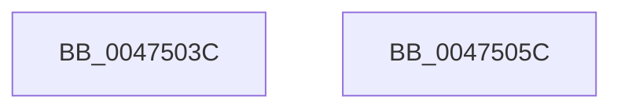

# KeSetClockInterval

- RVA: `0x0047503C`–`0x0047505D` (길이 `33` bytes)
- VA: `0x000000014047503C`
- 실행 섹션: `.text`
- PDB 이름 있음: `예`; PDB Function 태그: `아니요`
- unwind 정보 RVA: `0x0005CF00`
- 디코드: `11`개 명령, `33/33` bytes 표시
- 미해석 바이트: `0` (있으면 어셈블리에 `.byte`로 보존)

> 이 문서는 커널 이미지의 기계어와 PDB 기호를 분석해 생성했습니다. 4번과 5번은 함수 원형과 자료형을 바이너리 사용 방식에서 추정한 C 해석이며 원본 소스 복구 결과는 아닙니다.

## 1. Dependencies

- 직접 호출 지점: **2**; 고유 호출 대상: **2**
- 직접 호출자로 확인된 함수: **1**
- RIP 상대 이미지 참조: **1**

### Outgoing calls
- `0x00475042` → [KiSetClockInterval](KiSetClockInterval_function_00475064.md) (function, `0x00475064`)
- `0x0047504F` → [KiSendClockInterruptToTargetProcessor](../23/KiSendClockInterruptToTargetProcessor_function_00234700.md) (function, `0x00234700`)

### Direct callers
- [KiSetVirtualHeteroClockIntervalRequest](../5C/KiSetVirtualHeteroClockIntervalRequest_function_005C45F8.md) at `0x005C465A`

### Static image references
- `0x00475047` → RVA `0x00F21FB0` (`.data`; read)

## 2. Other-region calls and transfers

- 다른 실행 섹션으로 향하는 call: **0**
- 별도 외부 분기/꼬리 이동을 확인하지 못했습니다.

## 3. Assembly (complete function range)

```asm
0047503C  40 53                           push rbx
0047503E  48 83 EC 20                     sub rsp, 0x20
00475042  E8 1D 00 00 00                  call 0x140475064
00475047  8B 0D 63 CF AA 00               mov ecx, dword ptr [rip + 0xaacf63]
0047504D  8B D8                           mov ebx, eax
0047504F  E8 AC F6 DB FF                  call 0x140234700
00475054  8B C3                           mov eax, ebx
00475056  48 83 C4 20                     add rsp, 0x20
0047505A  5B                              pop rbx
0047505B  C3                              ret
0047505C  CC                              int3
```

## 4. C-style interpretation (structured pseudocode)

```c
__int64 __fastcall KeSetClockInterval(void)
{
    __int64 result;
    __int64 v_rsp;

    v_rsp = (v_rsp) - (32);
    result = KiSetClockInterval(a1, a2, a3, a4);
    result = KiSendClockInterruptToTargetProcessor((unsigned int)(*(unsigned int *)(v_rip + 11194211)), a2, a3, a4);
    v_rsp = (v_rsp) + (32);
    return (unsigned int)((unsigned int)((unsigned int)((unsigned int)(result))));
}
```

## 5. (Beta) C Style

```c
void KeSetClockInterval(void)
{
    int64_t result;
    int64_t local_rsp;

    local_rsp = (local_rsp) - (32);
    result = KiSetClockInterval(a1, a2, a3, a4);
    result = KiSendClockInterruptToTargetProcessor((uint32_t)(*(uint32_t *)(v_rip + 0xAACF63)), a2, a3, a4);
    local_rsp = (local_rsp) + (32);
    return (uint32_t)((uint32_t)((uint32_t)((uint32_t)(result))));
}
```

## 6. Execution-region graph

[열기: 2D/3D 그래프와 함수 탐색 컨트롤 패널](../../../control-panel.html?section=text&rva=0x0047503C&view=graph)

- 2D 그래프는 위에서 아래로 흐르고, 3D 그래프는 빈 공간을 드래그해 회전합니다. Shift+드래그는 이동, 휠은 확대·축소, 함수 노드 선택은 대상 보고서 이동입니다.

### Static fallback


