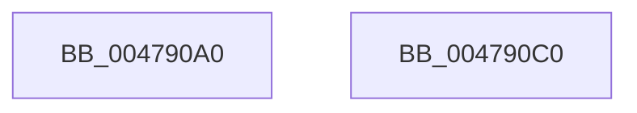

# KeTryToAcquireInStackQueuedSpinLockAtDpcLevel

- RVA: `0x004790A0`–`0x004790C1` (길이 `33` bytes)
- VA: `0x00000001404790A0`
- 실행 섹션: `.text`
- PDB 이름 있음: `예`; PDB Function 태그: `아니요`
- unwind 정보 RVA: `0x0005C788`
- 디코드: `11`개 명령, `33/33` bytes 표시
- 미해석 바이트: `0` (있으면 어셈블리에 `.byte`로 보존)

> 이 문서는 커널 이미지의 기계어와 PDB 기호를 분석해 생성했습니다. 4번과 5번은 함수 원형과 자료형을 바이너리 사용 방식에서 추정한 C 해석이며 원본 소스 복구 결과는 아닙니다.

## 1. Dependencies

- 직접 호출 지점: **1**; 고유 호출 대상: **1**
- 직접 호출자로 확인된 함수: **0**
- RIP 상대 이미지 참조: **0**

### Outgoing calls
- `0x004790B6` → [KxTryToAcquireQueuedSpinLock](../27/KxTryToAcquireQueuedSpinLock_function_00277388.md) (function, `0x00277388`)

### Direct callers
- 이 함수 시작 RVA로 연결되는 직접 call은 확인되지 않았습니다. 간접 호출은 완전히 역산할 수 없습니다.

### Static image references
- 디코드된 RIP-relative 메모리 참조가 없습니다.

## 2. Other-region calls and transfers

- 다른 실행 섹션으로 향하는 call: **0**
- 별도 외부 분기/꼬리 이동을 확인하지 못했습니다.

## 3. Assembly (complete function range)

```asm
004790A0  48 83 EC 28                     sub rsp, 0x28
004790A4  48 83 22 00                     and qword ptr [rdx], 0
004790A8  48 8B C2                        mov rax, rdx
004790AB  48 89 4A 08                     mov qword ptr [rdx + 8], rcx
004790AF  48 8B D1                        mov rdx, rcx
004790B2  48 8B C8                        mov rcx, rax
004790B5  90                              nop
004790B6  E8 CD E2 DF FF                  call 0x140277388
004790BB  48 83 C4 28                     add rsp, 0x28
004790BF  C3                              ret
004790C0  CC                              int3
```

## 4. C-style interpretation (structured pseudocode)

```c
__int64 __fastcall KeTryToAcquireInStackQueuedSpinLockAtDpcLevel(__int64 a1, __int64 a2)
{
    __int64 result;
    __int64 v_rsp;

    v_rsp = (v_rsp) - (40);
    *(unsigned __int64 *)(a2 + 8) = a1;
    result = KxTryToAcquireQueuedSpinLock(a2, a1, a3, a4);
    v_rsp = (v_rsp) + (40);
    return result;
}
```

## 5. (Beta) C Style

```c
int64_t KeTryToAcquireInStackQueuedSpinLockAtDpcLevel(int64_t Arg1, void *Arg2)
{
    uint8_t *arg2 = (uint8_t *)Arg2;

    int64_t result;
    int64_t local_rsp;

    local_rsp = (local_rsp) - (40);
    *(uint64_t *)(arg2 + 0x8) = Arg1;
    result = KxTryToAcquireQueuedSpinLock(Arg2, Arg1, a3, a4);
    local_rsp = (local_rsp) + (40);
    return result;
}
```

### 관측된 메모리 오프셋

구조체 형식이 확인되지 않은 접근은 인자 기준의 오프셋으로만 기록했습니다.

| 기준 인자 | 오프셋 표현 | 폭 (bit) | 접근 |
|---|---:|---:|---|
| `Arg2` | `+ 0x0` | `64` | `R/W` |
| `Arg2` | `+ 0x8` | `64` | `W` |

## 6. Execution-region graph

[열기: 2D/3D 그래프와 함수 탐색 컨트롤 패널](../../../control-panel.html?section=text&rva=0x004790A0&view=graph)

- 2D 그래프는 위에서 아래로 흐르고, 3D 그래프는 빈 공간을 드래그해 회전합니다. Shift+드래그는 이동, 휠은 확대·축소, 함수 노드 선택은 대상 보고서 이동입니다.

### Static fallback


