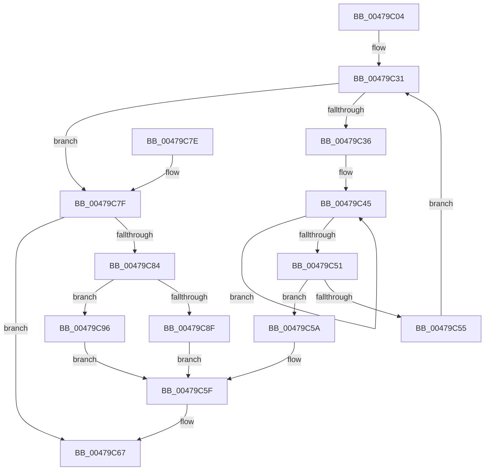

# KeUnmaskInterrupt

- RVA: `0x00479C04`–`0x00479CA0` (길이 `156` bytes)
- VA: `0x0000000140479C04`
- 실행 섹션: `.text`
- PDB 이름 있음: `예`; PDB Function 태그: `아니요`
- unwind 정보 RVA: `0x00069864`
- 디코드: `49`개 명령, `156/156` bytes 표시
- 미해석 바이트: `0` (있으면 어셈블리에 `.byte`로 보존)

> 이 문서는 커널 이미지의 기계어와 PDB 기호를 분석해 생성했습니다. 4번과 5번은 함수 원형과 자료형을 바이너리 사용 방식에서 추정한 C 해석이며 원본 소스 복구 결과는 아닙니다.

## 1. Dependencies

- 직접 호출 지점: **3**; 고유 호출 대상: **3**
- 직접 호출자로 확인된 함수: **1**
- RIP 상대 이미지 참조: **0**

### Outgoing calls
- `0x00479C24` → [KiIsInterruptTypeSecondary](../2D/KiIsInterruptTypeSecondary_function_002D44BC.md) (function, `0x002D44BC`)
- `0x00479C8F` → [KiUnmaskInterruptInternal](KiUnmaskInterruptInternal_function_00479CA8.md) (function, `0x00479CA8`)
- `0x00479C99` → [KiUnmaskSecondaryInterruptInternal](KiUnmaskSecondaryInterruptInternal_function_00479CC8.md) (function, `0x00479CC8`)

### Direct callers
- [IopUnmaskInterrupt](IopUnmaskInterrupt_function_00479BDC.md) at `0x00479BF1`

### Static image references
- 디코드된 RIP-relative 메모리 참조가 없습니다.

## 2. Other-region calls and transfers

- 다른 실행 섹션으로 향하는 call: **0**
- 별도 외부 분기/꼬리 이동을 확인하지 못했습니다.

## 3. Assembly (complete function range)

```asm
00479C04  48 89 5C 24 08                  mov qword ptr [rsp + 8], rbx
00479C09  48 89 6C 24 10                  mov qword ptr [rsp + 0x10], rbp
00479C0E  48 89 74 24 18                  mov qword ptr [rsp + 0x18], rsi
00479C13  57                              push rdi
00479C14  48 83 EC 20                     sub rsp, 0x20
00479C18  48 8B F1                        mov rsi, rcx
00479C1B  49 8B F8                        mov rdi, r8
00479C1E  49 8B C8                        mov rcx, r8
00479C21  40 8A EA                        mov bpl, dl
00479C24  E8 93 A8 E5 FF                  call 0x1402d44bc
00479C29  33 DB                           xor ebx, ebx
00479C2B  44 8A C0                        mov r8b, al
00479C2E  44 8A CB                        mov r9b, bl
00479C31  44 3A CD                        cmp r9b, bpl
00479C34  73 49                           jae 0x140479c7f
00479C36  41 0F B6 C9                     movzx ecx, r9b
00479C3A  48 8B 14 CE                     mov rdx, qword ptr [rsi + rcx*8]
00479C3E  0F 0D 4A 68                     prefetchw byte ptr [rdx + 0x68]
00479C42  8B 42 68                        mov eax, dword ptr [rdx + 0x68]
00479C45  8B C8                           mov ecx, eax
00479C47  83 E1 FE                        and ecx, 0xfffffffe
00479C4A  F0 0F B1 4A 68                  lock cmpxchg dword ptr [rdx + 0x68], ecx
00479C4F  75 F4                           jne 0x140479c45
00479C51  A8 01                           test al, 1
00479C53  74 05                           je 0x140479c5a
00479C55  41 FE C1                        inc r9b
00479C58  EB D7                           jmp 0x140479c31
00479C5A  B8 27 01 00 00                  mov eax, 0x127
00479C5F  3D 28 01 00 00                  cmp eax, 0x128
00479C64  0F 45 D8                        cmovne ebx, eax
00479C67  48 8B 6C 24 38                  mov rbp, qword ptr [rsp + 0x38]
00479C6C  8B C3                           mov eax, ebx
00479C6E  48 8B 5C 24 30                  mov rbx, qword ptr [rsp + 0x30]
00479C73  48 8B 74 24 40                  mov rsi, qword ptr [rsp + 0x40]
00479C78  48 83 C4 20                     add rsp, 0x20
00479C7C  5F                              pop rdi
00479C7D  C3                              ret
00479C7E  CC                              int3
00479C7F  39 5F 08                        cmp dword ptr [rdi + 8], ebx
00479C82  75 E3                           jne 0x140479c67
00479C84  48 8B 0E                        mov rcx, qword ptr [rsi]
00479C87  8B 57 40                        mov edx, dword ptr [rdi + 0x40]
00479C8A  45 84 C0                        test r8b, r8b
00479C8D  75 07                           jne 0x140479c96
00479C8F  E8 14 00 00 00                  call 0x140479ca8
00479C94  EB C9                           jmp 0x140479c5f
00479C96  8B 49 58                        mov ecx, dword ptr [rcx + 0x58]
00479C99  E8 2A 00 00 00                  call 0x140479cc8
00479C9E  EB BF                           jmp 0x140479c5f
```

## 4. C-style interpretation (structured pseudocode)

```c
__int64 __fastcall KeUnmaskInterrupt(__int64 a1, unsigned __int8 a2, __int64 a3)
{
    __int64 result;
    __int64 v_rbx;
    __int64 v_rsp;
    unsigned __int64 v_stack_p10;
    unsigned __int64 v_stack_p18;
    unsigned __int64 v_stack_p8;

    v_stack_p8 = v_rbx;
    v_stack_p10 = v_rbp;
    v_stack_p18 = v_rsi;
    v_rsp = (v_rsp) - (32);
    result = KiIsInterruptTypeSecondary(a3, a2, a3, a4);
    v_rbx = 0;
loc_00479C31:
    if (0 >= a2) goto loc_00479C7F;
loc_00479C45:
    a1 = (unsigned int)(((unsigned int)((unsigned int)((unsigned int)(*(unsigned int *)(*(unsigned __int64 *)(a1 + 0 * 8) + 104))))) & (0xFFFFFFFEULL));
    if (condition_is_not_equal) goto loc_00479C45;
    if ((((unsigned __int8)((unsigned int)(*(unsigned int *)(*(unsigned __int64 *)(a1 + 0 * 8) + 104)))) & (1)) == 0) goto loc_00479C5A;
    a4 = (unsigned __int8)((0) + 1);
    goto loc_00479C31;
loc_00479C5A:
loc_00479C5F:
    if (295 != 296) { v_rbx = 295; }
loc_00479C67:
    v_rsp = (v_rsp) + (32);
    return (unsigned int)((unsigned int)(v_rbx));
loc_00479C7F:
    if ((*(unsigned int *)(a3 + 8)) != ((unsigned int)(v_stack_p8))) goto loc_00479C67;
    if ((unsigned __int8)((unsigned __int8)(result)) != 0) goto loc_00479C96;
    result = KiUnmaskInterruptInternal(*(unsigned __int64 *)(v_stack_p18), (unsigned int)(*(unsigned int *)(a3 + 64)), (unsigned __int8)(result), a4);
    goto loc_00479C5F;
loc_00479C96:
    result = KiUnmaskSecondaryInterruptInternal((unsigned int)(*(unsigned int *)(*(unsigned __int64 *)(v_stack_p18) + 88)), (unsigned int)(*(unsigned int *)(a3 + 64)), (unsigned __int8)(result), a4);
    goto loc_00479C5F;
}
```

## 5. (Beta) C Style

```c
int64_t KeUnmaskInterrupt(void *Arg1, uint8_t Arg2, void *Arg3)
{
    uint8_t *arg1 = (uint8_t *)Arg1;
    uint8_t *arg3 = (uint8_t *)Arg3;

    int64_t result;
    int64_t local_rbx;
    int64_t local_rsp;
    uint64_t v_stack_p10;
    uint64_t v_stack_p18;
    uint64_t v_stack_p8;

    v_stack_p8 = local_rbx;
    v_stack_p10 = local_rbp;
    v_stack_p18 = local_rsi;
    local_rsp = (local_rsp) - (32);
    result = KiIsInterruptTypeSecondary(Arg3, Arg2, Arg3, a4);
    local_rbx = 0;
loc_00479C31:
    if (0 >= Arg2) goto loc_00479C7F;
loc_00479C45:
    Arg1 = (uint32_t)(((uint32_t)((uint32_t)((uint32_t)(*(uint32_t *)(*(uint64_t *)(arg1 + 0x0 * 8) + 0x68))))) & (0xFFFFFFFEULL));
    if (condition_is_not_equal) goto loc_00479C45;
    if ((((uint8_t)((uint32_t)(*(uint32_t *)(*(uint64_t *)(arg1 + 0x0 * 8) + 0x68)))) & (1)) == 0) goto loc_00479C5A;
    a4 = (uint8_t)((0) + 1);
    goto loc_00479C31;
loc_00479C5A:
loc_00479C5F:
    if (295 != 296) { local_rbx = 295; }
loc_00479C67:
    local_rsp = (local_rsp) + (32);
    return (uint32_t)((uint32_t)(local_rbx));
loc_00479C7F:
    if ((*(uint32_t *)(arg3 + 0x8)) != ((uint32_t)(v_stack_p8))) goto loc_00479C67;
    if ((uint8_t)((uint8_t)(result)) != 0) goto loc_00479C96;
    result = KiUnmaskInterruptInternal(*(uint64_t *)(v_stack_p18), (uint32_t)(*(uint32_t *)(arg3 + 0x40)), (uint8_t)(result), a4);
    goto loc_00479C5F;
loc_00479C96:
    result = KiUnmaskSecondaryInterruptInternal((uint32_t)(*(uint32_t *)(*(uint64_t *)(v_stack_p18) + 0x58)), (uint32_t)(*(uint32_t *)(arg3 + 0x40)), (uint8_t)(result), a4);
    goto loc_00479C5F;
}
```

### 관측된 메모리 오프셋

구조체 형식이 확인되지 않은 접근은 인자 기준의 오프셋으로만 기록했습니다.

| 기준 인자 | 오프셋 표현 | 폭 (bit) | 접근 |
|---|---:|---:|---|
| `Arg1` | `+ 0x0` | `64` | `R` |
| `Arg1` | `+ 0x0 + rcx*8` | `64` | `R` |
| `Arg3` | `+ 0x8` | `32` | `R` |
| `Arg3` | `+ 0x40` | `32` | `R` |

## 6. Execution-region graph

[열기: 2D/3D 그래프와 함수 탐색 컨트롤 패널](../../../control-panel.html?section=text&rva=0x00479C04&view=graph)

- 2D 그래프는 위에서 아래로 흐르고, 3D 그래프는 빈 공간을 드래그해 회전합니다. Shift+드래그는 이동, 휠은 확대·축소, 함수 노드 선택은 대상 보고서 이동입니다.

### Static fallback


