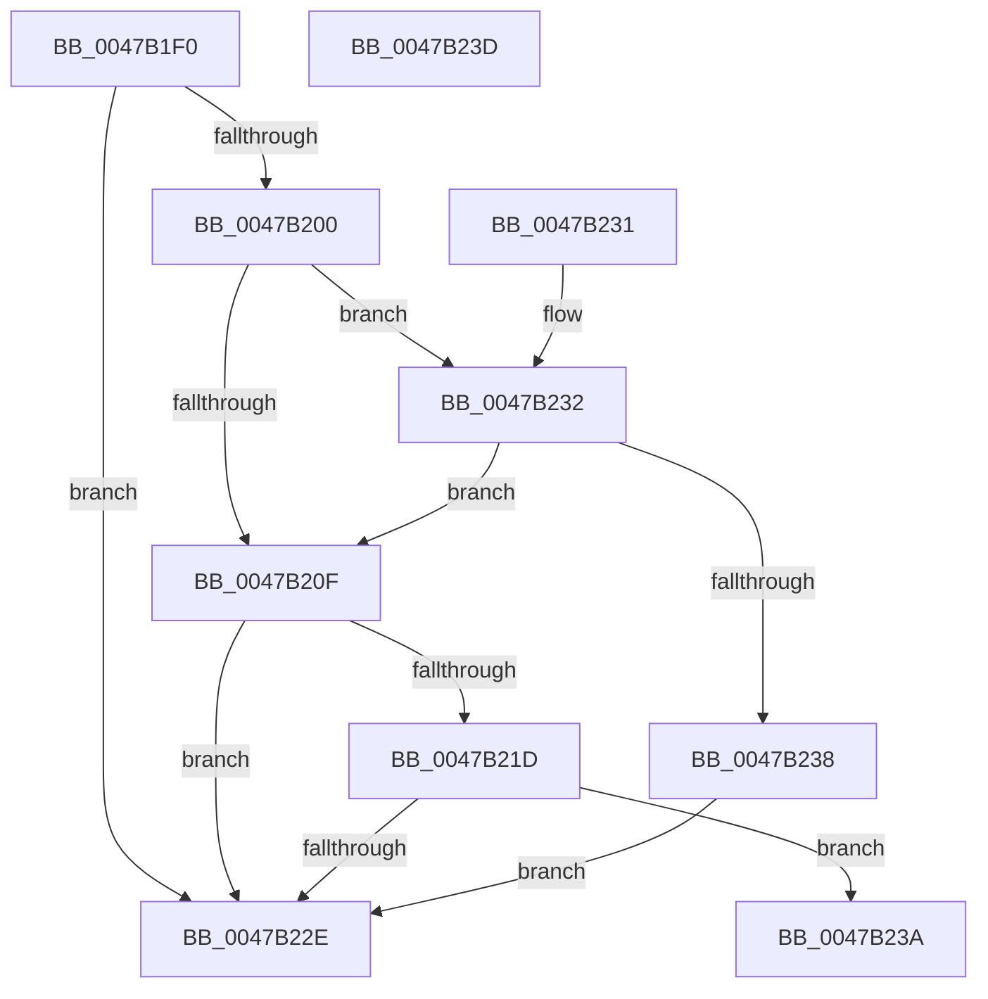

# KeVerifyGroupAffinity

- RVA: `0x0047B1F0`–`0x0047B23E` (길이 `78` bytes)
- VA: `0x000000014047B1F0`
- 실행 섹션: `.text`
- PDB 이름 있음: `예`; PDB Function 태그: `아니요`
- unwind 정보 RVA: `0x000DB714`
- 디코드: `26`개 명령, `78/78` bytes 표시
- 미해석 바이트: `0` (있으면 어셈블리에 `.byte`로 보존)

> 이 문서는 커널 이미지의 기계어와 PDB 기호를 분석해 생성했습니다. 4번과 5번은 함수 원형과 자료형을 바이너리 사용 방식에서 추정한 C 해석이며 원본 소스 복구 결과는 아닙니다.

## 1. Dependencies

- 직접 호출 지점: **0**; 고유 호출 대상: **0**
- 직접 호출자로 확인된 함수: **5**
- RIP 상대 이미지 참조: **2**

### Outgoing calls
- 직접 디코드된 call 명령이 없습니다.

### Direct callers
- [sub_0050C0E0](../50/Unknown_function_0050C0E0.md) at `0x0050C22F`
- [IopConnectInterruptFullySpecified](../../page/72/IopConnectInterruptFullySpecified_function_007273E8.md) at `0x00727453`
- [ExpProfileCreate](../../page/7D/ExpProfileCreate_function_007D1AB8.md) at `0x007D1D41`
- [PspBuildCreateProcessContext](../../page/9E/PspBuildCreateProcessContext_function_009ED6E0.md) at `0x009EE494`
- [NtSetInformationProcess](../../page/AE/NtSetInformationProcess_function_00AE5370.md) at `0x00AE64A2`

### Static image references
- `0x0047B1F7` → RVA `0x00FC5018` (`ALMOSTRO`; read)
- `0x0047B200` → RVA `0x00FC7128` (`ALMOSTRO`; read)

## 2. Other-region calls and transfers

- 다른 실행 섹션으로 향하는 call: **0**
- 별도 외부 분기/꼬리 이동을 확인하지 못했습니다.

## 3. Assembly (complete function range)

```asm
0047B1F0  0F B7 41 08                     movzx eax, word ptr [rcx + 8]
0047B1F4  4C 8B C1                        mov r8, rcx
0047B1F7  66 3B 05 1A 9E B4 00            cmp ax, word ptr [rip + 0xb49e1a]
0047B1FE  73 2E                           jae 0x14047b22e
0047B200  4C 8D 0D 21 BF B4 00            lea r9, [rip + 0xb4bf21]
0047B207  4D 8B 0C C1                     mov r9, qword ptr [r9 + rax*8]
0047B20B  84 D2                           test dl, dl
0047B20D  74 23                           je 0x14047b232
0047B20F  48 8B 09                        mov rcx, qword ptr [rcx]
0047B212  48 8B C1                        mov rax, rcx
0047B215  49 23 C1                        and rax, r9
0047B218  48 3B C1                        cmp rax, rcx
0047B21B  75 11                           jne 0x14047b22e
0047B21D  41 0F B7 48 0E                  movzx ecx, word ptr [r8 + 0xe]
0047B222  66 41 0B 48 0C                  or cx, word ptr [r8 + 0xc]
0047B227  66 41 0B 48 0A                  or cx, word ptr [r8 + 0xa]
0047B22C  74 0C                           je 0x14047b23a
0047B22E  32 C0                           xor al, al
0047B230  C3                              ret
0047B231  CC                              int3
0047B232  48 83 39 00                     cmp qword ptr [rcx], 0
0047B236  75 D7                           jne 0x14047b20f
0047B238  EB F4                           jmp 0x14047b22e
0047B23A  B0 01                           mov al, 1
0047B23C  C3                              ret
0047B23D  CC                              int3
```

## 4. C-style interpretation (structured pseudocode)

```c
__int64 __fastcall KeVerifyGroupAffinity(__int64 a1, unsigned __int8 a2)
{
    __int64 result;

    if (((unsigned __int16)(*(unsigned __int16 *)(a1 + 8))) >= (*(unsigned __int16 *)(v_rip + 11836954))) goto loc_0047B22E;
    if (a2 == 0) goto loc_0047B232;
loc_0047B20F:
    result = (*(unsigned __int64 *)(a1)) & (*(unsigned __int64 *)(v_rip + 11845409 + *(unsigned __int16 *)(a1 + 8) * 8));
    if (result != (*(unsigned __int64 *)(a1))) goto loc_0047B22E;
    a1 = (unsigned __int16)((*(unsigned __int16 *)(a1 + 14)) | (*(unsigned __int16 *)(a1 + 12)));
    a1 = (unsigned __int16)((a1) | (*(unsigned __int16 *)(a1 + 10)));
    if (condition_is_equal) goto loc_0047B23A;
loc_0047B22E:
    result = 0;
    return result;
loc_0047B232:
    if ((*(unsigned __int64 *)(a1)) != 0) goto loc_0047B20F;
    goto loc_0047B22E;
loc_0047B23A:
    return 1;
}
```

## 5. (Beta) C Style

```c
int64_t KeVerifyGroupAffinity(void *Arg1, uint8_t Arg2)
{
    uint8_t *arg1 = (uint8_t *)Arg1;

    int64_t result;

    if (((uint16_t)(*(uint16_t *)(arg1 + 0x8))) >= (*(uint16_t *)(v_rip + 0xB49E1A))) goto loc_0047B22E;
    if (Arg2 == 0) goto loc_0047B232;
loc_0047B20F:
    result = (*(uint64_t *)(arg1)) & (*(uint64_t *)(v_rip + 0xB4BF21 + *(uint16_t *)(arg1 + 0x8) * 8));
    if (result != (*(uint64_t *)(arg1))) goto loc_0047B22E;
    Arg1 = (uint16_t)((*(uint16_t *)(arg1 + 0xE)) | (*(uint16_t *)(arg1 + 0xC)));
    Arg1 = (uint16_t)((Arg1) | (*(uint16_t *)(arg1 + 0xA)));
    if (condition_is_equal) goto loc_0047B23A;
loc_0047B22E:
    result = 0;
    return result;
loc_0047B232:
    if ((*(uint64_t *)(arg1)) != 0) goto loc_0047B20F;
    goto loc_0047B22E;
loc_0047B23A:
    return 1;
}
```

### 관측된 메모리 오프셋

구조체 형식이 확인되지 않은 접근은 인자 기준의 오프셋으로만 기록했습니다.

| 기준 인자 | 오프셋 표현 | 폭 (bit) | 접근 |
|---|---:|---:|---|
| `Arg1` | `+ 0x0` | `64` | `R` |
| `Arg1` | `+ 0x8` | `16` | `R` |
| `Arg1` | `+ 0xA` | `16` | `R` |
| `Arg1` | `+ 0xC` | `16` | `R` |
| `Arg1` | `+ 0xE` | `16` | `R` |

## 6. Execution-region graph

[열기: 2D/3D 그래프와 함수 탐색 컨트롤 패널](../../../control-panel.html?section=text&rva=0x0047B1F0&view=graph)

- 2D 그래프는 위에서 아래로 흐르고, 3D 그래프는 빈 공간을 드래그해 회전합니다. Shift+드래그는 이동, 휠은 확대·축소, 함수 노드 선택은 대상 보고서 이동입니다.

### Static fallback


