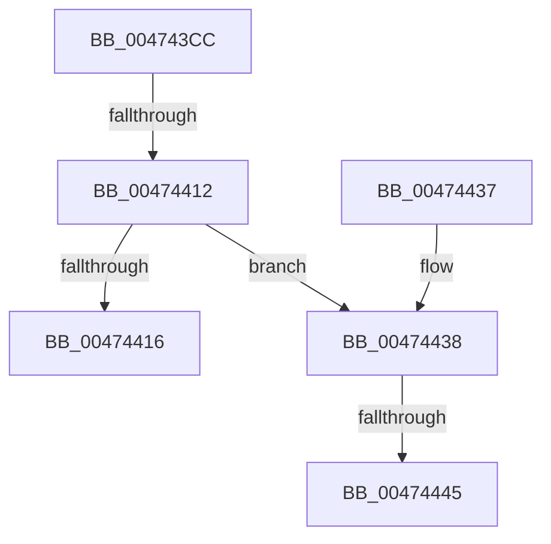

# KiCancelClockTimer

- RVA: `0x004743CC`–`0x00474456` (길이 `138` bytes)
- VA: `0x00000001404743CC`
- 실행 섹션: `.text`
- PDB 이름 있음: `예`; PDB Function 태그: `예`
- unwind 정보 RVA: `0x000AC794`
- 디코드: `33`개 명령, `138/138` bytes 표시
- 미해석 바이트: `0` (있으면 어셈블리에 `.byte`로 보존)

> 이 문서는 커널 이미지의 기계어와 PDB 기호를 분석해 생성했습니다. 4번과 5번은 함수 원형과 자료형을 바이너리 사용 방식에서 추정한 C 해석이며 원본 소스 복구 결과는 아닙니다.

## 1. Dependencies

- 직접 호출 지점: **2**; 고유 호출 대상: **2**
- 직접 호출자로 확인된 함수: **3**
- RIP 상대 이미지 참조: **3**

### Outgoing calls
- `0x0047441D` → [_security_check_cookie](../6A/_security_check_cookie_function_006AC640.md) (function, `0x006AC640`)
- `0x00474449` → [RtlGetInterruptTimePrecise](../20/RtlGetInterruptTimePrecise_function_0020A4C0.md) (function, `0x0020A4C0`)

### Direct callers
- [PpmIdleExecuteTransition](../2D/PpmIdleExecuteTransition_function_002D0A1C.md) at `0x002D0EC0`
- [PpmIdleExecuteTransition](../2D/PpmIdleExecuteTransition_function_002D0A1C.md) at `0x002D11C7`
- [KiResetClockIntervalOneShot](../39/KiResetClockIntervalOneShot_function_0039E0D4.md) at `0x0039E11E`
- [KiCancelClockTimerKTimerDeadlines](../5B/KiCancelClockTimerKTimerDeadlines_function_005BB5A0.md) at `0x005BB5B0`
- [KiCancelClockTimerKTimerDeadlines](../5B/KiCancelClockTimerKTimerDeadlines_function_005BB5A0.md) at `0x005BB5BF`

### Static image references
- `0x004743E3` → RVA `0x00E0A740` (`.data`; read)
- `0x00474405` → RVA `0x00E070D8` (`.data`; read)
- `0x00474438` → RVA `0x00FC6AA5` (`ALMOSTRO`; read)

## 2. Other-region calls and transfers

- 다른 실행 섹션으로 향하는 call: **0**
- call이 아닌 외부 분기/꼬리 이동: **3**
  - `0x0047440C` → [sub_006F418E](../6F/Unknown_function_006F418E.md) (`tail-transfer`)
  - `0x0047443F` → [sub_006F418E + 0x59](../6F/Unknown_function_006F418E.md) (`tail-transfer`)
  - `0x00474451` → [sub_006F418E + 0x5B](../6F/Unknown_function_006F418E.md) (`tail-transfer`)

## 3. Assembly (complete function range)

```asm
004743CC  48 89 5C 24 18                  mov qword ptr [rsp + 0x18], rbx
004743D1  48 89 7C 24 20                  mov qword ptr [rsp + 0x20], rdi
004743D6  55                              push rbp
004743D7  48 8D 6C 24 A9                  lea rbp, [rsp - 0x57]
004743DC  48 81 EC 90 00 00 00            sub rsp, 0x90
004743E3  48 8B 05 56 63 99 00            mov rax, qword ptr [rip + 0x996356]
004743EA  48 33 C4                        xor rax, rsp
004743ED  48 89 45 47                     mov qword ptr [rbp + 0x47], rax
004743F1  48 63 C2                        movsxd rax, edx
004743F4  41 8A D8                        mov bl, r8b
004743F7  48 03 C0                        add rax, rax
004743FA  48 8B F9                        mov rdi, rcx
004743FD  80 A4 C1 A4 95 00 00 FE         and byte ptr [rcx + rax*8 + 0x95a4], 0xfe
00474405  83 3D CC 2C 99 00 05            cmp dword ptr [rip + 0x992ccc], 5
0047440C  0F 87 7C FD 27 00               ja 0x1406f418e
00474412  84 DB                           test bl, bl
00474414  75 22                           jne 0x140474438
00474416  48 8B 4D 47                     mov rcx, qword ptr [rbp + 0x47]
0047441A  48 33 CC                        xor rcx, rsp
0047441D  E8 1E 82 23 00                  call 0x1406ac640
00474422  4C 8D 9C 24 90 00 00 00         lea r11, [rsp + 0x90]
0047442A  49 8B 5B 20                     mov rbx, qword ptr [r11 + 0x20]
0047442E  49 8B 7B 28                     mov rdi, qword ptr [r11 + 0x28]
00474432  49 8B E3                        mov rsp, r11
00474435  5D                              pop rbp
00474436  C3                              ret
00474437  CC                              int3
00474438  80 3D 66 26 B5 00 00            cmp byte ptr [rip + 0xb52666], 0
0047443F  0F 84 A2 FD 27 00               je 0x1406f41e7
00474445  48 8D 4D FF                     lea rcx, [rbp - 1]
00474449  E8 72 60 D9 FF                  call 0x14020a4c0
0047444E  48 8B D8                        mov rbx, rax
00474451  E9 93 FD 27 00                  jmp 0x1406f41e9
```

## 4. C-style interpretation (structured pseudocode)

```c
__int64 __fastcall KiCancelClockTimer(__int64 a1, int a2, unsigned __int8 a3)
{
    __int64 result;
    __int64 v_rsp;
    unsigned __int64 v_stack_m18;
    unsigned __int64 v_stack_m5F;
    unsigned __int64 v_stack_m60;
    unsigned __int64 v_stack_m8;
    unsigned __int64 v_stack_p18;
    unsigned __int64 v_stack_p20;

    v_stack_p18 = v_rbx;
    v_stack_p20 = v_rdi;
    v_rsp = (v_rsp) - (144);
    result = (*(unsigned __int64 *)(v_rip + 10052438)) ^ (v_rsp);
    v_stack_m18 = result;
    result = ((int)(a2)) + ((int)(a2));
    if (a3 != 0) goto loc_00474438;
    a1 = (v_stack_m18) ^ (v_rsp);
    result = _security_check_cookie(a1, a2, a3, a4);
    return result;
loc_00474438:
    result = RtlGetInterruptTimePrecise(v_stack_m60, a2, a3, a4);
}
```

## 5. (Beta) C Style

```c
int64_t KiCancelClockTimer(void *Arg1, int32_t Arg2, uint8_t Arg3)
{
    uint8_t *arg1 = (uint8_t *)Arg1;

    int64_t result;
    int64_t local_rsp;
    uint64_t v_stack_m18;
    uint64_t v_stack_m5F;
    uint64_t v_stack_m60;
    uint64_t v_stack_m8;
    uint64_t v_stack_p18;
    uint64_t v_stack_p20;

    v_stack_p18 = local_rbx;
    v_stack_p20 = local_rdi;
    local_rsp = (local_rsp) - (144);
    result = (*(uint64_t *)(v_rip + 0x996356)) ^ (local_rsp);
    v_stack_m18 = result;
    result = ((int32_t)(Arg2)) + ((int32_t)(Arg2));
    if (Arg3 != 0) goto loc_00474438;
    Arg1 = (v_stack_m18) ^ (local_rsp);
    result = _security_check_cookie(Arg1, Arg2, Arg3, a4);
    return result;
loc_00474438:
    result = RtlGetInterruptTimePrecise(v_stack_m60, Arg2, Arg3, a4);
}
```

### 관측된 메모리 오프셋

구조체 형식이 확인되지 않은 접근은 인자 기준의 오프셋으로만 기록했습니다.

| 기준 인자 | 오프셋 표현 | 폭 (bit) | 접근 |
|---|---:|---:|---|
| `Arg1` | `+ 0x95A4 + rax*8` | `8` | `R/W` |

## 6. Execution-region graph

[열기: 2D/3D 그래프와 함수 탐색 컨트롤 패널](../../../control-panel.html?section=text&rva=0x004743CC&view=graph)

- 2D 그래프는 위에서 아래로 흐르고, 3D 그래프는 빈 공간을 드래그해 회전합니다. Shift+드래그는 이동, 휠은 확대·축소, 함수 노드 선택은 대상 보고서 이동입니다.

### Static fallback


