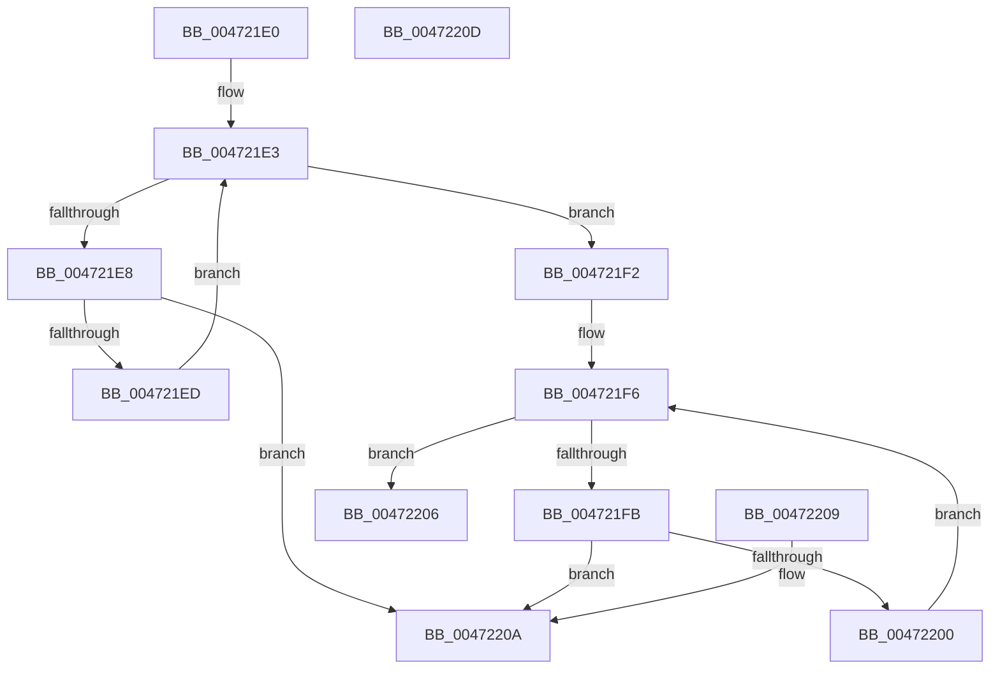

# KiCheckForDuplicateBugCheckCallback

- RVA: `0x004721E0`–`0x0047220E` (길이 `46` bytes)
- VA: `0x00000001404721E0`
- 실행 섹션: `.text`
- PDB 이름 있음: `예`; PDB Function 태그: `아니요`
- unwind 정보 RVA: `0x000DB714`
- 디코드: `20`개 명령, `46/46` bytes 표시
- 미해석 바이트: `0` (있으면 어셈블리에 `.byte`로 보존)

> 이 문서는 커널 이미지의 기계어와 PDB 기호를 분석해 생성했습니다. 4번과 5번은 함수 원형과 자료형을 바이너리 사용 방식에서 추정한 C 해석이며 원본 소스 복구 결과는 아닙니다.

## 1. Dependencies

- 직접 호출 지점: **0**; 고유 호출 대상: **0**
- 직접 호출자로 확인된 함수: **2**
- RIP 상대 이미지 참조: **0**

### Outgoing calls
- 직접 디코드된 call 명령이 없습니다.

### Direct callers
- [KeRegisterBugCheckReasonCallback](KeRegisterBugCheckReasonCallback_function_004720A0.md) at `0x0047216B`
- [KeRegisterBugCheckCallback](../4C/KeRegisterBugCheckCallback_function_004C8530.md) at `0x004C8594`

### Static image references
- 디코드된 RIP-relative 메모리 참조가 없습니다.

## 2. Other-region calls and transfers

- 다른 실행 섹션으로 향하는 call: **0**
- 별도 외부 분기/꼬리 이동을 확인하지 못했습니다.

## 3. Assembly (complete function range)

```asm
004721E0  48 8B 01                        mov rax, qword ptr [rcx]
004721E3  48 3B C1                        cmp rax, rcx
004721E6  74 0A                           je 0x1404721f2
004721E8  48 3B C2                        cmp rax, rdx
004721EB  74 1D                           je 0x14047220a
004721ED  48 8B 00                        mov rax, qword ptr [rax]
004721F0  EB F1                           jmp 0x1404721e3
004721F2  48 8B 41 08                     mov rax, qword ptr [rcx + 8]
004721F6  48 3B C1                        cmp rax, rcx
004721F9  74 0B                           je 0x140472206
004721FB  48 3B C2                        cmp rax, rdx
004721FE  74 0A                           je 0x14047220a
00472200  48 8B 40 08                     mov rax, qword ptr [rax + 8]
00472204  EB F0                           jmp 0x1404721f6
00472206  32 C0                           xor al, al
00472208  C3                              ret
00472209  CC                              int3
0047220A  B0 01                           mov al, 1
0047220C  C3                              ret
0047220D  CC                              int3
```

## 4. C-style interpretation (structured pseudocode)

```c
__int64 __fastcall KiCheckForDuplicateBugCheckCallback(__int64 a1, __int64 a2)
{
    __int64 result;

loc_004721E3:
    if ((*(unsigned __int64 *)(a1)) == a1) goto loc_004721F2;
    if ((*(unsigned __int64 *)(a1)) == a2) goto loc_0047220A;
    goto loc_004721E3;
loc_004721F2:
loc_004721F6:
    if ((*(unsigned __int64 *)(a1 + 8)) == a1) goto loc_00472206;
    if ((*(unsigned __int64 *)(a1 + 8)) == a2) goto loc_0047220A;
    goto loc_004721F6;
loc_00472206:
    result = 0;
    return result;
loc_0047220A:
    return 1;
}
```

## 5. (Beta) C Style

```c
int64_t KiCheckForDuplicateBugCheckCallback(void *Arg1, int64_t Arg2)
{
    uint8_t *arg1 = (uint8_t *)Arg1;

    int64_t result;

loc_004721E3:
    if ((*(uint64_t *)(arg1)) == Arg1) goto loc_004721F2;
    if ((*(uint64_t *)(arg1)) == Arg2) goto loc_0047220A;
    goto loc_004721E3;
loc_004721F2:
loc_004721F6:
    if ((*(uint64_t *)(arg1 + 0x8)) == Arg1) goto loc_00472206;
    if ((*(uint64_t *)(arg1 + 0x8)) == Arg2) goto loc_0047220A;
    goto loc_004721F6;
loc_00472206:
    result = 0;
    return result;
loc_0047220A:
    return 1;
}
```

### 관측된 메모리 오프셋

구조체 형식이 확인되지 않은 접근은 인자 기준의 오프셋으로만 기록했습니다.

| 기준 인자 | 오프셋 표현 | 폭 (bit) | 접근 |
|---|---:|---:|---|
| `Arg1` | `+ 0x0` | `64` | `R` |
| `Arg1` | `+ 0x8` | `64` | `R` |

## 6. Execution-region graph

[열기: 2D/3D 그래프와 함수 탐색 컨트롤 패널](../../../control-panel.html?section=text&rva=0x004721E0&view=graph)

- 2D 그래프는 위에서 아래로 흐르고, 3D 그래프는 빈 공간을 드래그해 회전합니다. Shift+드래그는 이동, 휠은 확대·축소, 함수 노드 선택은 대상 보고서 이동입니다.

### Static fallback


