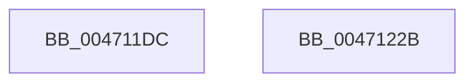

# KiIpiSendPacket

- RVA: `0x004711DC`–`0x0047122C` (길이 `80` bytes)
- VA: `0x00000001404711DC`
- 실행 섹션: `.text`
- PDB 이름 있음: `예`; PDB Function 태그: `아니요`
- unwind 정보 RVA: `0x0005CC98`
- 디코드: `18`개 명령, `80/80` bytes 표시
- 미해석 바이트: `0` (있으면 어셈블리에 `.byte`로 보존)

> 이 문서는 커널 이미지의 기계어와 PDB 기호를 분석해 생성했습니다. 4번과 5번은 함수 원형과 자료형을 바이너리 사용 방식에서 추정한 C 해석이며 원본 소스 복구 결과는 아닙니다.

## 1. Dependencies

- 직접 호출 지점: **1**; 고유 호출 대상: **1**
- 직접 호출자로 확인된 함수: **9**
- RIP 상대 이미지 참조: **0**

### Outgoing calls
- `0x00471221` → [KiIpiSendRequest](../31/KiIpiSendRequest_function_003113C0.md) (function, `0x003113C0`)

### Direct callers
- [KeChangeMemoryAttributes](../30/KeChangeMemoryAttributes_function_00304D08.md) at `0x00304DF4`
- [KeSynchronizeAddressPolicy](../49/KeSynchronizeAddressPolicy_function_00498358.md) at `0x004984DE`
- [KeSynchronizeSecurityDomain](../4B/KeSynchronizeSecurityDomain_function_004B0FE0.md) at `0x004B116D`
- [KeFlushRsb](../5B/KeFlushRsb_function_005BE8E4.md) at `0x005BE922`
- [KiSrcuReadUnlockRemote](../5C/KiSrcuReadUnlockRemote_function_005C2B1C.md) at `0x005C2BBF`
- [KiAdjustUserIsolationDomainThread](../5C/KiAdjustUserIsolationDomainThread_function_005C3B54.md) at `0x005C3F0A`
- [KiRequestApcInterruptSynchronously](../5C/KiRequestApcInterruptSynchronously_function_005C47CC.md) at `0x005C4860`
- [KiIpiTargetCall](../5C/KiIpiTargetCall_function_005C94B0.md) at `0x005C9579`
- [KiInitializeDynamicProcessorDpc](../../pagelk/B6/KiInitializeDynamicProcessorDpc_function_00B67A30.md) at `0x00B67B5F`

### Static image references
- 디코드된 RIP-relative 메모리 참조가 없습니다.

## 2. Other-region calls and transfers

- 다른 실행 섹션으로 향하는 call: **0**
- 별도 외부 분기/꼬리 이동을 확인하지 못했습니다.

## 3. Assembly (complete function range)

```asm
004711DC  4C 8B DC                        mov r11, rsp
004711DF  48 83 EC 58                     sub rsp, 0x58
004711E3  48 8B 84 24 80 00 00 00         mov rax, qword ptr [rsp + 0x80]
004711EB  44 8B D1                        mov r10d, ecx
004711EE  65 48 8B 0C 25 20 00 00 00      mov rcx, qword ptr gs:[0x20]
004711F7  49 89 43 E0                     mov qword ptr [r11 - 0x20], rax
004711FB  48 8B 84 24 88 00 00 00         mov rax, qword ptr [rsp + 0x88]
00471203  4D 89 43 F0                     mov qword ptr [r11 - 0x10], r8
00471207  4C 8B C2                        mov r8, rdx
0047120A  4D 89 4B D8                     mov qword ptr [r11 - 0x28], r9
0047120E  41 8B D2                        mov edx, r10d
00471211  4D 8D 4B D8                     lea r9, [r11 - 0x28]
00471215  49 89 43 E8                     mov qword ptr [r11 - 0x18], rax
00471219  49 C7 43 C8 05 00 00 00         mov qword ptr [r11 - 0x38], 5
00471221  E8 9A 01 EA FF                  call 0x1403113c0
00471226  48 83 C4 58                     add rsp, 0x58
0047122A  C3                              ret
0047122B  CC                              int3
```

## 4. C-style interpretation (structured pseudocode)

```c
__int64 __fastcall KiIpiSendPacket(int a1, __int64 a2, __int64 a3, __int64 a4, __int64 a5, __int64 a6)
{
    __int64 result;
    __int64 v_rsp;

    v_rsp = (v_rsp) - (88);
    *(unsigned __int64 *)(v_rsp - 32) = a5;
    *(unsigned __int64 *)(v_rsp - 16) = a3;
    *(unsigned __int64 *)(v_rsp - 40) = a4;
    *(unsigned __int64 *)(v_rsp - 24) = a6;
    *(unsigned __int64 *)(v_rsp - 56) = 5;
    result = KiIpiSendRequest(*(unsigned __int64 *)(gs_base + (0 + 32)), (unsigned int)((unsigned int)((unsigned int)(a1))), a2, v_rsp - 40);
    v_rsp = (v_rsp) + (88);
    return result;
}
```

## 5. (Beta) C Style

```c
int64_t KiIpiSendPacket(int32_t Arg1, int64_t Arg2, int64_t Arg3, int64_t Arg4, int64_t Arg5, int64_t Arg6)
{
    int64_t result;
    int64_t local_rsp;

    local_rsp = (local_rsp) - (88);
    *(uint64_t *)(local_rsp - 0x20) = Arg5;
    *(uint64_t *)(local_rsp - 0x10) = Arg3;
    *(uint64_t *)(local_rsp - 0x28) = Arg4;
    *(uint64_t *)(local_rsp - 0x18) = Arg6;
    *(uint64_t *)(local_rsp - 0x38) = 5;
    result = KiIpiSendRequest(*(uint64_t *)(gs_base + (0 + 0x20)), (uint32_t)((uint32_t)((uint32_t)(Arg1))), Arg2, local_rsp - 40);
    local_rsp = (local_rsp) + (88);
    return result;
}
```

## 6. Execution-region graph

[열기: 2D/3D 그래프와 함수 탐색 컨트롤 패널](../../../control-panel.html?section=text&rva=0x004711DC&view=graph)

- 2D 그래프는 위에서 아래로 흐르고, 3D 그래프는 빈 공간을 드래그해 회전합니다. Shift+드래그는 이동, 휠은 확대·축소, 함수 노드 선택은 대상 보고서 이동입니다.

### Static fallback


