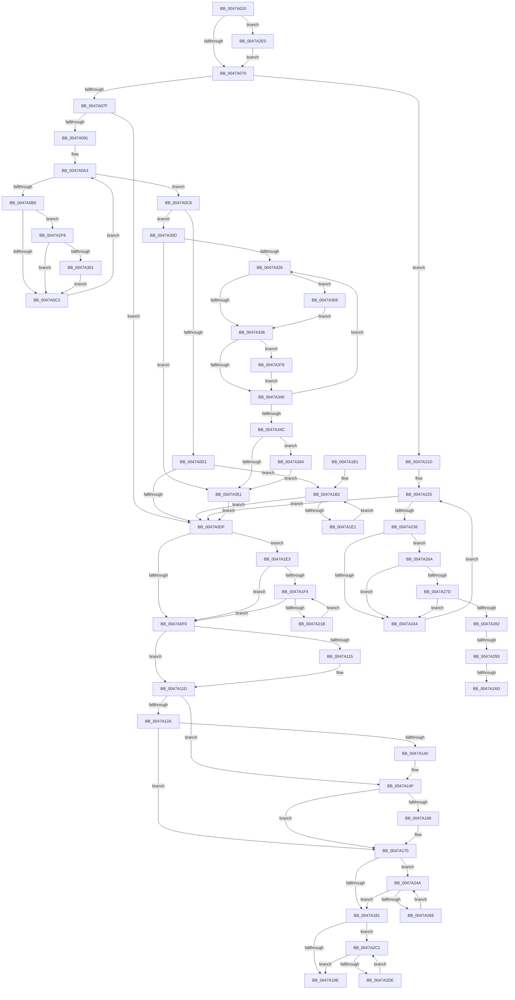

# KiLeaveCooperativeIdleSearch

- RVA: `0x0047A010`–`0x0047A384` (길이 `884` bytes)
- VA: `0x000000014047A010`
- 실행 섹션: `.text`
- PDB 이름 있음: `예`; PDB Function 태그: `예`
- unwind 정보 RVA: `0x000AD144`
- 디코드: `230`개 명령, `884/884` bytes 표시
- 미해석 바이트: `0` (있으면 어셈블리에 `.byte`로 보존)

> 이 문서는 커널 이미지의 기계어와 PDB 기호를 분석해 생성했습니다. 4번과 5번은 함수 원형과 자료형을 바이너리 사용 방식에서 추정한 C 해석이며 원본 소스 복구 결과는 아닙니다.

## 1. Dependencies

- 직접 호출 지점: **4**; 고유 호출 대상: **3**
- 직접 호출자로 확인된 함수: **1**
- RIP 상대 이미지 참조: **0**

### Outgoing calls
- `0x0047A144` → [KxWaitForLockChainValid](../21/KxWaitForLockChainValid_function_00217AA0.md) (function, `0x00217AA0`)
- `0x0047A168` → [KeWakeAddressAll](../21/KeWakeAddressAll_function_00217C20.md) (function, `0x00217C20`)
- `0x0047A2B1` → [KxWaitForLockChainValid](../21/KxWaitForLockChainValid_function_00217AA0.md) (function, `0x00217AA0`)
- `0x0047A2E4` → [KxWaitForLockOwnerShip](../25/KxWaitForLockOwnerShip_function_00257EB0.md) (function, `0x00257EB0`)

### Direct callers
- [KiSearchForNewThreadsWithinSearchContext](../35/KiSearchForNewThreadsWithinSearchContext_function_00353B30.md) at `0x00353C8C`
- [KiSearchForNewThreadsWithinSearchContext](../35/KiSearchForNewThreadsWithinSearchContext_function_00353B30.md) at `0x00353CCB`

### Static image references
- 디코드된 RIP-relative 메모리 참조가 없습니다.

## 2. Other-region calls and transfers

- 다른 실행 섹션으로 향하는 call: **0**
- call이 아닌 외부 분기/꼬리 이동: **3**
  - `0x0047A28D` → [sub_006F487E](../6F/Unknown_function_006F487E.md) (`tail-transfer`)
  - `0x0047A2A7` → [sub_006F487E + 0x1E](../6F/Unknown_function_006F487E.md) (`tail-transfer`)
  - `0x0047A2BC` → [sub_006F487E](../6F/Unknown_function_006F487E.md) (`tail-transfer`)

## 3. Assembly (complete function range)

```asm
0047A010  48 89 5C 24 08                  mov qword ptr [rsp + 8], rbx
0047A015  48 89 74 24 10                  mov qword ptr [rsp + 0x10], rsi
0047A01A  48 89 7C 24 18                  mov qword ptr [rsp + 0x18], rdi
0047A01F  55                              push rbp
0047A020  41 54                           push r12
0047A022  41 55                           push r13
0047A024  41 56                           push r14
0047A026  41 57                           push r15
0047A028  48 8B EC                        mov rbp, rsp
0047A02B  48 83 EC 30                     sub rsp, 0x30
0047A02F  45 0F B7 60 08                  movzx r12d, word ptr [r8 + 8]
0047A034  4C 8D 92 28 04 00 00            lea r10, [rdx + 0x428]
0047A03B  49 8B 18                        mov rbx, qword ptr [r8]
0047A03E  49 FF C4                        inc r12
0047A041  48 89 55 F8                     mov qword ptr [rbp - 8], rdx
0047A045  48 8B FA                        mov rdi, rdx
0047A048  45 33 DB                        xor r11d, r11d
0047A04B  49 C1 E4 04                     shl r12, 4
0047A04F  4C 89 5D F0                     mov qword ptr [rbp - 0x10], r11
0047A053  48 8D 55 F0                     lea rdx, [rbp - 0x10]
0047A057  90                              nop
0047A058  4D 03 E0                        add r12, r8
0047A05B  48 87 17                        xchg qword ptr [rdi], rdx
0047A05E  45 8A F1                        mov r14b, r9b
0047A061  49 8B F0                        mov rsi, r8
0047A064  4C 8B F9                        mov r15, rcx
0047A067  48 85 D2                        test rdx, rdx
0047A06A  0F 85 70 02 00 00               jne 0x14047a2e0
0047A070  45 84 F6                        test r14b, r14b
0047A073  41 BE 01 00 00 00               mov r14d, 1
0047A079  0F 84 9E 01 00 00               je 0x14047a21d
0047A07F  41 0F B6 97 D1 00 00 00         movzx edx, byte ptr [r15 + 0xd1]
0047A087  48 8B 54 D7 18                  mov rdx, qword ptr [rdi + rdx*8 + 0x18]
0047A08C  41 84 D6                        test r14b, dl
0047A08F  75 4E                           jne 0x14047a0df
0047A091  44 0F B6 87 24 04 00 00         movzx r8d, byte ptr [rdi + 0x424]
0047A099  48 83 C8 FF                     or rax, 0xffffffffffffffff
0047A09D  83 CB FF                        or ebx, 0xffffffff
0047A0A0  44 8B CB                        mov r9d, ebx
0047A0A3  0F B6 8F 25 04 00 00            movzx ecx, byte ptr [rdi + 0x425]
0047A0AA  66 44 3B C1                     cmp r8w, cx
0047A0AE  77 18                           ja 0x14047a0c8
0047A0B0  41 0F B7 C8                     movzx ecx, r8w
0047A0B4  48 8B 4C CF 18                  mov rcx, qword ptr [rdi + rcx*8 + 0x18]
0047A0B9  48 3B CA                        cmp rcx, rdx
0047A0BC  0F 87 36 02 00 00               ja 0x14047a2f8
0047A0C2  66 45 03 C6                     add r8w, r14w
0047A0C6  EB DB                           jmp 0x14047a0a3
0047A0C8  44 3B CB                        cmp r9d, ebx
0047A0CB  0F 85 3C 02 00 00               jne 0x14047a30d
0047A0D1  41 8B D3                        mov edx, r11d
0047A0D4  66 44 3B 5E 0A                  cmp r11w, word ptr [rsi + 0xa]
0047A0D9  0F 82 D3 00 00 00               jb 0x14047a1b2
0047A0DF  49 8B 87 C8 00 00 00            mov rax, qword ptr [r15 + 0xc8]
0047A0E6  48 39 47 08                     cmp qword ptr [rdi + 8], rax
0047A0EA  0F 84 F3 00 00 00               je 0x14047a1e3
0047A0F0  41 0F B6 87 D1 00 00 00         movzx eax, byte ptr [r15 + 0xd1]
0047A0F8  4C 89 5C C7 18                  mov qword ptr [rdi + rax*8 + 0x18], r11
0047A0FD  49 8B 87 C8 00 00 00            mov rax, qword ptr [r15 + 0xc8]
0047A104  48 F7 D0                        not rax
0047A107  48 23 47 08                     and rax, qword ptr [rdi + 8]
0047A10B  48 89 47 08                     mov qword ptr [rdi + 8], rax
0047A10F  4C 39 5F 08                     cmp qword ptr [rdi + 8], r11
0047A113  75 08                           jne 0x14047a11d
0047A115  48 C7 47 10 80 00 00 00         mov qword ptr [rdi + 0x10], 0x80
0047A11D  0F 0D 4D F0                     prefetchw byte ptr [rbp - 0x10]
0047A121  48 8B 4D F0                     mov rcx, qword ptr [rbp - 0x10]
0047A125  48 85 C9                        test rcx, rcx
0047A128  75 25                           jne 0x14047a14f
0047A12A  48 8B 4D F8                     mov rcx, qword ptr [rbp - 8]
0047A12E  48 8D 45 F0                     lea rax, [rbp - 0x10]
0047A132  F0 4C 0F B1 19                  lock cmpxchg qword ptr [rcx], r11
0047A137  48 8D 4D F0                     lea rcx, [rbp - 0x10]
0047A13B  48 3B C1                        cmp rax, rcx
0047A13E  74 30                           je 0x14047a170
0047A140  48 8D 4D F0                     lea rcx, [rbp - 0x10]
0047A144  E8 57 D9 D9 FF                  call 0x140217aa0
0047A149  48 8B C8                        mov rcx, rax
0047A14C  45 33 DB                        xor r11d, r11d
0047A14F  4C 89 5D F0                     mov qword ptr [rbp - 0x10], r11
0047A153  48 83 C1 08                     add rcx, 8
0047A157  48 8B 45 F8                     mov rax, qword ptr [rbp - 8]
0047A15B  48 8B D0                        mov rdx, rax
0047A15E  48 87 11                        xchg qword ptr [rcx], rdx
0047A161  32 D0                           xor dl, al
0047A163  F6 C2 04                        test dl, 4
0047A166  74 08                           je 0x14047a170
0047A168  E8 B3 DA D9 FF                  call 0x140217c20
0047A16D  45 33 DB                        xor r11d, r11d
0047A170  0F B7 46 0A                     movzx eax, word ptr [rsi + 0xa]
0047A174  41 8B CB                        mov ecx, r11d
0047A177  66 44 3B D8                     cmp r11w, ax
0047A17B  0F 82 C9 00 00 00               jb 0x14047a24a
0047A181  41 8B D3                        mov edx, r11d
0047A184  66 44 3B D8                     cmp r11w, ax
0047A188  0F 82 33 01 00 00               jb 0x14047a2c1
0047A18E  4C 89 1E                        mov qword ptr [rsi], r11
0047A191  41 8A C6                        mov al, r14b
0047A194  48 8B 5C 24 60                  mov rbx, qword ptr [rsp + 0x60]
0047A199  48 8B 74 24 68                  mov rsi, qword ptr [rsp + 0x68]
0047A19E  48 8B 7C 24 70                  mov rdi, qword ptr [rsp + 0x70]
0047A1A3  48 83 C4 30                     add rsp, 0x30
0047A1A7  41 5F                           pop r15
0047A1A9  41 5E                           pop r14
0047A1AB  41 5D                           pop r13
0047A1AD  41 5C                           pop r12
0047A1AF  5D                              pop rbp
0047A1B0  C3                              ret
0047A1B1  CC                              int3
0047A1B2  8B CA                           mov ecx, edx
0047A1B4  48 03 C9                        add rcx, rcx
0047A1B7  48 8B 44 CE 10                  mov rax, qword ptr [rsi + rcx*8 + 0x10]
0047A1BC  48 F7 D0                        not rax
0047A1BF  F0 49 21 04 CA                  lock and qword ptr [r10 + rcx*8], rax
0047A1C4  48 8B 44 CE 18                  mov rax, qword ptr [rsi + rcx*8 + 0x18]
0047A1C9  48 F7 D0                        not rax
0047A1CC  F0 49 21 44 CA 08               lock and qword ptr [r10 + rcx*8 + 8], rax
0047A1D2  0F B7 46 0A                     movzx eax, word ptr [rsi + 0xa]
0047A1D6  41 03 D6                        add edx, r14d
0047A1D9  3B D0                           cmp edx, eax
0047A1DB  0F 83 FE FE FF FF               jae 0x14047a0df
0047A1E1  EB CF                           jmp 0x14047a1b2
0047A1E3  41 8B CB                        mov ecx, r11d
0047A1E6  66 44 3B 9F 22 04 00 00         cmp r11w, word ptr [rdi + 0x422]
0047A1EE  0F 83 FC FE FF FF               jae 0x14047a0f0
0047A1F4  8B C1                           mov eax, ecx
0047A1F6  41 03 CE                        add ecx, r14d
0047A1F9  48 03 C0                        add rax, rax
0047A1FC  4C 89 9C C7 28 04 00 00         mov qword ptr [rdi + rax*8 + 0x428], r11
0047A204  4C 89 9C C7 30 04 00 00         mov qword ptr [rdi + rax*8 + 0x430], r11
0047A20C  0F B7 87 22 04 00 00            movzx eax, word ptr [rdi + 0x422]
0047A213  3B C8                           cmp ecx, eax
0047A215  0F 83 D5 FE FF FF               jae 0x14047a0f0
0047A21B  EB D7                           jmp 0x14047a1f4
0047A21D  44 0F B6 87 24 04 00 00         movzx r8d, byte ptr [rdi + 0x424]
0047A225  0F B6 87 25 04 00 00            movzx eax, byte ptr [rdi + 0x425]
0047A22C  66 44 3B C0                     cmp r8w, ax
0047A230  0F 87 A9 FE FF FF               ja 0x14047a0df
0047A236  41 0F B7 C0                     movzx eax, r8w
0047A23A  48 8B 44 C7 18                  mov rax, qword ptr [rdi + rax*8 + 0x18]
0047A23F  48 85 C0                        test rax, rax
0047A242  75 26                           jne 0x14047a26a
0047A244  66 45 03 C6                     add r8w, r14w
0047A248  EB DB                           jmp 0x14047a225
0047A24A  8B C1                           mov eax, ecx
0047A24C  41 03 CE                        add ecx, r14d
0047A24F  48 03 C0                        add rax, rax
0047A252  4C 89 5C C6 10                  mov qword ptr [rsi + rax*8 + 0x10], r11
0047A257  4C 89 5C C6 18                  mov qword ptr [rsi + rax*8 + 0x18], r11
0047A25C  0F B7 46 0A                     movzx eax, word ptr [rsi + 0xa]
0047A260  3B C8                           cmp ecx, eax
0047A262  0F 83 19 FF FF FF               jae 0x14047a181
0047A268  EB E0                           jmp 0x14047a24a
0047A26A  48 8B D0                        mov rdx, rax
0047A26D  48 8B CB                        mov rcx, rbx
0047A270  48 83 E2 80                     and rdx, 0xffffffffffffff80
0047A274  48 83 E1 80                     and rcx, 0xffffffffffffff80
0047A278  48 3B D1                        cmp rdx, rcx
0047A27B  77 C7                           ja 0x14047a244
0047A27D  41 84 C6                        test r14b, al
0047A280  75 C2                           jne 0x14047a244
0047A282  0F 0D 4D F0                     prefetchw byte ptr [rbp - 0x10]
0047A286  48 8B 4D F0                     mov rcx, qword ptr [rbp - 0x10]
0047A28A  48 85 C9                        test rcx, rcx
0047A28D  0F 85 EB A5 27 00               jne 0x1406f487e
0047A293  48 8B 4D F8                     mov rcx, qword ptr [rbp - 8]
0047A297  48 8D 45 F0                     lea rax, [rbp - 0x10]
0047A29B  F0 4C 0F B1 19                  lock cmpxchg qword ptr [rcx], r11
0047A2A0  48 8D 4D F0                     lea rcx, [rbp - 0x10]
0047A2A4  48 3B C1                        cmp rax, rcx
0047A2A7  0F 84 EF A5 27 00               je 0x1406f489c
0047A2AD  48 8D 4D F0                     lea rcx, [rbp - 0x10]
0047A2B1  E8 EA D7 D9 FF                  call 0x140217aa0
0047A2B6  48 8B C8                        mov rcx, rax
0047A2B9  45 33 DB                        xor r11d, r11d
0047A2BC  E9 BD A5 27 00                  jmp 0x1406f487e
0047A2C1  8B CA                           mov ecx, edx
0047A2C3  41 03 D6                        add edx, r14d
0047A2C6  48 03 C9                        add rcx, rcx
0047A2C9  4D 89 1C CC                     mov qword ptr [r12 + rcx*8], r11
0047A2CD  4D 89 5C CC 08                  mov qword ptr [r12 + rcx*8 + 8], r11
0047A2D2  0F B7 4E 0A                     movzx ecx, word ptr [rsi + 0xa]
0047A2D6  3B D1                           cmp edx, ecx
0047A2D8  0F 83 B0 FE FF FF               jae 0x14047a18e
0047A2DE  EB E1                           jmp 0x14047a2c1
0047A2E0  48 8D 4D F0                     lea rcx, [rbp - 0x10]
0047A2E4  E8 C7 DB DD FF                  call 0x140257eb0
0047A2E9  4C 8D 97 28 04 00 00            lea r10, [rdi + 0x428]
0047A2F0  45 33 DB                        xor r11d, r11d
0047A2F3  E9 78 FD FF FF                  jmp 0x14047a070
0047A2F8  48 3B C8                        cmp rcx, rax
0047A2FB  0F 83 C1 FD FF FF               jae 0x14047a0c2
0047A301  48 8B C1                        mov rax, rcx
0047A304  45 0F B7 C8                     movzx r9d, r8w
0047A308  E9 B5 FD FF FF                  jmp 0x14047a0c2
0047A30D  33 DB                           xor ebx, ebx
0047A30F  45 8A D3                        mov r10b, r11b
0047A312  44 8B C3                        mov r8d, ebx
0047A315  45 8B D9                        mov r11d, r9d
0047A318  4A 8B 94 DF 18 02 00 00         mov rdx, qword ptr [rdi + r11*8 + 0x218]
0047A320  66 3B 5E 0A                     cmp bx, word ptr [rsi + 0xa]
0047A324  73 2B                           jae 0x14047a351
0047A326  41 8B C8                        mov ecx, r8d
0047A329  48 03 C9                        add rcx, rcx
0047A32C  4C 8B 4C CE 10                  mov r9, qword ptr [rsi + rcx*8 + 0x10]
0047A331  4D 85 C9                        test r9, r9
0047A334  75 23                           jne 0x14047a359
0047A336  4C 8B 4C CE 18                  mov r9, qword ptr [rsi + rcx*8 + 0x18]
0047A33B  4D 85 C9                        test r9, r9
0047A33E  75 39                           jne 0x14047a379
0047A340  0F B7 4E 0A                     movzx ecx, word ptr [rsi + 0xa]
0047A344  45 03 C6                        add r8d, r14d
0047A347  44 3B C1                        cmp r8d, ecx
0047A34A  72 DA                           jb 0x14047a326
0047A34C  45 84 D2                        test r10b, r10b
0047A34F  75 13                           jne 0x14047a364
0047A351  45 33 DB                        xor r11d, r11d
0047A354  E9 86 FD FF FF                  jmp 0x14047a0df
0047A359  45 8A D6                        mov r10b, r14b
0047A35C  F0 4C 09 4C CA 10               lock or qword ptr [rdx + rcx*8 + 0x10], r9
0047A362  EB D2                           jmp 0x14047a336
0047A364  48 8D 48 02                     lea rcx, [rax + 2]
0047A368  48 83 E0 80                     and rax, 0xffffffffffffff80
0047A36C  83 E1 7E                        and ecx, 0x7e
0047A36F  48 0B C8                        or rcx, rax
0047A372  4A 89 4C DF 18                  mov qword ptr [rdi + r11*8 + 0x18], rcx
0047A377  EB D8                           jmp 0x14047a351
0047A379  45 8A D6                        mov r10b, r14b
0047A37C  F0 4C 09 4C CA 18               lock or qword ptr [rdx + rcx*8 + 0x18], r9
0047A382  EB BC                           jmp 0x14047a340
```

## 4. C-style interpretation (structured pseudocode)

```c
__int64 __fastcall KiLeaveCooperativeIdleSearch(__int64 a1, __int64 a2, __int64 a3, unsigned __int8 a4)
{
    __int64 result;
    __int64 v_r11;
    __int64 v_r12;
    __int64 v_rbx;
    __int64 v_rsp;
    unsigned __int64 v_stack_m30;
    unsigned __int64 v_stack_m38;
    unsigned __int64 v_stack_p10;
    unsigned __int64 v_stack_p18;
    unsigned __int64 v_stack_p8;

    v_stack_p8 = v_rbx;
    v_stack_p10 = v_rsi;
    v_stack_p18 = v_rdi;
    v_rsp = (v_rsp) - (48);
    v_r12 = (*(unsigned __int16 *)(a3 + 8)) + 1;
    v_stack_m30 = a2;
    v_r11 = 0;
    v_r12 = (v_r12) << (4);
    v_stack_m38 = 0;
    v_r12 = (v_r12) + (a3);
    if (v_stack_m38 != 0) goto loc_0047A2E0;
loc_0047A070:
    if (a4 == 0) goto loc_0047A21D;
    if (((1) & ((unsigned __int8)(*(unsigned __int64 *)(a2 + *(unsigned __int8 *)(a1 + 209) * 8 + 24)))) != 0) goto loc_0047A0DF;
    result = (result) | (-1);
    v_rbx = (unsigned int)((*(unsigned __int64 *)(a3)) | (0xFFFFFFFFULL));
loc_0047A0A3:
    if (((unsigned __int16)(*(unsigned __int8 *)(a2 + 1060))) > ((unsigned __int16)(*(unsigned __int8 *)(a2 + 1061)))) goto loc_0047A0C8;
    if ((*(unsigned __int64 *)(a2 + (unsigned __int16)(*(unsigned __int8 *)(a2 + 1060)) * 8 + 24)) > (*(unsigned __int64 *)(a2 + *(unsigned __int8 *)(a1 + 209) * 8 + 24))) goto loc_0047A2F8;
loc_0047A0C2:
    a3 = (unsigned __int16)((*(unsigned __int8 *)(a2 + 1060)) + (1));
    goto loc_0047A0A3;
loc_0047A0C8:
    if (((unsigned int)((unsigned int)((unsigned int)(v_rbx)))) != ((unsigned int)(v_rbx))) goto loc_0047A30D;
    if (0 < (*(unsigned __int16 *)(a3 + 10))) goto loc_0047A1B2;
loc_0047A0DF:
    if ((*(unsigned __int64 *)(a2 + 8)) == (*(unsigned __int64 *)(a1 + 200))) goto loc_0047A1E3;
loc_0047A0F0:
    *(unsigned __int64 *)(a2 + *(unsigned __int8 *)(a1 + 209) * 8 + 24) = 0;
    result = ~(*(unsigned __int64 *)(a1 + 200));
    result = (result) & (*(unsigned __int64 *)(a2 + 8));
    *(unsigned __int64 *)(a2 + 8) = result;
    if ((*(unsigned __int64 *)(a2 + 8)) == 0) {
        *(unsigned __int64 *)(a2 + 16) = 128;
    }
    if (v_stack_m38 != 0) goto loc_0047A14F;
    if (v_stack_m38 == v_stack_m38) goto loc_0047A170;
    result = KxWaitForLockChainValid(v_stack_m38, 0, a3, (unsigned int)((unsigned int)(v_rbx)));
    v_r11 = 0;
loc_0047A14F:
    v_stack_m38 = 0;
    a1 = (result) + (8);
    a2 = (unsigned __int8)((v_stack_m30) ^ ((unsigned __int8)(v_stack_m30)));
    result = v_stack_m30;
    if ((((unsigned __int8)(a2)) & (4)) != 0) {
        result = KeWakeAddressAll(a1, a2, a3, (unsigned int)((unsigned int)(v_rbx)));
        v_r11 = 0;
    }
    if (0 < ((unsigned __int16)(*(unsigned __int16 *)(a3 + 10)))) goto loc_0047A24A;
loc_0047A181:
    if (0 < ((unsigned __int16)(*(unsigned __int16 *)(a3 + 10)))) goto loc_0047A2C1;
loc_0047A18E:
    *(unsigned __int64 *)(a3) = 0;
    v_rsp = (v_rsp) + (48);
    return 1;
loc_0047A1B2:
    a1 = (0) + (0);
    result = ~(*(unsigned __int64 *)(v_stack_p10 + a1 * 8 + 16));
    result = ~(*(unsigned __int64 *)(v_stack_p10 + a1 * 8 + 24));
    a2 = (unsigned int)((0) + (1));
    if (((unsigned int)(a2)) >= ((unsigned int)(*(unsigned __int16 *)(v_stack_p10 + 10)))) goto loc_0047A0DF;
    goto loc_0047A1B2;
loc_0047A1E3:
    if (0 >= (*(unsigned __int16 *)(v_stack_p18 + 1058))) goto loc_0047A0F0;
loc_0047A1F4:
    a1 = (unsigned int)((0) + (1));
    result = (0) + (0);
    *(unsigned __int64 *)(v_stack_p18 + result * 8 + 1064) = 0;
    *(unsigned __int64 *)(v_stack_p18 + result * 8 + 1072) = 0;
    if (((unsigned int)(a1)) >= ((unsigned int)(*(unsigned __int16 *)(v_stack_p18 + 1058)))) goto loc_0047A0F0;
    goto loc_0047A1F4;
loc_0047A21D:
loc_0047A225:
    if (((unsigned __int16)(*(unsigned __int8 *)(v_stack_p18 + 1060))) > ((unsigned __int16)(*(unsigned __int8 *)(v_stack_p18 + 1061)))) goto loc_0047A0DF;
    if (*(unsigned __int64 *)(v_stack_p18 + (unsigned __int16)(*(unsigned __int8 *)(v_stack_p18 + 1060)) * 8 + 24) != 0) goto loc_0047A26A;
loc_0047A244:
    a3 = (unsigned __int16)((*(unsigned __int8 *)(v_stack_p18 + 1060)) + (1));
    goto loc_0047A225;
loc_0047A24A:
    a1 = (unsigned int)((a1) + (1));
    result = ((unsigned int)((unsigned int)(a1))) + ((unsigned int)((unsigned int)(a1)));
    *(unsigned __int64 *)(v_stack_p10 + result * 8 + 16) = 0;
    *(unsigned __int64 *)(v_stack_p10 + result * 8 + 24) = 0;
    if (((unsigned int)(a1)) >= ((unsigned int)(*(unsigned __int16 *)(v_stack_p10 + 10)))) goto loc_0047A181;
    goto loc_0047A24A;
loc_0047A26A:
    a2 = (*(unsigned __int16 *)(v_stack_p10 + 10)) & (-128);
    a1 = (v_stack_p8) & (-128);
    if (a2 > a1) goto loc_0047A244;
    if (((1) & ((unsigned __int8)(*(unsigned __int16 *)(v_stack_p10 + 10)))) != 0) goto loc_0047A244;
    result = KxWaitForLockChainValid(v_stack_m38, a2, a3, (unsigned int)((unsigned int)(v_rbx)));
    v_r11 = 0;
loc_0047A2C1:
    a2 = (unsigned int)((a2) + (1));
    a1 = ((unsigned int)((unsigned int)(a2))) + ((unsigned int)((unsigned int)(a2)));
    *(unsigned __int64 *)(v_r12 + a1 * 8) = 0;
    *(unsigned __int64 *)(v_r12 + a1 * 8 + 8) = 0;
    if (((unsigned int)(a2)) >= ((unsigned int)(*(unsigned __int16 *)(v_stack_p10 + 10)))) goto loc_0047A18E;
    goto loc_0047A2C1;
loc_0047A2E0:
    result = KxWaitForLockOwnerShip(v_stack_m38, a2, a3, (unsigned int)((unsigned int)(v_rbx)));
    v_r11 = 0;
    goto loc_0047A070;
loc_0047A2F8:
    if (v_stack_m38 >= result) goto loc_0047A0C2;
    goto loc_0047A0C2;
loc_0047A30D:
    v_rbx = 0;
    if (0 >= (*(unsigned __int16 *)(v_stack_p10 + 10))) goto loc_0047A351;
loc_0047A326:
    a1 = (0) + (0);
    if (*(unsigned __int64 *)(v_stack_p10 + a1 * 8 + 16) != 0) goto loc_0047A359;
loc_0047A336:
    if (*(unsigned __int64 *)(v_stack_p10 + a1 * 8 + 24) != 0) goto loc_0047A379;
loc_0047A340:
    a3 = (unsigned int)((0) + (1));
    if (((unsigned int)(a3)) < ((unsigned int)(*(unsigned __int16 *)(v_stack_p10 + 10)))) goto loc_0047A326;
    if (0 != 0) goto loc_0047A364;
loc_0047A351:
    v_r11 = 0;
    goto loc_0047A0DF;
loc_0047A359:
    goto loc_0047A336;
loc_0047A364:
    result = (v_stack_m38) & (-128);
    a1 = (unsigned int)((v_stack_m38 + 2) & (126));
    a1 = (a1) | (result);
    *(unsigned __int64 *)(v_stack_p18 + v_r11 * 8 + 24) = a1;
    goto loc_0047A351;
loc_0047A379:
    goto loc_0047A340;
}
```

## 5. (Beta) C Style

```c
int64_t KiLeaveCooperativeIdleSearch(void *Arg1, void *Arg2, void *Arg3, uint8_t Arg4)
{
    uint8_t *arg1 = (uint8_t *)Arg1;
    uint8_t *arg2 = (uint8_t *)Arg2;
    uint8_t *arg3 = (uint8_t *)Arg3;

    int64_t result;
    int64_t local_r11;
    int64_t local_r12;
    int64_t local_rbx;
    int64_t local_rsp;
    uint64_t v_stack_m30;
    uint64_t v_stack_m38;
    uint64_t v_stack_p10;
    uint64_t v_stack_p18;
    uint64_t v_stack_p8;

    v_stack_p8 = local_rbx;
    v_stack_p10 = local_rsi;
    v_stack_p18 = local_rdi;
    local_rsp = (local_rsp) - (48);
    local_r12 = (*(uint16_t *)(arg3 + 0x8)) + 1;
    v_stack_m30 = Arg2;
    local_r11 = 0;
    local_r12 = (local_r12) << (4);
    v_stack_m38 = 0;
    local_r12 = (local_r12) + (Arg3);
    if (v_stack_m38 != 0) goto loc_0047A2E0;
loc_0047A070:
    if (Arg4 == 0) goto loc_0047A21D;
    if (((1) & ((uint8_t)(*(uint64_t *)(arg2 + *(uint8_t *)(arg1 + 0xD1) * 8 + 0x18)))) != 0) goto loc_0047A0DF;
    result = (result) | (-1);
    local_rbx = (uint32_t)((*(uint64_t *)(arg3)) | (0xFFFFFFFFULL));
loc_0047A0A3:
    if (((uint16_t)(*(uint8_t *)(arg2 + 0x424))) > ((uint16_t)(*(uint8_t *)(arg2 + 0x425)))) goto loc_0047A0C8;
    if ((*(uint64_t *)(arg2 + (uint16_t)(*(uint8_t *)(arg2 + 0x424)) * 8 + 0x18)) > (*(uint64_t *)(arg2 + *(uint8_t *)(arg1 + 0xD1) * 8 + 0x18))) goto loc_0047A2F8;
loc_0047A0C2:
    Arg3 = (uint16_t)((*(uint8_t *)(arg2 + 0x424)) + (1));
    goto loc_0047A0A3;
loc_0047A0C8:
    if (((uint32_t)((uint32_t)((uint32_t)(local_rbx)))) != ((uint32_t)(local_rbx))) goto loc_0047A30D;
    if (0 < (*(uint16_t *)(arg3 + 0xA))) goto loc_0047A1B2;
loc_0047A0DF:
    if ((*(uint64_t *)(arg2 + 0x8)) == (*(uint64_t *)(arg1 + 0xC8))) goto loc_0047A1E3;
loc_0047A0F0:
    *(uint64_t *)(arg2 + *(uint8_t *)(arg1 + 0xD1) * 8 + 0x18) = 0;
    result = ~(*(uint64_t *)(arg1 + 0xC8));
    result = (result) & (*(uint64_t *)(arg2 + 0x8));
    *(uint64_t *)(arg2 + 0x8) = result;
    if ((*(uint64_t *)(arg2 + 0x8)) == 0) {
        *(uint64_t *)(arg2 + 0x10) = 128;
    }
    if (v_stack_m38 != 0) goto loc_0047A14F;
    if (v_stack_m38 == v_stack_m38) goto loc_0047A170;
    result = KxWaitForLockChainValid(v_stack_m38, 0, Arg3, (uint32_t)((uint32_t)(local_rbx)));
    local_r11 = 0;
loc_0047A14F:
    v_stack_m38 = 0;
    Arg1 = (result) + (8);
    Arg2 = (uint8_t)((v_stack_m30) ^ ((uint8_t)(v_stack_m30)));
    result = v_stack_m30;
    if ((((uint8_t)(Arg2)) & (4)) != 0) {
        result = KeWakeAddressAll(Arg1, Arg2, Arg3, (uint32_t)((uint32_t)(local_rbx)));
        local_r11 = 0;
    }
    if (0 < ((uint16_t)(*(uint16_t *)(arg3 + 0xA)))) goto loc_0047A24A;
loc_0047A181:
    if (0 < ((uint16_t)(*(uint16_t *)(arg3 + 0xA)))) goto loc_0047A2C1;
loc_0047A18E:
    *(uint64_t *)(arg3) = 0;
    local_rsp = (local_rsp) + (48);
    return 1;
loc_0047A1B2:
    Arg1 = (0) + (0);
    result = ~(*(uint64_t *)(v_stack_p10 + arg1 * 8 + 0x10));
    result = ~(*(uint64_t *)(v_stack_p10 + arg1 * 8 + 0x18));
    Arg2 = (uint32_t)((0) + (1));
    if (((uint32_t)(Arg2)) >= ((uint32_t)(*(uint16_t *)(v_stack_p10 + 0xA)))) goto loc_0047A0DF;
    goto loc_0047A1B2;
loc_0047A1E3:
    if (0 >= (*(uint16_t *)(v_stack_p18 + 0x422))) goto loc_0047A0F0;
loc_0047A1F4:
    Arg1 = (uint32_t)((0) + (1));
    result = (0) + (0);
    *(uint64_t *)(v_stack_p18 + result * 8 + 0x428) = 0;
    *(uint64_t *)(v_stack_p18 + result * 8 + 0x430) = 0;
    if (((uint32_t)(Arg1)) >= ((uint32_t)(*(uint16_t *)(v_stack_p18 + 0x422)))) goto loc_0047A0F0;
    goto loc_0047A1F4;
loc_0047A21D:
loc_0047A225:
    if (((uint16_t)(*(uint8_t *)(v_stack_p18 + 0x424))) > ((uint16_t)(*(uint8_t *)(v_stack_p18 + 0x425)))) goto loc_0047A0DF;
    if (*(uint64_t *)(v_stack_p18 + (uint16_t)(*(uint8_t *)(v_stack_p18 + 0x424)) * 8 + 0x18) != 0) goto loc_0047A26A;
loc_0047A244:
    Arg3 = (uint16_t)((*(uint8_t *)(v_stack_p18 + 0x424)) + (1));
    goto loc_0047A225;
loc_0047A24A:
    Arg1 = (uint32_t)((Arg1) + (1));
    result = ((uint32_t)((uint32_t)(Arg1))) + ((uint32_t)((uint32_t)(Arg1)));
    *(uint64_t *)(v_stack_p10 + result * 8 + 0x10) = 0;
    *(uint64_t *)(v_stack_p10 + result * 8 + 0x18) = 0;
    if (((uint32_t)(Arg1)) >= ((uint32_t)(*(uint16_t *)(v_stack_p10 + 0xA)))) goto loc_0047A181;
    goto loc_0047A24A;
loc_0047A26A:
    Arg2 = (*(uint16_t *)(v_stack_p10 + 0xA)) & (-128);
    Arg1 = (v_stack_p8) & (-128);
    if (Arg2 > Arg1) goto loc_0047A244;
    if (((1) & ((uint8_t)(*(uint16_t *)(v_stack_p10 + 0xA)))) != 0) goto loc_0047A244;
    result = KxWaitForLockChainValid(v_stack_m38, Arg2, Arg3, (uint32_t)((uint32_t)(local_rbx)));
    local_r11 = 0;
loc_0047A2C1:
    Arg2 = (uint32_t)((Arg2) + (1));
    Arg1 = ((uint32_t)((uint32_t)(Arg2))) + ((uint32_t)((uint32_t)(Arg2)));
    *(uint64_t *)(local_r12 + arg1 * 8) = 0;
    *(uint64_t *)(local_r12 + arg1 * 8 + 0x8) = 0;
    if (((uint32_t)(Arg2)) >= ((uint32_t)(*(uint16_t *)(v_stack_p10 + 0xA)))) goto loc_0047A18E;
    goto loc_0047A2C1;
loc_0047A2E0:
    result = KxWaitForLockOwnerShip(v_stack_m38, Arg2, Arg3, (uint32_t)((uint32_t)(local_rbx)));
    local_r11 = 0;
    goto loc_0047A070;
loc_0047A2F8:
    if (v_stack_m38 >= result) goto loc_0047A0C2;
    goto loc_0047A0C2;
loc_0047A30D:
    local_rbx = 0;
    if (0 >= (*(uint16_t *)(v_stack_p10 + 0xA))) goto loc_0047A351;
loc_0047A326:
    Arg1 = (0) + (0);
    if (*(uint64_t *)(v_stack_p10 + arg1 * 8 + 0x10) != 0) goto loc_0047A359;
loc_0047A336:
    if (*(uint64_t *)(v_stack_p10 + arg1 * 8 + 0x18) != 0) goto loc_0047A379;
loc_0047A340:
    Arg3 = (uint32_t)((0) + (1));
    if (((uint32_t)(Arg3)) < ((uint32_t)(*(uint16_t *)(v_stack_p10 + 0xA)))) goto loc_0047A326;
    if (0 != 0) goto loc_0047A364;
loc_0047A351:
    local_r11 = 0;
    goto loc_0047A0DF;
loc_0047A359:
    goto loc_0047A336;
loc_0047A364:
    result = (v_stack_m38) & (-128);
    Arg1 = (uint32_t)((v_stack_m38 + 2) & (126));
    Arg1 = (Arg1) | (result);
    *(void **)(v_stack_p18 + local_r11 * 8 + 0x18) = Arg1;
    goto loc_0047A351;
loc_0047A379:
    goto loc_0047A340;
}
```

### 관측된 메모리 오프셋

구조체 형식이 확인되지 않은 접근은 인자 기준의 오프셋으로만 기록했습니다.

| 기준 인자 | 오프셋 표현 | 폭 (bit) | 접근 |
|---|---:|---:|---|
| `Arg1` | `+ 0xC8` | `64` | `R` |
| `Arg1` | `+ 0xD1` | `8` | `R` |
| `Arg2` | `+ 0x0` | `64` | `R/W` |
| `Arg2` | `+ 0x0 + rcx*8` | `64` | `R/W` |
| `Arg2` | `+ 0x8` | `64` | `R` |
| `Arg2` | `+ 0x8` | `64` | `W` |
| `Arg2` | `+ 0x8 + rcx*8` | `64` | `R/W` |
| `Arg2` | `+ 0x10` | `64` | `W` |
| `Arg2` | `+ 0x18 + r11*8` | `64` | `W` |
| `Arg2` | `+ 0x18 + rax*8` | `64` | `R` |
| `Arg2` | `+ 0x18 + rax*8` | `64` | `W` |
| `Arg2` | `+ 0x18 + rcx*8` | `64` | `R` |
| `Arg2` | `+ 0x18 + rdx*8` | `64` | `R` |
| `Arg2` | `+ 0x218 + r11*8` | `64` | `R` |
| `Arg2` | `+ 0x422` | `16` | `R` |
| `Arg2` | `+ 0x424` | `8` | `R` |
| `Arg2` | `+ 0x425` | `8` | `R` |
| `Arg2` | `+ 0x428` | `64` | `R` |
| `Arg2` | `+ 0x428 + rax*8` | `64` | `W` |
| `Arg2` | `+ 0x430 + rax*8` | `64` | `W` |
| `Arg3` | `+ 0x0` | `64` | `R` |
| `Arg3` | `+ 0x0` | `64` | `W` |
| `Arg3` | `+ 0x8` | `16` | `R` |
| `Arg3` | `+ 0xA` | `16` | `R` |
| `Arg3` | `+ 0x10 + rax*8` | `64` | `W` |
| `Arg3` | `+ 0x10 + rcx*8` | `64` | `R` |
| `Arg3` | `+ 0x18 + rax*8` | `64` | `W` |
| `Arg3` | `+ 0x18 + rcx*8` | `64` | `R` |

## 6. Execution-region graph

[열기: 2D/3D 그래프와 함수 탐색 컨트롤 패널](../../../control-panel.html?section=text&rva=0x0047A010&view=graph)

- 2D 그래프는 위에서 아래로 흐르고, 3D 그래프는 빈 공간을 드래그해 회전합니다. Shift+드래그는 이동, 휠은 확대·축소, 함수 노드 선택은 대상 보고서 이동입니다.

### Static fallback


