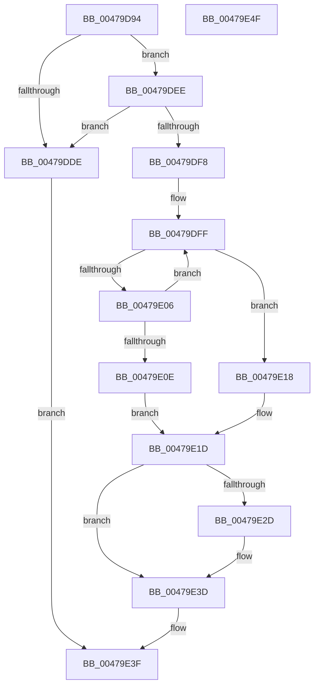

# KiMaskSecondaryInterruptInternal

- RVA: `0x00479D94`–`0x00479E50` (길이 `188` bytes)
- VA: `0x0000000140479D94`
- 실행 섹션: `.text`
- PDB 이름 있음: `예`; PDB Function 태그: `아니요`
- unwind 정보 RVA: `0x0005FD94`
- 디코드: `53`개 명령, `188/188` bytes 표시
- 미해석 바이트: `0` (있으면 어셈블리에 `.byte`로 보존)

> 이 문서는 커널 이미지의 기계어와 PDB 기호를 분석해 생성했습니다. 4번과 5번은 함수 원형과 자료형을 바이너리 사용 방식에서 추정한 C 해석이며 원본 소스 복구 결과는 아닙니다.

## 1. Dependencies

- 직접 호출 지점: **4**; 고유 호출 대상: **3**
- 직접 호출자로 확인된 함수: **1**
- RIP 상대 이미지 참조: **2**

### Outgoing calls
- `0x00479DCA` → [KiAcquireSecondaryInterruptConnectLock](KiAcquireSecondaryInterruptConnectLock_function_00479E58.md) (function, `0x00479E58`)
- `0x00479DE5` → [HalpReleaseHighLevelLock](../2D/HalpReleaseHighLevelLock_function_002D1C58.md) (function, `0x002D1C58`)
- `0x00479E24` → [HalpReleaseHighLevelLock](../2D/HalpReleaseHighLevelLock_function_002D1C58.md) (function, `0x002D1C58`)
- `0x00479E38` → [guard_dispatch_icall](../6B/guard_dispatch_icall_function_006BAAD0.md) (function, `0x006BAAD0`)

### Direct callers
- [KeMaskInterrupt](../2D/KeMaskInterrupt_function_002D42FC.md) at `0x002D444F`

### Static image references
- `0x00479DA3` → RVA `0x00F11028` (`.data`; read)
- `0x00479E2D` → RVA `0x00E009D0` (`.data`; read)

## 2. Other-region calls and transfers

- 다른 실행 섹션으로 향하는 call: **0**
- 별도 외부 분기/꼬리 이동을 확인하지 못했습니다.

## 3. Assembly (complete function range)

```asm
00479D94  48 89 5C 24 10                  mov qword ptr [rsp + 0x10], rbx
00479D99  48 89 74 24 18                  mov qword ptr [rsp + 0x18], rsi
00479D9E  57                              push rdi
00479D9F  48 83 EC 20                     sub rsp, 0x20
00479DA3  48 8B 3D 7E 72 A9 00            mov rdi, qword ptr [rip + 0xa9727e]
00479DAA  8D 81 00 FF FF FF               lea eax, [rcx - 0x100]
00479DB0  48 8D 1C 40                     lea rbx, [rax + rax*2]
00479DB4  C6 44 24 30 00                  mov byte ptr [rsp + 0x30], 0
00479DB9  8B F2                           mov esi, edx
00479DBB  48 C1 E3 04                     shl rbx, 4
00479DBF  48 03 FB                        add rdi, rbx
00479DC2  48 8D 54 24 30                  lea rdx, [rsp + 0x30]
00479DC7  48 8B CF                        mov rcx, rdi
00479DCA  E8 89 00 00 00                  call 0x140479e58
00479DCF  4C 8B 05 52 72 A9 00            mov r8, qword ptr [rip + 0xa97252]
00479DD6  42 80 7C 03 20 00               cmp byte ptr [rbx + r8 + 0x20], 0
00479DDC  74 10                           je 0x140479dee
00479DDE  8A 54 24 30                     mov dl, byte ptr [rsp + 0x30]
00479DE2  48 8B CF                        mov rcx, rdi
00479DE5  E8 6E 7E E5 FF                  call 0x1402d1c58
00479DEA  33 C0                           xor eax, eax
00479DEC  EB 51                           jmp 0x140479e3f
00479DEE  4A 8B 44 03 28                  mov rax, qword ptr [rbx + r8 + 0x28]
00479DF3  48 85 C0                        test rax, rax
00479DF6  74 E6                           je 0x140479dde
00479DF8  48 8D 50 08                     lea rdx, [rax + 8]
00479DFC  48 8B CA                        mov rcx, rdx
00479DFF  8B 41 60                        mov eax, dword ptr [rcx + 0x60]
00479E02  A8 01                           test al, 1
00479E04  74 12                           je 0x140479e18
00479E06  48 8B 09                        mov rcx, qword ptr [rcx]
00479E09  48 3B CA                        cmp rcx, rdx
00479E0C  75 F1                           jne 0x140479dff
00479E0E  42 C6 44 03 20 01               mov byte ptr [rbx + r8 + 0x20], 1
00479E14  33 DB                           xor ebx, ebx
00479E16  EB 05                           jmp 0x140479e1d
00479E18  BB 28 01 00 00                  mov ebx, 0x128
00479E1D  8A 54 24 30                     mov dl, byte ptr [rsp + 0x30]
00479E21  48 8B CF                        mov rcx, rdi
00479E24  E8 2F 7E E5 FF                  call 0x1402d1c58
00479E29  85 DB                           test ebx, ebx
00479E2B  75 10                           jne 0x140479e3d
00479E2D  48 8B 05 9C 6B 98 00            mov rax, qword ptr [rip + 0x986b9c]
00479E34  33 D2                           xor edx, edx
00479E36  8B CE                           mov ecx, esi
00479E38  E8 93 0C 24 00                  call 0x1406baad0
00479E3D  8B C3                           mov eax, ebx
00479E3F  48 8B 5C 24 38                  mov rbx, qword ptr [rsp + 0x38]
00479E44  48 8B 74 24 40                  mov rsi, qword ptr [rsp + 0x40]
00479E49  48 83 C4 20                     add rsp, 0x20
00479E4D  5F                              pop rdi
00479E4E  C3                              ret
00479E4F  CC                              int3
```

## 4. C-style interpretation (structured pseudocode)

```c
__int64 __fastcall KiMaskSecondaryInterruptInternal(__int64 a1, int a2)
{
    __int64 result;
    __int64 v_rbx;
    __int64 v_rdi;
    __int64 v_rsp;
    unsigned __int64 v_stack_p10;
    unsigned __int64 v_stack_p18;
    unsigned __int8 v_stack_p8;

    v_stack_p10 = v_rbx;
    v_stack_p18 = v_rsi;
    v_rsp = (v_rsp) - (32);
    v_stack_p8 = 0;
    v_rbx = (a1 - 256 + a1 - 256 * 2) << (4);
    v_rdi = (*(unsigned __int64 *)(v_rip + 11104894)) + (v_rbx);
    result = KiAcquireSecondaryInterruptConnectLock(v_rdi, v_stack_p8, a3, a4);
    if ((*(unsigned __int8 *)(v_rbx + *(unsigned __int64 *)(v_rip + 11104850) * 1 + 32)) == 0) goto loc_00479DEE;
loc_00479DDE:
    result = HalpReleaseHighLevelLock(v_rdi, v_stack_p8, *(unsigned __int64 *)(v_rip + 11104850), a4);
    result = 0;
    goto loc_00479E3F;
loc_00479DEE:
    if (*(unsigned __int64 *)(v_rbx + *(unsigned __int64 *)(v_rip + 11104850) * 1 + 40) == 0) goto loc_00479DDE;
loc_00479DFF:
    if ((((unsigned __int8)((unsigned int)(*(unsigned int *)(*(unsigned __int64 *)(v_rbx + *(unsigned __int64 *)(v_rip + 11104850) * 1 + 40) + 8 + 96)))) & (1)) == 0) goto loc_00479E18;
    if ((*(unsigned __int64 *)(*(unsigned __int64 *)(v_rbx + *(unsigned __int64 *)(v_rip + 11104850) * 1 + 40) + 8)) != (*(unsigned __int64 *)(v_rbx + *(unsigned __int64 *)(v_rip + 11104850) * 1 + 40) + 8)) goto loc_00479DFF;
    *(unsigned __int8 *)(v_rbx + *(unsigned __int64 *)(v_rip + 11104850) * 1 + 32) = 1;
    v_rbx = 0;
    goto loc_00479E1D;
loc_00479E18:
loc_00479E1D:
    result = HalpReleaseHighLevelLock(v_rdi, v_stack_p8, *(unsigned __int64 *)(v_rip + 11104850), a4);
    if (296 == 0) {
        result = *(unsigned __int64 *)(v_rip + 9989020);
        a2 = 0;
        a1 = (unsigned int)((unsigned int)(a2));
        result = guard_dispatch_icall(a1, a2, *(unsigned __int64 *)(v_rip + 11104850), a4);
    }
loc_00479E3F:
    v_rsp = (v_rsp) + (32);
    return 296;
}
```

## 5. (Beta) C Style

```c
int64_t KiMaskSecondaryInterruptInternal(void *Arg1, int32_t Arg2)
{
    uint8_t *arg1 = (uint8_t *)Arg1;

    int64_t result;
    int64_t local_rbx;
    int64_t local_rdi;
    int64_t local_rsp;
    uint64_t v_stack_p10;
    uint64_t v_stack_p18;
    uint8_t v_stack_p8;

    v_stack_p10 = local_rbx;
    v_stack_p18 = local_rsi;
    local_rsp = (local_rsp) - (32);
    v_stack_p8 = 0;
    local_rbx = (Arg1 - 256 + Arg1 - 256 * 2) << (4);
    local_rdi = (*(uint64_t *)(v_rip + 0xA9727E)) + (local_rbx);
    result = KiAcquireSecondaryInterruptConnectLock(local_rdi, v_stack_p8, a3, a4);
    if ((*(uint8_t *)(local_rbx + *(uint64_t *)(v_rip + 0xA97252) * 1 + 0x20)) == 0) goto loc_00479DEE;
loc_00479DDE:
    result = HalpReleaseHighLevelLock(local_rdi, v_stack_p8, *(uint64_t *)(v_rip + 0xA97252), a4);
    result = 0;
    goto loc_00479E3F;
loc_00479DEE:
    if (*(uint64_t *)(local_rbx + *(uint64_t *)(v_rip + 0xA97252) * 1 + 0x28) == 0) goto loc_00479DDE;
loc_00479DFF:
    if ((((uint8_t)((uint32_t)(*(uint32_t *)(*(uint64_t *)(local_rbx + *(uint64_t *)(v_rip + 0xA97252) * 1 + 0x28) + 0x8 + 0x60)))) & (1)) == 0) goto loc_00479E18;
    if ((*(uint64_t *)(*(uint64_t *)(local_rbx + *(uint64_t *)(v_rip + 0xA97252) * 1 + 0x28) + 0x8)) != (*(uint64_t *)(local_rbx + *(uint64_t *)(v_rip + 0xA97252) * 1 + 0x28) + 8)) goto loc_00479DFF;
    *(uint8_t *)(local_rbx + *(uint64_t *)(v_rip + 0xA97252) * 1 + 0x20) = 1;
    local_rbx = 0;
    goto loc_00479E1D;
loc_00479E18:
loc_00479E1D:
    result = HalpReleaseHighLevelLock(local_rdi, v_stack_p8, *(uint64_t *)(v_rip + 0xA97252), a4);
    if (296 == 0) {
        result = *(uint64_t *)(v_rip + 0x986B9C);
        Arg2 = 0;
        Arg1 = (uint32_t)((uint32_t)(Arg2));
        result = guard_dispatch_icall(Arg1, Arg2, *(uint64_t *)(v_rip + 0xA97252), a4);
    }
loc_00479E3F:
    local_rsp = (local_rsp) + (32);
    return 296;
}
```

### 관측된 메모리 오프셋

구조체 형식이 확인되지 않은 접근은 인자 기준의 오프셋으로만 기록했습니다.

| 기준 인자 | 오프셋 표현 | 폭 (bit) | 접근 |
|---|---:|---:|---|
| `Arg1` | `- 0x100` | `32` | `R` |
| `Arg1` | `+ 0x0 + rax*2` | `64` | `R` |

## 6. Execution-region graph

[열기: 2D/3D 그래프와 함수 탐색 컨트롤 패널](../../../control-panel.html?section=text&rva=0x00479D94&view=graph)

- 2D 그래프는 위에서 아래로 흐르고, 3D 그래프는 빈 공간을 드래그해 회전합니다. Shift+드래그는 이동, 휠은 확대·축소, 함수 노드 선택은 대상 보고서 이동입니다.

### Static fallback


