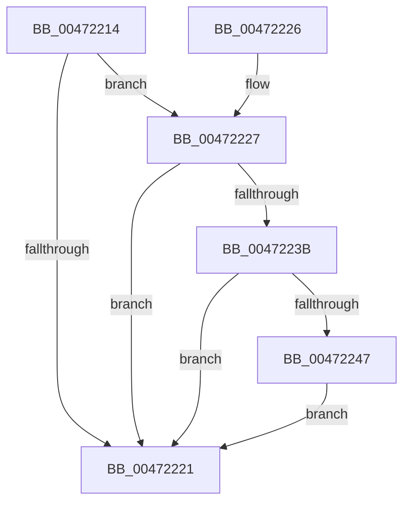

# KiRegisterBugcheckRecoveryCallback

- RVA: `0x00472214`–`0x0047225A` (길이 `70` bytes)
- VA: `0x0000000140472214`
- 실행 섹션: `.text`
- PDB 이름 있음: `예`; PDB Function 태그: `아니요`
- unwind 정보 RVA: `0x0006D4A0`
- 디코드: `19`개 명령, `70/70` bytes 표시
- 미해석 바이트: `0` (있으면 어셈블리에 `.byte`로 보존)

> 이 문서는 커널 이미지의 기계어와 PDB 기호를 분석해 생성했습니다. 4번과 5번은 함수 원형과 자료형을 바이너리 사용 방식에서 추정한 C 해석이며 원본 소스 복구 결과는 아닙니다.

## 1. Dependencies

- 직접 호출 지점: **1**; 고유 호출 대상: **1**
- 직접 호출자로 확인된 함수: **1**
- RIP 상대 이미지 참조: **3**

### Outgoing calls
- `0x00472253` → [KeInsertQueueDpc](../20/KeInsertQueueDpc_function_00207C50.md) (function, `0x00207C50`)

### Direct callers
- [KeRegisterBugCheckReasonCallback](KeRegisterBugCheckReasonCallback_function_004720A0.md) at `0x00472191`

### Static image references
- `0x0047222C` → RVA `0x00F1090C` (`.data`; read/write)
- `0x0047223B` → RVA `0x00F10898` (`.data`; read)
- `0x0047224A` → RVA `0x00F108C0` (`.data`; read)

## 2. Other-region calls and transfers

- 다른 실행 섹션으로 향하는 call: **0**
- 별도 외부 분기/꼬리 이동을 확인하지 못했습니다.

## 3. Assembly (complete function range)

```asm
00472214  48 83 EC 28                     sub rsp, 0x28
00472218  81 79 28 FF 03 00 00            cmp dword ptr [rcx + 0x28], 0x3ff
0047221F  74 06                           je 0x140472227
00472221  48 83 C4 28                     add rsp, 0x28
00472225  C3                              ret
00472226  CC                              int3
00472227  B8 01 00 00 00                  mov eax, 1
0047222C  F0 0F C1 05 D8 E6 A9 00         lock xadd dword ptr [rip + 0xa9e6d8], eax
00472234  FF C0                           inc eax
00472236  83 F8 01                        cmp eax, 1
00472239  75 E6                           jne 0x140472221
0047223B  48 8B 05 56 E6 A9 00            mov rax, qword ptr [rip + 0xa9e656]
00472242  48 85 C0                        test rax, rax
00472245  75 DA                           jne 0x140472221
00472247  45 33 C0                        xor r8d, r8d
0047224A  48 8D 0D 6F E6 A9 00            lea rcx, [rip + 0xa9e66f]
00472251  33 D2                           xor edx, edx
00472253  E8 F8 59 D9 FF                  call 0x140207c50
00472258  EB C7                           jmp 0x140472221
```

## 4. C-style interpretation (structured pseudocode)

```c
__int64 __fastcall KiRegisterBugcheckRecoveryCallback(__int64 a1, int a2, int a3)
{
    __int64 result;
    __int64 v_rsp;

    v_rsp = (v_rsp) - (40);
    if ((*(unsigned int *)(a1 + 40)) == 0x3FFULL) goto loc_00472227;
loc_00472221:
    v_rsp = (v_rsp) + (40);
    return result;
loc_00472227:
    result = (unsigned int)((1) + 1);
    if (((unsigned int)(result)) != 1) goto loc_00472221;
    if (*(unsigned __int64 *)(v_rip + 11134550) != 0) goto loc_00472221;
    a3 = 0;
    a2 = 0;
    result = KeInsertQueueDpc(v_rip + 11134575, a2, a3, a4);
    goto loc_00472221;
}
```

## 5. (Beta) C Style

```c
int64_t KiRegisterBugcheckRecoveryCallback(void *Arg1, int32_t Arg2, int32_t Arg3)
{
    uint8_t *arg1 = (uint8_t *)Arg1;

    int64_t result;
    int64_t local_rsp;

    local_rsp = (local_rsp) - (40);
    if ((*(uint32_t *)(arg1 + 0x28)) == 0x3FFULL) goto loc_00472227;
loc_00472221:
    local_rsp = (local_rsp) + (40);
    return result;
loc_00472227:
    result = (uint32_t)((1) + 1);
    if (((uint32_t)(result)) != 1) goto loc_00472221;
    if (*(uint64_t *)(v_rip + 0xA9E656) != 0) goto loc_00472221;
    Arg3 = 0;
    Arg2 = 0;
    result = KeInsertQueueDpc(v_rip + 11134575, Arg2, Arg3, a4);
    goto loc_00472221;
}
```

### 관측된 메모리 오프셋

구조체 형식이 확인되지 않은 접근은 인자 기준의 오프셋으로만 기록했습니다.

| 기준 인자 | 오프셋 표현 | 폭 (bit) | 접근 |
|---|---:|---:|---|
| `Arg1` | `+ 0x28` | `32` | `R` |

## 6. Execution-region graph

[열기: 2D/3D 그래프와 함수 탐색 컨트롤 패널](../../../control-panel.html?section=text&rva=0x00472214&view=graph)

- 2D 그래프는 위에서 아래로 흐르고, 3D 그래프는 빈 공간을 드래그해 회전합니다. Shift+드래그는 이동, 휠은 확대·축소, 함수 노드 선택은 대상 보고서 이동입니다.

### Static fallback


