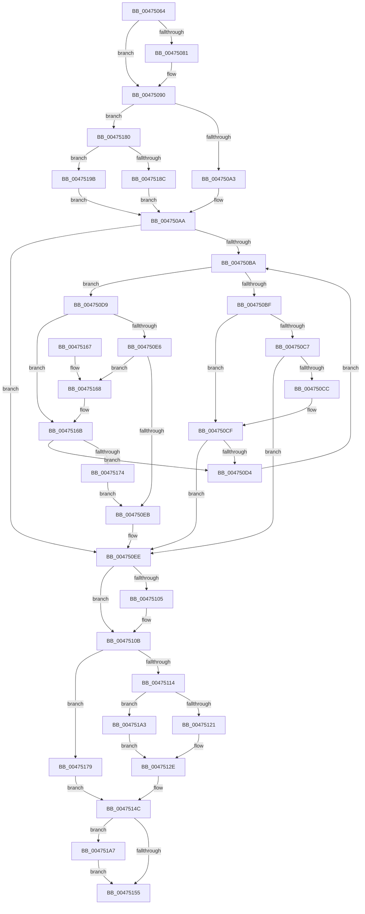

# KiSetClockInterval

- RVA: `0x00475064`–`0x004751B3` (길이 `335` bytes)
- VA: `0x0000000140475064`
- 실행 섹션: `.text`
- PDB 이름 있음: `예`; PDB Function 태그: `아니요`
- unwind 정보 RVA: `0x0006D4EC`
- 디코드: `92`개 명령, `335/335` bytes 표시
- 미해석 바이트: `0` (있으면 어셈블리에 `.byte`로 보존)

> 이 문서는 커널 이미지의 기계어와 PDB 기호를 분석해 생성했습니다. 4번과 5번은 함수 원형과 자료형을 바이너리 사용 방식에서 추정한 C 해석이며 원본 소스 복구 결과는 아닙니다.

## 1. Dependencies

- 직접 호출 지점: **7**; 고유 호출 대상: **7**
- 직접 호출자로 확인된 함수: **1**
- RIP 상대 이미지 참조: **5**

### Outgoing calls
- `0x0047508B` → [RtlRbRemoveNode](../2E/RtlRbRemoveNode_function_002E4C10.md) (function, `0x002E4C10`)
- `0x004750F8` → [RtlRbInsertNodeEx](../2E/RtlRbInsertNodeEx_function_002E4570.md) (function, `0x002E4570`)
- `0x00475126` → [RtlGetInterruptTimePrecise](../20/RtlGetInterruptTimePrecise_function_0020A4C0.md) (function, `0x0020A4C0`)
- `0x0047513D` → [KiSetClockTimerKTimerDeadlines](../23/KiSetClockTimerKTimerDeadlines_function_0023671C.md) (function, `0x0023671C`)
- `0x00475147` → [KiSetNextClockTickDueTime](../23/KiSetNextClockTickDueTime_function_002363F0.md) (function, `0x002363F0`)
- `0x00475179` → [KiSetClockIntervalToMinimumRequested](../39/KiSetClockIntervalToMinimumRequested_function_0039DF1C.md) (function, `0x0039DF1C`)
- `0x004751AC` → [PoTraceSystemTimerResolutionKernel](../2F/PoTraceSystemTimerResolutionKernel_function_002FD154.md) (function, `0x002FD154`)

### Direct callers
- [KeSetClockInterval](KeSetClockInterval_function_0047503C.md) at `0x00475042`

### Static image references
- `0x00475084` → RVA `0x00E668D8` (`.data`; read)
- `0x00475093` → RVA `0x00E668E0` (`.data`; read)
- `0x00475105` → RVA `0x00FC6BB8` (`ALMOSTRO`; write)
- `0x0047510B` → RVA `0x00FC6A85` (`ALMOSTRO`; read)
- `0x00475114` → RVA `0x00FC6AA5` (`ALMOSTRO`; read)

## 2. Other-region calls and transfers

- 다른 실행 섹션으로 향하는 call: **0**
- 별도 외부 분기/꼬리 이동을 확인하지 못했습니다.

## 3. Assembly (complete function range)

```asm
00475064  48 89 5C 24 08                  mov qword ptr [rsp + 8], rbx
00475069  48 89 74 24 10                  mov qword ptr [rsp + 0x10], rsi
0047506E  57                              push rdi
0047506F  48 83 EC 20                     sub rsp, 0x20
00475073  41 80 78 18 00                  cmp byte ptr [r8 + 0x18], 0
00475078  49 8B F8                        mov rdi, r8
0047507B  8A DA                           mov bl, dl
0047507D  8B F1                           mov esi, ecx
0047507F  74 0F                           je 0x140475090
00475081  49 8B D0                        mov rdx, r8
00475084  48 8D 0D 4D 18 9F 00            lea rcx, [rip + 0x9f184d]
0047508B  E8 80 FB E6 FF                  call 0x1402e4c10
00475090  89 77 1C                        mov dword ptr [rdi + 0x1c], esi
00475093  48 8B 0D 46 18 9F 00            mov rcx, qword ptr [rip + 0x9f1846]
0047509A  F6 C1 01                        test cl, 1
0047509D  0F 85 DD 00 00 00               jne 0x140475180
004750A3  48 8B 15 2E 18 9F 00            mov rdx, qword ptr [rip + 0x9f182e]
004750AA  44 0F B6 C9                     movzx r9d, cl
004750AE  45 32 C0                        xor r8b, r8b
004750B1  41 83 E1 01                     and r9d, 1
004750B5  48 85 D2                        test rdx, rdx
004750B8  74 34                           je 0x1404750ee
004750BA  3B 72 1C                        cmp esi, dword ptr [rdx + 0x1c]
004750BD  73 1A                           jae 0x1404750d9
004750BF  48 8B 02                        mov rax, qword ptr [rdx]
004750C2  45 85 C9                        test r9d, r9d
004750C5  74 08                           je 0x1404750cf
004750C7  48 85 C0                        test rax, rax
004750CA  74 22                           je 0x1404750ee
004750CC  48 33 C2                        xor rax, rdx
004750CF  48 85 C0                        test rax, rax
004750D2  74 1A                           je 0x1404750ee
004750D4  48 8B D0                        mov rdx, rax
004750D7  EB E1                           jmp 0x1404750ba
004750D9  48 8B 42 08                     mov rax, qword ptr [rdx + 8]
004750DD  45 85 C9                        test r9d, r9d
004750E0  0F 84 85 00 00 00               je 0x14047516b
004750E6  48 85 C0                        test rax, rax
004750E9  75 7D                           jne 0x140475168
004750EB  41 B0 01                        mov r8b, 1
004750EE  4C 8B CF                        mov r9, rdi
004750F1  48 8D 0D E0 17 9F 00            lea rcx, [rip + 0x9f17e0]
004750F8  E8 73 F4 E6 FF                  call 0x1402e4570
004750FD  C6 47 18 01                     mov byte ptr [rdi + 0x18], 1
00475101  84 DB                           test bl, bl
00475103  74 06                           je 0x14047510b
00475105  89 35 AD 1A B5 00               mov dword ptr [rip + 0xb51aad], esi
0047510B  80 3D 73 19 B5 00 00            cmp byte ptr [rip + 0xb51973], 0
00475112  74 65                           je 0x140475179
00475114  80 3D 8A 19 B5 00 00            cmp byte ptr [rip + 0xb5198a], 0
0047511B  0F 84 82 00 00 00               je 0x1404751a3
00475121  48 8D 4C 24 40                  lea rcx, [rsp + 0x40]
00475126  E8 95 53 D9 FF                  call 0x14020a4c0
0047512B  48 8B D8                        mov rbx, rax
0047512E  65 48 8B 0C 25 20 00 00 00      mov rcx, qword ptr gs:[0x20]
00475137  45 33 C0                        xor r8d, r8d
0047513A  48 8B D3                        mov rdx, rbx
0047513D  E8 DA 15 DC FF                  call 0x14023671c
00475142  B2 01                           mov dl, 1
00475144  48 8B CB                        mov rcx, rbx
00475147  E8 A4 12 DC FF                  call 0x1402363f0
0047514C  8B 57 20                        mov edx, dword ptr [rdi + 0x20]
0047514F  8B D8                           mov ebx, eax
00475151  85 D2                           test edx, edx
00475153  75 52                           jne 0x1404751a7
00475155  48 8B 74 24 38                  mov rsi, qword ptr [rsp + 0x38]
0047515A  8B C3                           mov eax, ebx
0047515C  48 8B 5C 24 30                  mov rbx, qword ptr [rsp + 0x30]
00475161  48 83 C4 20                     add rsp, 0x20
00475165  5F                              pop rdi
00475166  C3                              ret
00475167  CC                              int3
00475168  48 33 C2                        xor rax, rdx
0047516B  48 85 C0                        test rax, rax
0047516E  0F 85 60 FF FF FF               jne 0x1404750d4
00475174  E9 72 FF FF FF                  jmp 0x1404750eb
00475179  E8 9E 8D F2 FF                  call 0x14039df1c
0047517E  EB CC                           jmp 0x14047514c
00475180  48 8B 05 51 17 9F 00            mov rax, qword ptr [rip + 0x9f1751]
00475187  48 85 C0                        test rax, rax
0047518A  74 0F                           je 0x14047519b
0047518C  48 8D 15 45 17 9F 00            lea rdx, [rip + 0x9f1745]
00475193  48 33 D0                        xor rdx, rax
00475196  E9 0F FF FF FF                  jmp 0x1404750aa
0047519B  48 8B D0                        mov rdx, rax
0047519E  E9 07 FF FF FF                  jmp 0x1404750aa
004751A3  33 DB                           xor ebx, ebx
004751A5  EB 87                           jmp 0x14047512e
004751A7  41 B0 01                        mov r8b, 1
004751AA  8B CE                           mov ecx, esi
004751AC  E8 A3 7F E8 FF                  call 0x1402fd154
004751B1  EB A2                           jmp 0x140475155
```

## 4. C-style interpretation (structured pseudocode)

```c
__int64 __fastcall KiSetClockInterval(int a1, unsigned __int8 a2, __int64 a3)
{
    __int64 result;
    __int64 v_rbx;
    __int64 v_rsp;
    unsigned __int64 v_stack_p10;
    unsigned __int64 v_stack_p18;
    unsigned __int64 v_stack_p8;

    v_stack_p8 = v_rbx;
    v_stack_p10 = v_rsi;
    v_rsp = (v_rsp) - (32);
    if ((*(unsigned __int8 *)(a3 + 24)) != 0) {
        a2 = a3;
        a1 = v_rip + 10426445;
        result = RtlRbRemoveNode(a1, a2, a3, a4);
    }
    *(unsigned int *)(a3 + 28) = (unsigned int)((unsigned int)(a1));
    if ((((unsigned __int8)(*(unsigned __int64 *)(v_rip + 10426438))) & (1)) != 0) goto loc_00475180;
loc_004750AA:
    a3 = 0;
    a4 = (unsigned int)(((unsigned __int8)(*(unsigned __int64 *)(v_rip + 10426438))) & (1));
    if (*(unsigned __int64 *)(v_rip + 10426414) == 0) goto loc_004750EE;
loc_004750BA:
    if (((unsigned int)((unsigned int)(a1))) >= (*(unsigned int *)(*(unsigned __int64 *)(v_rip + 10426414) + 28))) goto loc_004750D9;
    if ((unsigned int)(a4) == 0) goto loc_004750CF;
    if (*(unsigned __int64 *)(*(unsigned __int64 *)(v_rip + 10426414)) == 0) goto loc_004750EE;
    result = (*(unsigned __int64 *)(*(unsigned __int64 *)(v_rip + 10426414))) ^ (*(unsigned __int64 *)(v_rip + 10426414));
loc_004750CF:
    if (result == 0) goto loc_004750EE;
loc_004750D4:
    goto loc_004750BA;
loc_004750D9:
    if ((unsigned int)(a4) == 0) goto loc_0047516B;
    if (*(unsigned __int64 *)(result + 8) != 0) goto loc_00475168;
loc_004750EB:
loc_004750EE:
    result = RtlRbInsertNodeEx(v_rip + 10426336, result, 1, 0);
    *(unsigned __int8 *)(a3 + 24) = 1;
    if (a2 != 0) {
        *(unsigned int *)(v_rip + 11868845) = (unsigned int)((unsigned int)(a1));
    }
    if ((*(unsigned __int8 *)(v_rip + 11868531)) == 0) goto loc_00475179;
    if ((*(unsigned __int8 *)(v_rip + 11868554)) == 0) goto loc_004751A3;
    result = RtlGetInterruptTimePrecise(v_stack_p18, result, 1, 0);
loc_0047512E:
    a3 = 0;
    result = KiSetClockTimerKTimerDeadlines(*(unsigned __int64 *)(gs_base + (0 + 32)), result, a3, 0);
    result = KiSetNextClockTickDueTime(result, 1, a3, 0);
loc_0047514C:
    if ((unsigned int)((unsigned int)(*(unsigned int *)(a3 + 32))) != 0) goto loc_004751A7;
loc_00475155:
    v_rsp = (v_rsp) + (32);
    return (unsigned int)((unsigned int)((unsigned int)((unsigned int)(result))));
loc_00475168:
    result = ((unsigned int)((unsigned int)((unsigned int)((unsigned int)(result))))) ^ ((unsigned int)(*(unsigned int *)(a3 + 32)));
loc_0047516B:
    if (result != 0) goto loc_004750D4;
    goto loc_004750EB;
loc_00475179:
    result = KiSetClockIntervalToMinimumRequested(result, (unsigned int)(*(unsigned int *)(a3 + 32)), a3, 0);
    goto loc_0047514C;
loc_00475180:
    if (*(unsigned __int64 *)(v_rip + 10426193) == 0) goto loc_0047519B;
    a2 = (v_rip + 10426181) ^ (*(unsigned __int64 *)(v_rip + 10426193));
    goto loc_004750AA;
loc_0047519B:
    goto loc_004750AA;
loc_004751A3:
    v_rbx = 0;
    goto loc_0047512E;
loc_004751A7:
    result = PoTraceSystemTimerResolutionKernel((unsigned int)((unsigned int)(v_stack_p10)), *(unsigned __int64 *)(v_rip + 10426193), 1, 0);
    goto loc_00475155;
}
```

## 5. (Beta) C Style

```c
int64_t KiSetClockInterval(int32_t Arg1, uint8_t Arg2, void *Arg3)
{
    uint8_t *arg3 = (uint8_t *)Arg3;

    int64_t result;
    int64_t local_rbx;
    int64_t local_rsp;
    uint64_t v_stack_p10;
    uint64_t v_stack_p18;
    uint64_t v_stack_p8;

    v_stack_p8 = local_rbx;
    v_stack_p10 = local_rsi;
    local_rsp = (local_rsp) - (32);
    if ((*(uint8_t *)(arg3 + 0x18)) != 0) {
        Arg2 = Arg3;
        Arg1 = v_rip + 10426445;
        result = RtlRbRemoveNode(Arg1, Arg2, Arg3, a4);
    }
    *(uint32_t *)(arg3 + 0x1C) = (uint32_t)((uint32_t)(Arg1));
    if ((((uint8_t)(*(uint64_t *)(v_rip + 0x9F1846))) & (1)) != 0) goto loc_00475180;
loc_004750AA:
    Arg3 = 0;
    a4 = (uint32_t)(((uint8_t)(*(uint64_t *)(v_rip + 0x9F1846))) & (1));
    if (*(uint64_t *)(v_rip + 0x9F182E) == 0) goto loc_004750EE;
loc_004750BA:
    if (((uint32_t)((uint32_t)(Arg1))) >= (*(uint32_t *)(*(uint64_t *)(v_rip + 0x9F182E) + 0x1C))) goto loc_004750D9;
    if ((uint32_t)(a4) == 0) goto loc_004750CF;
    if (*(uint64_t *)(*(uint64_t *)(v_rip + 0x9F182E)) == 0) goto loc_004750EE;
    result = (*(uint64_t *)(*(uint64_t *)(v_rip + 0x9F182E))) ^ (*(uint64_t *)(v_rip + 0x9F182E));
loc_004750CF:
    if (result == 0) goto loc_004750EE;
loc_004750D4:
    goto loc_004750BA;
loc_004750D9:
    if ((uint32_t)(a4) == 0) goto loc_0047516B;
    if (*(uint64_t *)(result + 0x8) != 0) goto loc_00475168;
loc_004750EB:
loc_004750EE:
    result = RtlRbInsertNodeEx(v_rip + 10426336, result, 1, 0);
    *(uint8_t *)(arg3 + 0x18) = 1;
    if (Arg2 != 0) {
        *(uint32_t *)(v_rip + 0xB51AAD) = (uint32_t)((uint32_t)(Arg1));
    }
    if ((*(uint8_t *)(v_rip + 0xB51973)) == 0) goto loc_00475179;
    if ((*(uint8_t *)(v_rip + 0xB5198A)) == 0) goto loc_004751A3;
    result = RtlGetInterruptTimePrecise(v_stack_p18, result, 1, 0);
loc_0047512E:
    Arg3 = 0;
    result = KiSetClockTimerKTimerDeadlines(*(uint64_t *)(gs_base + (0 + 0x20)), result, Arg3, 0);
    result = KiSetNextClockTickDueTime(result, 1, Arg3, 0);
loc_0047514C:
    if ((uint32_t)((uint32_t)(*(uint32_t *)(arg3 + 0x20))) != 0) goto loc_004751A7;
loc_00475155:
    local_rsp = (local_rsp) + (32);
    return (uint32_t)((uint32_t)((uint32_t)((uint32_t)(result))));
loc_00475168:
    result = ((uint32_t)((uint32_t)((uint32_t)((uint32_t)(result))))) ^ ((uint32_t)(*(uint32_t *)(arg3 + 0x20)));
loc_0047516B:
    if (result != 0) goto loc_004750D4;
    goto loc_004750EB;
loc_00475179:
    result = KiSetClockIntervalToMinimumRequested(result, (uint32_t)(*(uint32_t *)(arg3 + 0x20)), Arg3, 0);
    goto loc_0047514C;
loc_00475180:
    if (*(uint64_t *)(v_rip + 0x9F1751) == 0) goto loc_0047519B;
    Arg2 = (v_rip + 10426181) ^ (*(uint64_t *)(v_rip + 0x9F1751));
    goto loc_004750AA;
loc_0047519B:
    goto loc_004750AA;
loc_004751A3:
    local_rbx = 0;
    goto loc_0047512E;
loc_004751A7:
    result = PoTraceSystemTimerResolutionKernel((uint32_t)((uint32_t)(v_stack_p10)), *(uint64_t *)(v_rip + 0x9F1751), 1, 0);
    goto loc_00475155;
}
```

### 관측된 메모리 오프셋

구조체 형식이 확인되지 않은 접근은 인자 기준의 오프셋으로만 기록했습니다.

| 기준 인자 | 오프셋 표현 | 폭 (bit) | 접근 |
|---|---:|---:|---|
| `Arg3` | `+ 0x18` | `8` | `R` |
| `Arg3` | `+ 0x18` | `8` | `W` |
| `Arg3` | `+ 0x1C` | `32` | `W` |
| `Arg3` | `+ 0x20` | `32` | `R` |

## 6. Execution-region graph

[열기: 2D/3D 그래프와 함수 탐색 컨트롤 패널](../../../control-panel.html?section=text&rva=0x00475064&view=graph)

- 2D 그래프는 위에서 아래로 흐르고, 3D 그래프는 빈 공간을 드래그해 회전합니다. Shift+드래그는 이동, 휠은 확대·축소, 함수 노드 선택은 대상 보고서 이동입니다.

### Static fallback


