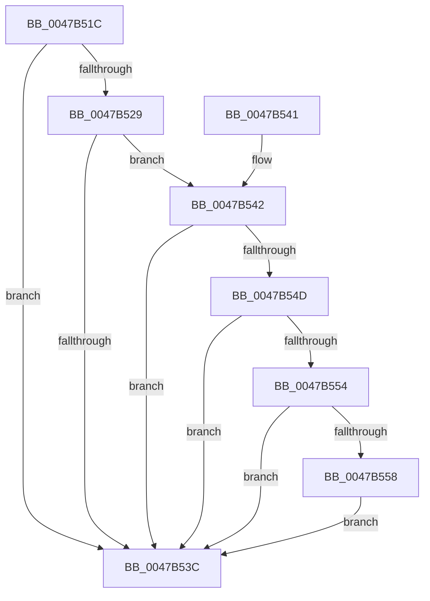

# KiTryScheduleNextForegroundBoost

- RVA: `0x0047B51C`–`0x0047B55F` (길이 `67` bytes)
- VA: `0x000000014047B51C`
- 실행 섹션: `.text`
- PDB 이름 있음: `예`; PDB Function 태그: `아니요`
- unwind 정보 RVA: `0x000AD68C`
- 디코드: `20`개 명령, `67/67` bytes 표시
- 미해석 바이트: `0` (있으면 어셈블리에 `.byte`로 보존)

> 이 문서는 커널 이미지의 기계어와 PDB 기호를 분석해 생성했습니다. 4번과 5번은 함수 원형과 자료형을 바이너리 사용 방식에서 추정한 C 해석이며 원본 소스 복구 결과는 아닙니다.

## 1. Dependencies

- 직접 호출 지점: **1**; 고유 호출 대상: **1**
- 직접 호출자로 확인된 함수: **3**
- RIP 상대 이미지 참조: **1**

### Outgoing calls
- `0x0047B558` → [KiScheduleNextForegroundBoost](../5C/KiScheduleNextForegroundBoost_function_005C6670.md) (function, `0x005C6670`)

### Direct callers
- [sub_0021BDD6](../21/Unknown_function_0021BDD6.md) at `0x0021BF0B`
- [KiQueueReadyThread](../21/KiQueueReadyThread_function_0021C7B0.md) at `0x0021CF20`
- [sub_002546EC](../25/Unknown_function_002546EC.md) at `0x00254DE8`

### Static image references
- `0x0047B520` → RVA `0x00FC50A0` (`ALMOSTRO`; read)

## 2. Other-region calls and transfers

- 다른 실행 섹션으로 향하는 call: **0**
- 별도 외부 분기/꼬리 이동을 확인하지 못했습니다.

## 3. Assembly (complete function range)

```asm
0047B51C  48 83 EC 28                     sub rsp, 0x28
0047B520  83 3D 79 9B B4 00 00            cmp dword ptr [rip + 0xb49b79], 0
0047B527  74 13                           je 0x14047b53c
0047B529  48 8B 81 20 02 00 00            mov rax, qword ptr [rcx + 0x220]
0047B530  8B 80 88 00 00 00               mov eax, dword ptr [rax + 0x88]
0047B536  0F BA E0 0D                     bt eax, 0xd
0047B53A  72 06                           jb 0x14047b542
0047B53C  48 83 C4 28                     add rsp, 0x28
0047B540  C3                              ret
0047B541  CC                              int3
0047B542  8A 91 C3 00 00 00               mov dl, byte ptr [rcx + 0xc3]
0047B548  80 FA 10                        cmp dl, 0x10
0047B54B  7D EF                           jge 0x14047b53c
0047B54D  8B 41 78                        mov eax, dword ptr [rcx + 0x78]
0047B550  A8 08                           test al, 8
0047B552  75 E8                           jne 0x14047b53c
0047B554  84 D2                           test dl, dl
0047B556  7E E4                           jle 0x14047b53c
0047B558  E8 13 B1 14 00                  call 0x1405c6670
0047B55D  EB DD                           jmp 0x14047b53c
```

## 4. C-style interpretation (structured pseudocode)

```c
__int64 __fastcall KiTryScheduleNextForegroundBoost(__int64 a1)
{
    __int64 result;
    __int64 v_rsp;

    v_rsp = (v_rsp) - (40);
    if ((*(unsigned int *)(v_rip + 11836281)) == 0) goto loc_0047B53C;
    if ((*(unsigned int *)(v_rip + 11836281)) < 0) goto loc_0047B542;
loc_0047B53C:
    v_rsp = (v_rsp) + (40);
    return (unsigned int)(*(unsigned int *)(*(unsigned __int64 *)(a1 + 544) + 136));
loc_0047B542:
    if (((unsigned __int8)(*(unsigned __int8 *)(a1 + 195))) >= 16) goto loc_0047B53C;
    if ((((unsigned __int8)((unsigned int)(*(unsigned int *)(a1 + 120)))) & (8)) != 0) goto loc_0047B53C;
    if (condition_is_less_or_equal) goto loc_0047B53C;
    result = KiScheduleNextForegroundBoost(a1, *(unsigned __int8 *)(a1 + 195), a3, a4);
    goto loc_0047B53C;
}
```

## 5. (Beta) C Style

```c
int64_t KiTryScheduleNextForegroundBoost(void *Arg1)
{
    uint8_t *arg1 = (uint8_t *)Arg1;

    int64_t result;
    int64_t local_rsp;

    local_rsp = (local_rsp) - (40);
    if ((*(uint32_t *)(v_rip + 0xB49B79)) == 0) goto loc_0047B53C;
    if ((*(uint32_t *)(v_rip + 0xB49B79)) < 0) goto loc_0047B542;
loc_0047B53C:
    local_rsp = (local_rsp) + (40);
    return (uint32_t)(*(uint32_t *)(*(uint64_t *)(arg1 + 0x220) + 0x88));
loc_0047B542:
    if (((uint8_t)(*(uint8_t *)(arg1 + 0xC3))) >= 16) goto loc_0047B53C;
    if ((((uint8_t)((uint32_t)(*(uint32_t *)(arg1 + 0x78)))) & (8)) != 0) goto loc_0047B53C;
    if (condition_is_less_or_equal) goto loc_0047B53C;
    result = KiScheduleNextForegroundBoost(Arg1, *(uint8_t *)(arg1 + 0xC3), a3, a4);
    goto loc_0047B53C;
}
```

### 관측된 메모리 오프셋

구조체 형식이 확인되지 않은 접근은 인자 기준의 오프셋으로만 기록했습니다.

| 기준 인자 | 오프셋 표현 | 폭 (bit) | 접근 |
|---|---:|---:|---|
| `Arg1` | `+ 0x78` | `32` | `R` |
| `Arg1` | `+ 0xC3` | `8` | `R` |
| `Arg1` | `+ 0x220` | `64` | `R` |

## 6. Execution-region graph

[열기: 2D/3D 그래프와 함수 탐색 컨트롤 패널](../../../control-panel.html?section=text&rva=0x0047B51C&view=graph)

- 2D 그래프는 위에서 아래로 흐르고, 3D 그래프는 빈 공간을 드래그해 회전합니다. Shift+드래그는 이동, 휠은 확대·축소, 함수 노드 선택은 대상 보고서 이동입니다.

### Static fallback


