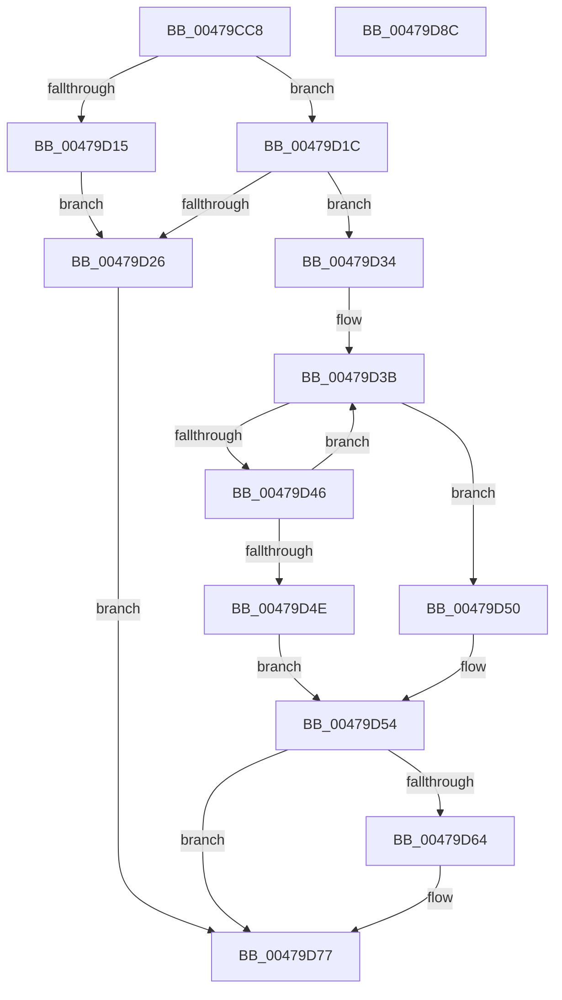

# KiUnmaskSecondaryInterruptInternal

- RVA: `0x00479CC8`–`0x00479D8D` (길이 `197` bytes)
- VA: `0x0000000140479CC8`
- 실행 섹션: `.text`
- PDB 이름 있음: `예`; PDB Function 태그: `아니요`
- unwind 정보 RVA: `0x000701D4`
- 디코드: `60`개 명령, `197/197` bytes 표시
- 미해석 바이트: `0` (있으면 어셈블리에 `.byte`로 보존)

> 이 문서는 커널 이미지의 기계어와 PDB 기호를 분석해 생성했습니다. 4번과 5번은 함수 원형과 자료형을 바이너리 사용 방식에서 추정한 C 해석이며 원본 소스 복구 결과는 아닙니다.

## 1. Dependencies

- 직접 호출 지점: **4**; 고유 호출 대상: **3**
- 직접 호출자로 확인된 함수: **2**
- RIP 상대 이미지 참조: **2**

### Outgoing calls
- `0x00479D03` → [KiAcquireSecondaryInterruptConnectLock](KiAcquireSecondaryInterruptConnectLock_function_00479E58.md) (function, `0x00479E58`)
- `0x00479D2D` → [HalpReleaseHighLevelLock](../2D/HalpReleaseHighLevelLock_function_002D1C58.md) (function, `0x002D1C58`)
- `0x00479D5B` → [HalpReleaseHighLevelLock](../2D/HalpReleaseHighLevelLock_function_002D1C58.md) (function, `0x002D1C58`)
- `0x00479D70` → [guard_dispatch_icall](../6B/guard_dispatch_icall_function_006BAAD0.md) (function, `0x006BAAD0`)

### Direct callers
- [KeConnectInterrupt](../2D/KeConnectInterrupt_function_002D3D5C.md) at `0x002D3EFF`
- [KeUnmaskInterrupt](KeUnmaskInterrupt_function_00479C04.md) at `0x00479C99`

### Static image references
- `0x00479CDA` → RVA `0x00F11028` (`.data`; read)
- `0x00479D64` → RVA `0x00E009D8` (`.data`; read)

## 2. Other-region calls and transfers

- 다른 실행 섹션으로 향하는 call: **0**
- 별도 외부 분기/꼬리 이동을 확인하지 못했습니다.

## 3. Assembly (complete function range)

```asm
00479CC8  48 89 5C 24 10                  mov qword ptr [rsp + 0x10], rbx
00479CCD  48 89 6C 24 18                  mov qword ptr [rsp + 0x18], rbp
00479CD2  56                              push rsi
00479CD3  57                              push rdi
00479CD4  41 56                           push r14
00479CD6  48 83 EC 20                     sub rsp, 0x20
00479CDA  48 8B 2D 47 73 A9 00            mov rbp, qword ptr [rip + 0xa97347]
00479CE1  8D 81 00 FF FF FF               lea eax, [rcx - 0x100]
00479CE7  48 8D 34 40                     lea rsi, [rax + rax*2]
00479CEB  44 8B F2                        mov r14d, edx
00479CEE  48 C1 E6 04                     shl rsi, 4
00479CF2  48 8D 54 24 40                  lea rdx, [rsp + 0x40]
00479CF7  48 03 EE                        add rbp, rsi
00479CFA  33 DB                           xor ebx, ebx
00479CFC  48 8B CD                        mov rcx, rbp
00479CFF  88 5C 24 40                     mov byte ptr [rsp + 0x40], bl
00479D03  E8 50 01 00 00                  call 0x140479e58
00479D08  48 8B 15 19 73 A9 00            mov rdx, qword ptr [rip + 0xa97319]
00479D0F  38 5C 16 20                     cmp byte ptr [rsi + rdx + 0x20], bl
00479D13  75 07                           jne 0x140479d1c
00479D15  BB 28 01 00 00                  mov ebx, 0x128
00479D1A  EB 0A                           jmp 0x140479d26
00479D1C  48 8B 44 16 28                  mov rax, qword ptr [rsi + rdx + 0x28]
00479D21  48 85 C0                        test rax, rax
00479D24  75 0E                           jne 0x140479d34
00479D26  8A 54 24 40                     mov dl, byte ptr [rsp + 0x40]
00479D2A  48 8B CD                        mov rcx, rbp
00479D2D  E8 26 7F E5 FF                  call 0x1402d1c58
00479D32  EB 43                           jmp 0x140479d77
00479D34  48 8D 48 08                     lea rcx, [rax + 8]
00479D38  48 8B C1                        mov rax, rcx
00479D3B  8B 78 60                        mov edi, dword ptr [rax + 0x60]
00479D3E  D1 EF                           shr edi, 1
00479D40  1B FF                           sbb edi, edi
00479D42  85 FF                           test edi, edi
00479D44  74 0A                           je 0x140479d50
00479D46  48 8B 00                        mov rax, qword ptr [rax]
00479D49  48 3B C1                        cmp rax, rcx
00479D4C  75 ED                           jne 0x140479d3b
00479D4E  EB 04                           jmp 0x140479d54
00479D50  88 5C 16 20                     mov byte ptr [rsi + rdx + 0x20], bl
00479D54  8A 54 24 40                     mov dl, byte ptr [rsp + 0x40]
00479D58  48 8B CD                        mov rcx, rbp
00479D5B  E8 F8 7E E5 FF                  call 0x1402d1c58
00479D60  85 FF                           test edi, edi
00479D62  75 13                           jne 0x140479d77
00479D64  48 8B 05 6D 6C 98 00            mov rax, qword ptr [rip + 0x986c6d]
00479D6B  33 D2                           xor edx, edx
00479D6D  41 8B CE                        mov ecx, r14d
00479D70  E8 5B 0D 24 00                  call 0x1406baad0
00479D75  8B D8                           mov ebx, eax
00479D77  48 8B 6C 24 50                  mov rbp, qword ptr [rsp + 0x50]
00479D7C  8B C3                           mov eax, ebx
00479D7E  48 8B 5C 24 48                  mov rbx, qword ptr [rsp + 0x48]
00479D83  48 83 C4 20                     add rsp, 0x20
00479D87  41 5E                           pop r14
00479D89  5F                              pop rdi
00479D8A  5E                              pop rsi
00479D8B  C3                              ret
00479D8C  CC                              int3
```

## 4. C-style interpretation (structured pseudocode)

```c
__int64 __fastcall KiUnmaskSecondaryInterruptInternal(__int64 a1, int a2)
{
    __int64 result;
    __int64 v_rbp;
    __int64 v_rbx;
    __int64 v_rdi;
    __int64 v_rsi;
    __int64 v_rsp;
    unsigned __int64 v_stack_p10;
    unsigned __int64 v_stack_p18;
    unsigned __int64 v_stack_p8;

    v_stack_p10 = v_rbx;
    v_stack_p18 = v_rbp;
    v_rsp = (v_rsp) - (32);
    v_rsi = (a1 - 256 + a1 - 256 * 2) << (4);
    v_rbp = (*(unsigned __int64 *)(v_rip + 11105095)) + (v_rsi);
    v_rbx = 0;
    v_stack_p8 = 0;
    result = KiAcquireSecondaryInterruptConnectLock(v_rbp, v_stack_p8, a3, a4);
    if ((*(unsigned __int8 *)(v_rsi + *(unsigned __int64 *)(v_rip + 11105049) * 1 + 32)) != 0) goto loc_00479D1C;
    goto loc_00479D26;
loc_00479D1C:
    if (*(unsigned __int64 *)(v_rsi + *(unsigned __int64 *)(v_rip + 11105049) * 1 + 40) != 0) goto loc_00479D34;
loc_00479D26:
    result = HalpReleaseHighLevelLock(v_rbp, v_stack_p8, a3, a4);
    goto loc_00479D77;
loc_00479D34:
loc_00479D3B:
    v_rdi = (unsigned int)(((unsigned int)(*(unsigned int *)(result + 8 + 96))) >> (1));
    if ((unsigned int)(v_rdi) == 0) goto loc_00479D50;
    if ((*(unsigned __int64 *)(result + 8)) != (result + 8)) goto loc_00479D3B;
    goto loc_00479D54;
loc_00479D50:
    *(unsigned __int8 *)(v_rsi + v_stack_p8 * 1 + 32) = 296;
loc_00479D54:
    result = HalpReleaseHighLevelLock(v_rbp, v_stack_p8, a3, a4);
    v_rbx = 296;
    if ((unsigned int)(v_rdi) == 0) {
        result = *(unsigned __int64 *)(v_rip + 9989229);
        a2 = 0;
        a1 = (unsigned int)((unsigned int)(a2));
        result = guard_dispatch_icall(a1, a2, a3, a4);
        v_rbx = (unsigned int)(result);
    }
    v_rsp = (v_rsp) + (32);
    return (unsigned int)((unsigned int)(v_rbx));
}
```

## 5. (Beta) C Style

```c
int64_t KiUnmaskSecondaryInterruptInternal(void *Arg1, int32_t Arg2)
{
    uint8_t *arg1 = (uint8_t *)Arg1;

    int64_t result;
    int64_t local_rbp;
    int64_t local_rbx;
    int64_t local_rdi;
    int64_t local_rsi;
    int64_t local_rsp;
    uint64_t v_stack_p10;
    uint64_t v_stack_p18;
    uint64_t v_stack_p8;

    v_stack_p10 = local_rbx;
    v_stack_p18 = local_rbp;
    local_rsp = (local_rsp) - (32);
    local_rsi = (Arg1 - 256 + Arg1 - 256 * 2) << (4);
    local_rbp = (*(uint64_t *)(v_rip + 0xA97347)) + (local_rsi);
    local_rbx = 0;
    v_stack_p8 = 0;
    result = KiAcquireSecondaryInterruptConnectLock(local_rbp, v_stack_p8, a3, a4);
    if ((*(uint8_t *)(local_rsi + *(uint64_t *)(v_rip + 0xA97319) * 1 + 0x20)) != 0) goto loc_00479D1C;
    goto loc_00479D26;
loc_00479D1C:
    if (*(uint64_t *)(local_rsi + *(uint64_t *)(v_rip + 0xA97319) * 1 + 0x28) != 0) goto loc_00479D34;
loc_00479D26:
    result = HalpReleaseHighLevelLock(local_rbp, v_stack_p8, a3, a4);
    goto loc_00479D77;
loc_00479D34:
loc_00479D3B:
    local_rdi = (uint32_t)(((uint32_t)(*(uint32_t *)(result + 0x8 + 0x60))) >> (1));
    if ((uint32_t)(local_rdi) == 0) goto loc_00479D50;
    if ((*(uint64_t *)(result + 0x8)) != (result + 8)) goto loc_00479D3B;
    goto loc_00479D54;
loc_00479D50:
    *(uint8_t *)(local_rsi + v_stack_p8 * 1 + 0x20) = 296;
loc_00479D54:
    result = HalpReleaseHighLevelLock(local_rbp, v_stack_p8, a3, a4);
    local_rbx = 296;
    if ((uint32_t)(local_rdi) == 0) {
        result = *(uint64_t *)(v_rip + 0x986C6D);
        Arg2 = 0;
        Arg1 = (uint32_t)((uint32_t)(Arg2));
        result = guard_dispatch_icall(Arg1, Arg2, a3, a4);
        local_rbx = (uint32_t)(result);
    }
    local_rsp = (local_rsp) + (32);
    return (uint32_t)((uint32_t)(local_rbx));
}
```

### 관측된 메모리 오프셋

구조체 형식이 확인되지 않은 접근은 인자 기준의 오프셋으로만 기록했습니다.

| 기준 인자 | 오프셋 표현 | 폭 (bit) | 접근 |
|---|---:|---:|---|
| `Arg1` | `- 0x100` | `32` | `R` |
| `Arg1` | `+ 0x0 + rax*2` | `64` | `R` |

## 6. Execution-region graph

[열기: 2D/3D 그래프와 함수 탐색 컨트롤 패널](../../../control-panel.html?section=text&rva=0x00479CC8&view=graph)

- 2D 그래프는 위에서 아래로 흐르고, 3D 그래프는 빈 공간을 드래그해 회전합니다. Shift+드래그는 이동, 휠은 확대·축소, 함수 노드 선택은 대상 보고서 이동입니다.

### Static fallback


