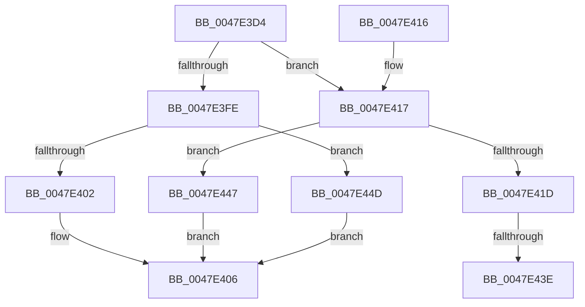

# LdrpCompareResourceNamesWithValidation

- RVA: `0x0047E3D4`–`0x0047E454` (길이 `128` bytes)
- VA: `0x000000014047E3D4`
- 실행 섹션: `.text`
- PDB 이름 있음: `예`; PDB Function 태그: `예`
- unwind 정보 RVA: `0x00092E64`
- 디코드: `39`개 명령, `128/128` bytes 표시
- 미해석 바이트: `0` (있으면 어셈블리에 `.byte`로 보존)

> 이 문서는 커널 이미지의 기계어와 PDB 기호를 분석해 생성했습니다. 4번과 5번은 함수 원형과 자료형을 바이너리 사용 방식에서 추정한 C 해석이며 원본 소스 복구 결과는 아닙니다.

## 1. Dependencies

- 직접 호출 지점: **1**; 고유 호출 대상: **1**
- 직접 호출자로 확인된 함수: **2**
- RIP 상대 이미지 참조: **0**

### Outgoing calls
- `0x0047E42F` → [wcsncmp](../50/wcsncmp_function_00501CA0.md) (function, `0x00501CA0`)

### Direct callers
- [LdrEnumResources](../../page/78/LdrEnumResources_function_0078BA00.md) at `0x0078BAB9`
- [LdrEnumResources](../../page/78/LdrEnumResources_function_0078BA00.md) at `0x0078BB36`
- [LdrEnumResources](../../page/78/LdrEnumResources_function_0078BA00.md) at `0x0078BBBC`
- [LdrpSearchResourceSection_U](../../page/99/LdrpSearchResourceSection_U_function_0099B2DC.md) at `0x0099B3F1`
- [LdrpSearchResourceSection_U](../../page/99/LdrpSearchResourceSection_U_function_0099B2DC.md) at `0x0099B54E`

### Static image references
- 디코드된 RIP-relative 메모리 참조가 없습니다.

## 2. Other-region calls and transfers

- 다른 실행 섹션으로 향하는 call: **0**
- call이 아닌 외부 분기/꼬리 이동: **2**
  - `0x0047E438` → [sub_006F4C70 + 0x15](../6F/Unknown_function_006F4C70.md) (`tail-transfer`)
  - `0x0047E442` → [sub_006F4C70](../6F/Unknown_function_006F4C70.md) (`tail-transfer`)

## 3. Assembly (complete function range)

```asm
0047E3D4  48 89 5C 24 08                  mov qword ptr [rsp + 8], rbx
0047E3D9  48 89 74 24 10                  mov qword ptr [rsp + 0x10], rsi
0047E3DE  57                              push rdi
0047E3DF  48 83 EC 20                     sub rsp, 0x20
0047E3E3  48 8B 44 24 58                  mov rax, qword ptr [rsp + 0x58]
0047E3E8  49 8B F8                        mov rdi, r8
0047E3EB  C6 00 01                        mov byte ptr [rax], 1
0047E3EE  48 8B 44 24 50                  mov rax, qword ptr [rsp + 0x50]
0047E3F3  8B 18                           mov ebx, dword ptr [rax]
0047E3F5  49 F7 C0 00 00 FF FF            test r8, -0x10000
0047E3FC  75 19                           jne 0x14047e417
0047E3FE  85 DB                           test ebx, ebx
0047E400  78 4B                           js 0x14047e44d
0047E402  2B FB                           sub edi, ebx
0047E404  8B C7                           mov eax, edi
0047E406  48 8B 5C 24 30                  mov rbx, qword ptr [rsp + 0x30]
0047E40B  48 8B 74 24 38                  mov rsi, qword ptr [rsp + 0x38]
0047E410  48 83 C4 20                     add rsp, 0x20
0047E414  5F                              pop rdi
0047E415  C3                              ret
0047E416  CC                              int3
0047E417  33 F6                           xor esi, esi
0047E419  85 DB                           test ebx, ebx
0047E41B  79 2A                           jns 0x14047e447
0047E41D  0F BA F3 1F                     btr ebx, 0x1f
0047E421  48 8B CF                        mov rcx, rdi
0047E424  49 03 D9                        add rbx, r9
0047E427  44 0F B7 03                     movzx r8d, word ptr [rbx]
0047E42B  48 8D 53 02                     lea rdx, [rbx + 2]
0047E42F  E8 6C 38 08 00                  call 0x140501ca0
0047E434  8B D0                           mov edx, eax
0047E436  85 C0                           test eax, eax
0047E438  0F 85 47 68 27 00               jne 0x1406f4c85
0047E43E  48 83 C9 FF                     or rcx, 0xffffffffffffffff
0047E442  E9 29 68 27 00                  jmp 0x1406f4c70
0047E447  48 83 C8 FF                     or rax, 0xffffffffffffffff
0047E44B  EB B9                           jmp 0x14047e406
0047E44D  B8 01 00 00 00                  mov eax, 1
0047E452  EB B2                           jmp 0x14047e406
```

## 4. C-style interpretation (structured pseudocode)

```c
__int64 __fastcall LdrpCompareResourceNamesWithValidation(__int64 a1, __int64 a2, __int64 a3, __int64 a4, __int64 a5, __int64 a6)
{
    __int64 result;
    __int64 v_rbx;
    __int64 v_rdi;
    __int64 v_rsi;
    __int64 v_rsp;
    unsigned __int64 v_stack_p10;
    unsigned __int64 v_stack_p8;

    v_stack_p8 = v_rbx;
    v_stack_p10 = v_rsi;
    v_rsp = (v_rsp) - (32);
    *(unsigned __int8 *)(a6) = 1;
    if (((a3) & (0xFFFFFFFFFFFF0000ULL)) != 0) goto loc_0047E417;
    if (sign_flag) goto loc_0047E44D;
    v_rdi = (unsigned int)((a3) - ((unsigned int)((unsigned int)(*(unsigned int *)(a5)))));
loc_0047E406:
    v_rsp = (v_rsp) + (32);
    return (unsigned int)((unsigned int)(v_rdi));
loc_0047E417:
    v_rsi = 0;
    if (!sign_flag) goto loc_0047E447;
    v_rbx = (v_stack_p8) + (a4);
    result = wcsncmp(v_rdi, v_rbx + 2, *(unsigned __int16 *)(v_rbx), a4);
    a1 = (v_rdi) | (-1);
loc_0047E447:
    result = (result) | (-1);
    goto loc_0047E406;
loc_0047E44D:
    goto loc_0047E406;
}
```

## 5. (Beta) C Style

```c
int64_t LdrpCompareResourceNamesWithValidation(int64_t Arg1, int64_t Arg2, int64_t Arg3, int64_t Arg4, void *Arg5, void *Arg6)
{
    uint8_t *arg5 = (uint8_t *)Arg5;
    uint8_t *arg6 = (uint8_t *)Arg6;

    int64_t result;
    int64_t local_rbx;
    int64_t local_rdi;
    int64_t local_rsi;
    int64_t local_rsp;
    uint64_t v_stack_p10;
    uint64_t v_stack_p8;

    v_stack_p8 = local_rbx;
    v_stack_p10 = local_rsi;
    local_rsp = (local_rsp) - (32);
    *(uint8_t *)(arg6) = 1;
    if (((Arg3) & (0xFFFFFFFFFFFF0000ULL)) != 0) goto loc_0047E417;
    if (sign_flag) goto loc_0047E44D;
    local_rdi = (uint32_t)((Arg3) - ((uint32_t)((uint32_t)(*(uint32_t *)(arg5)))));
loc_0047E406:
    local_rsp = (local_rsp) + (32);
    return (uint32_t)((uint32_t)(local_rdi));
loc_0047E417:
    local_rsi = 0;
    if (!sign_flag) goto loc_0047E447;
    local_rbx = (v_stack_p8) + (Arg4);
    result = wcsncmp(local_rdi, local_rbx + 2, *(uint16_t *)(local_rbx), Arg4);
    Arg1 = (local_rdi) | (-1);
loc_0047E447:
    result = (result) | (-1);
    goto loc_0047E406;
loc_0047E44D:
    goto loc_0047E406;
}
```

### 관측된 메모리 오프셋

구조체 형식이 확인되지 않은 접근은 인자 기준의 오프셋으로만 기록했습니다.

| 기준 인자 | 오프셋 표현 | 폭 (bit) | 접근 |
|---|---:|---:|---|
| `Arg5` | `+ 0x0` | `32` | `R` |
| `Arg6` | `+ 0x0` | `8` | `W` |

## 6. Execution-region graph

[열기: 2D/3D 그래프와 함수 탐색 컨트롤 패널](../../../control-panel.html?section=text&rva=0x0047E3D4&view=graph)

- 2D 그래프는 위에서 아래로 흐르고, 3D 그래프는 빈 공간을 드래그해 회전합니다. Shift+드래그는 이동, 휠은 확대·축소, 함수 노드 선택은 대상 보고서 이동입니다.

### Static fallback


