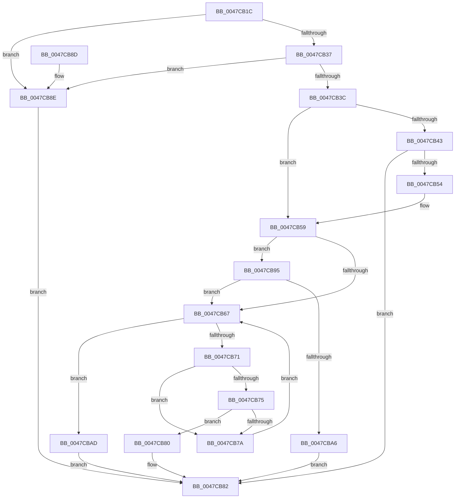

# LdrpFindMessageInAlternateModule

- RVA: `0x0047CB1C`–`0x0047CBB4` (길이 `152` bytes)
- VA: `0x000000014047CB1C`
- 실행 섹션: `.text`
- PDB 이름 있음: `예`; PDB Function 태그: `아니요`
- unwind 정보 RVA: `0x000AD860`
- 디코드: `48`개 명령, `152/152` bytes 표시
- 미해석 바이트: `0` (있으면 어셈블리에 `.byte`로 보존)

> 이 문서는 커널 이미지의 기계어와 PDB 기호를 분석해 생성했습니다. 4번과 5번은 함수 원형과 자료형을 바이너리 사용 방식에서 추정한 C 해석이며 원본 소스 복구 결과는 아닙니다.

## 1. Dependencies

- 직접 호출 지점: **1**; 고유 호출 대상: **1**
- 직접 호출자로 확인된 함수: **1**
- RIP 상대 이미지 참조: **0**

### Outgoing calls
- `0x0047CB4B` → [LdrpAccessResourceDataNoMultipleLanguage](../../page/99/LdrpAccessResourceDataNoMultipleLanguage_function_0099BF00.md) (function, `0x0099BF00`)

### Direct callers
- [sub_006F1854](../6F/Unknown_function_006F1854.md) at `0x006F1878`

### Static image references
- 디코드된 RIP-relative 메모리 참조가 없습니다.

## 2. Other-region calls and transfers

- 다른 실행 섹션으로 향하는 call: **1**
  - `0x0047CB4B` → [LdrpAccessResourceDataNoMultipleLanguage](../../page/99/LdrpAccessResourceDataNoMultipleLanguage_function_0099BF00.md) (`.text` → `PAGE`)
- 별도 외부 분기/꼬리 이동을 확인하지 못했습니다.

## 3. Assembly (complete function range)

```asm
0047CB1C  48 89 74 24 10                  mov qword ptr [rsp + 0x10], rsi
0047CB21  57                              push rdi
0047CB22  48 83 EC 20                     sub rsp, 0x20
0047CB26  48 83 64 24 30 00               and qword ptr [rsp + 0x30], 0
0047CB2C  41 8B F9                        mov edi, r9d
0047CB2F  49 8B F0                        mov rsi, r8
0047CB32  48 85 C9                        test rcx, rcx
0047CB35  74 57                           je 0x14047cb8e
0047CB37  48 85 D2                        test rdx, rdx
0047CB3A  74 52                           je 0x14047cb8e
0047CB3C  80 7C 24 50 00                  cmp byte ptr [rsp + 0x50], 0
0047CB41  75 16                           jne 0x14047cb59
0047CB43  45 33 C9                        xor r9d, r9d
0047CB46  4C 8D 44 24 30                  lea r8, [rsp + 0x30]
0047CB4B  E8 B0 F3 51 00                  call 0x14099bf00
0047CB50  85 C0                           test eax, eax
0047CB52  78 2E                           js 0x14047cb82
0047CB54  48 8B 54 24 30                  mov rdx, qword ptr [rsp + 0x30]
0047CB59  44 8B 02                        mov r8d, dword ptr [rdx]
0047CB5C  48 83 C2 04                     add rdx, 4
0047CB60  80 7C 24 50 00                  cmp byte ptr [rsp + 0x50], 0
0047CB65  75 2E                           jne 0x14047cb95
0047CB67  41 8B C0                        mov eax, r8d
0047CB6A  41 FF C8                        dec r8d
0047CB6D  85 C0                           test eax, eax
0047CB6F  74 3C                           je 0x14047cbad
0047CB71  3B 3A                           cmp edi, dword ptr [rdx]
0047CB73  72 05                           jb 0x14047cb7a
0047CB75  3B 7A 04                        cmp edi, dword ptr [rdx + 4]
0047CB78  76 06                           jbe 0x14047cb80
0047CB7A  48 83 C2 0C                     add rdx, 0xc
0047CB7E  EB E7                           jmp 0x14047cb67
0047CB80  33 C0                           xor eax, eax
0047CB82  48 8B 74 24 38                  mov rsi, qword ptr [rsp + 0x38]
0047CB87  48 83 C4 20                     add rsp, 0x20
0047CB8B  5F                              pop rdi
0047CB8C  C3                              ret
0047CB8D  CC                              int3
0047CB8E  B8 0D 00 00 C0                  mov eax, 0xc000000d
0047CB93  EB ED                           jmp 0x14047cb82
0047CB95  4B 8D 0C 40                     lea rcx, [r8 + r8*2]
0047CB99  48 8D 0C 8D 04 00 00 00         lea rcx, [rcx*4 + 4]
0047CBA1  48 3B CE                        cmp rcx, rsi
0047CBA4  76 C1                           jbe 0x14047cb67
0047CBA6  B8 7B 00 00 C0                  mov eax, 0xc000007b
0047CBAB  EB D5                           jmp 0x14047cb82
0047CBAD  B8 09 01 00 C0                  mov eax, 0xc0000109
0047CBB2  EB CE                           jmp 0x14047cb82
```

## 4. C-style interpretation (structured pseudocode)

```c
__int64 __fastcall LdrpFindMessageInAlternateModule(__int64 a1, __int64 a2, __int64 a3, int a4, unsigned __int8 a5)
{
    __int64 result;
    __int64 v_rsp;
    unsigned __int64 v_stack_p10;
    unsigned __int64 v_stack_p8;

    v_stack_p10 = v_rsi;
    v_rsp = (v_rsp) - (32);
    if (a1 == 0) goto loc_0047CB8E;
    if (a2 == 0) goto loc_0047CB8E;
    if (a5 != 0) goto loc_0047CB59;
    a4 = 0;
    result = LdrpAccessResourceDataNoMultipleLanguage(a1, a2, v_stack_p8, a4);
    if (sign_flag) goto loc_0047CB82;
loc_0047CB59:
    a2 = (v_stack_p8) + (4);
    if (a5 != 0) goto loc_0047CB95;
loc_0047CB67:
    a3 = (unsigned int)(((unsigned int)(*(unsigned int *)(v_stack_p8))) - 1);
    if ((unsigned int)((unsigned int)((unsigned int)((unsigned int)(*(unsigned int *)(v_stack_p8))))) == 0) goto loc_0047CBAD;
    if (((unsigned int)((unsigned int)(a4))) < (*(unsigned int *)(a2))) goto loc_0047CB7A;
    if (((unsigned int)((unsigned int)(a4))) <= (*(unsigned int *)(a2 + 4))) goto loc_0047CB80;
loc_0047CB7A:
    a2 = (a2) + (12);
    goto loc_0047CB67;
loc_0047CB80:
    result = 0;
loc_0047CB82:
    v_rsp = (v_rsp) + (32);
    return result;
loc_0047CB8E:
    goto loc_0047CB82;
loc_0047CB95:
    if ((a3 + a3 * 2 * 4 + 4) <= v_stack_p10) goto loc_0047CB67;
    goto loc_0047CB82;
loc_0047CBAD:
    goto loc_0047CB82;
}
```

## 5. (Beta) C Style

```c
int64_t LdrpFindMessageInAlternateModule(int64_t Arg1, int64_t Arg2, int64_t Arg3, int32_t Arg4, uint8_t Arg5)
{
    int64_t result;
    int64_t local_rsp;
    uint64_t v_stack_p10;
    uint64_t v_stack_p8;

    v_stack_p10 = local_rsi;
    local_rsp = (local_rsp) - (32);
    if (Arg1 == 0) goto loc_0047CB8E;
    if (Arg2 == 0) goto loc_0047CB8E;
    if (Arg5 != 0) goto loc_0047CB59;
    Arg4 = 0;
    result = LdrpAccessResourceDataNoMultipleLanguage(Arg1, Arg2, v_stack_p8, Arg4);
    if (sign_flag) goto loc_0047CB82;
loc_0047CB59:
    Arg2 = (v_stack_p8) + (4);
    if (Arg5 != 0) goto loc_0047CB95;
loc_0047CB67:
    Arg3 = (uint32_t)(((uint32_t)(*(uint32_t *)(v_stack_p8))) - 1);
    if ((uint32_t)((uint32_t)((uint32_t)((uint32_t)(*(uint32_t *)(v_stack_p8))))) == 0) goto loc_0047CBAD;
    if (((uint32_t)((uint32_t)(Arg4))) < (*(uint32_t *)(Arg2))) goto loc_0047CB7A;
    if (((uint32_t)((uint32_t)(Arg4))) <= (*(uint32_t *)(Arg2 + 0x4))) goto loc_0047CB80;
loc_0047CB7A:
    Arg2 = (Arg2) + (12);
    goto loc_0047CB67;
loc_0047CB80:
    result = 0;
loc_0047CB82:
    local_rsp = (local_rsp) + (32);
    return result;
loc_0047CB8E:
    goto loc_0047CB82;
loc_0047CB95:
    if ((Arg3 + Arg3 * 2 * 4 + 4) <= v_stack_p10) goto loc_0047CB67;
    goto loc_0047CB82;
loc_0047CBAD:
    goto loc_0047CB82;
}
```

## 6. Execution-region graph

[열기: 2D/3D 그래프와 함수 탐색 컨트롤 패널](../../../control-panel.html?section=text&rva=0x0047CB1C&view=graph)

- 2D 그래프는 위에서 아래로 흐르고, 3D 그래프는 빈 공간을 드래그해 회전합니다. Shift+드래그는 이동, 휠은 확대·축소, 함수 노드 선택은 대상 보고서 이동입니다.

### Static fallback


