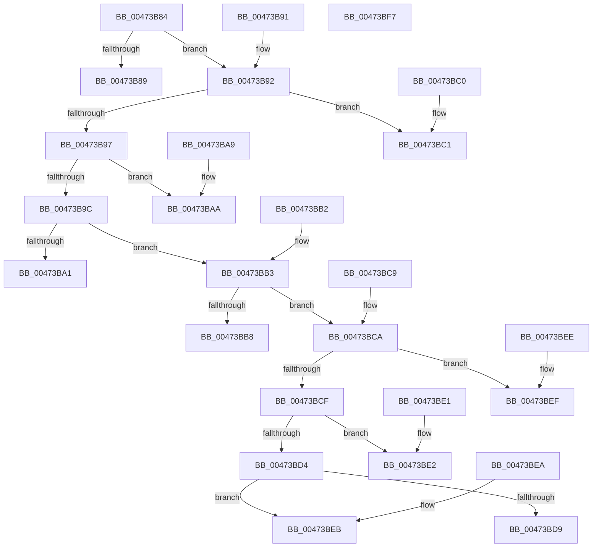

# MapCmClassPropertyToRegValue

- RVA: `0x00473B84`–`0x00473BF8` (길이 `116` bytes)
- VA: `0x0000000140473B84`
- 실행 섹션: `.text`
- PDB 이름 있음: `예`; PDB Function 태그: `아니요`
- unwind 정보 RVA: `0x000DB714`
- 디코드: `43`개 명령, `116/116` bytes 표시
- 미해석 바이트: `0` (있으면 어셈블리에 `.byte`로 보존)

> 이 문서는 커널 이미지의 기계어와 PDB 기호를 분석해 생성했습니다. 4번과 5번은 함수 원형과 자료형을 바이너리 사용 방식에서 추정한 C 해석이며 원본 소스 복구 결과는 아닙니다.

## 1. Dependencies

- 직접 호출 지점: **0**; 고유 호출 대상: **0**
- 직접 호출자로 확인된 함수: **2**
- RIP 상대 이미지 참조: **8**

### Outgoing calls
- 직접 디코드된 call 명령이 없습니다.

### Direct callers
- [CmSetInstallerClassRegPropWorker](../../page/82/CmSetInstallerClassRegPropWorker_function_0082ABF4.md) at `0x0082ADB9`
- [CmGetInstallerClassRegPropWorker](../../page/99/CmGetInstallerClassRegPropWorker_function_00994AF4.md) at `0x00994BDE`

### Static image references
- `0x00473B89` → RVA `0x006CB400` (` ?? ::FNODOBFM::`string'`; read)
- `0x00473BA1` → RVA `0x006D1240` (` ?? ::FNODOBFM::`string'`; read)
- `0x00473BAA` → RVA `0x006D1220` (` ?? ::FNODOBFM::`string'`; read)
- `0x00473BB8` → RVA `0x006D1260` (` ?? ::FNODOBFM::`string'`; read)
- `0x00473BC1` → RVA `0x006D13B0` (` ?? ::FNODOBFM::`string'`; read)
- `0x00473BD9` → RVA `0x006D12C0` (` ?? ::FNODOBFM::`string'`; read)
- `0x00473BE2` → RVA `0x006D12A0` (` ?? ::FNODOBFM::`string'`; read)
- `0x00473BEF` → RVA `0x006D1280` (` ?? ::FNODOBFM::`string'`; read)

## 2. Other-region calls and transfers

- 다른 실행 섹션으로 향하는 call: **0**
- 별도 외부 분기/꼬리 이동을 확인하지 못했습니다.

## 3. Assembly (complete function range)

```asm
00473B84  83 EA 08                        sub edx, 8
00473B87  75 09                           jne 0x140473b92
00473B89  48 8D 05 70 78 25 00            lea rax, [rip + 0x257870]
00473B90  C3                              ret
00473B91  CC                              int3
00473B92  83 EA 05                        sub edx, 5
00473B95  74 2A                           je 0x140473bc1
00473B97  83 EA 05                        sub edx, 5
00473B9A  74 0E                           je 0x140473baa
00473B9C  83 EA 01                        sub edx, 1
00473B9F  75 12                           jne 0x140473bb3
00473BA1  48 8D 05 98 D6 25 00            lea rax, [rip + 0x25d698]
00473BA8  C3                              ret
00473BA9  CC                              int3
00473BAA  48 8D 05 6F D6 25 00            lea rax, [rip + 0x25d66f]
00473BB1  C3                              ret
00473BB2  CC                              int3
00473BB3  83 EA 05                        sub edx, 5
00473BB6  75 12                           jne 0x140473bca
00473BB8  48 8D 05 A1 D6 25 00            lea rax, [rip + 0x25d6a1]
00473BBF  C3                              ret
00473BC0  CC                              int3
00473BC1  48 8D 05 E8 D7 25 00            lea rax, [rip + 0x25d7e8]
00473BC8  C3                              ret
00473BC9  CC                              int3
00473BCA  83 EA 02                        sub edx, 2
00473BCD  74 20                           je 0x140473bef
00473BCF  83 EA 01                        sub edx, 1
00473BD2  74 0E                           je 0x140473be2
00473BD4  83 FA 01                        cmp edx, 1
00473BD7  75 12                           jne 0x140473beb
00473BD9  48 8D 05 E0 D6 25 00            lea rax, [rip + 0x25d6e0]
00473BE0  C3                              ret
00473BE1  CC                              int3
00473BE2  48 8D 05 B7 D6 25 00            lea rax, [rip + 0x25d6b7]
00473BE9  C3                              ret
00473BEA  CC                              int3
00473BEB  33 C0                           xor eax, eax
00473BED  C3                              ret
00473BEE  CC                              int3
00473BEF  48 8D 05 8A D6 25 00            lea rax, [rip + 0x25d68a]
00473BF6  C3                              ret
00473BF7  CC                              int3
```

## 4. C-style interpretation (structured pseudocode)

```c
__int64 __fastcall MapCmClassPropertyToRegValue(__int64 a1, int a2)
{
    __int64 result;

    a2 = (unsigned int)((a2) - (8));
    if (condition_is_not_equal) goto loc_00473B92;
    return v_rip + 2455664;
loc_00473B92:
    a2 = (unsigned int)((a2) - (5));
    if (condition_is_equal) goto loc_00473BC1;
    a2 = (unsigned int)((a2) - (5));
    if (condition_is_equal) goto loc_00473BAA;
    a2 = (unsigned int)((a2) - (1));
    if (condition_is_not_equal) goto loc_00473BB3;
    return v_rip + 2479768;
loc_00473BAA:
    return v_rip + 2479727;
loc_00473BB3:
    a2 = (unsigned int)((a2) - (5));
    if (condition_is_not_equal) goto loc_00473BCA;
    return v_rip + 2479777;
loc_00473BC1:
    return v_rip + 2480104;
loc_00473BCA:
    a2 = (unsigned int)((a2) - (2));
    if (condition_is_equal) goto loc_00473BEF;
    a2 = (unsigned int)((a2) - (1));
    if (condition_is_equal) goto loc_00473BE2;
    if (a2 != 1) goto loc_00473BEB;
    return v_rip + 2479840;
loc_00473BE2:
    return v_rip + 2479799;
loc_00473BEB:
    result = 0;
    return result;
loc_00473BEF:
    return v_rip + 2479754;
}
```

## 5. (Beta) C Style

```c
int64_t MapCmClassPropertyToRegValue(int64_t Arg1, int32_t Arg2)
{
    int64_t result;

    Arg2 = (uint32_t)((Arg2) - (8));
    if (condition_is_not_equal) goto loc_00473B92;
    return v_rip + 2455664;
loc_00473B92:
    Arg2 = (uint32_t)((Arg2) - (5));
    if (condition_is_equal) goto loc_00473BC1;
    Arg2 = (uint32_t)((Arg2) - (5));
    if (condition_is_equal) goto loc_00473BAA;
    Arg2 = (uint32_t)((Arg2) - (1));
    if (condition_is_not_equal) goto loc_00473BB3;
    return v_rip + 2479768;
loc_00473BAA:
    return v_rip + 2479727;
loc_00473BB3:
    Arg2 = (uint32_t)((Arg2) - (5));
    if (condition_is_not_equal) goto loc_00473BCA;
    return v_rip + 2479777;
loc_00473BC1:
    return v_rip + 2480104;
loc_00473BCA:
    Arg2 = (uint32_t)((Arg2) - (2));
    if (condition_is_equal) goto loc_00473BEF;
    Arg2 = (uint32_t)((Arg2) - (1));
    if (condition_is_equal) goto loc_00473BE2;
    if (Arg2 != 1) goto loc_00473BEB;
    return v_rip + 2479840;
loc_00473BE2:
    return v_rip + 2479799;
loc_00473BEB:
    result = 0;
    return result;
loc_00473BEF:
    return v_rip + 2479754;
}
```

## 6. Execution-region graph

[열기: 2D/3D 그래프와 함수 탐색 컨트롤 패널](../../../control-panel.html?section=text&rva=0x00473B84&view=graph)

- 2D 그래프는 위에서 아래로 흐르고, 3D 그래프는 빈 공간을 드래그해 회전합니다. Shift+드래그는 이동, 휠은 확대·축소, 함수 노드 선택은 대상 보고서 이동입니다.

### Static fallback


