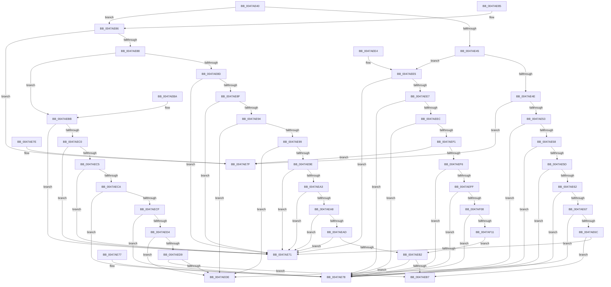

# MapCmDevicePropertyToRegType

- RVA: `0x0047AE40`–`0x0047AF13` (길이 `211` bytes)
- VA: `0x000000014047AE40`
- 실행 섹션: `.text`
- PDB 이름 있음: `예`; PDB Function 태그: `아니요`
- unwind 정보 RVA: `0x000DB714`
- 디코드: `81`개 명령, `211/211` bytes 표시
- 미해석 바이트: `0` (있으면 어셈블리에 `.byte`로 보존)

> 이 문서는 커널 이미지의 기계어와 PDB 기호를 분석해 생성했습니다. 4번과 5번은 함수 원형과 자료형을 바이너리 사용 방식에서 추정한 C 해석이며 원본 소스 복구 결과는 아닙니다.

## 1. Dependencies

- 직접 호출 지점: **0**; 고유 호출 대상: **0**
- 직접 호출자로 확인된 함수: **2**
- RIP 상대 이미지 참조: **0**

### Outgoing calls
- 직접 디코드된 call 명령이 없습니다.

### Direct callers
- [sub_008EDC5D](../../page/8E/Unknown_function_008EDC5D.md) at `0x008EDE59`
- [_CmSetDeviceRegPropWorker](../../page/8F/_CmSetDeviceRegPropWorker_function_008FD804.md) at `0x008FD8B2`

### Static image references
- 디코드된 RIP-relative 메모리 참조가 없습니다.

## 2. Other-region calls and transfers

- 다른 실행 섹션으로 향하는 call: **0**
- 별도 외부 분기/꼬리 이동을 확인하지 못했습니다.

## 3. Assembly (complete function range)

```asm
0047AE40  83 F9 14                        cmp ecx, 0x14
0047AE43  7E 41                           jle 0x14047ae86
0047AE45  83 F9 1E                        cmp ecx, 0x1e
0047AE48  0F 8E 97 00 00 00               jle 0x14047aee5
0047AE4E  83 E9 1F                        sub ecx, 0x1f
0047AE51  74 2C                           je 0x14047ae7f
0047AE53  83 E9 01                        sub ecx, 1
0047AE56  74 20                           je 0x14047ae78
0047AE58  83 E9 01                        sub ecx, 1
0047AE5B  74 1B                           je 0x14047ae78
0047AE5D  83 E9 01                        sub ecx, 1
0047AE60  74 16                           je 0x14047ae78
0047AE62  83 E9 01                        sub ecx, 1
0047AE65  74 11                           je 0x14047ae78
0047AE67  83 E9 01                        sub ecx, 1
0047AE6A  74 72                           je 0x14047aede
0047AE6C  83 F9 01                        cmp ecx, 1
0047AE6F  75 46                           jne 0x14047aeb7
0047AE71  B8 01 00 00 00                  mov eax, 1
0047AE76  C3                              ret
0047AE77  CC                              int3
0047AE78  B8 04 00 00 00                  mov eax, 4
0047AE7D  C3                              ret
0047AE7E  CC                              int3
0047AE7F  B8 03 00 00 00                  mov eax, 3
0047AE84  C3                              ret
0047AE85  CC                              int3
0047AE86  74 F7                           je 0x14047ae7f
0047AE88  83 F9 0C                        cmp ecx, 0xc
0047AE8B  7F 2E                           jg 0x14047aebb
0047AE8D  74 E2                           je 0x14047ae71
0047AE8F  83 E9 01                        sub ecx, 1
0047AE92  74 DD                           je 0x14047ae71
0047AE94  83 E9 01                        sub ecx, 1
0047AE97  74 45                           je 0x14047aede
0047AE99  83 E9 01                        sub ecx, 1
0047AE9C  74 40                           je 0x14047aede
0047AE9E  83 E9 02                        sub ecx, 2
0047AEA1  74 CE                           je 0x14047ae71
0047AEA3  83 E9 03                        sub ecx, 3
0047AEA6  74 C9                           je 0x14047ae71
0047AEA8  83 E9 01                        sub ecx, 1
0047AEAB  74 C4                           je 0x14047ae71
0047AEAD  83 E9 01                        sub ecx, 1
0047AEB0  74 BF                           je 0x14047ae71
0047AEB2  83 F9 01                        cmp ecx, 1
0047AEB5  74 C1                           je 0x14047ae78
0047AEB7  33 C0                           xor eax, eax
0047AEB9  C3                              ret
0047AEBA  CC                              int3
0047AEBB  83 E9 0D                        sub ecx, 0xd
0047AEBE  74 B1                           je 0x14047ae71
0047AEC0  83 E9 01                        sub ecx, 1
0047AEC3  74 AC                           je 0x14047ae71
0047AEC5  83 E9 01                        sub ecx, 1
0047AEC8  74 A7                           je 0x14047ae71
0047AECA  83 E9 01                        sub ecx, 1
0047AECD  74 A9                           je 0x14047ae78
0047AECF  83 E9 01                        sub ecx, 1
0047AED2  74 A4                           je 0x14047ae78
0047AED4  83 E9 01                        sub ecx, 1
0047AED7  74 05                           je 0x14047aede
0047AED9  83 F9 01                        cmp ecx, 1
0047AEDC  75 D9                           jne 0x14047aeb7
0047AEDE  B8 07 00 00 00                  mov eax, 7
0047AEE3  C3                              ret
0047AEE4  CC                              int3
0047AEE5  74 8A                           je 0x14047ae71
0047AEE7  83 E9 15                        sub ecx, 0x15
0047AEEA  74 8C                           je 0x14047ae78
0047AEEC  83 E9 01                        sub ecx, 1
0047AEEF  74 87                           je 0x14047ae78
0047AEF1  83 E9 02                        sub ecx, 2
0047AEF4  74 89                           je 0x14047ae7f
0047AEF6  83 E9 02                        sub ecx, 2
0047AEF9  0F 84 79 FF FF FF               je 0x14047ae78
0047AEFF  83 E9 01                        sub ecx, 1
0047AF02  0F 84 70 FF FF FF               je 0x14047ae78
0047AF08  83 E9 01                        sub ecx, 1
0047AF0B  0F 84 67 FF FF FF               je 0x14047ae78
0047AF11  EB 9F                           jmp 0x14047aeb2
```

## 4. C-style interpretation (structured pseudocode)

```c
__int64 __fastcall MapCmDevicePropertyToRegType(int a1)
{
    __int64 result;

    if (a1 <= 20) goto loc_0047AE86;
    if (a1 <= 30) goto loc_0047AEE5;
    a1 = (unsigned int)((a1) - (31));
    if (condition_is_equal) goto loc_0047AE7F;
    a1 = (unsigned int)((a1) - (1));
    if (condition_is_equal) goto loc_0047AE78;
    a1 = (unsigned int)((a1) - (1));
    if (condition_is_equal) goto loc_0047AE78;
    a1 = (unsigned int)((a1) - (1));
    if (condition_is_equal) goto loc_0047AE78;
    a1 = (unsigned int)((a1) - (1));
    if (condition_is_equal) goto loc_0047AE78;
    a1 = (unsigned int)((a1) - (1));
    if (condition_is_equal) goto loc_0047AEDE;
    if (a1 != 1) goto loc_0047AEB7;
loc_0047AE71:
    return 1;
loc_0047AE78:
    return 4;
loc_0047AE7F:
    return 3;
loc_0047AE86:
    if (a1 == 1) goto loc_0047AE7F;
    if (a1 > 12) goto loc_0047AEBB;
    if (a1 == 12) goto loc_0047AE71;
    a1 = (unsigned int)((a1) - (1));
    if (condition_is_equal) goto loc_0047AE71;
    a1 = (unsigned int)((a1) - (1));
    if (condition_is_equal) goto loc_0047AEDE;
    a1 = (unsigned int)((a1) - (1));
    if (condition_is_equal) goto loc_0047AEDE;
    a1 = (unsigned int)((a1) - (2));
    if (condition_is_equal) goto loc_0047AE71;
    a1 = (unsigned int)((a1) - (3));
    if (condition_is_equal) goto loc_0047AE71;
    a1 = (unsigned int)((a1) - (1));
    if (condition_is_equal) goto loc_0047AE71;
    a1 = (unsigned int)((a1) - (1));
    if (condition_is_equal) goto loc_0047AE71;
loc_0047AEB2:
    if (a1 == 1) goto loc_0047AE78;
loc_0047AEB7:
    result = 0;
    return result;
loc_0047AEBB:
    a1 = (unsigned int)((a1) - (13));
    if (condition_is_equal) goto loc_0047AE71;
    a1 = (unsigned int)((a1) - (1));
    if (condition_is_equal) goto loc_0047AE71;
    a1 = (unsigned int)((a1) - (1));
    if (condition_is_equal) goto loc_0047AE71;
    a1 = (unsigned int)((a1) - (1));
    if (condition_is_equal) goto loc_0047AE78;
    a1 = (unsigned int)((a1) - (1));
    if (condition_is_equal) goto loc_0047AE78;
    a1 = (unsigned int)((a1) - (1));
    if (condition_is_equal) goto loc_0047AEDE;
    if (a1 != 1) goto loc_0047AEB7;
loc_0047AEDE:
    return 7;
loc_0047AEE5:
    if (a1 == 1) goto loc_0047AE71;
    a1 = (unsigned int)((a1) - (21));
    if (condition_is_equal) goto loc_0047AE78;
    a1 = (unsigned int)((a1) - (1));
    if (condition_is_equal) goto loc_0047AE78;
    a1 = (unsigned int)((a1) - (2));
    if (condition_is_equal) goto loc_0047AE7F;
    a1 = (unsigned int)((a1) - (2));
    if (condition_is_equal) goto loc_0047AE78;
    a1 = (unsigned int)((a1) - (1));
    if (condition_is_equal) goto loc_0047AE78;
    a1 = (unsigned int)((a1) - (1));
    if (condition_is_equal) goto loc_0047AE78;
    goto loc_0047AEB2;
}
```

## 5. (Beta) C Style

```c
int64_t MapCmDevicePropertyToRegType(int32_t Arg1)
{
    int64_t result;

    if (Arg1 <= 20) goto loc_0047AE86;
    if (Arg1 <= 30) goto loc_0047AEE5;
    Arg1 = (uint32_t)((Arg1) - (31));
    if (condition_is_equal) goto loc_0047AE7F;
    Arg1 = (uint32_t)((Arg1) - (1));
    if (condition_is_equal) goto loc_0047AE78;
    Arg1 = (uint32_t)((Arg1) - (1));
    if (condition_is_equal) goto loc_0047AE78;
    Arg1 = (uint32_t)((Arg1) - (1));
    if (condition_is_equal) goto loc_0047AE78;
    Arg1 = (uint32_t)((Arg1) - (1));
    if (condition_is_equal) goto loc_0047AE78;
    Arg1 = (uint32_t)((Arg1) - (1));
    if (condition_is_equal) goto loc_0047AEDE;
    if (Arg1 != 1) goto loc_0047AEB7;
loc_0047AE71:
    return 1;
loc_0047AE78:
    return 4;
loc_0047AE7F:
    return 3;
loc_0047AE86:
    if (Arg1 == 1) goto loc_0047AE7F;
    if (Arg1 > 12) goto loc_0047AEBB;
    if (Arg1 == 12) goto loc_0047AE71;
    Arg1 = (uint32_t)((Arg1) - (1));
    if (condition_is_equal) goto loc_0047AE71;
    Arg1 = (uint32_t)((Arg1) - (1));
    if (condition_is_equal) goto loc_0047AEDE;
    Arg1 = (uint32_t)((Arg1) - (1));
    if (condition_is_equal) goto loc_0047AEDE;
    Arg1 = (uint32_t)((Arg1) - (2));
    if (condition_is_equal) goto loc_0047AE71;
    Arg1 = (uint32_t)((Arg1) - (3));
    if (condition_is_equal) goto loc_0047AE71;
    Arg1 = (uint32_t)((Arg1) - (1));
    if (condition_is_equal) goto loc_0047AE71;
    Arg1 = (uint32_t)((Arg1) - (1));
    if (condition_is_equal) goto loc_0047AE71;
loc_0047AEB2:
    if (Arg1 == 1) goto loc_0047AE78;
loc_0047AEB7:
    result = 0;
    return result;
loc_0047AEBB:
    Arg1 = (uint32_t)((Arg1) - (13));
    if (condition_is_equal) goto loc_0047AE71;
    Arg1 = (uint32_t)((Arg1) - (1));
    if (condition_is_equal) goto loc_0047AE71;
    Arg1 = (uint32_t)((Arg1) - (1));
    if (condition_is_equal) goto loc_0047AE71;
    Arg1 = (uint32_t)((Arg1) - (1));
    if (condition_is_equal) goto loc_0047AE78;
    Arg1 = (uint32_t)((Arg1) - (1));
    if (condition_is_equal) goto loc_0047AE78;
    Arg1 = (uint32_t)((Arg1) - (1));
    if (condition_is_equal) goto loc_0047AEDE;
    if (Arg1 != 1) goto loc_0047AEB7;
loc_0047AEDE:
    return 7;
loc_0047AEE5:
    if (Arg1 == 1) goto loc_0047AE71;
    Arg1 = (uint32_t)((Arg1) - (21));
    if (condition_is_equal) goto loc_0047AE78;
    Arg1 = (uint32_t)((Arg1) - (1));
    if (condition_is_equal) goto loc_0047AE78;
    Arg1 = (uint32_t)((Arg1) - (2));
    if (condition_is_equal) goto loc_0047AE7F;
    Arg1 = (uint32_t)((Arg1) - (2));
    if (condition_is_equal) goto loc_0047AE78;
    Arg1 = (uint32_t)((Arg1) - (1));
    if (condition_is_equal) goto loc_0047AE78;
    Arg1 = (uint32_t)((Arg1) - (1));
    if (condition_is_equal) goto loc_0047AE78;
    goto loc_0047AEB2;
}
```

## 6. Execution-region graph

[열기: 2D/3D 그래프와 함수 탐색 컨트롤 패널](../../../control-panel.html?section=text&rva=0x0047AE40&view=graph)

- 2D 그래프는 위에서 아래로 흐르고, 3D 그래프는 빈 공간을 드래그해 회전합니다. Shift+드래그는 이동, 휠은 확대·축소, 함수 노드 선택은 대상 보고서 이동입니다.

### Static fallback


