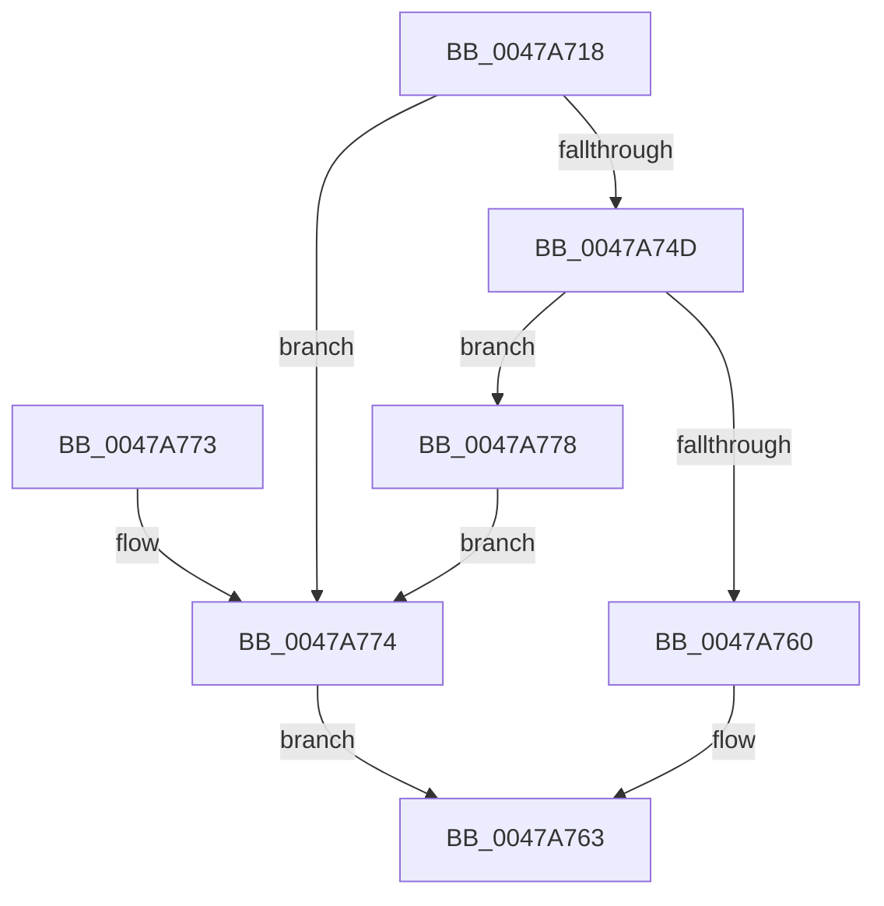

# MiAllocateModWriterEntry

- RVA: `0x0047A718`–`0x0047A784` (길이 `108` bytes)
- VA: `0x000000014047A718`
- 실행 섹션: `.text`
- PDB 이름 있음: `예`; PDB Function 태그: `아니요`
- unwind 정보 RVA: `0x00083408`
- 디코드: `33`개 명령, `108/108` bytes 표시
- 미해석 바이트: `0` (있으면 어셈블리에 `.byte`로 보존)

> 이 문서는 커널 이미지의 기계어와 PDB 기호를 분석해 생성했습니다. 4번과 5번은 함수 원형과 자료형을 바이너리 사용 방식에서 추정한 C 해석이며 원본 소스 복구 결과는 아닙니다.

## 1. Dependencies

- 직접 호출 지점: **3**; 고유 호출 대상: **3**
- 직접 호출자로 확인된 함수: **2**
- RIP 상대 이미지 참조: **0**

### Outgoing calls
- `0x0047A740` → [MiAllocatePool](../35/MiAllocatePool_function_0035B540.md) (function, `0x0035B540`)
- `0x0047A757` → [MiChargeForWriteInProgressPage](../28/MiChargeForWriteInProgressPage_function_00286D60.md) (function, `0x00286D60`)
- `0x0047A77D` → [ExFreePoolWithTag](../../poolcode/B8/ExFreePoolWithTag_function_00B82870.md) (function, `0x00B82870`)

### Direct callers
- [sub_006EC200](../6E/Unknown_function_006EC200.md) at `0x006EC21B`
- [MiCreatePagefile](../../page/7F/MiCreatePagefile_function_007FEC30.md) at `0x007FEEBE`

### Static image references
- 디코드된 RIP-relative 메모리 참조가 없습니다.

## 2. Other-region calls and transfers

- 다른 실행 섹션으로 향하는 call: **1**
  - `0x0047A77D` → [ExFreePoolWithTag](../../poolcode/B8/ExFreePoolWithTag_function_00B82870.md) (`.text` → `POOLCODE`)
- 별도 외부 분기/꼬리 이동을 확인하지 못했습니다.

## 3. Assembly (complete function range)

```asm
0047A718  48 89 5C 24 08                  mov qword ptr [rsp + 8], rbx
0047A71D  48 89 74 24 10                  mov qword ptr [rsp + 0x10], rsi
0047A722  57                              push rdi
0047A723  48 83 EC 20                     sub rsp, 0x20
0047A727  41 8B F8                        mov edi, r8d
0047A72A  48 8D 14 D5 98 00 00 00         lea rdx, [rdx*8 + 0x98]
0047A732  48 8B F1                        mov rsi, rcx
0047A735  41 B8 4D 6D 57 65               mov r8d, 0x65576d4d
0047A73B  B9 40 00 00 00                  mov ecx, 0x40
0047A740  E8 FB 0D EE FF                  call 0x14035b540
0047A745  48 8B D8                        mov rbx, rax
0047A748  48 85 C0                        test rax, rax
0047A74B  74 27                           je 0x14047a774
0047A74D  33 D2                           xor edx, edx
0047A74F  48 8B CE                        mov rcx, rsi
0047A752  85 FF                           test edi, edi
0047A754  0F 95 C2                        setne dl
0047A757  E8 04 C6 E0 FF                  call 0x140286d60
0047A75C  85 C0                           test eax, eax
0047A75E  74 18                           je 0x14047a778
0047A760  48 8B C3                        mov rax, rbx
0047A763  48 8B 5C 24 30                  mov rbx, qword ptr [rsp + 0x30]
0047A768  48 8B 74 24 38                  mov rsi, qword ptr [rsp + 0x38]
0047A76D  48 83 C4 20                     add rsp, 0x20
0047A771  5F                              pop rdi
0047A772  C3                              ret
0047A773  CC                              int3
0047A774  33 C0                           xor eax, eax
0047A776  EB EB                           jmp 0x14047a763
0047A778  33 D2                           xor edx, edx
0047A77A  48 8B CB                        mov rcx, rbx
0047A77D  E8 EE 80 70 00                  call 0x140b82870
0047A782  EB F0                           jmp 0x14047a774
```

## 4. C-style interpretation (structured pseudocode)

```c
__int64 __fastcall MiAllocateModWriterEntry(__int64 a1, __int64 a2, int a3)
{
    __int64 result;
    __int64 v_rsp;
    unsigned __int64 v_stack_p10;
    unsigned __int64 v_stack_p8;

    v_stack_p8 = v_rbx;
    v_stack_p10 = v_rsi;
    v_rsp = (v_rsp) - (32);
    result = MiAllocatePool(64, a2 * 8 + 152, (unsigned int)(0x65576D4DULL), a4);
    if (result == 0) goto loc_0047A774;
    a2 = 0;
    a2 = ((unsigned int)((unsigned int)(a3)) != 0) ? 1 : 0;
    result = MiChargeForWriteInProgressPage(a1, a2, (unsigned int)(0x65576D4DULL), a4);
    if ((unsigned int)(result) == 0) goto loc_0047A778;
loc_0047A763:
    v_rsp = (v_rsp) + (32);
    return result;
loc_0047A774:
    result = 0;
    goto loc_0047A763;
loc_0047A778:
    a2 = 0;
    result = ExFreePoolWithTag(v_stack_p8, a2, (unsigned int)(0x65576D4DULL), a4);
    goto loc_0047A774;
}
```

## 5. (Beta) C Style

```c
int64_t MiAllocateModWriterEntry(int64_t Arg1, int64_t Arg2, int32_t Arg3)
{
    int64_t result;
    int64_t local_rsp;
    uint64_t v_stack_p10;
    uint64_t v_stack_p8;

    v_stack_p8 = local_rbx;
    v_stack_p10 = local_rsi;
    local_rsp = (local_rsp) - (32);
    result = MiAllocatePool(64, Arg2 * 8 + 152, (uint32_t)(0x65576D4DULL), a4);
    if (result == 0) goto loc_0047A774;
    Arg2 = 0;
    Arg2 = ((uint32_t)((uint32_t)(Arg3)) != 0) ? 1 : 0;
    result = MiChargeForWriteInProgressPage(Arg1, Arg2, (uint32_t)(0x65576D4DULL), a4);
    if ((uint32_t)(result) == 0) goto loc_0047A778;
loc_0047A763:
    local_rsp = (local_rsp) + (32);
    return result;
loc_0047A774:
    result = 0;
    goto loc_0047A763;
loc_0047A778:
    Arg2 = 0;
    result = ExFreePoolWithTag(v_stack_p8, Arg2, (uint32_t)(0x65576D4DULL), a4);
    goto loc_0047A774;
}
```

## 6. Execution-region graph

[열기: 2D/3D 그래프와 함수 탐색 컨트롤 패널](../../../control-panel.html?section=text&rva=0x0047A718&view=graph)

- 2D 그래프는 위에서 아래로 흐르고, 3D 그래프는 빈 공간을 드래그해 회전합니다. Shift+드래그는 이동, 휠은 확대·축소, 함수 노드 선택은 대상 보고서 이동입니다.

### Static fallback


