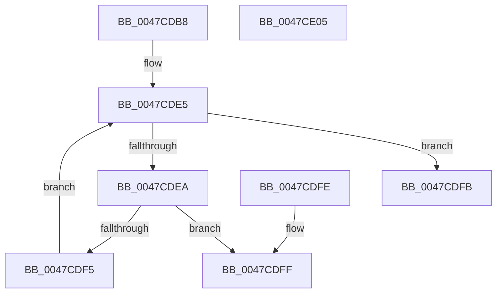

# MiAnyPagesRemovalPending

- RVA: `0x0047CDB8`–`0x0047CE06` (길이 `78` bytes)
- VA: `0x000000014047CDB8`
- 실행 섹션: `.text`
- PDB 이름 있음: `예`; PDB Function 태그: `아니요`
- unwind 정보 RVA: `0x000DB714`
- 디코드: `24`개 명령, `78/78` bytes 표시
- 미해석 바이트: `0` (있으면 어셈블리에 `.byte`로 보존)

> 이 문서는 커널 이미지의 기계어와 PDB 기호를 분석해 생성했습니다. 4번과 5번은 함수 원형과 자료형을 바이너리 사용 방식에서 추정한 C 해석이며 원본 소스 복구 결과는 아닙니다.

## 1. Dependencies

- 직접 호출 지점: **0**; 고유 호출 대상: **0**
- 직접 호출자로 확인된 함수: **3**
- RIP 상대 이미지 참조: **1**

### Outgoing calls
- 직접 디코드된 call 명령이 없습니다.

### Direct callers
- [MiConvertSmallPageRangeToLarge](../34/MiConvertSmallPageRangeToLarge_function_003484DC.md) at `0x003485BE`
- [sub_00435958](../43/Unknown_function_00435958.md) at `0x0043597C`
- [MiSetPfnRemovalRequested](../67/MiSetPfnRemovalRequested_function_0067A4D0.md) at `0x0067A600`

### Static image references
- `0x0047CDCD` → RVA `0x00011C60` (`.rdata`; read)

## 2. Other-region calls and transfers

- 다른 실행 섹션으로 향하는 call: **0**
- 별도 외부 분기/꼬리 이동을 확인하지 못했습니다.

## 3. Assembly (complete function range)

```asm
0047CDB8  4C 8D 04 49                     lea r8, [rcx + rcx*2]
0047CDBC  49 C1 E0 04                     shl r8, 4
0047CDC0  48 B8 00 00 00 00 00 DE FF FF   movabs rax, 0xffffde0000000000
0047CDCA  4C 03 C0                        add r8, rax
0047CDCD  48 8D 0D 8C 4E B9 FF            lea rcx, [rip - 0x46b174]
0047CDD4  8B C2                           mov eax, edx
0047CDD6  48 8B 04 C1                     mov rax, qword ptr [rcx + rax*8]
0047CDDA  48 8D 0C 40                     lea rcx, [rax + rax*2]
0047CDDE  48 C1 E1 04                     shl rcx, 4
0047CDE2  49 03 C8                        add rcx, r8
0047CDE5  4C 3B C1                        cmp r8, rcx
0047CDE8  73 11                           jae 0x14047cdfb
0047CDEA  41 8B 40 20                     mov eax, dword ptr [r8 + 0x20]
0047CDEE  C1 E8 18                        shr eax, 0x18
0047CDF1  A8 40                           test al, 0x40
0047CDF3  75 0A                           jne 0x14047cdff
0047CDF5  49 83 C0 30                     add r8, 0x30
0047CDF9  EB EA                           jmp 0x14047cde5
0047CDFB  33 C0                           xor eax, eax
0047CDFD  C3                              ret
0047CDFE  CC                              int3
0047CDFF  B8 01 00 00 00                  mov eax, 1
0047CE04  C3                              ret
0047CE05  CC                              int3
```

## 4. C-style interpretation (structured pseudocode)

```c
__int64 __fastcall MiAnyPagesRemovalPending(__int64 a1, int a2)
{
    __int64 result;

    a3 = (a1 + a1 * 2) << (4);
    a3 = (a3) + (result);
    a1 = (*(unsigned __int64 *)(v_rip - 4632948 + (unsigned int)(a2) * 8) + *(unsigned __int64 *)(v_rip - 4632948 + (unsigned int)(a2) * 8) * 2) << (4);
    a1 = (a1) + (a3);
loc_0047CDE5:
    if (a3 >= a1) goto loc_0047CDFB;
    result = (unsigned int)(((unsigned int)(*(unsigned int *)(a3 + 32))) >> (24));
    if ((((unsigned __int8)(result)) & (64)) != 0) goto loc_0047CDFF;
    a3 = (a3) + (48);
    goto loc_0047CDE5;
loc_0047CDFB:
    result = 0;
    return result;
loc_0047CDFF:
    return 1;
}
```

## 5. (Beta) C Style

```c
int64_t MiAnyPagesRemovalPending(void *Arg1, int32_t Arg2)
{
    uint8_t *arg1 = (uint8_t *)Arg1;

    int64_t result;

    a3 = (Arg1 + Arg1 * 2) << (4);
    a3 = (a3) + (result);
    Arg1 = (*(uint64_t *)(v_rip - 0x46B174 + (uint32_t)(Arg2) * 8) + *(uint64_t *)(v_rip - 0x46B174 + (uint32_t)(Arg2) * 8) * 2) << (4);
    Arg1 = (Arg1) + (a3);
loc_0047CDE5:
    if (a3 >= Arg1) goto loc_0047CDFB;
    result = (uint32_t)(((uint32_t)(*(uint32_t *)(a3 + 0x20))) >> (24));
    if ((((uint8_t)(result)) & (64)) != 0) goto loc_0047CDFF;
    a3 = (a3) + (48);
    goto loc_0047CDE5;
loc_0047CDFB:
    result = 0;
    return result;
loc_0047CDFF:
    return 1;
}
```

### 관측된 메모리 오프셋

구조체 형식이 확인되지 않은 접근은 인자 기준의 오프셋으로만 기록했습니다.

| 기준 인자 | 오프셋 표현 | 폭 (bit) | 접근 |
|---|---:|---:|---|
| `Arg1` | `+ 0x0 + rcx*2` | `64` | `R` |

## 6. Execution-region graph

[열기: 2D/3D 그래프와 함수 탐색 컨트롤 패널](../../../control-panel.html?section=text&rva=0x0047CDB8&view=graph)

- 2D 그래프는 위에서 아래로 흐르고, 3D 그래프는 빈 공간을 드래그해 회전합니다. Shift+드래그는 이동, 휠은 확대·축소, 함수 노드 선택은 대상 보고서 이동입니다.

### Static fallback


