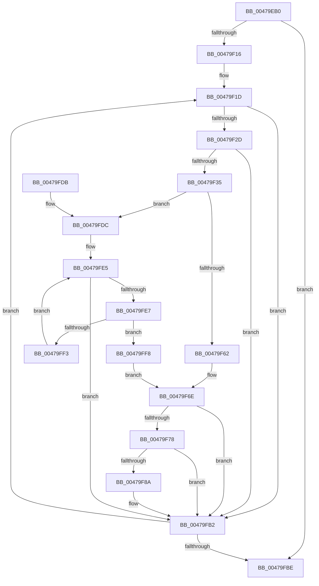

# MiAttemptCoalesce

- RVA: `0x00479EB0`–`0x0047A009` (길이 `345` bytes)
- VA: `0x0000000140479EB0`
- 실행 섹션: `.text`
- PDB 이름 있음: `예`; PDB Function 태그: `아니요`
- unwind 정보 RVA: `0x000AD010`
- 디코드: `105`개 명령, `345/345` bytes 표시
- 미해석 바이트: `0` (있으면 어셈블리에 `.byte`로 보존)

> 이 문서는 커널 이미지의 기계어와 PDB 기호를 분석해 생성했습니다. 4번과 5번은 함수 원형과 자료형을 바이너리 사용 방식에서 추정한 C 해석이며 원본 소스 복구 결과는 아닙니다.

## 1. Dependencies

- 직접 호출 지점: **2**; 고유 호출 대상: **2**
- 직접 호출자로 확인된 함수: **2**
- RIP 상대 이미지 참조: **0**

### Outgoing calls
- `0x00479F81` → [RtlInterlockedSetClearRunEx](../23/RtlInterlockedSetClearRunEx_function_00238660.md) (function, `0x00238660`)
- `0x00479FAD` → [MiReturnSystemPtes](../23/MiReturnSystemPtes_function_002385C0.md) (function, `0x002385C0`)

### Direct callers
- [MiReleasePtes](../24/MiReleasePtes_function_00247240.md) at `0x00247742`
- [MiAdjustPteBins](../46/MiAdjustPteBins_function_0046410C.md) at `0x00464218`

### Static image references
- 디코드된 RIP-relative 메모리 참조가 없습니다.

## 2. Other-region calls and transfers

- 다른 실행 섹션으로 향하는 call: **0**
- 별도 외부 분기/꼬리 이동을 확인하지 못했습니다.

## 3. Assembly (complete function range)

```asm
00479EB0  48 89 5C 24 08                  mov qword ptr [rsp + 8], rbx
00479EB5  48 89 6C 24 10                  mov qword ptr [rsp + 0x10], rbp
00479EBA  48 89 74 24 18                  mov qword ptr [rsp + 0x18], rsi
00479EBF  57                              push rdi
00479EC0  41 54                           push r12
00479EC2  41 55                           push r13
00479EC4  41 56                           push r14
00479EC6  41 57                           push r15
00479EC8  48 83 EC 20                     sub rsp, 0x20
00479ECC  44 8B 69 28                     mov r13d, dword ptr [rcx + 0x28]
00479ED0  4D 8D 78 FF                     lea r15, [r8 - 1]
00479ED4  41 83 E5 01                     and r13d, 1
00479ED8  48 8B F1                        mov rsi, rcx
00479EDB  41 8B C5                        mov eax, r13d
00479EDE  BD 00 00 00 00                  mov ebp, 0
00479EE3  F7 D8                           neg eax
00479EE5  48 1B DB                        sbb rbx, rbx
00479EE8  48 81 E3 20 FE FF FF            and rbx, 0xfffffffffffffe20
00479EEF  48 81 C3 00 02 00 00            add rbx, 0x200
00479EF6  4C 8D 43 FF                     lea r8, [rbx - 1]
00479EFA  49 F7 D0                        not r8
00479EFD  48 8D 04 13                     lea rax, [rbx + rdx]
00479F01  4C 03 F8                        add r15, rax
00479F04  4D 8B E0                        mov r12, r8
00479F07  4C 23 E2                        and r12, rdx
00479F0A  4D 23 F8                        and r15, r8
00479F0D  4D 2B FC                        sub r15, r12
00479F10  0F 84 A8 00 00 00               je 0x140479fbe
00479F16  44 8D 75 40                     lea r14d, [rbp + 0x40]
00479F1A  4C 2B F3                        sub r14, rbx
00479F1D  48 8B 06                        mov rax, qword ptr [rsi]
00479F20  49 8D 3C 2C                     lea rdi, [r12 + rbp]
00479F24  48 3B F8                        cmp rdi, rax
00479F27  0F 83 85 00 00 00               jae 0x140479fb2
00479F2D  48 2B C7                        sub rax, rdi
00479F30  48 3B C3                        cmp rax, rbx
00479F33  72 7D                           jb 0x140479fb2
00479F35  48 8B 4E 08                     mov rcx, qword ptr [rsi + 8]
00479F39  4C 8D 57 FF                     lea r10, [rdi - 1]
00479F3D  4C 03 D3                        add r10, rbx
00479F40  48 8B C7                        mov rax, rdi
00479F43  48 C1 E8 06                     shr rax, 6
00479F47  48 8D 14 C1                     lea rdx, [rcx + rax*8]
00479F4B  49 8B C2                        mov rax, r10
00479F4E  4C 8B 02                        mov r8, qword ptr [rdx]
00479F51  48 C1 E8 06                     shr rax, 6
00479F55  4C 8D 0C C1                     lea r9, [rcx + rax*8]
00479F59  48 83 C8 FF                     or rax, 0xffffffffffffffff
00479F5D  49 3B D1                        cmp rdx, r9
00479F60  75 7A                           jne 0x140479fdc
00479F62  49 8B CE                        mov rcx, r14
00479F65  48 D3 E8                        shr rax, cl
00479F68  48 8B CF                        mov rcx, rdi
00479F6B  48 D3 E0                        shl rax, cl
00479F6E  4C 85 C0                        test rax, r8
00479F71  0F 94 C0                        sete al
00479F74  84 C0                           test al, al
00479F76  74 3A                           je 0x140479fb2
00479F78  4C 8B C3                        mov r8, rbx
00479F7B  48 8B D7                        mov rdx, rdi
00479F7E  48 8B CE                        mov rcx, rsi
00479F81  E8 DA E6 DB FF                  call 0x140238660
00479F86  85 C0                           test eax, eax
00479F88  74 28                           je 0x140479fb2
00479F8A  41 8B C5                        mov eax, r13d
00479F8D  F7 D8                           neg eax
00479F8F  48 1B C9                        sbb rcx, rcx
00479F92  48 83 E1 F1                     and rcx, 0xfffffffffffffff1
00479F96  48 FF C9                        dec rcx
00479F99  48 0F AF CB                     imul rcx, rbx
00479F9D  F0 48 01 4E 58                  lock add qword ptr [rsi + 0x58], rcx
00479FA2  4C 8B CB                        mov r9, rbx
00479FA5  4C 8B C7                        mov r8, rdi
00479FA8  33 D2                           xor edx, edx
00479FAA  48 8B CE                        mov rcx, rsi
00479FAD  E8 0E E6 DB FF                  call 0x1402385c0
00479FB2  48 03 EB                        add rbp, rbx
00479FB5  49 3B EF                        cmp rbp, r15
00479FB8  0F 82 5F FF FF FF               jb 0x140479f1d
00479FBE  48 8B 5C 24 50                  mov rbx, qword ptr [rsp + 0x50]
00479FC3  48 8B 6C 24 58                  mov rbp, qword ptr [rsp + 0x58]
00479FC8  48 8B 74 24 60                  mov rsi, qword ptr [rsp + 0x60]
00479FCD  48 83 C4 20                     add rsp, 0x20
00479FD1  41 5F                           pop r15
00479FD3  41 5E                           pop r14
00479FD5  41 5D                           pop r13
00479FD7  41 5C                           pop r12
00479FD9  5F                              pop rdi
00479FDA  C3                              ret
00479FDB  CC                              int3
00479FDC  48 8B CF                        mov rcx, rdi
00479FDF  48 D3 E0                        shl rax, cl
00479FE2  4C 85 C0                        test rax, r8
00479FE5  75 CB                           jne 0x140479fb2
00479FE7  48 83 C2 08                     add rdx, 8
00479FEB  4C 8B 02                        mov r8, qword ptr [rdx]
00479FEE  49 3B D1                        cmp rdx, r9
00479FF1  74 05                           je 0x140479ff8
00479FF3  4D 85 C0                        test r8, r8
00479FF6  EB ED                           jmp 0x140479fe5
00479FF8  41 8A CA                        mov cl, r10b
00479FFB  48 83 C8 FF                     or rax, 0xffffffffffffffff
00479FFF  F6 D1                           not cl
0047A001  48 D3 E8                        shr rax, cl
0047A004  E9 65 FF FF FF                  jmp 0x140479f6e
```

## 4. C-style interpretation (structured pseudocode)

```c
__int64 __fastcall MiAttemptCoalesce(__int64 a1, __int64 a2, __int64 a3)
{
    __int64 result;
    __int64 v_r10;
    __int64 v_r12;
    __int64 v_r13;
    __int64 v_r14;
    __int64 v_r15;
    __int64 v_rbp;
    __int64 v_rbx;
    __int64 v_rsp;
    unsigned __int64 v_stack_p10;
    unsigned __int64 v_stack_p18;
    unsigned __int64 v_stack_p8;

    v_stack_p8 = v_rbx;
    v_stack_p10 = v_rbp;
    v_stack_p18 = v_rsi;
    v_rsp = (v_rsp) - (32);
    v_r13 = (unsigned int)(((unsigned int)(*(unsigned int *)(a1 + 40))) & (1));
    result = (unsigned int)(-((unsigned int)((unsigned int)(v_r13))));
    v_rbx = (v_rbx) & (-480);
    v_rbx = (v_rbx) + (512);
    a3 = ~(v_rbx - 1);
    v_r15 = (a3 - 1) + (v_rbx + a2 * 1);
    v_r12 = (a3) & (a2);
    v_r15 = (v_r15) & (a3);
    v_r15 = (v_r15) - (v_r12);
    if (condition_is_equal) goto loc_00479FBE;
    v_r14 = (0 + 64) - (v_rbx);
loc_00479F1D:
    if ((v_r12 + 0 * 1) >= (*(unsigned __int64 *)(a1))) goto loc_00479FB2;
    result = (*(unsigned __int64 *)(a1)) - (v_r12 + 0 * 1);
    if (result < v_rbx) goto loc_00479FB2;
    v_r10 = (v_r12 + 0 * 1 - 1) + (v_rbx);
    result = (v_r12 + 0 * 1) >> (6);
    result = (v_r10) >> (6);
    result = (result) | (-1);
    if ((*(unsigned __int64 *)(a1 + 8) + result * 8) != (*(unsigned __int64 *)(a1 + 8) + result * 8)) goto loc_00479FDC;
    result = (result) >> ((unsigned __int8)(v_r14));
    result = (result) << ((unsigned __int8)(v_r12 + 0 * 1));
loc_00479F6E:
    result = (((result) & (*(unsigned __int64 *)(*(unsigned __int64 *)(a1 + 8) + result * 8))) == 0) ? 1 : 0;
    if ((unsigned __int8)(result) == 0) goto loc_00479FB2;
    result = RtlInterlockedSetClearRunEx(a1, v_r12 + 0 * 1, v_rbx, *(unsigned __int64 *)(a1 + 8) + result * 8);
    if ((unsigned int)(result) != 0) {
        result = (unsigned int)(v_r13);
        result = (unsigned int)(-(result));
        a1 = (a1) & (-15);
        a1 = (a1) - 1;
        a1 = (a1) * (v_rbx);
        a4 = v_rbx;
        a3 = v_r12 + 0 * 1;
        a2 = 0;
        a1 = a1;
        result = MiReturnSystemPtes(a1, a2, a3, a4);
    }
    v_rbp = (0) + (v_rbx);
    if (v_rbp < v_r15) goto loc_00479F1D;
loc_00479FBE:
    v_rsp = (v_rsp) + (32);
    return result;
loc_00479FDC:
    result = (result) << ((unsigned __int8)(v_r12 + 0 * 1));
loc_00479FE5:
    if (((result) & (a3)) != 0) goto loc_00479FB2;
    a2 = (a2) + (8);
    if (a2 == a4) goto loc_00479FF8;
    goto loc_00479FE5;
loc_00479FF8:
    result = (result) | (-1);
    a1 = (unsigned __int8)(~((unsigned __int8)(v_r10)));
    result = (result) >> ((unsigned __int8)(a1));
    goto loc_00479F6E;
}
```

## 5. (Beta) C Style

```c
int64_t MiAttemptCoalesce(void *Arg1, int64_t Arg2, void *Arg3)
{
    uint8_t *arg1 = (uint8_t *)Arg1;
    uint8_t *arg3 = (uint8_t *)Arg3;

    int64_t result;
    int64_t local_r10;
    int64_t local_r12;
    int64_t local_r13;
    int64_t local_r14;
    int64_t local_r15;
    int64_t local_rbp;
    int64_t local_rbx;
    int64_t local_rsp;
    uint64_t v_stack_p10;
    uint64_t v_stack_p18;
    uint64_t v_stack_p8;

    v_stack_p8 = local_rbx;
    v_stack_p10 = local_rbp;
    v_stack_p18 = local_rsi;
    local_rsp = (local_rsp) - (32);
    local_r13 = (uint32_t)(((uint32_t)(*(uint32_t *)(arg1 + 0x28))) & (1));
    result = (uint32_t)(-((uint32_t)((uint32_t)(local_r13))));
    local_rbx = (local_rbx) & (-480);
    local_rbx = (local_rbx) + (512);
    Arg3 = ~(local_rbx - 1);
    local_r15 = (Arg3 - 1) + (local_rbx + Arg2 * 1);
    local_r12 = (Arg3) & (Arg2);
    local_r15 = (local_r15) & (Arg3);
    local_r15 = (local_r15) - (local_r12);
    if (condition_is_equal) goto loc_00479FBE;
    local_r14 = (0 + 64) - (local_rbx);
loc_00479F1D:
    if ((local_r12 + 0 * 1) >= (*(uint64_t *)(arg1))) goto loc_00479FB2;
    result = (*(uint64_t *)(arg1)) - (local_r12 + 0 * 1);
    if (result < local_rbx) goto loc_00479FB2;
    local_r10 = (local_r12 + 0 * 1 - 1) + (local_rbx);
    result = (local_r12 + 0 * 1) >> (6);
    result = (local_r10) >> (6);
    result = (result) | (-1);
    if ((*(uint64_t *)(arg1 + 0x8) + result * 8) != (*(uint64_t *)(arg1 + 0x8) + result * 8)) goto loc_00479FDC;
    result = (result) >> ((uint8_t)(local_r14));
    result = (result) << ((uint8_t)(local_r12 + 0 * 1));
loc_00479F6E:
    result = (((result) & (*(uint64_t *)(*(uint64_t *)(arg1 + 0x8) + result * 8))) == 0) ? 1 : 0;
    if ((uint8_t)(result) == 0) goto loc_00479FB2;
    result = RtlInterlockedSetClearRunEx(Arg1, local_r12 + 0 * 1, local_rbx, *(uint64_t *)(arg1 + 0x8) + result * 8);
    if ((uint32_t)(result) != 0) {
        result = (uint32_t)(local_r13);
        result = (uint32_t)(-(result));
        Arg1 = (Arg1) & (-15);
        Arg1 = (Arg1) - 1;
        Arg1 = (Arg1) * (local_rbx);
        a4 = local_rbx;
        Arg3 = local_r12 + 0 * 1;
        Arg2 = 0;
        Arg1 = Arg1;
        result = MiReturnSystemPtes(Arg1, Arg2, Arg3, a4);
    }
    local_rbp = (0) + (local_rbx);
    if (local_rbp < local_r15) goto loc_00479F1D;
loc_00479FBE:
    local_rsp = (local_rsp) + (32);
    return result;
loc_00479FDC:
    result = (result) << ((uint8_t)(local_r12 + 0 * 1));
loc_00479FE5:
    if (((result) & (Arg3)) != 0) goto loc_00479FB2;
    Arg2 = (Arg2) + (8);
    if (Arg2 == a4) goto loc_00479FF8;
    goto loc_00479FE5;
loc_00479FF8:
    result = (result) | (-1);
    Arg1 = (uint8_t)(~((uint8_t)(local_r10)));
    result = (result) >> ((uint8_t)(Arg1));
    goto loc_00479F6E;
}
```

### 관측된 메모리 오프셋

구조체 형식이 확인되지 않은 접근은 인자 기준의 오프셋으로만 기록했습니다.

| 기준 인자 | 오프셋 표현 | 폭 (bit) | 접근 |
|---|---:|---:|---|
| `Arg1` | `+ 0x0` | `64` | `R` |
| `Arg1` | `+ 0x8` | `64` | `R` |
| `Arg1` | `+ 0x28` | `32` | `R` |
| `Arg1` | `+ 0x58` | `64` | `R/W` |
| `Arg3` | `- 0x1` | `64` | `R` |

## 6. Execution-region graph

[열기: 2D/3D 그래프와 함수 탐색 컨트롤 패널](../../../control-panel.html?section=text&rva=0x00479EB0&view=graph)

- 2D 그래프는 위에서 아래로 흐르고, 3D 그래프는 빈 공간을 드래그해 회전합니다. Shift+드래그는 이동, 휠은 확대·축소, 함수 노드 선택은 대상 보고서 이동입니다.

### Static fallback


