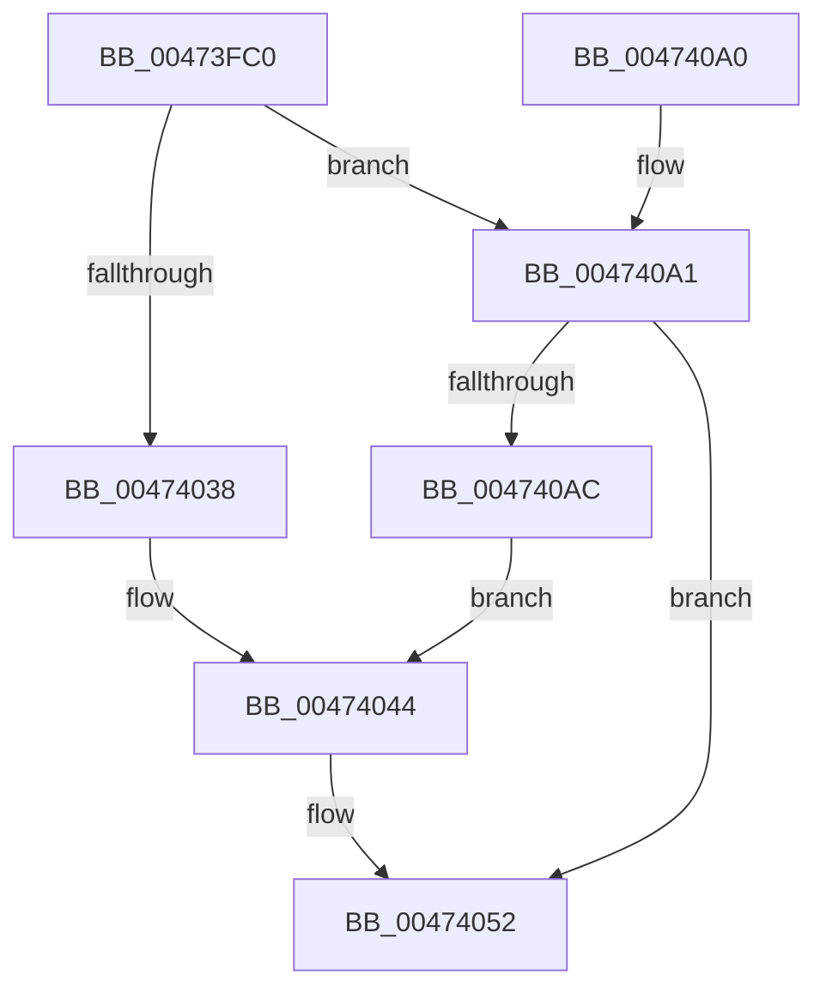

# MiCaptureAndResetWorkingSetAccessBits

- RVA: `0x00473FC0`–`0x004740BC` (길이 `252` bytes)
- VA: `0x0000000140473FC0`
- 실행 섹션: `.text`
- PDB 이름 있음: `예`; PDB Function 태그: `아니요`
- unwind 정보 RVA: `0x000AC6BC`
- 디코드: `64`개 명령, `252/252` bytes 표시
- 미해석 바이트: `0` (있으면 어셈블리에 `.byte`로 보존)

> 이 문서는 커널 이미지의 기계어와 PDB 기호를 분석해 생성했습니다. 4번과 5번은 함수 원형과 자료형을 바이너리 사용 방식에서 추정한 C 해석이며 원본 소스 복구 결과는 아닙니다.

## 1. Dependencies

- 직접 호출 지점: **4**; 고유 호출 대상: **4**
- 직접 호출자로 확인된 함수: **1**
- RIP 상대 이미지 참조: **3**

### Outgoing calls
- `0x00473FFB` → [memset](../6C/memset_function_006C6C40.md) (function, `0x006C6C40`)
- `0x00474064` → [MiVmAccessLoggingEnabled](../36/MiVmAccessLoggingEnabled_function_003629D4.md) (function, `0x003629D4`)
- `0x0047407A` → [MiWalkPageTables](../2C/MiWalkPageTables_function_002C2710.md) (function, `0x002C2710`)
- `0x00474082` → [MiDrainSystemAccessLog](MiDrainSystemAccessLog_function_00474144.md) (function, `0x00474144`)

### Direct callers
- [MiTrimOrAgeWorkingSet](../34/MiTrimOrAgeWorkingSet_function_0034EFC0.md) at `0x0034F20D`

### Static image references
- `0x00474005` → RVA `0x0022A800` (`MiResetAccessBitPte`; read)
- `0x00474015` → RVA `0x004A6820` (`MiResetAccessBitsTail`; read)
- `0x004740A1` → RVA `0x00FC6A88` (`ALMOSTRO`; read)

## 2. Other-region calls and transfers

- 다른 실행 섹션으로 향하는 call: **0**
- 별도 외부 분기/꼬리 이동을 확인하지 못했습니다.

## 3. Assembly (complete function range)

```asm
00473FC0  48 8B C4                        mov rax, rsp
00473FC3  48 89 58 08                     mov qword ptr [rax + 8], rbx
00473FC7  48 89 70 10                     mov qword ptr [rax + 0x10], rsi
00473FCB  48 89 78 18                     mov qword ptr [rax + 0x18], rdi
00473FCF  55                              push rbp
00473FD0  48 8D 68 A1                     lea rbp, [rax - 0x5f]
00473FD4  48 81 EC 00 01 00 00            sub rsp, 0x100
00473FDB  0F 57 C0                        xorps xmm0, xmm0
00473FDE  41 8B F0                        mov esi, r8d
00473FE1  8A DA                           mov bl, dl
00473FE3  48 8B F9                        mov rdi, rcx
00473FE6  33 D2                           xor edx, edx
00473FE8  48 8D 4D 97                     lea rcx, [rbp - 0x69]
00473FEC  41 B8 C0 00 00 00               mov r8d, 0xc0
00473FF2  0F 11 44 24 20                  movups xmmword ptr [rsp + 0x20], xmm0
00473FF7  0F 11 45 87                     movups xmmword ptr [rbp - 0x79], xmm0
00473FFB  E8 40 2C 25 00                  call 0x1406c6c40
00474000  48 83 4D C7 FF                  or qword ptr [rbp - 0x39], 0xffffffffffffffff
00474005  48 8D 05 F4 67 DB FF            lea rax, [rip - 0x24980c]
0047400C  48 89 45 3F                     mov qword ptr [rbp + 0x3f], rax
00474010  BA 01 00 00 00                  mov edx, 1
00474015  48 8D 05 04 28 03 00            lea rax, [rip + 0x32804]
0047401C  C7 45 97 06 00 00 00            mov dword ptr [rbp - 0x69], 6
00474023  48 89 45 47                     mov qword ptr [rbp + 0x47], rax
00474027  8B 87 B8 00 00 00               mov eax, dword ptr [rdi + 0xb8]
0047402D  48 89 7D B7                     mov qword ptr [rbp - 0x49], rdi
00474031  88 5D A0                        mov byte ptr [rbp - 0x60], bl
00474034  A8 0F                           test al, 0xf
00474036  75 69                           jne 0x1404740a1
00474038  33 C9                           xor ecx, ecx
0047403A  48 39 8F 70 02 00 00            cmp qword ptr [rdi + 0x270], rcx
00474041  0F 95 C1                        setne cl
00474044  48 8B 45 8F                     mov rax, qword ptr [rbp - 0x71]
00474048  85 C9                           test ecx, ecx
0047404A  48 0F 45 C2                     cmovne rax, rdx
0047404E  48 89 45 8F                     mov qword ptr [rbp - 0x71], rax
00474052  8B 44 24 24                     mov eax, dword ptr [rsp + 0x24]
00474056  40 F6 C6 10                     test sil, 0x10
0047405A  48 8B CF                        mov rcx, rdi
0047405D  0F 45 C2                        cmovne eax, edx
00474060  89 44 24 24                     mov dword ptr [rsp + 0x24], eax
00474064  E8 6B E9 EE FF                  call 0x1403629d4
00474069  89 44 24 20                     mov dword ptr [rsp + 0x20], eax
0047406D  48 8D 4D 97                     lea rcx, [rbp - 0x69]
00474071  48 8D 44 24 20                  lea rax, [rsp + 0x20]
00474076  48 89 45 4F                     mov qword ptr [rbp + 0x4f], rax
0047407A  E8 91 E6 E4 FF                  call 0x1402c2710
0047407F  48 8B CF                        mov rcx, rdi
00474082  E8 BD 00 00 00                  call 0x140474144
00474087  4C 8D 9C 24 00 01 00 00         lea r11, [rsp + 0x100]
0047408F  49 8B 5B 10                     mov rbx, qword ptr [r11 + 0x10]
00474093  49 8B 73 18                     mov rsi, qword ptr [r11 + 0x18]
00474097  49 8B 7B 20                     mov rdi, qword ptr [r11 + 0x20]
0047409B  49 8B E3                        mov rsp, r11
0047409E  5D                              pop rbp
0047409F  C3                              ret
004740A0  CC                              int3
004740A1  48 0F BA 25 DE 29 B5 00 24      bt qword ptr [rip + 0xb529de], 0x24
004740AA  73 A6                           jae 0x140474052
004740AC  8B 8F B8 00 00 00               mov ecx, dword ptr [rdi + 0xb8]
004740B2  C1 E9 08                        shr ecx, 8
004740B5  C1 E9 03                        shr ecx, 3
004740B8  23 CA                           and ecx, edx
004740BA  EB 88                           jmp 0x140474044
```

## 4. C-style interpretation (structured pseudocode)

```c
__int64 __fastcall MiCaptureAndResetWorkingSetAccessBits(__int64 a1, int a2, int a3)
{
    __int64 result;
    __int64 v_rsp;
    unsigned __int64 v_stack_m8;
    unsigned int v_stack_mE4;
    unsigned __int64 v_stack_mE8;

    *(unsigned __int64 *)(v_rsp + 8) = v_rbx;
    *(unsigned __int64 *)(v_rsp + 16) = v_rsi;
    *(unsigned __int64 *)(v_rsp + 24) = v_rdi;
    v_rsp = (v_rsp) - (256);
    a2 = 0;
    v_stack_mE8 = v_xmm0;
    *(unsigned __int64 *)(v_rsp - 95 - 121) = v_xmm0;
    result = memset(v_rsp - 95 - 105, a2, 192, a4);
    *(unsigned __int64 *)(v_rsp - 95 + 63) = v_rip - 2398220;
    *(unsigned int *)(v_rsp - 95 - 105) = 6;
    *(unsigned __int64 *)(v_rsp - 95 + 71) = v_rip + 206852;
    *(unsigned __int64 *)(v_rsp - 95 - 73) = a1;
    *(unsigned __int8 *)(v_rsp - 95 - 96) = (unsigned __int8)((unsigned __int8)(a2));
    if ((((unsigned __int8)((unsigned int)(*(unsigned int *)(a1 + 184)))) & (15)) != 0) goto loc_004740A1;
    a1 = 0;
    a1 = ((*(unsigned __int64 *)(a1 + 624)) != 0) ? 1 : 0;
loc_00474044:
    result = *(unsigned __int64 *)(v_rsp - 95 - 113);
    if ((unsigned int)(a1) != 0) { result = 1; }
    *(unsigned __int64 *)(v_rsp - 95 - 113) = result;
loc_00474052:
    result = (unsigned int)(v_stack_mE4);
    if ((((unsigned __int8)((unsigned int)(a3))) & (16)) != 0) { result = 1; }
    v_stack_mE4 = (unsigned int)(result);
    result = MiVmAccessLoggingEnabled(a1, 1, 192, a4);
    v_stack_mE8 = (unsigned int)(result);
    *(unsigned __int64 *)(v_rsp - 95 + 79) = v_stack_mE8;
    result = MiWalkPageTables(v_rsp - 95 - 105, 1, 192, a4);
    result = MiDrainSystemAccessLog(a1, 1, 192, a4);
    return result;
loc_004740A1:
    if (condition_is_above_or_equal) goto loc_00474052;
    a1 = (unsigned int)(((unsigned int)(*(unsigned int *)(*(unsigned __int64 *)(v_stack_m8 + 32) + 184))) >> (8));
    a1 = (unsigned int)((a1) >> (3));
    a1 = (unsigned int)((a1) & (1));
    goto loc_00474044;
}
```

## 5. (Beta) C Style

```c
int64_t MiCaptureAndResetWorkingSetAccessBits(void *Arg1, int32_t Arg2, int32_t Arg3)
{
    uint8_t *arg1 = (uint8_t *)Arg1;

    int64_t result;
    int64_t local_rsp;
    uint64_t v_stack_m8;
    uint32_t v_stack_mE4;
    uint64_t v_stack_mE8;

    *(uint64_t *)(local_rsp + 0x8) = local_rbx;
    *(uint64_t *)(local_rsp + 0x10) = local_rsi;
    *(uint64_t *)(local_rsp + 0x18) = local_rdi;
    local_rsp = (local_rsp) - (256);
    Arg2 = 0;
    v_stack_mE8 = v_xmm0;
    *(uint64_t *)(local_rsp - 0x5F - 0x79) = v_xmm0;
    result = memset(local_rsp - 95 - 105, Arg2, 192, a4);
    *(uint64_t *)(local_rsp - 0x5F + 0x3F) = v_rip - 2398220;
    *(uint32_t *)(local_rsp - 0x5F - 0x69) = 6;
    *(uint64_t *)(local_rsp - 0x5F + 0x47) = v_rip + 206852;
    *(void **)(local_rsp - 0x5F - 0x49) = Arg1;
    *(uint8_t *)(local_rsp - 0x5F - 0x60) = (uint8_t)((uint8_t)(Arg2));
    if ((((uint8_t)((uint32_t)(*(uint32_t *)(arg1 + 0xB8)))) & (15)) != 0) goto loc_004740A1;
    Arg1 = 0;
    Arg1 = ((*(uint64_t *)(arg1 + 0x270)) != 0) ? 1 : 0;
loc_00474044:
    result = *(uint64_t *)(local_rsp - 0x5F - 0x71);
    if ((uint32_t)(Arg1) != 0) { result = 1; }
    *(uint64_t *)(local_rsp - 0x5F - 0x71) = result;
loc_00474052:
    result = (uint32_t)(v_stack_mE4);
    if ((((uint8_t)((uint32_t)(Arg3))) & (16)) != 0) { result = 1; }
    v_stack_mE4 = (uint32_t)(result);
    result = MiVmAccessLoggingEnabled(Arg1, 1, 192, a4);
    v_stack_mE8 = (uint32_t)(result);
    *(uint64_t *)(local_rsp - 0x5F + 0x4F) = v_stack_mE8;
    result = MiWalkPageTables(local_rsp - 95 - 105, 1, 192, a4);
    result = MiDrainSystemAccessLog(Arg1, 1, 192, a4);
    return result;
loc_004740A1:
    if (condition_is_above_or_equal) goto loc_00474052;
    Arg1 = (uint32_t)(((uint32_t)(*(uint32_t *)(*(uint64_t *)(v_stack_m8 + 0x20) + 0xB8))) >> (8));
    Arg1 = (uint32_t)((Arg1) >> (3));
    Arg1 = (uint32_t)((Arg1) & (1));
    goto loc_00474044;
}
```

### 관측된 메모리 오프셋

구조체 형식이 확인되지 않은 접근은 인자 기준의 오프셋으로만 기록했습니다.

| 기준 인자 | 오프셋 표현 | 폭 (bit) | 접근 |
|---|---:|---:|---|
| `Arg1` | `+ 0xB8` | `32` | `R` |
| `Arg1` | `+ 0x270` | `64` | `R` |

## 6. Execution-region graph

[열기: 2D/3D 그래프와 함수 탐색 컨트롤 패널](../../../control-panel.html?section=text&rva=0x00473FC0&view=graph)

- 2D 그래프는 위에서 아래로 흐르고, 3D 그래프는 빈 공간을 드래그해 회전합니다. Shift+드래그는 이동, 휠은 확대·축소, 함수 노드 선택은 대상 보고서 이동입니다.

### Static fallback


