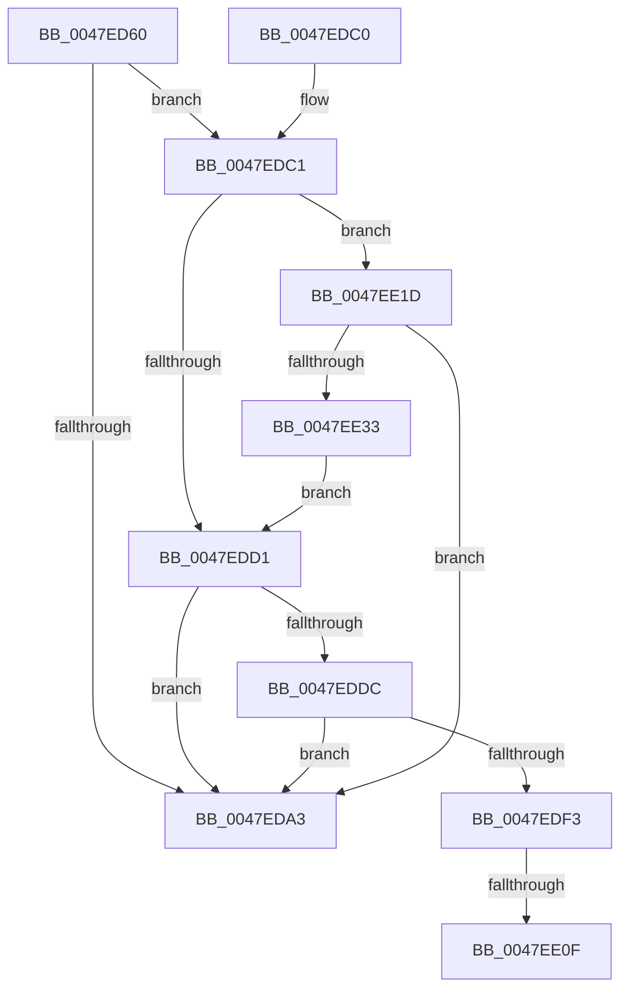

# MiCheckFreeModifiedReservations

- RVA: `0x0047ED60`–`0x0047EE35` (길이 `213` bytes)
- VA: `0x000000014047ED60`
- 실행 섹션: `.text`
- PDB 이름 있음: `예`; PDB Function 태그: `예`
- unwind 정보 RVA: `0x000AE04C`
- 디코드: `57`개 명령, `213/213` bytes 표시
- 미해석 바이트: `0` (있으면 어셈블리에 `.byte`로 보존)

> 이 문서는 커널 이미지의 기계어와 PDB 기호를 분석해 생성했습니다. 4번과 5번은 함수 원형과 자료형을 바이너리 사용 방식에서 추정한 C 해석이며 원본 소스 복구 결과는 아닙니다.

## 1. Dependencies

- 직접 호출 지점: **0**; 고유 호출 대상: **0**
- 직접 호출자로 확인된 함수: **1**
- RIP 상대 이미지 참조: **1**

### Outgoing calls
- 직접 디코드된 call 명령이 없습니다.

### Direct callers
- [MiModifiedPageWriter](MiModifiedPageWriter_function_0047E5F0.md) at `0x0047E8E3`

### Static image references
- `0x0047EDE6` → RVA `0x00FC520C` (`ALMOSTRO`; read)

## 2. Other-region calls and transfers

- 다른 실행 섹션으로 향하는 call: **0**
- call이 아닌 외부 분기/꼬리 이동: **2**
  - `0x0047EE09` → [sub_006F4DB8 + 0x6C](../6F/Unknown_function_006F4DB8.md) (`tail-transfer`)
  - `0x0047EE18` → [sub_006F4DB8](../6F/Unknown_function_006F4DB8.md) (`tail-transfer`)

## 3. Assembly (complete function range)

```asm
0047ED60  48 89 5C 24 08                  mov qword ptr [rsp + 8], rbx
0047ED65  48 89 6C 24 10                  mov qword ptr [rsp + 0x10], rbp
0047ED6A  48 89 74 24 18                  mov qword ptr [rsp + 0x18], rsi
0047ED6F  57                              push rdi
0047ED70  41 54                           push r12
0047ED72  41 55                           push r13
0047ED74  41 56                           push r14
0047ED76  41 57                           push r15
0047ED78  48 83 EC 20                     sub rsp, 0x20
0047ED7C  4C 8B B9 80 0F 00 00            mov r15, qword ptr [rcx + 0xf80]
0047ED83  48 8B D9                        mov rbx, rcx
0047ED86  4C 8B 81 A0 4C 00 00            mov r8, qword ptr [rcx + 0x4ca0]
0047ED8D  48 8B 89 40 49 00 00            mov rcx, qword ptr [rcx + 0x4940]
0047ED94  48 8B 83 70 03 00 00            mov rax, qword ptr [rbx + 0x370]
0047ED9B  48 3D 00 08 00 00               cmp rax, 0x800
0047EDA1  72 1E                           jb 0x14047edc1
0047EDA3  48 8B 5C 24 50                  mov rbx, qword ptr [rsp + 0x50]
0047EDA8  48 8B 6C 24 58                  mov rbp, qword ptr [rsp + 0x58]
0047EDAD  48 8B 74 24 60                  mov rsi, qword ptr [rsp + 0x60]
0047EDB2  48 83 C4 20                     add rsp, 0x20
0047EDB6  41 5F                           pop r15
0047EDB8  41 5E                           pop r14
0047EDBA  41 5D                           pop r13
0047EDBC  41 5C                           pop r12
0047EDBE  5F                              pop rdi
0047EDBF  C3                              ret
0047EDC0  CC                              int3
0047EDC1  48 8B 83 50 48 00 00            mov rax, qword ptr [rbx + 0x4850]
0047EDC8  48 C1 E8 02                     shr rax, 2
0047EDCC  4C 3B C0                        cmp r8, rax
0047EDCF  76 4C                           jbe 0x14047ee1d
0047EDD1  8B 8B 80 03 00 00               mov ecx, dword ptr [rbx + 0x380]
0047EDD7  83 F9 40                        cmp ecx, 0x40
0047EDDA  72 C7                           jb 0x14047eda3
0047EDDC  8B 83 78 03 00 00               mov eax, dword ptr [rbx + 0x378]
0047EDE2  33 D2                           xor edx, edx
0047EDE4  F7 F1                           div ecx
0047EDE6  8B 0D 20 64 B4 00               mov ecx, dword ptr [rip + 0xb46420]
0047EDEC  C1 E9 03                        shr ecx, 3
0047EDEF  3B C1                           cmp eax, ecx
0047EDF1  73 B0                           jae 0x14047eda3
0047EDF3  8B 83 58 48 00 00               mov eax, dword ptr [rbx + 0x4858]
0047EDF9  41 BC 01 00 00 00               mov r12d, 1
0047EDFF  49 C1 E8 02                     shr r8, 2
0047EE03  4F 8D 34 40                     lea r14, [r8 + r8*2]
0047EE07  85 C0                           test eax, eax
0047EE09  0F 84 15 60 27 00               je 0x1406f4e24
0047EE0F  48 8D B3 60 48 00 00            lea rsi, [rbx + 0x4860]
0047EE16  8B E8                           mov ebp, eax
0047EE18  E9 9B 5F 27 00                  jmp 0x1406f4db8
0047EE1D  33 C0                           xor eax, eax
0047EE1F  48 85 C9                        test rcx, rcx
0047EE22  48 0F 49 C1                     cmovns rax, rcx
0047EE26  48 C1 E8 02                     shr rax, 2
0047EE2A  4C 3B C0                        cmp r8, rax
0047EE2D  0F 86 70 FF FF FF               jbe 0x14047eda3
0047EE33  EB 9C                           jmp 0x14047edd1
```

## 4. C-style interpretation (structured pseudocode)

```c
__int64 __fastcall MiCheckFreeModifiedReservations(__int64 a1, int a2)
{
    __int64 result;
    __int64 v_rsp;
    unsigned __int64 v_stack_p10;
    unsigned __int64 v_stack_p18;
    unsigned __int64 v_stack_p8;

    v_stack_p8 = v_rbx;
    v_stack_p10 = v_rbp;
    v_stack_p18 = v_rsi;
    v_rsp = (v_rsp) - (32);
    if ((*(unsigned __int64 *)(a1 + 880)) < 0x800ULL) goto loc_0047EDC1;
loc_0047EDA3:
    v_rsp = (v_rsp) + (32);
    return *(unsigned __int64 *)(a1 + 880);
loc_0047EDC1:
    result = (*(unsigned __int64 *)(v_stack_p8 + 18512)) >> (2);
    if ((*(unsigned __int64 *)(a1 + 19616)) <= result) goto loc_0047EE1D;
loc_0047EDD1:
    if (((unsigned int)((unsigned int)(*(unsigned int *)(v_stack_p8 + 896)))) < 64) goto loc_0047EDA3;
    a2 = 0;
    a1 = (unsigned int)(((unsigned int)(*(unsigned int *)(v_rip + 11822112))) >> (3));
    if (((unsigned int)((unsigned int)(*(unsigned int *)(v_stack_p8 + 888)))) >= ((unsigned int)(a1))) goto loc_0047EDA3;
    a3 = (*(unsigned __int64 *)(a1 + 19616)) >> (2);
loc_0047EE1D:
    result = 0;
    if (!sign_flag) { result = a1; }
    result = (result) >> (2);
    if (a3 <= result) goto loc_0047EDA3;
    goto loc_0047EDD1;
}
```

## 5. (Beta) C Style

```c
int64_t MiCheckFreeModifiedReservations(void *Arg1, int32_t Arg2)
{
    uint8_t *arg1 = (uint8_t *)Arg1;

    int64_t result;
    int64_t local_rsp;
    uint64_t v_stack_p10;
    uint64_t v_stack_p18;
    uint64_t v_stack_p8;

    v_stack_p8 = local_rbx;
    v_stack_p10 = local_rbp;
    v_stack_p18 = local_rsi;
    local_rsp = (local_rsp) - (32);
    if ((*(uint64_t *)(arg1 + 0x370)) < 0x800ULL) goto loc_0047EDC1;
loc_0047EDA3:
    local_rsp = (local_rsp) + (32);
    return *(uint64_t *)(arg1 + 0x370);
loc_0047EDC1:
    result = (*(uint64_t *)(v_stack_p8 + 0x4850)) >> (2);
    if ((*(uint64_t *)(arg1 + 0x4CA0)) <= result) goto loc_0047EE1D;
loc_0047EDD1:
    if (((uint32_t)((uint32_t)(*(uint32_t *)(v_stack_p8 + 0x380)))) < 64) goto loc_0047EDA3;
    Arg2 = 0;
    Arg1 = (uint32_t)(((uint32_t)(*(uint32_t *)(v_rip + 0xB46420))) >> (3));
    if (((uint32_t)((uint32_t)(*(uint32_t *)(v_stack_p8 + 0x378)))) >= ((uint32_t)(Arg1))) goto loc_0047EDA3;
    a3 = (*(uint64_t *)(arg1 + 0x4CA0)) >> (2);
loc_0047EE1D:
    result = 0;
    if (!sign_flag) { result = Arg1; }
    result = (result) >> (2);
    if (a3 <= result) goto loc_0047EDA3;
    goto loc_0047EDD1;
}
```

### 관측된 메모리 오프셋

구조체 형식이 확인되지 않은 접근은 인자 기준의 오프셋으로만 기록했습니다.

| 기준 인자 | 오프셋 표현 | 폭 (bit) | 접근 |
|---|---:|---:|---|
| `Arg1` | `+ 0x370` | `64` | `R` |
| `Arg1` | `+ 0x378` | `32` | `R` |
| `Arg1` | `+ 0x380` | `32` | `R` |
| `Arg1` | `+ 0xF80` | `64` | `R` |
| `Arg1` | `+ 0x4850` | `64` | `R` |
| `Arg1` | `+ 0x4858` | `32` | `R` |
| `Arg1` | `+ 0x4860` | `64` | `R` |
| `Arg1` | `+ 0x4940` | `64` | `R` |
| `Arg1` | `+ 0x4CA0` | `64` | `R` |

## 6. Execution-region graph

[열기: 2D/3D 그래프와 함수 탐색 컨트롤 패널](../../../control-panel.html?section=text&rva=0x0047ED60&view=graph)

- 2D 그래프는 위에서 아래로 흐르고, 3D 그래프는 빈 공간을 드래그해 회전합니다. Shift+드래그는 이동, 휠은 확대·축소, 함수 노드 선택은 대상 보고서 이동입니다.

### Static fallback


