# MiCheckWsLimits

- RVA: `0x0047DD44`–`0x0047DE85` (길이 `321` bytes)
- VA: `0x000000014047DD44`
- 실행 섹션: `.text`
- PDB 이름 있음: `예`; PDB Function 태그: `아니요`
- unwind 정보 RVA: `0x000ADB64`
- 디코드: `101`개 명령, `321/321` bytes 표시
- 미해석 바이트: `0` (있으면 어셈블리에 `.byte`로 보존)

> 이 문서는 커널 이미지의 기계어와 PDB 기호를 분석해 생성했습니다. 4번과 5번은 함수 원형과 자료형을 바이너리 사용 방식에서 추정한 C 해석이며 원본 소스 복구 결과는 아닙니다.

## 1. Dependencies

- 직접 호출 지점: **0**; 고유 호출 대상: **0**
- 직접 호출자로 확인된 함수: **2**
- RIP 상대 이미지 참조: **0**

### Outgoing calls
- 직접 디코드된 call 명령이 없습니다.

### Direct callers
- [MmAdjustWorkingSetSizeEx](MmAdjustWorkingSetSizeEx_function_0047D8D4.md) at `0x0047D9C0`
- [MmCreateProcessAddressSpace](../../page/A5/MmCreateProcessAddressSpace_function_00A5EE5C.md) at `0x00A5EF77`

### Static image references
- 디코드된 RIP-relative 메모리 참조가 없습니다.

## 2. Other-region calls and transfers

- 다른 실행 섹션으로 향하는 call: **0**
- 별도 외부 분기/꼬리 이동을 확인하지 못했습니다.

## 3. Assembly (complete function range)

```asm
0047DD44  48 89 5C 24 08                  mov qword ptr [rsp + 8], rbx
0047DD49  48 89 6C 24 18                  mov qword ptr [rsp + 0x18], rbp
0047DD4E  48 89 74 24 20                  mov qword ptr [rsp + 0x20], rsi
0047DD53  57                              push rdi
0047DD54  41 56                           push r14
0047DD56  41 57                           push r15
0047DD58  48 8B 1A                        mov rbx, qword ptr [rdx]
0047DD5B  45 33 DB                        xor r11d, r11d
0047DD5E  4D 8B 10                        mov r10, qword ptr [r8]
0047DD61  4D 8B F0                        mov r14, r8
0047DD64  8B 7C 24 40                     mov edi, dword ptr [rsp + 0x40]
0047DD68  4C 8B FA                        mov r15, rdx
0047DD6B  48 8B F1                        mov rsi, rcx
0047DD6E  BD 02 00 00 40                  mov ebp, 0x40000002
0047DD73  49 3B DA                        cmp rbx, r10
0047DD76  77 22                           ja 0x14047dd9a
0047DD78  49 B8 F0 FF FF FF 07 00 00 00   movabs r8, 0x7fffffff0
0047DD82  4D 3B D0                        cmp r10, r8
0047DD85  0F 87 D8 00 00 00               ja 0x14047de63
0047DD8B  B9 14 00 00 00                  mov ecx, 0x14
0047DD90  49 3B D8                        cmp rbx, r8
0047DD93  76 3B                           jbe 0x14047ddd0
0047DD95  44 8B DD                        mov r11d, ebp
0047DD98  EB 42                           jmp 0x14047dddc
0047DD9A  0F BA E7 00                     bt edi, 0
0047DD9E  73 0C                           jae 0x14047ddac
0047DDA0  4C 8B D3                        mov r10, rbx
0047DDA3  44 8B DD                        mov r11d, ebp
0047DDA6  EB D0                           jmp 0x14047dd78
0047DDA8  85 FF                           test edi, edi
0047DDAA  75 1B                           jne 0x14047ddc7
0047DDAC  B8 4C 00 00 C0                  mov eax, 0xc000004c
0047DDB1  48 8B 5C 24 20                  mov rbx, qword ptr [rsp + 0x20]
0047DDB6  48 8B 6C 24 30                  mov rbp, qword ptr [rsp + 0x30]
0047DDBB  48 8B 74 24 38                  mov rsi, qword ptr [rsp + 0x38]
0047DDC0  41 5F                           pop r15
0047DDC2  41 5E                           pop r14
0047DDC4  5F                              pop rdi
0047DDC5  C3                              ret
0047DDC6  CC                              int3
0047DDC7  4C 8D 51 07                     lea r10, [rcx + 7]
0047DDCB  44 8B DD                        mov r11d, ebp
0047DDCE  EB 25                           jmp 0x14047ddf5
0047DDD0  4C 8B C3                        mov r8, rbx
0047DDD3  48 3B D9                        cmp rbx, rcx
0047DDD6  0F 82 92 00 00 00               jb 0x14047de6e
0047DDDC  48 8B 46 10                     mov rax, qword ptr [rsi + 0x10]
0047DDE0  48 85 C0                        test rax, rax
0047DDE3  74 04                           je 0x14047dde9
0047DDE5  48 8B 48 20                     mov rcx, qword ptr [rax + 0x20]
0047DDE9  83 E7 01                        and edi, 1
0047DDEC  48 8D 41 06                     lea rax, [rcx + 6]
0047DDF0  49 3B C2                        cmp rax, r10
0047DDF3  73 B3                           jae 0x14047dda8
0047DDF5  8B 86 B8 00 00 00               mov eax, dword ptr [rsi + 0xb8]
0047DDFB  41 F6 C1 04                     test r9b, 4
0047DDFF  75 28                           jne 0x14047de29
0047DE01  84 C0                           test al, al
0047DE03  78 78                           js 0x14047de7d
0047DE05  41 F6 C1 01                     test r9b, 1
0047DE09  75 1E                           jne 0x14047de29
0047DE0B  8A D0                           mov dl, al
0047DE0D  C0 EA 06                        shr dl, 6
0047DE10  41 F6 C1 02                     test r9b, 2
0047DE14  0F 94 C1                        sete cl
0047DE17  22 D1                           and dl, cl
0047DE19  F6 C2 01                        test dl, 1
0047DE1C  75 0B                           jne 0x14047de29
0047DE1E  4D 89 07                        mov qword ptr [r15], r8
0047DE21  41 8B C3                        mov eax, r11d
0047DE24  4D 89 16                        mov qword ptr [r14], r10
0047DE27  EB 88                           jmp 0x14047ddb1
0047DE29  49 8D 48 06                     lea rcx, [r8 + 6]
0047DE2D  49 3B CA                        cmp rcx, r10
0047DE30  73 20                           jae 0x14047de52
0047DE32  24 0F                           and al, 0xf
0047DE34  3C 01                           cmp al, 1
0047DE36  72 E6                           jb 0x14047de1e
0047DE38  B8 00 10 00 00                  mov eax, 0x1000
0047DE3D  4C 3B D0                        cmp r10, rax
0047DE40  73 DC                           jae 0x14047de1e
0047DE42  85 FF                           test edi, edi
0047DE44  0F 84 62 FF FF FF               je 0x14047ddac
0047DE4A  44 8B D0                        mov r10d, eax
0047DE4D  44 8B DD                        mov r11d, ebp
0047DE50  EB CC                           jmp 0x14047de1e
0047DE52  85 FF                           test edi, edi
0047DE54  0F 84 52 FF FF FF               je 0x14047ddac
0047DE5A  4D 8D 50 07                     lea r10, [r8 + 7]
0047DE5E  44 8B DD                        mov r11d, ebp
0047DE61  EB CF                           jmp 0x14047de32
0047DE63  4D 8B D0                        mov r10, r8
0047DE66  44 8B DD                        mov r11d, ebp
0047DE69  E9 1D FF FF FF                  jmp 0x14047dd8b
0047DE6E  4C 3B D1                        cmp r10, rcx
0047DE71  4C 8B C1                        mov r8, rcx
0047DE74  4C 0F 42 D1                     cmovb r10, rcx
0047DE78  E9 18 FF FF FF                  jmp 0x14047dd95
0047DE7D  41 F6 C1 08                     test r9b, 8
0047DE81  74 A6                           je 0x14047de29
0047DE83  EB 80                           jmp 0x14047de05
```

## 4. C-style interpretation (structured pseudocode)

```c
__int64 __fastcall MiCheckWsLimits(__int64 a1, __int64 a2, __int64 a3, unsigned __int8 a4, unsigned int a5)
{
    __int64 result;
    __int64 v_r10;
    __int64 v_r11;
    __int64 v_rdi;
    unsigned __int64 v_stack_p18;
    unsigned __int64 v_stack_p20;
    unsigned __int64 v_stack_p8;

    v_stack_p8 = v_rbx;
    v_stack_p18 = v_rbp;
    v_stack_p20 = v_rsi;
    v_r11 = 0;
    if ((*(unsigned __int64 *)(a2)) > (*(unsigned __int64 *)(a3))) goto loc_0047DD9A;
loc_0047DD78:
    if ((*(unsigned __int64 *)(a3)) > a3) goto loc_0047DE63;
loc_0047DD8B:
    if ((*(unsigned __int64 *)(a2)) <= a3) goto loc_0047DDD0;
loc_0047DD95:
    goto loc_0047DDDC;
loc_0047DD9A:
    if ((*(unsigned __int64 *)(a2)) >= a3) goto loc_0047DDAC;
    goto loc_0047DD78;
loc_0047DDA8:
    if ((unsigned int)((unsigned int)(a5)) != 0) goto loc_0047DDC7;
loc_0047DDAC:
loc_0047DDB1:
    return (unsigned int)(0xC000004CULL);
loc_0047DDC7:
    goto loc_0047DDF5;
loc_0047DDD0:
    if (v_stack_p8 < 20) goto loc_0047DE6E;
loc_0047DDDC:
    if (*(unsigned __int64 *)(v_stack_p20 + 16) != 0) {
        a1 = *(unsigned __int64 *)(*(unsigned __int64 *)(v_stack_p20 + 16) + 32);
    }
    v_rdi = (unsigned int)(((unsigned int)(a5)) & (1));
    if ((a1 + 6) >= (20 + 7)) goto loc_0047DDA8;
loc_0047DDF5:
    if (((a4) & (4)) != 0) goto loc_0047DE29;
    if (sign_flag) goto loc_0047DE7D;
loc_0047DE05:
    if (((a4) & (1)) != 0) goto loc_0047DE29;
    a2 = (unsigned __int8)(((unsigned __int8)((unsigned int)(*(unsigned int *)(v_stack_p20 + 184)))) >> (6));
    a1 = (((a4) & (2)) == 0) ? 1 : 0;
    a2 = (unsigned __int8)((a2) & ((unsigned __int8)(a1)));
    if ((((unsigned __int8)(a2)) & (1)) != 0) goto loc_0047DE29;
loc_0047DE1E:
    *(unsigned __int64 *)(a2) = v_stack_p8;
    *(unsigned __int64 *)(a3) = 20 + 7;
    goto loc_0047DDB1;
loc_0047DE29:
    if ((v_stack_p8 + 6) >= (20 + 7)) goto loc_0047DE52;
loc_0047DE32:
    result = (unsigned __int8)(((unsigned int)((unsigned int)((unsigned int)((unsigned int)(v_stack_p18))))) & (15));
    if (((unsigned __int8)(result)) < 1) goto loc_0047DE1E;
    if ((20 + 7) >= ((unsigned int)(0x1000ULL))) goto loc_0047DE1E;
    if ((unsigned int)(v_rdi) == 0) goto loc_0047DDAC;
    goto loc_0047DE1E;
loc_0047DE52:
    if ((unsigned int)(v_rdi) == 0) goto loc_0047DDAC;
    goto loc_0047DE32;
loc_0047DE63:
    goto loc_0047DD8B;
loc_0047DE6E:
    v_r10 = v_stack_p8;
    if (v_stack_p8 < (v_stack_p8 + 6)) { v_r10 = v_stack_p8 + 6; }
    goto loc_0047DD95;
loc_0047DE7D:
    if (((a4) & (8)) == 0) goto loc_0047DE29;
    goto loc_0047DE05;
}
```

## 5. (Beta) C Style

```c
int64_t MiCheckWsLimits(void *Arg1, void *Arg2, void *Arg3, uint8_t Arg4, uint32_t Arg5)
{
    uint8_t *arg1 = (uint8_t *)Arg1;
    uint8_t *arg2 = (uint8_t *)Arg2;
    uint8_t *arg3 = (uint8_t *)Arg3;

    int64_t result;
    int64_t local_r10;
    int64_t local_r11;
    int64_t local_rdi;
    uint64_t v_stack_p18;
    uint64_t v_stack_p20;
    uint64_t v_stack_p8;

    v_stack_p8 = local_rbx;
    v_stack_p18 = local_rbp;
    v_stack_p20 = local_rsi;
    local_r11 = 0;
    if ((*(uint64_t *)(arg2)) > (*(uint64_t *)(arg3))) goto loc_0047DD9A;
loc_0047DD78:
    if ((*(uint64_t *)(arg3)) > Arg3) goto loc_0047DE63;
loc_0047DD8B:
    if ((*(uint64_t *)(arg2)) <= Arg3) goto loc_0047DDD0;
loc_0047DD95:
    goto loc_0047DDDC;
loc_0047DD9A:
    if ((*(uint64_t *)(arg2)) >= Arg3) goto loc_0047DDAC;
    goto loc_0047DD78;
loc_0047DDA8:
    if ((uint32_t)((uint32_t)(Arg5)) != 0) goto loc_0047DDC7;
loc_0047DDAC:
loc_0047DDB1:
    return (uint32_t)(0xC000004CULL);
loc_0047DDC7:
    goto loc_0047DDF5;
loc_0047DDD0:
    if (v_stack_p8 < 20) goto loc_0047DE6E;
loc_0047DDDC:
    if (*(uint64_t *)(v_stack_p20 + 0x10) != 0) {
        Arg1 = *(uint64_t *)(*(uint64_t *)(v_stack_p20 + 0x10) + 0x20);
    }
    local_rdi = (uint32_t)(((uint32_t)(Arg5)) & (1));
    if ((Arg1 + 6) >= (20 + 7)) goto loc_0047DDA8;
loc_0047DDF5:
    if (((Arg4) & (4)) != 0) goto loc_0047DE29;
    if (sign_flag) goto loc_0047DE7D;
loc_0047DE05:
    if (((Arg4) & (1)) != 0) goto loc_0047DE29;
    Arg2 = (uint8_t)(((uint8_t)((uint32_t)(*(uint32_t *)(v_stack_p20 + 0xB8)))) >> (6));
    Arg1 = (((Arg4) & (2)) == 0) ? 1 : 0;
    Arg2 = (uint8_t)((Arg2) & ((uint8_t)(Arg1)));
    if ((((uint8_t)(Arg2)) & (1)) != 0) goto loc_0047DE29;
loc_0047DE1E:
    *(uint64_t *)(arg2) = v_stack_p8;
    *(uint64_t *)(arg3) = 20 + 7;
    goto loc_0047DDB1;
loc_0047DE29:
    if ((v_stack_p8 + 6) >= (20 + 7)) goto loc_0047DE52;
loc_0047DE32:
    result = (uint8_t)(((uint32_t)((uint32_t)((uint32_t)((uint32_t)(v_stack_p18))))) & (15));
    if (((uint8_t)(result)) < 1) goto loc_0047DE1E;
    if ((20 + 7) >= ((uint32_t)(0x1000ULL))) goto loc_0047DE1E;
    if ((uint32_t)(local_rdi) == 0) goto loc_0047DDAC;
    goto loc_0047DE1E;
loc_0047DE52:
    if ((uint32_t)(local_rdi) == 0) goto loc_0047DDAC;
    goto loc_0047DE32;
loc_0047DE63:
    goto loc_0047DD8B;
loc_0047DE6E:
    local_r10 = v_stack_p8;
    if (v_stack_p8 < (v_stack_p8 + 6)) { local_r10 = v_stack_p8 + 6; }
    goto loc_0047DD95;
loc_0047DE7D:
    if (((Arg4) & (8)) == 0) goto loc_0047DE29;
    goto loc_0047DE05;
}
```

### 관측된 메모리 오프셋

구조체 형식이 확인되지 않은 접근은 인자 기준의 오프셋으로만 기록했습니다.

| 기준 인자 | 오프셋 표현 | 폭 (bit) | 접근 |
|---|---:|---:|---|
| `Arg1` | `+ 0x10` | `64` | `R` |
| `Arg1` | `+ 0xB8` | `32` | `R` |
| `Arg2` | `+ 0x0` | `64` | `R` |
| `Arg2` | `+ 0x0` | `64` | `W` |
| `Arg3` | `+ 0x0` | `64` | `R` |
| `Arg3` | `+ 0x0` | `64` | `W` |

## 6. Execution-region graph

[열기: 2D/3D 그래프와 함수 탐색 컨트롤 패널](../../../control-panel.html?section=text&rva=0x0047DD44&view=graph)

- 2D 그래프는 위에서 아래로 흐르고, 3D 그래프는 빈 공간을 드래그해 회전합니다. Shift+드래그는 이동, 휠은 확대·축소, 함수 노드 선택은 대상 보고서 이동입니다.

### Static fallback

```mermaid
flowchart TD
  bb_0047DD44[BB_0047DD44]
  bb_0047DD78[BB_0047DD78]
  bb_0047DD8B[BB_0047DD8B]
  bb_0047DD95[BB_0047DD95]
  bb_0047DD9A[BB_0047DD9A]
  bb_0047DDA0[BB_0047DDA0]
  bb_0047DDA8[BB_0047DDA8]
  bb_0047DDAC[BB_0047DDAC]
  bb_0047DDB1[BB_0047DDB1]
  bb_0047DDC6[BB_0047DDC6]
  bb_0047DDC7[BB_0047DDC7]
  bb_0047DDD0[BB_0047DDD0]
  bb_0047DDDC[BB_0047DDDC]
  bb_0047DDE5[BB_0047DDE5]
  bb_0047DDE9[BB_0047DDE9]
  bb_0047DDF5[BB_0047DDF5]
  bb_0047DE01[BB_0047DE01]
  bb_0047DE05[BB_0047DE05]
  bb_0047DE0B[BB_0047DE0B]
  bb_0047DE1E[BB_0047DE1E]
  bb_0047DE29[BB_0047DE29]
  bb_0047DE32[BB_0047DE32]
  bb_0047DE38[BB_0047DE38]
  bb_0047DE42[BB_0047DE42]
  bb_0047DE4A[BB_0047DE4A]
  bb_0047DE52[BB_0047DE52]
  bb_0047DE5A[BB_0047DE5A]
  bb_0047DE63[BB_0047DE63]
  bb_0047DE6E[BB_0047DE6E]
  bb_0047DE7D[BB_0047DE7D]
  bb_0047DE83[BB_0047DE83]
  bb_0047DD44 -->|branch| bb_0047DD9A
  bb_0047DD44 -->|fallthrough| bb_0047DD78
  bb_0047DD78 -->|branch| bb_0047DE63
  bb_0047DD78 -->|fallthrough| bb_0047DD8B
  bb_0047DD8B -->|branch| bb_0047DDD0
  bb_0047DD8B -->|fallthrough| bb_0047DD95
  bb_0047DD95 -->|branch| bb_0047DDDC
  bb_0047DD9A -->|branch| bb_0047DDAC
  bb_0047DD9A -->|fallthrough| bb_0047DDA0
  bb_0047DDA0 -->|branch| bb_0047DD78
  bb_0047DDA8 -->|branch| bb_0047DDC7
  bb_0047DDA8 -->|fallthrough| bb_0047DDAC
  bb_0047DDAC -->|flow| bb_0047DDB1
  bb_0047DDC6 -->|flow| bb_0047DDC7
  bb_0047DDC7 -->|branch| bb_0047DDF5
  bb_0047DDD0 -->|branch| bb_0047DE6E
  bb_0047DDD0 -->|fallthrough| bb_0047DDDC
  bb_0047DDDC -->|branch| bb_0047DDE9
  bb_0047DDDC -->|fallthrough| bb_0047DDE5
  bb_0047DDE5 -->|flow| bb_0047DDE9
  bb_0047DDE9 -->|branch| bb_0047DDA8
  bb_0047DDE9 -->|fallthrough| bb_0047DDF5
  bb_0047DDF5 -->|branch| bb_0047DE29
  bb_0047DDF5 -->|fallthrough| bb_0047DE01
  bb_0047DE01 -->|branch| bb_0047DE7D
  bb_0047DE01 -->|fallthrough| bb_0047DE05
  bb_0047DE05 -->|branch| bb_0047DE29
  bb_0047DE05 -->|fallthrough| bb_0047DE0B
  bb_0047DE0B -->|branch| bb_0047DE29
  bb_0047DE0B -->|fallthrough| bb_0047DE1E
  bb_0047DE1E -->|branch| bb_0047DDB1
  bb_0047DE29 -->|branch| bb_0047DE52
  bb_0047DE29 -->|fallthrough| bb_0047DE32
  bb_0047DE32 -->|branch| bb_0047DE1E
  bb_0047DE32 -->|fallthrough| bb_0047DE38
  bb_0047DE38 -->|branch| bb_0047DE1E
  bb_0047DE38 -->|fallthrough| bb_0047DE42
  bb_0047DE42 -->|branch| bb_0047DDAC
  bb_0047DE42 -->|fallthrough| bb_0047DE4A
  bb_0047DE4A -->|branch| bb_0047DE1E
  bb_0047DE52 -->|branch| bb_0047DDAC
  bb_0047DE52 -->|fallthrough| bb_0047DE5A
  bb_0047DE5A -->|branch| bb_0047DE32
  bb_0047DE63 -->|branch| bb_0047DD8B
  bb_0047DE6E -->|branch| bb_0047DD95
  bb_0047DE7D -->|branch| bb_0047DE29
  bb_0047DE7D -->|fallthrough| bb_0047DE83
  bb_0047DE83 -->|branch| bb_0047DE05
```


