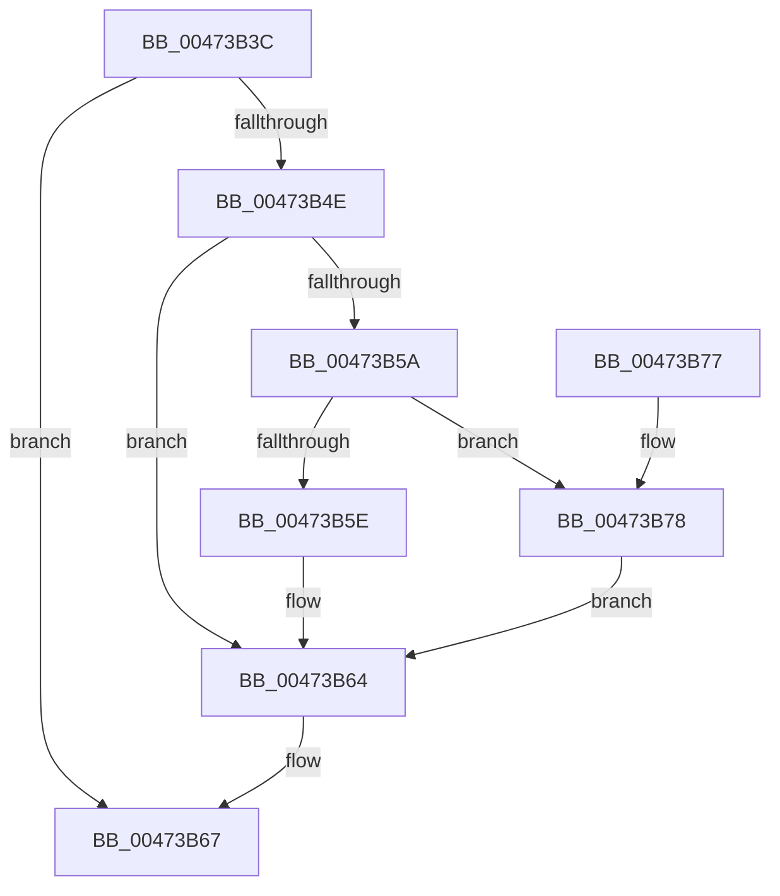

# MiClearResetPfn

- RVA: `0x00473B3C`–`0x00473B7E` (길이 `66` bytes)
- VA: `0x0000000140473B3C`
- 실행 섹션: `.text`
- PDB 이름 있음: `예`; PDB Function 태그: `아니요`
- unwind 정보 RVA: `0x000AC5C8`
- 디코드: `22`개 명령, `66/66` bytes 표시
- 미해석 바이트: `0` (있으면 어셈블리에 `.byte`로 보존)

> 이 문서는 커널 이미지의 기계어와 PDB 기호를 분석해 생성했습니다. 4번과 5번은 함수 원형과 자료형을 바이너리 사용 방식에서 추정한 C 해석이며 원본 소스 복구 결과는 아닙니다.

## 1. Dependencies

- 직접 호출 지점: **1**; 고유 호출 대상: **1**
- 직접 호출자로 확인된 함수: **2**
- RIP 상대 이미지 참조: **1**

### Outgoing calls
- `0x00473B69` → [MiSwizzleInvalidPte](../28/MiSwizzleInvalidPte_function_0028F5E0.md) (function, `0x0028F5E0`)

### Direct callers
- [MiActOnPte](../24/MiActOnPte_function_00244C90.md) at `0x0024509C`
- [MiActOnPte](../24/MiActOnPte_function_00244C90.md) at `0x00245767`
- [MiRestoreTransitionPte](../33/MiRestoreTransitionPte_function_0033DD90.md) at `0x0033E092`
- [MiRestoreTransitionPte](../33/MiRestoreTransitionPte_function_0033DD90.md) at `0x0033E147`

### Static image references
- `0x00473B4E` → RVA `0x00E2DC80` (`.data`; read)

## 2. Other-region calls and transfers

- 다른 실행 섹션으로 향하는 call: **0**
- 별도 외부 분기/꼬리 이동을 확인하지 못했습니다.

## 3. Assembly (complete function range)

```asm
00473B3C  48 83 EC 28                     sub rsp, 0x28
00473B40  48 8B 41 10                     mov rax, qword ptr [rcx + 0x10]
00473B44  33 D2                           xor edx, edx
00473B46  4C 8B C1                        mov r8, rcx
00473B49  48 85 C0                        test rax, rax
00473B4C  74 19                           je 0x140473b67
00473B4E  48 8B 0D 2B A1 9B 00            mov rcx, qword ptr [rip + 0x9ba12b]
00473B55  48 85 C9                        test rcx, rcx
00473B58  74 0A                           je 0x140473b64
00473B5A  A8 10                           test al, 0x10
00473B5C  75 1A                           jne 0x140473b78
00473B5E  48 F7 D1                        not rcx
00473B61  48 23 C1                        and rax, rcx
00473B64  48 8B D0                        mov rdx, rax
00473B67  8B CA                           mov ecx, edx
00473B69  E8 72 BA E1 FF                  call 0x14028f5e0
00473B6E  49 89 40 10                     mov qword ptr [r8 + 0x10], rax
00473B72  48 83 C4 28                     add rsp, 0x28
00473B76  C3                              ret
00473B77  CC                              int3
00473B78  48 83 E0 EF                     and rax, 0xffffffffffffffef
00473B7C  EB E6                           jmp 0x140473b64
```

## 4. C-style interpretation (structured pseudocode)

```c
__int64 __fastcall MiClearResetPfn(__int64 a1, int a2)
{
    __int64 result;
    __int64 v_rsp;

    v_rsp = (v_rsp) - (40);
    a2 = 0;
    if (*(unsigned __int64 *)(a1 + 16) == 0) goto loc_00473B67;
    if (*(unsigned __int64 *)(v_rip + 10199339) == 0) goto loc_00473B64;
    if ((((unsigned __int8)(*(unsigned __int64 *)(a1 + 16))) & (16)) != 0) goto loc_00473B78;
    a1 = ~(*(unsigned __int64 *)(v_rip + 10199339));
    result = (*(unsigned __int64 *)(a1 + 16)) & (a1);
loc_00473B64:
loc_00473B67:
    result = MiSwizzleInvalidPte((unsigned int)((unsigned int)(result)), result, a1, a4);
    *(unsigned __int64 *)(a1 + 16) = result;
    v_rsp = (v_rsp) + (40);
    return result;
loc_00473B78:
    result = (result) & (-17);
    goto loc_00473B64;
}
```

## 5. (Beta) C Style

```c
int64_t MiClearResetPfn(void *Arg1, int32_t Arg2)
{
    uint8_t *arg1 = (uint8_t *)Arg1;

    int64_t result;
    int64_t local_rsp;

    local_rsp = (local_rsp) - (40);
    Arg2 = 0;
    if (*(uint64_t *)(arg1 + 0x10) == 0) goto loc_00473B67;
    if (*(uint64_t *)(v_rip + 0x9BA12B) == 0) goto loc_00473B64;
    if ((((uint8_t)(*(uint64_t *)(arg1 + 0x10))) & (16)) != 0) goto loc_00473B78;
    Arg1 = ~(*(uint64_t *)(v_rip + 0x9BA12B));
    result = (*(uint64_t *)(arg1 + 0x10)) & (Arg1);
loc_00473B64:
loc_00473B67:
    result = MiSwizzleInvalidPte((uint32_t)((uint32_t)(result)), result, Arg1, a4);
    *(uint64_t *)(arg1 + 0x10) = result;
    local_rsp = (local_rsp) + (40);
    return result;
loc_00473B78:
    result = (result) & (-17);
    goto loc_00473B64;
}
```

### 관측된 메모리 오프셋

구조체 형식이 확인되지 않은 접근은 인자 기준의 오프셋으로만 기록했습니다.

| 기준 인자 | 오프셋 표현 | 폭 (bit) | 접근 |
|---|---:|---:|---|
| `Arg1` | `+ 0x10` | `64` | `R` |

## 6. Execution-region graph

[열기: 2D/3D 그래프와 함수 탐색 컨트롤 패널](../../../control-panel.html?section=text&rva=0x00473B3C&view=graph)

- 2D 그래프는 위에서 아래로 흐르고, 3D 그래프는 빈 공간을 드래그해 회전합니다. Shift+드래그는 이동, 휠은 확대·축소, 함수 노드 선택은 대상 보고서 이동입니다.

### Static fallback


