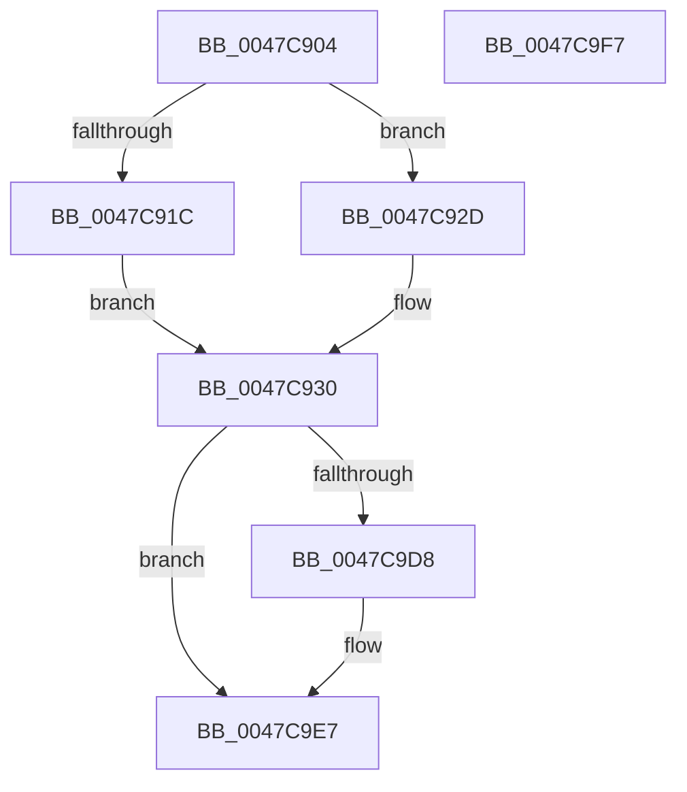

# MiComputeCommitThresholds

- RVA: `0x0047C904`–`0x0047C9F8` (길이 `244` bytes)
- VA: `0x000000014047C904`
- 실행 섹션: `.text`
- PDB 이름 있음: `예`; PDB Function 태그: `아니요`
- unwind 정보 RVA: `0x00060BC4`
- 디코드: `62`개 명령, `244/244` bytes 표시
- 미해석 바이트: `0` (있으면 어셈블리에 `.byte`로 보존)

> 이 문서는 커널 이미지의 기계어와 PDB 기호를 분석해 생성했습니다. 4번과 5번은 함수 원형과 자료형을 바이너리 사용 방식에서 추정한 C 해석이며 원본 소스 복구 결과는 아닙니다.

## 1. Dependencies

- 직접 호출 지점: **3**; 고유 호출 대상: **3**
- 직접 호출자로 확인된 함수: **4**
- RIP 상대 이미지 참조: **0**

### Outgoing calls
- `0x0047C923` → [ExAcquireSpinLockExclusive](../24/ExAcquireSpinLockExclusive_function_00248690.md) (function, `0x00248690`)
- `0x0047C9CF` → [MiSyncCommitSignals](MiSyncCommitSignals_function_0047CA00.md) (function, `0x0047CA00`)
- `0x0047C9E2` → [MiReleaseSpinLockExclusive](../24/MiReleaseSpinLockExclusive_function_002482C0.md) (function, `0x002482C0`)

### Direct callers
- [MiIncreaseCommitLimits](../68/MiIncreaseCommitLimits_function_0068CADC.md) at `0x0068CB97`
- [MiReduceCommitLimits](../68/MiReduceCommitLimits_function_0068CDA0.md) at `0x0068CDFC`
- [MiFinishChildPartitionHotAdd](../69/MiFinishChildPartitionHotAdd_function_00690C00.md) at `0x00690CEB`
- [MiInsertPartitionPages](../69/MiInsertPartitionPages_function_006911A0.md) at `0x00691593`

### Static image references
- 디코드된 RIP-relative 메모리 참조가 없습니다.

## 2. Other-region calls and transfers

- 다른 실행 섹션으로 향하는 call: **0**
- 별도 외부 분기/꼬리 이동을 확인하지 못했습니다.

## 3. Assembly (complete function range)

```asm
0047C904  48 89 5C 24 08                  mov qword ptr [rsp + 8], rbx
0047C909  48 89 74 24 10                  mov qword ptr [rsp + 0x10], rsi
0047C90E  57                              push rdi
0047C90F  48 83 EC 20                     sub rsp, 0x20
0047C913  8B F2                           mov esi, edx
0047C915  48 8B D9                        mov rbx, rcx
0047C918  85 D2                           test edx, edx
0047C91A  75 11                           jne 0x14047c92d
0047C91C  48 81 C1 F8 41 00 00            add rcx, 0x41f8
0047C923  E8 68 BD DC FF                  call 0x140248690
0047C928  40 8A F8                        mov dil, al
0047C92B  EB 03                           jmp 0x14047c930
0047C92D  40 B7 11                        mov dil, 0x11
0047C930  4C 8B 83 98 4C 00 00            mov r8, qword ptr [rbx + 0x4c98]
0047C937  49 B9 CD CC CC CC CC CC CC CC   movabs r9, 0xcccccccccccccccd
0047C941  B9 00 00 01 00                  mov ecx, 0x10000
0047C946  49 8B C1                        mov rax, r9
0047C949  49 F7 E0                        mul r8
0047C94C  49 8B C1                        mov rax, r9
0047C94F  48 C1 EA 03                     shr rdx, 3
0047C953  48 3B D1                        cmp rdx, rcx
0047C956  48 0F 47 D1                     cmova rdx, rcx
0047C95A  49 8B C8                        mov rcx, r8
0047C95D  48 2B CA                        sub rcx, rdx
0047C960  49 F7 E0                        mul r8
0047C963  48 89 8B E0 41 00 00            mov qword ptr [rbx + 0x41e0], rcx
0047C96A  B8 00 80 00 00                  mov eax, 0x8000
0047C96F  48 C1 EA 04                     shr rdx, 4
0047C973  49 81 F8 14 00 0A 00            cmp r8, 0xa0014
0047C97A  48 0F 43 D0                     cmovae rdx, rax
0047C97E  49 8B C0                        mov rax, r8
0047C981  48 2B C2                        sub rax, rdx
0047C984  BA 00 00 10 00                  mov edx, 0x100000
0047C989  48 89 83 E8 41 00 00            mov qword ptr [rbx + 0x41e8], rax
0047C990  49 8B C0                        mov rax, r8
0047C993  48 C1 E8 02                     shr rax, 2
0047C997  48 3B C2                        cmp rax, rdx
0047C99A  48 0F 47 C2                     cmova rax, rdx
0047C99E  BA 00 40 00 00                  mov edx, 0x4000
0047C9A3  4C 2B C0                        sub r8, rax
0047C9A6  48 8B C1                        mov rax, rcx
0047C9A9  49 2B C0                        sub rax, r8
0047C9AC  4C 89 83 D8 41 00 00            mov qword ptr [rbx + 0x41d8], r8
0047C9B3  48 D1 E8                        shr rax, 1
0047C9B6  48 3B C2                        cmp rax, rdx
0047C9B9  48 0F 47 C2                     cmova rax, rdx
0047C9BD  BA 01 00 00 00                  mov edx, 1
0047C9C2  48 2B C8                        sub rcx, rax
0047C9C5  48 89 8B F0 41 00 00            mov qword ptr [rbx + 0x41f0], rcx
0047C9CC  48 8B CB                        mov rcx, rbx
0047C9CF  E8 2C 00 00 00                  call 0x14047ca00
0047C9D4  85 F6                           test esi, esi
0047C9D6  75 0F                           jne 0x14047c9e7
0047C9D8  48 8D 8B F8 41 00 00            lea rcx, [rbx + 0x41f8]
0047C9DF  40 8A D7                        mov dl, dil
0047C9E2  E8 D9 B8 DC FF                  call 0x1402482c0
0047C9E7  48 8B 5C 24 30                  mov rbx, qword ptr [rsp + 0x30]
0047C9EC  48 8B 74 24 38                  mov rsi, qword ptr [rsp + 0x38]
0047C9F1  48 83 C4 20                     add rsp, 0x20
0047C9F5  5F                              pop rdi
0047C9F6  C3                              ret
0047C9F7  CC                              int3
```

## 4. C-style interpretation (structured pseudocode)

```c
__int64 __fastcall MiComputeCommitThresholds(__int64 a1, __int64 a2)
{
    __int64 result;
    __int64 v_rsp;
    unsigned __int64 v_stack_p10;
    unsigned __int64 v_stack_p8;

    v_stack_p8 = v_rbx;
    v_stack_p10 = v_rsi;
    v_rsp = (v_rsp) - (32);
    if ((unsigned int)(a2) != 0) goto loc_0047C92D;
    a1 = (a1) + (0x41F8ULL);
    result = ExAcquireSpinLockExclusive(a1, a2, a3, a4);
    goto loc_0047C930;
loc_0047C92D:
loc_0047C930:
    a2 = (a2) >> (3);
    if (a2 > ((unsigned int)(0x10000ULL))) { a2 = (unsigned int)(0x10000ULL); }
    a1 = (*(unsigned __int64 *)(a1 + 19608)) - (a2);
    *(unsigned __int64 *)(a1 + 16864) = a1;
    a2 = (a2) >> (4);
    if ((*(unsigned __int64 *)(a1 + 19608)) >= 0xA0014ULL) { a2 = (unsigned int)(0x8000ULL); }
    result = (*(unsigned __int64 *)(a1 + 19608)) - (a2);
    *(unsigned __int64 *)(a1 + 16872) = result;
    result = (*(unsigned __int64 *)(a1 + 19608)) >> (2);
    if (result > ((unsigned int)(0x100000ULL))) { result = (unsigned int)(0x100000ULL); }
    a3 = (*(unsigned __int64 *)(a1 + 19608)) - (result);
    result = (a1) - (a3);
    *(unsigned __int64 *)(a1 + 16856) = a3;
    result = (result) >> (1);
    if (result > ((unsigned int)(0x4000ULL))) { result = (unsigned int)(0x4000ULL); }
    a1 = (a1) - (result);
    *(unsigned __int64 *)(a1 + 16880) = a1;
    result = MiSyncCommitSignals(a1, 1, a3, a4);
    if ((unsigned int)((unsigned int)((unsigned int)(a2))) == 0) {
        a1 = a1 + 16888;
        a2 = 17;
        result = MiReleaseSpinLockExclusive(a1, a2, a3, a4);
    }
    v_rsp = (v_rsp) + (32);
    return result;
}
```

## 5. (Beta) C Style

```c
int64_t MiComputeCommitThresholds(void *Arg1, int64_t Arg2)
{
    uint8_t *arg1 = (uint8_t *)Arg1;

    int64_t result;
    int64_t local_rsp;
    uint64_t v_stack_p10;
    uint64_t v_stack_p8;

    v_stack_p8 = local_rbx;
    v_stack_p10 = local_rsi;
    local_rsp = (local_rsp) - (32);
    if ((uint32_t)(Arg2) != 0) goto loc_0047C92D;
    Arg1 = (Arg1) + (0x41F8ULL);
    result = ExAcquireSpinLockExclusive(Arg1, Arg2, a3, a4);
    goto loc_0047C930;
loc_0047C92D:
loc_0047C930:
    Arg2 = (Arg2) >> (3);
    if (Arg2 > ((uint32_t)(0x10000ULL))) { Arg2 = (uint32_t)(0x10000ULL); }
    Arg1 = (*(uint64_t *)(arg1 + 0x4C98)) - (Arg2);
    *(void **)(arg1 + 0x41E0) = Arg1;
    Arg2 = (Arg2) >> (4);
    if ((*(uint64_t *)(arg1 + 0x4C98)) >= 0xA0014ULL) { Arg2 = (uint32_t)(0x8000ULL); }
    result = (*(uint64_t *)(arg1 + 0x4C98)) - (Arg2);
    *(uint64_t *)(arg1 + 0x41E8) = result;
    result = (*(uint64_t *)(arg1 + 0x4C98)) >> (2);
    if (result > ((uint32_t)(0x100000ULL))) { result = (uint32_t)(0x100000ULL); }
    a3 = (*(uint64_t *)(arg1 + 0x4C98)) - (result);
    result = (Arg1) - (a3);
    *(uint64_t *)(arg1 + 0x41D8) = a3;
    result = (result) >> (1);
    if (result > ((uint32_t)(0x4000ULL))) { result = (uint32_t)(0x4000ULL); }
    Arg1 = (Arg1) - (result);
    *(void **)(arg1 + 0x41F0) = Arg1;
    result = MiSyncCommitSignals(Arg1, 1, a3, a4);
    if ((uint32_t)((uint32_t)((uint32_t)(Arg2))) == 0) {
        Arg1 = Arg1 + 16888;
        Arg2 = 17;
        result = MiReleaseSpinLockExclusive(Arg1, Arg2, a3, a4);
    }
    local_rsp = (local_rsp) + (32);
    return result;
}
```

### 관측된 메모리 오프셋

구조체 형식이 확인되지 않은 접근은 인자 기준의 오프셋으로만 기록했습니다.

| 기준 인자 | 오프셋 표현 | 폭 (bit) | 접근 |
|---|---:|---:|---|
| `Arg1` | `+ 0x41D8` | `64` | `W` |
| `Arg1` | `+ 0x41E0` | `64` | `W` |
| `Arg1` | `+ 0x41E8` | `64` | `W` |
| `Arg1` | `+ 0x41F0` | `64` | `W` |
| `Arg1` | `+ 0x41F8` | `64` | `R` |
| `Arg1` | `+ 0x4C98` | `64` | `R` |

## 6. Execution-region graph

[열기: 2D/3D 그래프와 함수 탐색 컨트롤 패널](../../../control-panel.html?section=text&rva=0x0047C904&view=graph)

- 2D 그래프는 위에서 아래로 흐르고, 3D 그래프는 빈 공간을 드래그해 회전합니다. Shift+드래그는 이동, 휠은 확대·축소, 함수 노드 선택은 대상 보고서 이동입니다.

### Static fallback


