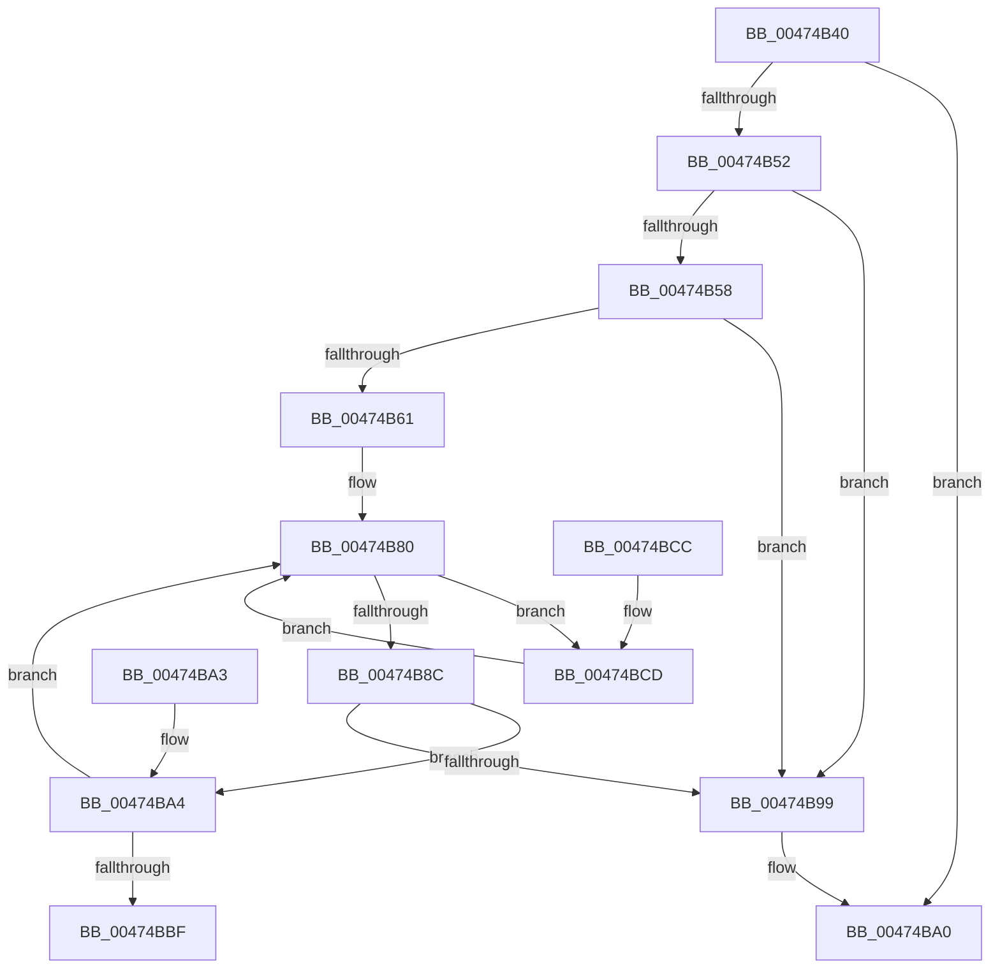

# MiConsumeSystemCachePde

- RVA: `0x00474B40`–`0x00474BE7` (길이 `167` bytes)
- VA: `0x0000000140474B40`
- 실행 섹션: `.text`
- PDB 이름 있음: `예`; PDB Function 태그: `아니요`
- unwind 정보 RVA: `0x000DB714`
- 디코드: `47`개 명령, `167/167` bytes 표시
- 미해석 바이트: `0` (있으면 어셈블리에 `.byte`로 보존)

> 이 문서는 커널 이미지의 기계어와 PDB 기호를 분석해 생성했습니다. 4번과 5번은 함수 원형과 자료형을 바이너리 사용 방식에서 추정한 C 해석이며 원본 소스 복구 결과는 아닙니다.

## 1. Dependencies

- 직접 호출 지점: **0**; 고유 호출 대상: **0**
- 직접 호출자로 확인된 함수: **1**
- RIP 상대 이미지 참조: **0**

### Outgoing calls
- 직접 디코드된 call 명령이 없습니다.

### Direct callers
- [sub_00238CD1](../23/Unknown_function_00238CD1.md) at `0x00238CD4`

### Static image references
- 디코드된 RIP-relative 메모리 참조가 없습니다.

## 2. Other-region calls and transfers

- 다른 실행 섹션으로 향하는 call: **0**
- 별도 외부 분기/꼬리 이동을 확인하지 못했습니다.

## 3. Assembly (complete function range)

```asm
00474B40  48 8D 81 20 09 00 00            lea rax, [rcx + 0x920]
00474B47  4C 8B C1                        mov r8, rcx
00474B4A  48 8B 10                        mov rdx, qword ptr [rax]
00474B4D  48 3B D0                        cmp rdx, rax
00474B50  74 4E                           je 0x140474ba0
00474B52  48 39 42 08                     cmp qword ptr [rdx + 8], rax
00474B56  75 41                           jne 0x140474b99
00474B58  48 8B 0A                        mov rcx, qword ptr [rdx]
00474B5B  48 39 51 08                     cmp qword ptr [rcx + 8], rdx
00474B5F  75 38                           jne 0x140474b99
00474B61  48 89 08                        mov qword ptr [rax], rcx
00474B64  49 BA FF FF FF FF FF FF FF 3F   movabs r10, 0x3fffffffffffffff
00474B6E  48 89 41 08                     mov qword ptr [rcx + 8], rax
00474B72  49 8D 88 00 09 00 00            lea rcx, [r8 + 0x900]
00474B79  48 FF 48 10                     dec qword ptr [rax + 0x10]
00474B7D  45 33 C0                        xor r8d, r8d
00474B80  48 8B 42 20                     mov rax, qword ptr [rdx + 0x20]
00474B84  49 23 C2                        and rax, r10
00474B87  45 85 C0                        test r8d, r8d
00474B8A  74 41                           je 0x140474bcd
00474B8C  48 89 42 20                     mov qword ptr [rdx + 0x20], rax
00474B90  48 8B 41 08                     mov rax, qword ptr [rcx + 8]
00474B94  48 39 08                        cmp qword ptr [rax], rcx
00474B97  74 0B                           je 0x140474ba4
00474B99  B9 03 00 00 00                  mov ecx, 3
00474B9E  CD 29                           int 0x29
00474BA0  33 C0                           xor eax, eax
00474BA2  C3                              ret
00474BA3  CC                              int3
00474BA4  48 89 0A                        mov qword ptr [rdx], rcx
00474BA7  41 FF C0                        inc r8d
00474BAA  48 89 42 08                     mov qword ptr [rdx + 8], rax
00474BAE  48 89 10                        mov qword ptr [rax], rdx
00474BB1  48 89 51 08                     mov qword ptr [rcx + 8], rdx
00474BB5  48 83 C2 28                     add rdx, 0x28
00474BB9  41 83 F8 08                     cmp r8d, 8
00474BBD  72 C1                           jb 0x140474b80
00474BBF  48 83 41 10 07                  add qword ptr [rcx + 0x10], 7
00474BC4  48 8D 82 C0 FE FF FF            lea rax, [rdx - 0x140]
00474BCB  C3                              ret
00474BCC  CC                              int3
00474BCD  49 B9 00 00 00 00 00 00 00 80   movabs r9, 0x8000000000000000
00474BD7  49 0B C1                        or rax, r9
00474BDA  48 89 42 20                     mov qword ptr [rdx + 0x20], rax
00474BDE  48 83 C2 28                     add rdx, 0x28
00474BE2  41 FF C0                        inc r8d
00474BE5  EB 99                           jmp 0x140474b80
```

## 4. C-style interpretation (structured pseudocode)

```c
__int64 __fastcall MiConsumeSystemCachePde(__int64 a1)
{
    __int64 result;

    if ((*(unsigned __int64 *)(a1 + 2336)) == (a1 + 2336)) goto loc_00474BA0;
    if ((*(unsigned __int64 *)(*(unsigned __int64 *)(a1 + 2336) + 8)) != (a1 + 2336)) goto loc_00474B99;
    if ((*(unsigned __int64 *)(*(unsigned __int64 *)(*(unsigned __int64 *)(a1 + 2336)) + 8)) != (*(unsigned __int64 *)(a1 + 2336))) goto loc_00474B99;
    *(unsigned __int64 *)(a1 + 2336) = *(unsigned __int64 *)(*(unsigned __int64 *)(a1 + 2336));
    *(unsigned __int64 *)(*(unsigned __int64 *)(*(unsigned __int64 *)(a1 + 2336)) + 8) = a1 + 2336;
    a3 = 0;
loc_00474B80:
    result = (*(unsigned __int64 *)(*(unsigned __int64 *)(a1 + 2336) + 32)) & (v_r10);
    if (0 == 0) goto loc_00474BCD;
    *(unsigned __int64 *)(*(unsigned __int64 *)(a1 + 2336) + 32) = result;
    if ((*(unsigned __int64 *)(*(unsigned __int64 *)(a1 + 2304 + 8))) == (a1 + 2304)) goto loc_00474BA4;
loc_00474B99:
loc_00474BA0:
    result = 0;
    return result;
loc_00474BA4:
    *(unsigned __int64 *)(*(unsigned __int64 *)(a1 + 2336)) = 3;
    a3 = (unsigned int)((a3) + 1);
    *(unsigned __int64 *)(*(unsigned __int64 *)(a1 + 2336) + 8) = 0;
    *(unsigned __int64 *)(result) = *(unsigned __int64 *)(a1 + 2336);
    *(unsigned __int64 *)(3 + 8) = *(unsigned __int64 *)(a1 + 2336);
    a2 = (*(unsigned __int64 *)(a1 + 2336)) + (40);
    if (((unsigned int)(a3)) < 8) goto loc_00474B80;
    return a2 - 320;
loc_00474BCD:
    result = (a2 - 320) | (a4);
    *(unsigned __int64 *)(a2 + 32) = result;
    a2 = (a2) + (40);
    a3 = (unsigned int)((a3) + 1);
    goto loc_00474B80;
}
```

## 5. (Beta) C Style

```c
int64_t MiConsumeSystemCachePde(void *Arg1)
{
    uint8_t *arg1 = (uint8_t *)Arg1;

    int64_t result;

    if ((*(uint64_t *)(arg1 + 0x920)) == (Arg1 + 2336)) goto loc_00474BA0;
    if ((*(uint64_t *)(*(uint64_t *)(arg1 + 0x920) + 0x8)) != (Arg1 + 2336)) goto loc_00474B99;
    if ((*(uint64_t *)(*(uint64_t *)(*(uint64_t *)(arg1 + 0x920)) + 0x8)) != (*(uint64_t *)(arg1 + 0x920))) goto loc_00474B99;
    *(uint64_t *)(arg1 + 0x920) = *(uint64_t *)(*(uint64_t *)(arg1 + 0x920));
    *(void **)(*(uint64_t *)(*(uint64_t *)(arg1 + 0x920)) + 0x8) = Arg1 + 2336;
    a3 = 0;
loc_00474B80:
    result = (*(uint64_t *)(*(uint64_t *)(arg1 + 0x920) + 0x20)) & (local_r10);
    if (0 == 0) goto loc_00474BCD;
    *(uint64_t *)(*(uint64_t *)(arg1 + 0x920) + 0x20) = result;
    if ((*(uint64_t *)(*(uint64_t *)(arg1 + 0x900 + 0x8))) == (Arg1 + 2304)) goto loc_00474BA4;
loc_00474B99:
loc_00474BA0:
    result = 0;
    return result;
loc_00474BA4:
    *(uint64_t *)(*(uint64_t *)(arg1 + 0x920)) = 3;
    a3 = (uint32_t)((a3) + 1);
    *(uint64_t *)(*(uint64_t *)(arg1 + 0x920) + 0x8) = 0;
    *(uint64_t *)(result) = *(uint64_t *)(arg1 + 0x920);
    *(uint64_t *)(3 + 0x8) = *(uint64_t *)(arg1 + 0x920);
    a2 = (*(uint64_t *)(arg1 + 0x920)) + (40);
    if (((uint32_t)(a3)) < 8) goto loc_00474B80;
    return a2 - 320;
loc_00474BCD:
    result = (a2 - 320) | (a4);
    *(uint64_t *)(a2 + 0x20) = result;
    a2 = (a2) + (40);
    a3 = (uint32_t)((a3) + 1);
    goto loc_00474B80;
}
```

### 관측된 메모리 오프셋

구조체 형식이 확인되지 않은 접근은 인자 기준의 오프셋으로만 기록했습니다.

| 기준 인자 | 오프셋 표현 | 폭 (bit) | 접근 |
|---|---:|---:|---|
| `Arg1` | `+ 0x0` | `64` | `R` |
| `Arg1` | `+ 0x0` | `64` | `W` |
| `Arg1` | `+ 0x8` | `64` | `R` |
| `Arg1` | `+ 0x8` | `64` | `W` |
| `Arg1` | `+ 0x10` | `64` | `R/W` |
| `Arg1` | `+ 0x900` | `64` | `R` |
| `Arg1` | `+ 0x920` | `64` | `R` |

## 6. Execution-region graph

[열기: 2D/3D 그래프와 함수 탐색 컨트롤 패널](../../../control-panel.html?section=text&rva=0x00474B40&view=graph)

- 2D 그래프는 위에서 아래로 흐르고, 3D 그래프는 빈 공간을 드래그해 회전합니다. Shift+드래그는 이동, 휠은 확대·축소, 함수 노드 선택은 대상 보고서 이동입니다.

### Static fallback


