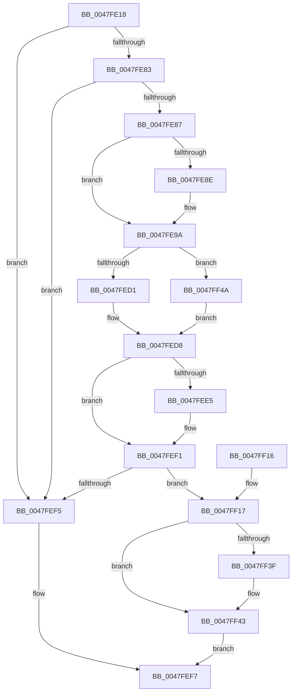

# MiDeleteEmptyPageTableWorker

- RVA: `0x0047FE18`–`0x0047FF54` (길이 `316` bytes)
- VA: `0x000000014047FE18`
- 실행 섹션: `.text`
- PDB 이름 있음: `예`; PDB Function 태그: `아니요`
- unwind 정보 RVA: `0x000AE300`
- 디코드: `87`개 명령, `316/316` bytes 표시
- 미해석 바이트: `0` (있으면 어셈블리에 `.byte`로 보존)

> 이 문서는 커널 이미지의 기계어와 PDB 기호를 분석해 생성했습니다. 4번과 5번은 함수 원형과 자료형을 바이너리 사용 방식에서 추정한 C 해석이며 원본 소스 복구 결과는 아닙니다.

## 1. Dependencies

- 직접 호출 지점: **5**; 고유 호출 대상: **4**
- 직접 호출자로 확인된 함수: **1**
- RIP 상대 이미지 참조: **0**

### Outgoing calls
- `0x0047FE77` → [MI_READ_PTE_LOCK_FREE](../28/MI_READ_PTE_LOCK_FREE_function_002828A0.md) (function, `0x002828A0`)
- `0x0047FE95` → [MiLockNestedPageTable](../23/MiLockNestedPageTable_function_0023E890.md) (function, `0x0023E890`)
- `0x0047FE9D` → [MI_READ_PTE_LOCK_FREE](../28/MI_READ_PTE_LOCK_FREE_function_002828A0.md) (function, `0x002828A0`)
- `0x0047FEEC` → [MiUnlockPageTable](../21/MiUnlockPageTable_function_00216EC0.md) (function, `0x00216EC0`)
- `0x0047FF21` → [MiDecommitHandleValidPte](../24/MiDecommitHandleValidPte_function_00241A50.md) (function, `0x00241A50`)

### Direct callers
- [MiDeleteEmptyPageTable](MiDeleteEmptyPageTable_function_0047FE00.md) at `0x0047FE04`

### Static image references
- 디코드된 RIP-relative 메모리 참조가 없습니다.

## 2. Other-region calls and transfers

- 다른 실행 섹션으로 향하는 call: **0**
- 별도 외부 분기/꼬리 이동을 확인하지 못했습니다.

## 3. Assembly (complete function range)

```asm
0047FE18  48 8B C4                        mov rax, rsp
0047FE1B  48 89 58 08                     mov qword ptr [rax + 8], rbx
0047FE1F  48 89 68 10                     mov qword ptr [rax + 0x10], rbp
0047FE23  48 89 70 18                     mov qword ptr [rax + 0x18], rsi
0047FE27  48 89 78 20                     mov qword ptr [rax + 0x20], rdi
0047FE2B  41 54                           push r12
0047FE2D  41 56                           push r14
0047FE2F  41 57                           push r15
0047FE31  48 83 EC 20                     sub rsp, 0x20
0047FE35  4C 8B B9 B8 00 00 00            mov r15, qword ptr [rcx + 0xb8]
0047FE3C  48 8D 42 08                     lea rax, [rdx + 8]
0047FE40  4C 8B CA                        mov r9, rdx
0047FE43  45 8B E0                        mov r12d, r8d
0047FE46  48 8B F2                        mov rsi, rdx
0047FE49  49 C1 E1 19                     shl r9, 0x19
0047FE4D  4C 8B F1                        mov r14, rcx
0047FE50  49 8B 2F                        mov rbp, qword ptr [r15]
0047FE53  48 89 55 48                     mov qword ptr [rbp + 0x48], rdx
0047FE57  48 89 45 58                     mov qword ptr [rbp + 0x58], rax
0047FE5B  48 B8 00 00 00 00 80 F6 FF FF   movabs rax, 0xfffff68000000000
0047FE65  48 C1 E0 19                     shl rax, 0x19
0047FE69  48 8B CA                        mov rcx, rdx
0047FE6C  4C 2B C8                        sub r9, rax
0047FE6F  49 C1 F9 10                     sar r9, 0x10
0047FE73  4C 89 4D 38                     mov qword ptr [rbp + 0x38], r9
0047FE77  E8 24 2A E0 FF                  call 0x1402828a0
0047FE7C  48 8B D8                        mov rbx, rax
0047FE7F  A8 01                           test al, 1
0047FE81  74 72                           je 0x14047fef5
0047FE83  84 DB                           test bl, bl
0047FE85  78 6E                           js 0x14047fef5
0047FE87  41 8B 06                        mov eax, dword ptr [r14]
0047FE8A  A8 04                           test al, 4
0047FE8C  74 0C                           je 0x14047fe9a
0047FE8E  49 8B 4E 20                     mov rcx, qword ptr [r14 + 0x20]
0047FE92  48 8B D6                        mov rdx, rsi
0047FE95  E8 F6 E9 DB FF                  call 0x14023e890
0047FE9A  48 8B CE                        mov rcx, rsi
0047FE9D  E8 FE 29 E0 FF                  call 0x1402828a0
0047FEA2  48 C1 E8 0C                     shr rax, 0xc
0047FEA6  48 B9 FF FF FF FF FF 00 00 00   movabs rcx, 0xffffffffff
0047FEB0  48 23 C1                        and rax, rcx
0047FEB3  48 8D 3C 40                     lea rdi, [rax + rax*2]
0047FEB7  48 C1 E7 04                     shl rdi, 4
0047FEBB  48 B8 00 00 00 00 00 DE FF FF   movabs rax, 0xffffde0000000000
0047FEC5  48 03 F8                        add rdi, rax
0047FEC8  8B 47 24                        mov eax, dword ptr [rdi + 0x24]
0047FECB  0F BA E0 1A                     bt eax, 0x1a
0047FECF  73 79                           jae 0x14047ff4a
0047FED1  48 8B 3F                        mov rdi, qword ptr [rdi]
0047FED4  48 C1 EF 20                     shr rdi, 0x20
0047FED8  41 8B 06                        mov eax, dword ptr [r14]
0047FEDB  81 E7 FF 03 00 00               and edi, 0x3ff
0047FEE1  A8 04                           test al, 4
0047FEE3  74 0C                           je 0x14047fef1
0047FEE5  49 8B 4E 20                     mov rcx, qword ptr [r14 + 0x20]
0047FEE9  48 8B D6                        mov rdx, rsi
0047FEEC  E8 CF 6F D9 FF                  call 0x140216ec0
0047FEF1  85 FF                           test edi, edi
0047FEF3  74 22                           je 0x14047ff17
0047FEF5  33 C0                           xor eax, eax
0047FEF7  48 8B 5C 24 40                  mov rbx, qword ptr [rsp + 0x40]
0047FEFC  48 8B 6C 24 48                  mov rbp, qword ptr [rsp + 0x48]
0047FF01  48 8B 74 24 50                  mov rsi, qword ptr [rsp + 0x50]
0047FF06  48 8B 7C 24 58                  mov rdi, qword ptr [rsp + 0x58]
0047FF0B  48 83 C4 20                     add rsp, 0x20
0047FF0F  41 5F                           pop r15
0047FF11  41 5E                           pop r14
0047FF13  41 5C                           pop r12
0047FF15  C3                              ret
0047FF16  CC                              int3
0047FF17  48 8B D3                        mov rdx, rbx
0047FF1A  44 89 65 60                     mov dword ptr [rbp + 0x60], r12d
0047FF1E  48 8B CD                        mov rcx, rbp
0047FF21  E8 2A 1B DC FF                  call 0x140241a50
0047FF26  48 8B CE                        mov rcx, rsi
0047FF29  48 C1 E9 03                     shr rcx, 3
0047FF2D  81 E1 FF 01 00 00               and ecx, 0x1ff
0047FF33  49 0F AB 4F 10                  bts qword ptr [r15 + 0x10], rcx
0047FF38  49 83 7F 58 00                  cmp qword ptr [r15 + 0x58], 0
0047FF3D  75 04                           jne 0x14047ff43
0047FF3F  49 89 77 58                     mov qword ptr [r15 + 0x58], rsi
0047FF43  B8 01 00 00 00                  mov eax, 1
0047FF48  EB AD                           jmp 0x14047fef7
0047FF4A  48 8B 7F 10                     mov rdi, qword ptr [rdi + 0x10]
0047FF4E  48 C1 EF 10                     shr rdi, 0x10
0047FF52  EB 84                           jmp 0x14047fed8
```

## 4. C-style interpretation (structured pseudocode)

```c
__int64 __fastcall MiDeleteEmptyPageTableWorker(__int64 a1, __int64 a2, int a3)
{
    __int64 result;
    __int64 v_rdi;
    __int64 v_rsp;
    unsigned __int64 v_stack_p10;
    unsigned __int64 v_stack_p18;
    unsigned __int64 v_stack_p20;
    unsigned __int64 v_stack_p8;

    *(unsigned __int64 *)(v_rsp + 8) = v_rbx;
    *(unsigned __int64 *)(v_rsp + 16) = v_rbp;
    *(unsigned __int64 *)(v_rsp + 24) = v_rsi;
    *(unsigned __int64 *)(v_rsp + 32) = v_rdi;
    v_rsp = (v_rsp) - (32);
    a4 = (a2) << (25);
    *(unsigned __int64 *)(*(unsigned __int64 *)(*(unsigned __int64 *)(a1 + 184)) + 72) = a2;
    *(unsigned __int64 *)(*(unsigned __int64 *)(*(unsigned __int64 *)(a1 + 184)) + 88) = a2 + 8;
    result = (a2 + 8) << (25);
    a4 = (a4) - (result);
    a4 = (a4) >> (16);
    *(unsigned __int64 *)(*(unsigned __int64 *)(*(unsigned __int64 *)(a1 + 184)) + 56) = a4;
    result = MI_READ_PTE_LOCK_FREE(a2, a2, a3, a4);
    if ((((unsigned __int8)(result)) & (1)) == 0) goto loc_0047FEF5;
    if (sign_flag) goto loc_0047FEF5;
    result = (unsigned int)(*(unsigned int *)(a1));
    if ((((unsigned __int8)((unsigned int)(*(unsigned int *)(a1)))) & (4)) != 0) {
        a1 = *(unsigned __int64 *)(a1 + 32);
        a2 = a2;
        result = MiLockNestedPageTable(a1, a2, a3, a4);
    }
    result = MI_READ_PTE_LOCK_FREE(a2, a2, a3, a4);
    result = (result) >> (12);
    result = (result) & (a2);
    v_rdi = (result + result * 2) << (4);
    v_rdi = (v_rdi) + (result);
    if (condition_is_above_or_equal) goto loc_0047FF4A;
    v_rdi = (*(unsigned __int64 *)(v_rdi)) >> (32);
loc_0047FED8:
    v_rdi = (unsigned int)((v_rdi) & (0x3FFULL));
    result = (unsigned int)(*(unsigned int *)(a1));
    if ((((unsigned __int8)((unsigned int)(*(unsigned int *)(a1)))) & (4)) != 0) {
        a1 = *(unsigned __int64 *)(a1 + 32);
        a2 = a2;
        result = MiUnlockPageTable(a1, a2, a3, a4);
    }
    if ((unsigned int)(v_rdi) == 0) goto loc_0047FF17;
loc_0047FEF5:
    result = 0;
loc_0047FEF7:
    v_rsp = (v_rsp) + (32);
    return result;
loc_0047FF17:
    *(unsigned int *)(v_stack_p10 + 96) = (unsigned int)((unsigned int)(a3));
    result = MiDecommitHandleValidPte(v_stack_p10, v_stack_p8, a3, a4);
    a1 = (v_stack_p18) >> (3);
    a1 = (unsigned int)((a1) & (511));
    if ((*(unsigned __int64 *)(*(unsigned __int64 *)(a1 + 184) + 88)) == 0) {
        *(unsigned __int64 *)(*(unsigned __int64 *)(a1 + 184) + 88) = v_stack_p18;
    }
    goto loc_0047FEF7;
loc_0047FF4A:
    v_rdi = (*(unsigned __int64 *)(v_stack_p20 + 16)) >> (16);
    goto loc_0047FED8;
}
```

## 5. (Beta) C Style

```c
int64_t MiDeleteEmptyPageTableWorker(void *Arg1, void *Arg2, int32_t Arg3)
{
    uint8_t *arg1 = (uint8_t *)Arg1;
    uint8_t *arg2 = (uint8_t *)Arg2;

    int64_t result;
    int64_t local_rdi;
    int64_t local_rsp;
    uint64_t v_stack_p10;
    uint64_t v_stack_p18;
    uint64_t v_stack_p20;
    uint64_t v_stack_p8;

    *(uint64_t *)(local_rsp + 0x8) = local_rbx;
    *(uint64_t *)(local_rsp + 0x10) = local_rbp;
    *(uint64_t *)(local_rsp + 0x18) = local_rsi;
    *(uint64_t *)(local_rsp + 0x20) = local_rdi;
    local_rsp = (local_rsp) - (32);
    a4 = (Arg2) << (25);
    *(void **)(*(uint64_t *)(*(uint64_t *)(arg1 + 0xB8)) + 0x48) = Arg2;
    *(void **)(*(uint64_t *)(*(uint64_t *)(arg1 + 0xB8)) + 0x58) = Arg2 + 8;
    result = (Arg2 + 8) << (25);
    a4 = (a4) - (result);
    a4 = (a4) >> (16);
    *(uint64_t *)(*(uint64_t *)(*(uint64_t *)(arg1 + 0xB8)) + 0x38) = a4;
    result = MI_READ_PTE_LOCK_FREE(Arg2, Arg2, Arg3, a4);
    if ((((uint8_t)(result)) & (1)) == 0) goto loc_0047FEF5;
    if (sign_flag) goto loc_0047FEF5;
    result = (uint32_t)(*(uint32_t *)(arg1));
    if ((((uint8_t)((uint32_t)(*(uint32_t *)(arg1)))) & (4)) != 0) {
        Arg1 = *(uint64_t *)(arg1 + 0x20);
        Arg2 = Arg2;
        result = MiLockNestedPageTable(Arg1, Arg2, Arg3, a4);
    }
    result = MI_READ_PTE_LOCK_FREE(Arg2, Arg2, Arg3, a4);
    result = (result) >> (12);
    result = (result) & (Arg2);
    local_rdi = (result + result * 2) << (4);
    local_rdi = (local_rdi) + (result);
    if (condition_is_above_or_equal) goto loc_0047FF4A;
    local_rdi = (*(uint64_t *)(local_rdi)) >> (32);
loc_0047FED8:
    local_rdi = (uint32_t)((local_rdi) & (0x3FFULL));
    result = (uint32_t)(*(uint32_t *)(arg1));
    if ((((uint8_t)((uint32_t)(*(uint32_t *)(arg1)))) & (4)) != 0) {
        Arg1 = *(uint64_t *)(arg1 + 0x20);
        Arg2 = Arg2;
        result = MiUnlockPageTable(Arg1, Arg2, Arg3, a4);
    }
    if ((uint32_t)(local_rdi) == 0) goto loc_0047FF17;
loc_0047FEF5:
    result = 0;
loc_0047FEF7:
    local_rsp = (local_rsp) + (32);
    return result;
loc_0047FF17:
    *(uint32_t *)(v_stack_p10 + 0x60) = (uint32_t)((uint32_t)(Arg3));
    result = MiDecommitHandleValidPte(v_stack_p10, v_stack_p8, Arg3, a4);
    Arg1 = (v_stack_p18) >> (3);
    Arg1 = (uint32_t)((Arg1) & (511));
    if ((*(uint64_t *)(*(uint64_t *)(arg1 + 0xB8) + 0x58)) == 0) {
        *(uint64_t *)(*(uint64_t *)(arg1 + 0xB8) + 0x58) = v_stack_p18;
    }
    goto loc_0047FEF7;
loc_0047FF4A:
    local_rdi = (*(uint64_t *)(v_stack_p20 + 0x10)) >> (16);
    goto loc_0047FED8;
}
```

### 관측된 메모리 오프셋

구조체 형식이 확인되지 않은 접근은 인자 기준의 오프셋으로만 기록했습니다.

| 기준 인자 | 오프셋 표현 | 폭 (bit) | 접근 |
|---|---:|---:|---|
| `Arg1` | `+ 0x0` | `32` | `R` |
| `Arg1` | `+ 0x20` | `64` | `R` |
| `Arg1` | `+ 0xB8` | `64` | `R` |
| `Arg2` | `+ 0x8` | `64` | `R` |

## 6. Execution-region graph

[열기: 2D/3D 그래프와 함수 탐색 컨트롤 패널](../../../control-panel.html?section=text&rva=0x0047FE18&view=graph)

- 2D 그래프는 위에서 아래로 흐르고, 3D 그래프는 빈 공간을 드래그해 회전합니다. Shift+드래그는 이동, 휠은 확대·축소, 함수 노드 선택은 대상 보고서 이동입니다.

### Static fallback


