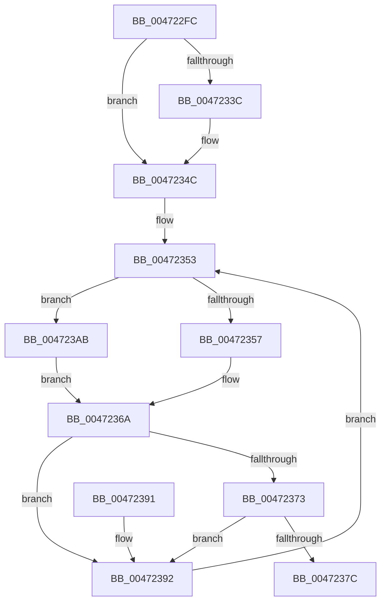

# MiDeleteUltraMapHierarchy

- RVA: `0x004722FC`–`0x004723B2` (길이 `182` bytes)
- VA: `0x00000001404722FC`
- 실행 섹션: `.text`
- PDB 이름 있음: `예`; PDB Function 태그: `아니요`
- unwind 정보 RVA: `0x000AC4F4`
- 디코드: `48`개 명령, `182/182` bytes 표시
- 미해석 바이트: `0` (있으면 어셈블리에 `.byte`로 보존)

> 이 문서는 커널 이미지의 기계어와 PDB 기호를 분석해 생성했습니다. 4번과 5번은 함수 원형과 자료형을 바이너리 사용 방식에서 추정한 C 해석이며 원본 소스 복구 결과는 아닙니다.

## 1. Dependencies

- 직접 호출 지점: **1**; 고유 호출 대상: **1**
- 직접 호출자로 확인된 함수: **1**
- RIP 상대 이미지 참조: **3**

### Outgoing calls
- `0x0047235E` → [MiRewritePteWithLockBit](../32/MiRewritePteWithLockBit_function_00322FEC.md) (function, `0x00322FEC`)

### Direct callers
- [MiGetUltraMapping](../32/MiGetUltraMapping_function_00323270.md) at `0x0032388F`

### Static image references
- `0x0047234C` → RVA `0x00010880` (`.rdata`; read)
- `0x0047236A` → RVA `0x00E36030` (`.data`; read)
- `0x00472373` → RVA `0x00E36038` (`.data`; read)

## 2. Other-region calls and transfers

- 다른 실행 섹션으로 향하는 call: **0**
- 별도 외부 분기/꼬리 이동을 확인하지 못했습니다.

## 3. Assembly (complete function range)

```asm
004722FC  48 89 5C 24 10                  mov qword ptr [rsp + 0x10], rbx
00472301  48 89 6C 24 18                  mov qword ptr [rsp + 0x18], rbp
00472306  48 89 74 24 20                  mov qword ptr [rsp + 0x20], rsi
0047230B  57                              push rdi
0047230C  48 83 EC 20                     sub rsp, 0x20
00472310  48 8B D9                        mov rbx, rcx
00472313  48 BD 00 00 00 00 80 F6 FF FF   movabs rbp, 0xfffff68000000000
0047231D  48 C1 E1 19                     shl rcx, 0x19
00472321  33 FF                           xor edi, edi
00472323  48 8B C5                        mov rax, rbp
00472326  48 C1 E0 19                     shl rax, 0x19
0047232A  48 2B C8                        sub rcx, rax
0047232D  48 C1 F9 10                     sar rcx, 0x10
00472331  48 8B C5                        mov rax, rbp
00472334  8D 77 01                        lea esi, [rdi + 1]
00472337  48 3B C8                        cmp rcx, rax
0047233A  72 10                           jb 0x14047234c
0047233C  48 B8 FF FF FF FF FF F6 FF FF   movabs rax, 0xfffff6ffffffffff
00472346  48 3B C8                        cmp rcx, rax
00472349  0F 46 FE                        cmovbe edi, esi
0047234C  4C 8B 0D 2D E5 B9 FF            mov r9, qword ptr [rip - 0x461ad3]
00472353  85 FF                           test edi, edi
00472355  74 54                           je 0x1404723ab
00472357  4C 8B C3                        mov r8, rbx
0047235A  33 D2                           xor edx, edx
0047235C  33 C9                           xor ecx, ecx
0047235E  E8 89 0C EB FF                  call 0x140322fec
00472363  4C 8B 0D 16 E5 B9 FF            mov r9, qword ptr [rip - 0x461aea]
0047236A  48 3B 1D BF 3C 9C 00            cmp rbx, qword ptr [rip + 0x9c3cbf]
00472371  72 1F                           jb 0x140472392
00472373  48 3B 1D BE 3C 9C 00            cmp rbx, qword ptr [rip + 0x9c3cbe]
0047237A  77 16                           ja 0x140472392
0047237C  48 8B 5C 24 38                  mov rbx, qword ptr [rsp + 0x38]
00472381  48 8B 6C 24 40                  mov rbp, qword ptr [rsp + 0x40]
00472386  48 8B 74 24 48                  mov rsi, qword ptr [rsp + 0x48]
0047238B  48 83 C4 20                     add rsp, 0x20
0047238F  5F                              pop rdi
00472390  C3                              ret
00472391  CC                              int3
00472392  48 C1 EB 09                     shr rbx, 9
00472396  48 B8 F8 FF FF FF 7F 00 00 00   movabs rax, 0x7ffffffff8
004723A0  48 23 D8                        and rbx, rax
004723A3  48 8B C5                        mov rax, rbp
004723A6  48 03 D8                        add rbx, rax
004723A9  EB A8                           jmp 0x140472353
004723AB  4C 89 0B                        mov qword ptr [rbx], r9
004723AE  8B FE                           mov edi, esi
004723B0  EB B8                           jmp 0x14047236a
```

## 4. C-style interpretation (structured pseudocode)

```c
__int64 __fastcall MiDeleteUltraMapHierarchy(__int64 a1, int a2)
{
    __int64 result;
    __int64 v_rbx;
    __int64 v_rdi;
    __int64 v_rsp;
    unsigned __int64 v_stack_p10;
    unsigned __int64 v_stack_p18;
    unsigned __int64 v_stack_p20;

    v_stack_p10 = v_rbx;
    v_stack_p18 = v_rbp;
    v_stack_p20 = v_rsi;
    v_rsp = (v_rsp) - (32);
    a1 = (a1) << (25);
    v_rdi = 0;
    result = (v_rbp) << (25);
    a1 = (a1) - (result);
    a1 = (a1) >> (16);
    if (a1 >= v_rbp) {
        if (a1 <= v_rbp) { v_rdi = (unsigned int)(v_rdi + 1); }
    }
loc_00472353:
    if ((unsigned int)(v_rdi) == 0) goto loc_004723AB;
    a2 = 0;
    a1 = 0;
    result = MiRewritePteWithLockBit(a1, a2, a1, *(unsigned __int64 *)(v_rip - 4594387));
loc_0047236A:
    if (0 < (*(unsigned __int64 *)(v_rip + 10239167))) goto loc_00472392;
    if (0 > (*(unsigned __int64 *)(v_rip + 10239166))) goto loc_00472392;
    v_rsp = (v_rsp) + (32);
    return result;
loc_00472392:
    v_rbx = (v_stack_p10) >> (9);
    v_rbx = (v_rbx) & (result);
    v_rbx = (v_rbx) + (v_stack_p18);
    goto loc_00472353;
loc_004723AB:
    *(unsigned __int64 *)(v_rbx) = *(unsigned __int64 *)(v_rip - 4594410);
    goto loc_0047236A;
}
```

## 5. (Beta) C Style

```c
int64_t MiDeleteUltraMapHierarchy(int64_t Arg1, int32_t Arg2)
{
    int64_t result;
    int64_t local_rbx;
    int64_t local_rdi;
    int64_t local_rsp;
    uint64_t v_stack_p10;
    uint64_t v_stack_p18;
    uint64_t v_stack_p20;

    v_stack_p10 = local_rbx;
    v_stack_p18 = local_rbp;
    v_stack_p20 = local_rsi;
    local_rsp = (local_rsp) - (32);
    Arg1 = (Arg1) << (25);
    local_rdi = 0;
    result = (local_rbp) << (25);
    Arg1 = (Arg1) - (result);
    Arg1 = (Arg1) >> (16);
    if (Arg1 >= local_rbp) {
        if (Arg1 <= local_rbp) { local_rdi = (uint32_t)(local_rdi + 1); }
    }
loc_00472353:
    if ((uint32_t)(local_rdi) == 0) goto loc_004723AB;
    Arg2 = 0;
    Arg1 = 0;
    result = MiRewritePteWithLockBit(Arg1, Arg2, Arg1, *(uint64_t *)(v_rip - 0x461AD3));
loc_0047236A:
    if (0 < (*(uint64_t *)(v_rip + 0x9C3CBF))) goto loc_00472392;
    if (0 > (*(uint64_t *)(v_rip + 0x9C3CBE))) goto loc_00472392;
    local_rsp = (local_rsp) + (32);
    return result;
loc_00472392:
    local_rbx = (v_stack_p10) >> (9);
    local_rbx = (local_rbx) & (result);
    local_rbx = (local_rbx) + (v_stack_p18);
    goto loc_00472353;
loc_004723AB:
    *(uint64_t *)(local_rbx) = *(uint64_t *)(v_rip - 0x461AEA);
    goto loc_0047236A;
}
```

## 6. Execution-region graph

[열기: 2D/3D 그래프와 함수 탐색 컨트롤 패널](../../../control-panel.html?section=text&rva=0x004722FC&view=graph)

- 2D 그래프는 위에서 아래로 흐르고, 3D 그래프는 빈 공간을 드래그해 회전합니다. Shift+드래그는 이동, 휠은 확대·축소, 함수 노드 선택은 대상 보고서 이동입니다.

### Static fallback


