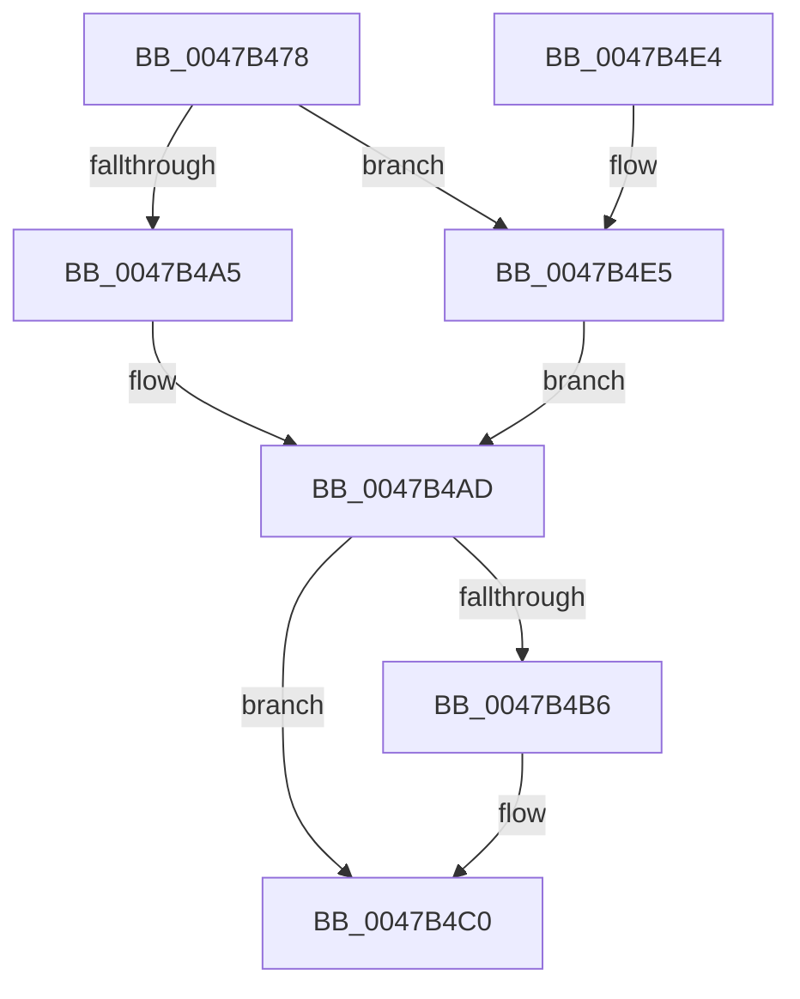

# MiDerefPageFileSpaceBitmaps

- RVA: `0x0047B478`–`0x0047B4E9` (길이 `113` bytes)
- VA: `0x000000014047B478`
- 실행 섹션: `.text`
- PDB 이름 있음: `예`; PDB Function 태그: `아니요`
- unwind 정보 RVA: `0x0005FD64`
- 디코드: `35`개 명령, `113/113` bytes 표시
- 미해석 바이트: `0` (있으면 어셈블리에 `.byte`로 보존)

> 이 문서는 커널 이미지의 기계어와 PDB 기호를 분석해 생성했습니다. 4번과 5번은 함수 원형과 자료형을 바이너리 사용 방식에서 추정한 C 해석이며 원본 소스 복구 결과는 아닙니다.

## 1. Dependencies

- 직접 호출 지점: **2**; 고유 호출 대상: **2**
- 직접 호출자로 확인된 함수: **3**
- RIP 상대 이미지 참조: **0**

### Outgoing calls
- `0x0047B4A8` → [ExAcquireSpinLockExclusive](../24/ExAcquireSpinLockExclusive_function_00248690.md) (function, `0x00248690`)
- `0x0047B4BB` → [MiReleaseSpinLockExclusive](../24/MiReleaseSpinLockExclusive_function_002482C0.md) (function, `0x002482C0`)

### Direct callers
- [MiStoreContractVirtualPagefileApc](../3A/MiStoreContractVirtualPagefileApc_function_003A4710.md) at `0x003A48C0`
- [MiChangePagingFileMaximum](../67/MiChangePagingFileMaximum_function_0067FEFC.md) at `0x0068013A`
- [sub_006EA81C](../6E/Unknown_function_006EA81C.md) at `0x006EA83F`

### Static image references
- 디코드된 RIP-relative 메모리 참조가 없습니다.

## 2. Other-region calls and transfers

- 다른 실행 섹션으로 향하는 call: **0**
- 별도 외부 분기/꼬리 이동을 확인하지 못했습니다.

## 3. Assembly (complete function range)

```asm
0047B478  48 8B C4                        mov rax, rsp
0047B47B  48 89 58 08                     mov qword ptr [rax + 8], rbx
0047B47F  48 89 68 10                     mov qword ptr [rax + 0x10], rbp
0047B483  48 89 70 18                     mov qword ptr [rax + 0x18], rsi
0047B487  48 89 78 20                     mov qword ptr [rax + 0x20], rdi
0047B48B  41 56                           push r14
0047B48D  48 83 EC 20                     sub rsp, 0x20
0047B491  48 8B 3A                        mov rdi, qword ptr [rdx]
0047B494  48 8D B1 C8 00 00 00            lea rsi, [rcx + 0xc8]
0047B49B  33 DB                           xor ebx, ebx
0047B49D  45 8B F0                        mov r14d, r8d
0047B4A0  45 85 C0                        test r8d, r8d
0047B4A3  75 40                           jne 0x14047b4e5
0047B4A5  48 8B CE                        mov rcx, rsi
0047B4A8  E8 E3 D1 DC FF                  call 0x140248690
0047B4AD  FF 0F                           dec dword ptr [rdi]
0047B4AF  8B 2F                           mov ebp, dword ptr [rdi]
0047B4B1  45 85 F6                        test r14d, r14d
0047B4B4  75 0A                           jne 0x14047b4c0
0047B4B6  8A D0                           mov dl, al
0047B4B8  48 8B CE                        mov rcx, rsi
0047B4BB  E8 00 CE DC FF                  call 0x1402482c0
0047B4C0  48 8B 74 24 40                  mov rsi, qword ptr [rsp + 0x40]
0047B4C5  85 ED                           test ebp, ebp
0047B4C7  48 8B 6C 24 38                  mov rbp, qword ptr [rsp + 0x38]
0047B4CC  48 0F 44 DF                     cmove rbx, rdi
0047B4D0  48 8B 7C 24 48                  mov rdi, qword ptr [rsp + 0x48]
0047B4D5  48 8B C3                        mov rax, rbx
0047B4D8  48 8B 5C 24 30                  mov rbx, qword ptr [rsp + 0x30]
0047B4DD  48 83 C4 20                     add rsp, 0x20
0047B4E1  41 5E                           pop r14
0047B4E3  C3                              ret
0047B4E4  CC                              int3
0047B4E5  B0 11                           mov al, 0x11
0047B4E7  EB C4                           jmp 0x14047b4ad
```

## 4. C-style interpretation (structured pseudocode)

```c
__int64 __fastcall MiDerefPageFileSpaceBitmaps(__int64 a1, __int64 a2, int a3)
{
    __int64 result;
    __int64 v_rbx;
    __int64 v_rsp;
    unsigned __int64 v_stack_p10;
    unsigned __int64 v_stack_p18;
    unsigned __int64 v_stack_p20;
    unsigned __int64 v_stack_p8;

    *(unsigned __int64 *)(v_rsp + 8) = v_rbx;
    *(unsigned __int64 *)(v_rsp + 16) = v_rbp;
    *(unsigned __int64 *)(v_rsp + 24) = v_rsi;
    *(unsigned __int64 *)(v_rsp + 32) = v_rdi;
    v_rsp = (v_rsp) - (32);
    v_rbx = 0;
    if (a3 != 0) goto loc_0047B4E5;
    result = ExAcquireSpinLockExclusive(a1 + 200, a2, a3, a4);
loc_0047B4AD:
    if ((unsigned int)((unsigned int)(a3)) == 0) {
        a2 = (unsigned __int8)(result);
        a1 = a1 + 200;
        result = MiReleaseSpinLockExclusive(a1, a2, a3, a4);
    }
    if ((unsigned int)((unsigned int)(*(unsigned int *)(*(unsigned __int64 *)(a2)))) == 0) { v_rbx = *(unsigned __int64 *)(a2); }
    v_rsp = (v_rsp) + (32);
    return v_rbx;
loc_0047B4E5:
    goto loc_0047B4AD;
}
```

## 5. (Beta) C Style

```c
int64_t MiDerefPageFileSpaceBitmaps(void *Arg1, void *Arg2, int32_t Arg3)
{
    uint8_t *arg1 = (uint8_t *)Arg1;
    uint8_t *arg2 = (uint8_t *)Arg2;

    int64_t result;
    int64_t local_rbx;
    int64_t local_rsp;
    uint64_t v_stack_p10;
    uint64_t v_stack_p18;
    uint64_t v_stack_p20;
    uint64_t v_stack_p8;

    *(uint64_t *)(local_rsp + 0x8) = local_rbx;
    *(uint64_t *)(local_rsp + 0x10) = local_rbp;
    *(uint64_t *)(local_rsp + 0x18) = local_rsi;
    *(uint64_t *)(local_rsp + 0x20) = local_rdi;
    local_rsp = (local_rsp) - (32);
    local_rbx = 0;
    if (Arg3 != 0) goto loc_0047B4E5;
    result = ExAcquireSpinLockExclusive(Arg1 + 200, Arg2, Arg3, a4);
loc_0047B4AD:
    if ((uint32_t)((uint32_t)(Arg3)) == 0) {
        Arg2 = (uint8_t)(result);
        Arg1 = Arg1 + 200;
        result = MiReleaseSpinLockExclusive(Arg1, Arg2, Arg3, a4);
    }
    if ((uint32_t)((uint32_t)(*(uint32_t *)(*(uint64_t *)(arg2)))) == 0) { local_rbx = *(uint64_t *)(arg2); }
    local_rsp = (local_rsp) + (32);
    return local_rbx;
loc_0047B4E5:
    goto loc_0047B4AD;
}
```

### 관측된 메모리 오프셋

구조체 형식이 확인되지 않은 접근은 인자 기준의 오프셋으로만 기록했습니다.

| 기준 인자 | 오프셋 표현 | 폭 (bit) | 접근 |
|---|---:|---:|---|
| `Arg1` | `+ 0xC8` | `64` | `R` |
| `Arg2` | `+ 0x0` | `64` | `R` |

## 6. Execution-region graph

[열기: 2D/3D 그래프와 함수 탐색 컨트롤 패널](../../../control-panel.html?section=text&rva=0x0047B478&view=graph)

- 2D 그래프는 위에서 아래로 흐르고, 3D 그래프는 빈 공간을 드래그해 회전합니다. Shift+드래그는 이동, 휠은 확대·축소, 함수 노드 선택은 대상 보고서 이동입니다.

### Static fallback


