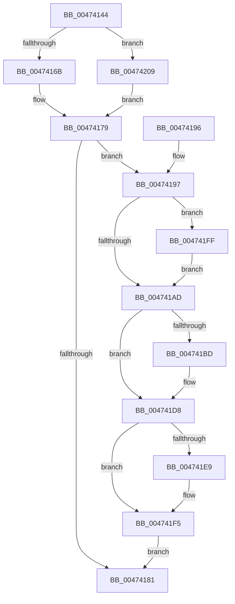

# MiDrainSystemAccessLog

- RVA: `0x00474144`–`0x0047421C` (길이 `216` bytes)
- VA: `0x0000000140474144`
- 실행 섹션: `.text`
- PDB 이름 있음: `예`; PDB Function 태그: `아니요`
- unwind 정보 RVA: `0x000AC6D8`
- 디코드: `54`개 명령, `216/216` bytes 표시
- 미해석 바이트: `0` (있으면 어셈블리에 `.byte`로 보존)

> 이 문서는 커널 이미지의 기계어와 PDB 기호를 분석해 생성했습니다. 4번과 5번은 함수 원형과 자료형을 바이너리 사용 방식에서 추정한 C 해석이며 원본 소스 복구 결과는 아닙니다.

## 1. Dependencies

- 직접 호출 지점: **6**; 고유 호출 대상: **6**
- 직접 호출자로 확인된 함수: **4**
- RIP 상대 이미지 참조: **3**

### Outgoing calls
- `0x004741B0` → [MiLockWorkingSetCoreExclusive](../2C/MiLockWorkingSetCoreExclusive_function_002C0CFC.md) (function, `0x002C0CFC`)
- `0x004741C0` → [MiGetVmAccessLoggingPartition](../38/MiGetVmAccessLoggingPartition_function_003815A0.md) (function, `0x003815A0`)
- `0x004741CB` → [MiEmptyPageAccessLog](../34/MiEmptyPageAccessLog_function_00348700.md) (function, `0x00348700`)
- `0x004741DB` → [MiUnlockWorkingSetCoreExclusive](../2C/MiUnlockWorkingSetCoreExclusive_function_002C0DC4.md) (function, `0x002C0DC4`)
- `0x004741F0` → [KiLowerIrqlProcessIrqlFlags](../4F/KiLowerIrqlProcessIrqlFlags_function_004F5698.md) (function, `0x004F5698`)
- `0x00474202` → [KiRaiseIrqlProcessIrqlFlags](../4F/KiRaiseIrqlProcessIrqlFlags_function_004F56FC.md) (function, `0x004F56FC`)

### Direct callers
- [MiCaptureAndResetWorkingSetAccessBits](MiCaptureAndResetWorkingSetAccessBits_function_00473FC0.md) at `0x00474082`
- [MiCleanWorkingSet](MiCleanWorkingSet_function_004740C4.md) at `0x00474113`
- [MiEmptyAccessLogs](../68/MiEmptyAccessLogs_function_00689FF0.md) at `0x0068A0A5`
- [MiEmptyAccessLogs](../68/MiEmptyAccessLogs_function_00689FF0.md) at `0x0068A0E7`
- [MiDeleteVad](../../page/88/MiDeleteVad_function_00888C80.md) at `0x00888E99`

### Static image references
- `0x0047416B` → RVA `0x00E38840` (`.data`; read)
- `0x00474172` → RVA `0x00E38868` (`.data`; read)
- `0x004741A4` → RVA `0x00FC6D20` (`ALMOSTRO`; read)

## 2. Other-region calls and transfers

- 다른 실행 섹션으로 향하는 call: **0**
- 별도 외부 분기/꼬리 이동을 확인하지 못했습니다.

## 3. Assembly (complete function range)

```asm
00474144  48 89 5C 24 08                  mov qword ptr [rsp + 8], rbx
00474149  48 89 6C 24 10                  mov qword ptr [rsp + 0x10], rbp
0047414E  48 89 74 24 18                  mov qword ptr [rsp + 0x18], rsi
00474153  57                              push rdi
00474154  48 83 EC 20                     sub rsp, 0x20
00474158  8B 81 B8 00 00 00               mov eax, dword ptr [rcx + 0xb8]
0047415E  48 8B D9                        mov rbx, rcx
00474161  24 0F                           and al, 0xf
00474163  3C 01                           cmp al, 1
00474165  0F 85 9E 00 00 00               jne 0x140474209
0047416B  48 8D 2D CE 46 9C 00            lea rbp, [rip + 0x9c46ce]
00474172  48 8D 35 EF 46 9C 00            lea rsi, [rip + 0x9c46ef]
00474179  48 8B 06                        mov rax, qword ptr [rsi]
0047417C  48 85 C0                        test rax, rax
0047417F  75 16                           jne 0x140474197
00474181  48 8B 5C 24 30                  mov rbx, qword ptr [rsp + 0x30]
00474186  48 8B 6C 24 38                  mov rbp, qword ptr [rsp + 0x38]
0047418B  48 8B 74 24 40                  mov rsi, qword ptr [rsp + 0x40]
00474190  48 83 C4 20                     add rsp, 0x20
00474194  5F                              pop rdi
00474195  C3                              ret
00474196  CC                              int3
00474197  44 0F 20 C7                     mov rdi, cr8
0047419B  BA 02 00 00 00                  mov edx, 2
004741A0  44 0F 22 C2                     mov cr8, rdx
004741A4  83 3D 75 2B B5 00 00            cmp dword ptr [rip + 0xb52b75], 0
004741AB  75 52                           jne 0x1404741ff
004741AD  48 8B CB                        mov rcx, rbx
004741B0  E8 47 CB E4 FF                  call 0x1402c0cfc
004741B5  4C 8B 06                        mov r8, qword ptr [rsi]
004741B8  4D 85 C0                        test r8, r8
004741BB  74 1B                           je 0x1404741d8
004741BD  48 8B CB                        mov rcx, rbx
004741C0  E8 DB D3 F0 FF                  call 0x1403815a0
004741C5  48 8B C8                        mov rcx, rax
004741C8  49 8B D0                        mov rdx, r8
004741CB  E8 30 45 ED FF                  call 0x140348700
004741D0  48 C7 45 28 00 00 00 00         mov qword ptr [rbp + 0x28], 0
004741D8  48 8B CB                        mov rcx, rbx
004741DB  E8 E4 CB E4 FF                  call 0x1402c0dc4
004741E0  83 3D 39 2B B5 00 00            cmp dword ptr [rip + 0xb52b39], 0
004741E7  74 0C                           je 0x1404741f5
004741E9  44 0F 20 C1                     mov rcx, cr8
004741ED  40 8A D7                        mov dl, dil
004741F0  E8 A3 14 08 00                  call 0x1404f5698
004741F5  40 0F B6 C7                     movzx eax, dil
004741F9  44 0F 22 C0                     mov cr8, rax
004741FD  EB 82                           jmp 0x140474181
004741FF  40 8A CF                        mov cl, dil
00474202  E8 F5 14 08 00                  call 0x1404f56fc
00474207  EB A4                           jmp 0x1404741ad
00474209  48 8D A9 C0 00 00 00            lea rbp, [rcx + 0xc0]
00474210  48 8D B1 E8 00 00 00            lea rsi, [rcx + 0xe8]
00474217  E9 5D FF FF FF                  jmp 0x140474179
```

## 4. C-style interpretation (structured pseudocode)

```c
__int64 __fastcall MiDrainSystemAccessLog(__int64 a1)
{
    __int64 result;
    __int64 v_rsp;
    unsigned __int64 v_stack_p10;
    unsigned __int64 v_stack_p18;
    unsigned __int64 v_stack_p8;

    v_stack_p8 = v_rbx;
    v_stack_p10 = v_rbp;
    v_stack_p18 = v_rsi;
    v_rsp = (v_rsp) - (32);
    result = (unsigned __int8)(((unsigned int)(*(unsigned int *)(a1 + 184))) & (15));
    if (((unsigned __int8)(result)) != 1) goto loc_00474209;
loc_00474179:
    if (*(unsigned __int64 *)(v_rip + 10241775) != 0) goto loc_00474197;
loc_00474181:
    v_rsp = (v_rsp) + (32);
    return *(unsigned __int64 *)(v_rip + 10241775);
loc_00474197:
    if ((*(unsigned int *)(v_rip + 11873141)) != 0) goto loc_004741FF;
loc_004741AD:
    result = MiLockWorkingSetCoreExclusive(v_stack_p8, 2, a3, a4);
    if (*(unsigned __int64 *)(v_stack_p18) != 0) {
        a1 = v_stack_p8;
        result = MiGetVmAccessLoggingPartition(a1, 2, *(unsigned __int64 *)(v_stack_p18), a4);
        a1 = result;
        a2 = *(unsigned __int64 *)(v_stack_p18);
        result = MiEmptyPageAccessLog(a1, a2, *(unsigned __int64 *)(v_stack_p18), a4);
        *(unsigned __int64 *)(v_stack_p10 + 40) = 0;
    }
    result = MiUnlockWorkingSetCoreExclusive(v_stack_p8, a2, *(unsigned __int64 *)(v_stack_p18), a4);
    if ((*(unsigned int *)(v_rip + 11873081)) != 0) {
        a1 = 2;
        a2 = (unsigned __int8)(v_cr8);
        result = KiLowerIrqlProcessIrqlFlags(a1, a2, *(unsigned __int64 *)(v_stack_p18), a4);
    }
    goto loc_00474181;
loc_004741FF:
    result = KiRaiseIrqlProcessIrqlFlags((unsigned __int8)(v_cr8), a2, *(unsigned __int64 *)(v_stack_p18), a4);
    goto loc_004741AD;
loc_00474209:
    goto loc_00474179;
}
```

## 5. (Beta) C Style

```c
int64_t MiDrainSystemAccessLog(void *Arg1)
{
    uint8_t *arg1 = (uint8_t *)Arg1;

    int64_t result;
    int64_t local_rsp;
    uint64_t v_stack_p10;
    uint64_t v_stack_p18;
    uint64_t v_stack_p8;

    v_stack_p8 = local_rbx;
    v_stack_p10 = local_rbp;
    v_stack_p18 = local_rsi;
    local_rsp = (local_rsp) - (32);
    result = (uint8_t)(((uint32_t)(*(uint32_t *)(arg1 + 0xB8))) & (15));
    if (((uint8_t)(result)) != 1) goto loc_00474209;
loc_00474179:
    if (*(uint64_t *)(v_rip + 0x9C46EF) != 0) goto loc_00474197;
loc_00474181:
    local_rsp = (local_rsp) + (32);
    return *(uint64_t *)(v_rip + 0x9C46EF);
loc_00474197:
    if ((*(uint32_t *)(v_rip + 0xB52B75)) != 0) goto loc_004741FF;
loc_004741AD:
    result = MiLockWorkingSetCoreExclusive(v_stack_p8, 2, a3, a4);
    if (*(uint64_t *)(v_stack_p18) != 0) {
        Arg1 = v_stack_p8;
        result = MiGetVmAccessLoggingPartition(Arg1, 2, *(uint64_t *)(v_stack_p18), a4);
        Arg1 = result;
        a2 = *(uint64_t *)(v_stack_p18);
        result = MiEmptyPageAccessLog(Arg1, a2, *(uint64_t *)(v_stack_p18), a4);
        *(uint64_t *)(v_stack_p10 + 0x28) = 0;
    }
    result = MiUnlockWorkingSetCoreExclusive(v_stack_p8, a2, *(uint64_t *)(v_stack_p18), a4);
    if ((*(uint32_t *)(v_rip + 0xB52B39)) != 0) {
        Arg1 = 2;
        a2 = (uint8_t)(v_cr8);
        result = KiLowerIrqlProcessIrqlFlags(Arg1, a2, *(uint64_t *)(v_stack_p18), a4);
    }
    goto loc_00474181;
loc_004741FF:
    result = KiRaiseIrqlProcessIrqlFlags((uint8_t)(v_cr8), a2, *(uint64_t *)(v_stack_p18), a4);
    goto loc_004741AD;
loc_00474209:
    goto loc_00474179;
}
```

### 관측된 메모리 오프셋

구조체 형식이 확인되지 않은 접근은 인자 기준의 오프셋으로만 기록했습니다.

| 기준 인자 | 오프셋 표현 | 폭 (bit) | 접근 |
|---|---:|---:|---|
| `Arg1` | `+ 0xB8` | `32` | `R` |
| `Arg1` | `+ 0xC0` | `64` | `R` |
| `Arg1` | `+ 0xE8` | `64` | `R` |

## 6. Execution-region graph

[열기: 2D/3D 그래프와 함수 탐색 컨트롤 패널](../../../control-panel.html?section=text&rva=0x00474144&view=graph)

- 2D 그래프는 위에서 아래로 흐르고, 3D 그래프는 빈 공간을 드래그해 회전합니다. Shift+드래그는 이동, 휠은 확대·축소, 함수 노드 선택은 대상 보고서 이동입니다.

### Static fallback


