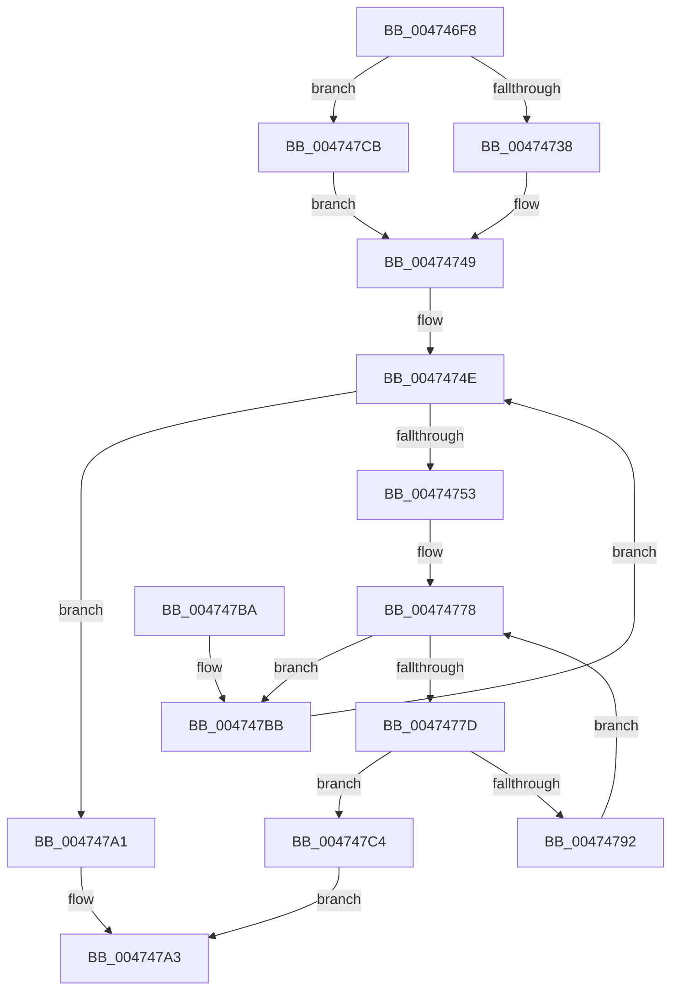

# MiEnumerateSlabAllocatorsEx

- RVA: `0x004746F8`–`0x004747E4` (길이 `236` bytes)
- VA: `0x00000001404746F8`
- 실행 섹션: `.text`
- PDB 이름 있음: `예`; PDB Function 태그: `아니요`
- unwind 정보 RVA: `0x000AC800`
- 디코드: `65`개 명령, `236/236` bytes 표시
- 미해석 바이트: `0` (있으면 어셈블리에 `.byte`로 보존)

> 이 문서는 커널 이미지의 기계어와 PDB 기호를 분석해 생성했습니다. 4번과 5번은 함수 원형과 자료형을 바이너리 사용 방식에서 추정한 C 해석이며 원본 소스 복구 결과는 아닙니다.

## 1. Dependencies

- 직접 호출 지점: **1**; 고유 호출 대상: **1**
- 직접 호출자로 확인된 함수: **14**
- RIP 상대 이미지 참조: **1**

### Outgoing calls
- `0x00474789` → [guard_dispatch_icall](../6B/guard_dispatch_icall_function_006BAAD0.md) (function, `0x006BAAD0`)

### Direct callers
- [MiLogPeriodicTelemetry](../2D/MiLogPeriodicTelemetry_function_002DB750.md) at `0x002DBB07`
- [MiDemoteSlabEntriesDpc](../44/MiDemoteSlabEntriesDpc_function_0044C3C0.md) at `0x0044C632`
- [MiDemoteSlabEntriesDpc](../44/MiDemoteSlabEntriesDpc_function_0044C3C0.md) at `0x0044C65F`
- [MiDemoteSlabEntriesDpc](../44/MiDemoteSlabEntriesDpc_function_0044C3C0.md) at `0x0044C690`
- [MiChangeSlabIdentitiesDpc](../68/MiChangeSlabIdentitiesDpc_function_0068CF10.md) at `0x0068CF83`
- [MiDefragmentAllSlabAllocators](../68/MiDefragmentAllSlabAllocators_function_0068D43C.md) at `0x0068D4EA`
- [MiDefragmentAllSlabAllocators](../68/MiDefragmentAllSlabAllocators_function_0068D43C.md) at `0x0068D519`
- [MiDefragmentSlabWorker](../68/MiDefragmentSlabWorker_function_0068D730.md) at `0x0068D7B0`
- [MiDeletePendingSlabIdentities](../68/MiDeletePendingSlabIdentities_function_0068DA3C.md) at `0x0068DC3A`
- [MiDetermineDefragmentSlabIdentity](../68/MiDetermineDefragmentSlabIdentity_function_0068E02C.md) at `0x0068E067`
- [MiEstablishDefragSlabEntries](../68/MiEstablishDefragSlabEntries_function_0068E0EC.md) at `0x0068E140`
- [MiEstablishDefragSlabEntries](../68/MiEstablishDefragSlabEntries_function_0068E0EC.md) at `0x0068E19D`
- [MiEstablishDefragSlabEntries](../68/MiEstablishDefragSlabEntries_function_0068E0EC.md) at `0x0068E43C`
- [MiFindDefragmentSlabEntries](../68/MiFindDefragmentSlabEntries_function_0068E464.md) at `0x0068E4B2`
- [MiFindDefragmentSlabEntries](../68/MiFindDefragmentSlabEntries_function_0068E464.md) at `0x0068E4D2`
- [MiFindDefragmentSlabEntries](../68/MiFindDefragmentSlabEntries_function_0068E464.md) at `0x0068E51B`
- [MiLockUnlockSlabContextsForDefrag](../68/MiLockUnlockSlabContextsForDefrag_function_0068EDA4.md) at `0x0068EE02`
- [MiUpdateSlabContextSlabSize](../68/MiUpdateSlabContextSlabSize_function_0068F2A4.md) at `0x0068F2F2`
- [MiUpdateSlabContextSlabSize](../68/MiUpdateSlabContextSlabSize_function_0068F2A4.md) at `0x0068F310`
- [MiUpdateSlabContextSlabSize](../68/MiUpdateSlabContextSlabSize_function_0068F2A4.md) at `0x0068F339`
- [MiUpdateSlabContextSlabSize](../68/MiUpdateSlabContextSlabSize_function_0068F2A4.md) at `0x0068F359`
- [MiDeletePartitionSlabState](../../page/80/MiDeletePartitionSlabState_function_0080C890.md) at `0x0080C8C0`
- [MiInitNucleus](../../init/C5/MiInitNucleus_function_00C5FD38.md) at `0x00C6059A`
- [MmUpdateSlabRangeType](../../init/C6/MmUpdateSlabRangeType_function_00C6A10C.md) at `0x00C6A182`

### Static image references
- `0x00474738` → RVA `0x00FC5000` (`ALMOSTRO`; read)

## 2. Other-region calls and transfers

- 다른 실행 섹션으로 향하는 call: **0**
- 별도 외부 분기/꼬리 이동을 확인하지 못했습니다.

## 3. Assembly (complete function range)

```asm
004746F8  48 89 5C 24 08                  mov qword ptr [rsp + 8], rbx
004746FD  48 89 6C 24 18                  mov qword ptr [rsp + 0x18], rbp
00474702  48 89 54 24 10                  mov qword ptr [rsp + 0x10], rdx
00474707  56                              push rsi
00474708  57                              push rdi
00474709  41 54                           push r12
0047470B  41 55                           push r13
0047470D  41 57                           push r15
0047470F  48 83 EC 20                     sub rsp, 0x20
00474713  48 8B 59 10                     mov rbx, qword ptr [rcx + 0x10]
00474717  45 33 FF                        xor r15d, r15d
0047471A  83 7C 24 70 09                  cmp dword ptr [rsp + 0x70], 9
0047471F  4D 8B E0                        mov r12, r8
00474722  4C 8B D2                        mov r10, rdx
00474725  4C 8B E9                        mov r13, rcx
00474728  44 0F 45 7C 24 70               cmovne r15d, dword ptr [rsp + 0x70]
0047472E  41 83 F9 FF                     cmp r9d, -1
00474732  0F 85 93 00 00 00               jne 0x1404747cb
00474738  0F B7 05 C1 08 B5 00            movzx eax, word ptr [rip + 0xb508c1]
0047473F  48 69 F0 80 DF 00 00            imul rsi, rax, 0xdf80
00474746  48 03 F3                        add rsi, rbx
00474749  BA E8 00 00 00                  mov edx, 0xe8
0047474E  48 3B DE                        cmp rbx, rsi
00474751  73 4E                           jae 0x1404747a1
00474753  41 8B C7                        mov eax, r15d
00474756  BD 28 08 00 00                  mov ebp, 0x828
0047475B  48 69 F8 E8 00 00 00            imul rdi, rax, 0xe8
00474762  48 81 C7 50 3D 00 00            add rdi, 0x3d50
00474769  48 03 FB                        add rdi, rbx
0047476C  83 7C 24 70 09                  cmp dword ptr [rsp + 0x70], 9
00474771  48 0F 45 EA                     cmovne rbp, rdx
00474775  48 03 EF                        add rbp, rdi
00474778  48 3B FD                        cmp rdi, rbp
0047477B  73 3E                           jae 0x1404747bb
0047477D  4D 8B C4                        mov r8, r12
00474780  48 8B D7                        mov rdx, rdi
00474783  49 8B CD                        mov rcx, r13
00474786  49 8B C2                        mov rax, r10
00474789  E8 42 63 24 00                  call 0x1406baad0
0047478E  85 C0                           test eax, eax
00474790  75 32                           jne 0x1404747c4
00474792  4C 8B 54 24 58                  mov r10, qword ptr [rsp + 0x58]
00474797  BA E8 00 00 00                  mov edx, 0xe8
0047479C  48 03 FA                        add rdi, rdx
0047479F  EB D7                           jmp 0x140474778
004747A1  33 C0                           xor eax, eax
004747A3  48 8B 5C 24 50                  mov rbx, qword ptr [rsp + 0x50]
004747A8  48 8B 6C 24 60                  mov rbp, qword ptr [rsp + 0x60]
004747AD  48 83 C4 20                     add rsp, 0x20
004747B1  41 5F                           pop r15
004747B3  41 5D                           pop r13
004747B5  41 5C                           pop r12
004747B7  5F                              pop rdi
004747B8  5E                              pop rsi
004747B9  C3                              ret
004747BA  CC                              int3
004747BB  48 81 C3 80 DF 00 00            add rbx, 0xdf80
004747C2  EB 8A                           jmp 0x14047474e
004747C4  B8 01 00 00 00                  mov eax, 1
004747C9  EB D8                           jmp 0x1404747a3
004747CB  41 8B C1                        mov eax, r9d
004747CE  48 69 C8 80 DF 00 00            imul rcx, rax, 0xdf80
004747D5  48 03 D9                        add rbx, rcx
004747D8  48 8D B3 80 DF 00 00            lea rsi, [rbx + 0xdf80]
004747DF  E9 65 FF FF FF                  jmp 0x140474749
```

## 4. C-style interpretation (structured pseudocode)

```c
__int64 __fastcall MiEnumerateSlabAllocatorsEx(__int64 a1, __int64 a2, __int64 a3, int a4, unsigned int a5)
{
    __int64 result;
    __int64 v_r15;
    __int64 v_rbp;
    __int64 v_rbx;
    __int64 v_rdi;
    __int64 v_rsi;
    __int64 v_rsp;
    unsigned __int64 v_stack_p10;
    unsigned __int64 v_stack_p18;
    unsigned __int64 v_stack_p8;

    v_stack_p8 = v_rbx;
    v_stack_p18 = v_rbp;
    v_stack_p10 = a2;
    v_rsp = (v_rsp) - (32);
    v_r15 = 0;
    if (a5 != 9) { v_r15 = a5; }
    if (a4 != -1) goto loc_004747CB;
    v_rsi = (v_rsi) * (*(unsigned __int16 *)(v_rip + 11864257));
    v_rsi = (v_rsi) + (*(unsigned __int64 *)(a1 + 16));
loc_00474749:
loc_0047474E:
    if ((*(unsigned __int64 *)(a1 + 16)) >= v_rsi) goto loc_004747A1;
    v_rdi = (v_rdi) * ((unsigned int)((unsigned int)(v_r15)));
    v_rdi = (v_rdi) + (0x3D50ULL);
    v_rdi = (v_rdi) + (*(unsigned __int64 *)(a1 + 16));
    v_rbp = (unsigned int)(0x828ULL);
    if (a5 != 9) { v_rbp = 232; }
    v_rbp = (v_rbp) + (v_rdi);
loc_00474778:
    if (v_rdi >= v_rbp) goto loc_004747BB;
    result = guard_dispatch_icall(a1, v_rdi, a3, a4);
    if ((unsigned int)(result) != 0) goto loc_004747C4;
    v_rdi = (v_rdi) + (232);
    goto loc_00474778;
loc_004747A1:
    result = 0;
loc_004747A3:
    v_rsp = (v_rsp) + (32);
    return result;
loc_004747BB:
    v_rbx = (v_stack_p8) + (0xDF80ULL);
    goto loc_0047474E;
loc_004747C4:
    goto loc_004747A3;
loc_004747CB:
    a1 = (a1) * ((unsigned int)(a4));
    v_rbx = (v_rbx) + (a1);
    goto loc_00474749;
}
```

## 5. (Beta) C Style

```c
int64_t MiEnumerateSlabAllocatorsEx(void *Arg1, int64_t Arg2, int64_t Arg3, int32_t Arg4, uint32_t Arg5)
{
    uint8_t *arg1 = (uint8_t *)Arg1;

    int64_t result;
    int64_t local_r15;
    int64_t local_rbp;
    int64_t local_rbx;
    int64_t local_rdi;
    int64_t local_rsi;
    int64_t local_rsp;
    uint64_t v_stack_p10;
    uint64_t v_stack_p18;
    uint64_t v_stack_p8;

    v_stack_p8 = local_rbx;
    v_stack_p18 = local_rbp;
    v_stack_p10 = Arg2;
    local_rsp = (local_rsp) - (32);
    local_r15 = 0;
    if (Arg5 != 9) { local_r15 = Arg5; }
    if (Arg4 != -1) goto loc_004747CB;
    local_rsi = (local_rsi) * (*(uint16_t *)(v_rip + 0xB508C1));
    local_rsi = (local_rsi) + (*(uint64_t *)(arg1 + 0x10));
loc_00474749:
loc_0047474E:
    if ((*(uint64_t *)(arg1 + 0x10)) >= local_rsi) goto loc_004747A1;
    local_rdi = (local_rdi) * ((uint32_t)((uint32_t)(local_r15)));
    local_rdi = (local_rdi) + (0x3D50ULL);
    local_rdi = (local_rdi) + (*(uint64_t *)(arg1 + 0x10));
    local_rbp = (uint32_t)(0x828ULL);
    if (Arg5 != 9) { local_rbp = 232; }
    local_rbp = (local_rbp) + (local_rdi);
loc_00474778:
    if (local_rdi >= local_rbp) goto loc_004747BB;
    result = guard_dispatch_icall(Arg1, local_rdi, Arg3, Arg4);
    if ((uint32_t)(result) != 0) goto loc_004747C4;
    local_rdi = (local_rdi) + (232);
    goto loc_00474778;
loc_004747A1:
    result = 0;
loc_004747A3:
    local_rsp = (local_rsp) + (32);
    return result;
loc_004747BB:
    local_rbx = (v_stack_p8) + (0xDF80ULL);
    goto loc_0047474E;
loc_004747C4:
    goto loc_004747A3;
loc_004747CB:
    Arg1 = (Arg1) * ((uint32_t)(Arg4));
    local_rbx = (local_rbx) + (Arg1);
    goto loc_00474749;
}
```

### 관측된 메모리 오프셋

구조체 형식이 확인되지 않은 접근은 인자 기준의 오프셋으로만 기록했습니다.

| 기준 인자 | 오프셋 표현 | 폭 (bit) | 접근 |
|---|---:|---:|---|
| `Arg1` | `+ 0x10` | `64` | `R` |

## 6. Execution-region graph

[열기: 2D/3D 그래프와 함수 탐색 컨트롤 패널](../../../control-panel.html?section=text&rva=0x004746F8&view=graph)

- 2D 그래프는 위에서 아래로 흐르고, 3D 그래프는 빈 공간을 드래그해 회전합니다. Shift+드래그는 이동, 휠은 확대·축소, 함수 노드 선택은 대상 보고서 이동입니다.

### Static fallback


