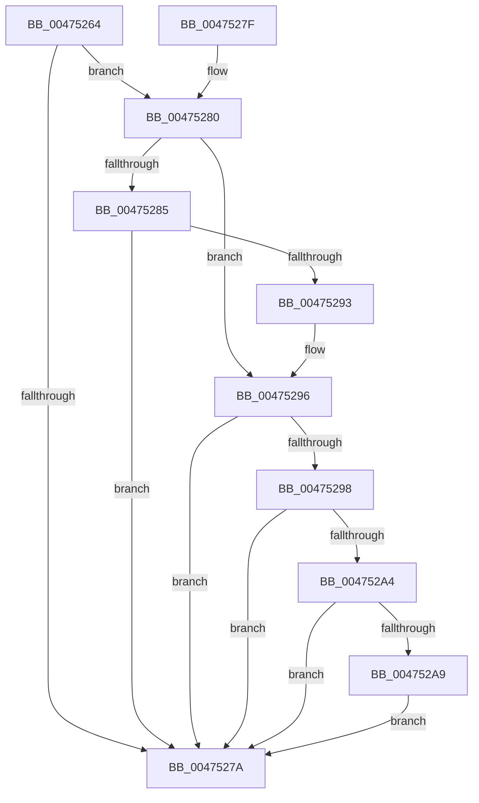

# MiExtendPageFilesIfNecessary

- RVA: `0x00475264`–`0x004752EB` (길이 `135` bytes)
- VA: `0x0000000140475264`
- 실행 섹션: `.text`
- PDB 이름 있음: `예`; PDB Function 태그: `아니요`
- unwind 정보 RVA: `0x000ACB00`
- 디코드: `39`개 명령, `135/135` bytes 표시
- 미해석 바이트: `0` (있으면 어셈블리에 `.byte`로 보존)

> 이 문서는 커널 이미지의 기계어와 PDB 기호를 분석해 생성했습니다. 4번과 5번은 함수 원형과 자료형을 바이너리 사용 방식에서 추정한 C 해석이며 원본 소스 복구 결과는 아닙니다.

## 1. Dependencies

- 직접 호출 지점: **1**; 고유 호출 대상: **1**
- 직접 호출자로 확인된 함수: **1**
- RIP 상대 이미지 참조: **0**

### Outgoing calls
- `0x004752E4` → [MiIssuePageExtendRequest](MiIssuePageExtendRequest_function_004752F4.md) (function, `0x004752F4`)

### Direct callers
- [MiChargeCommit](../28/MiChargeCommit_function_00286EB0.md) at `0x00287095`

### Static image references
- 디코드된 RIP-relative 메모리 참조가 없습니다.

## 2. Other-region calls and transfers

- 다른 실행 섹션으로 향하는 call: **0**
- 별도 외부 분기/꼬리 이동을 확인하지 못했습니다.

## 3. Assembly (complete function range)

```asm
00475264  48 83 EC 28                     sub rsp, 0x28
00475268  48 8B 81 E0 41 00 00            mov rax, qword ptr [rcx + 0x41e0]
0047526F  4C 8B CA                        mov r9, rdx
00475272  4C 8B D1                        mov r10, rcx
00475275  48 3B D0                        cmp rdx, rax
00475278  73 06                           jae 0x140475280
0047527A  48 83 C4 28                     add rsp, 0x28
0047527E  C3                              ret
0047527F  CC                              int3
00475280  4D 3B C8                        cmp r9, r8
00475283  73 11                           jae 0x140475296
00475285  49 8B C0                        mov rax, r8
00475288  49 2B C1                        sub rax, r9
0047528B  48 3D 00 00 40 00               cmp rax, 0x400000
00475291  73 E7                           jae 0x14047527a
00475293  4D 3B C8                        cmp r9, r8
00475296  77 E2                           ja 0x14047527a
00475298  48 8B 89 C8 41 00 00            mov rcx, qword ptr [rcx + 0x41c8]
0047529F  4C 3B C1                        cmp r8, rcx
004752A2  73 D6                           jae 0x14047527a
004752A4  4C 3B C9                        cmp r9, rcx
004752A7  73 D1                           jae 0x14047527a
004752A9  48 B8 CD CC CC CC CC CC CC CC   movabs rax, 0xcccccccccccccccd
004752B3  49 F7 E0                        mul r8
004752B6  B8 00 00 04 00                  mov eax, 0x40000
004752BB  48 C1 EA 03                     shr rdx, 3
004752BF  48 3B D0                        cmp rdx, rax
004752C2  48 0F 47 D0                     cmova rdx, rax
004752C6  49 2B C8                        sub rcx, r8
004752C9  49 2B D1                        sub rdx, r9
004752CC  4A 8D 04 02                     lea rax, [rdx + r8]
004752D0  48 3B C1                        cmp rax, rcx
004752D3  48 0F 46 C8                     cmovbe rcx, rax
004752D7  45 33 C9                        xor r9d, r9d
004752DA  48 8B D1                        mov rdx, rcx
004752DD  49 8B CA                        mov rcx, r10
004752E0  45 8D 41 02                     lea r8d, [r9 + 2]
004752E4  E8 0B 00 00 00                  call 0x1404752f4
004752E9  EB 8F                           jmp 0x14047527a
```

## 4. C-style interpretation (structured pseudocode)

```c
__int64 __fastcall MiExtendPageFilesIfNecessary(__int64 a1, __int64 a2, __int64 a3)
{
    __int64 result;
    __int64 v_rsp;

    v_rsp = (v_rsp) - (40);
    if (a2 >= (*(unsigned __int64 *)(a1 + 16864))) goto loc_00475280;
loc_0047527A:
    v_rsp = (v_rsp) + (40);
    return *(unsigned __int64 *)(a1 + 16864);
loc_00475280:
    if (a2 >= a3) goto loc_00475296;
    result = (a3) - (a2);
    if (result >= 0x400000ULL) goto loc_0047527A;
loc_00475296:
    if (a2 > a3) goto loc_0047527A;
    if (a3 >= (*(unsigned __int64 *)(a1 + 16840))) goto loc_0047527A;
    if (a2 >= (*(unsigned __int64 *)(a1 + 16840))) goto loc_0047527A;
    a2 = (a2) >> (3);
    if (a2 > ((unsigned int)(0x40000ULL))) { a2 = (unsigned int)(0x40000ULL); }
    a1 = (*(unsigned __int64 *)(a1 + 16840)) - (a3);
    a2 = (a2) - (a2);
    if ((a2 + a3 * 1) <= a1) { a1 = a2 + a3 * 1; }
    a4 = 0;
    result = MiIssuePageExtendRequest(a1, a1, a4 + 2, a4);
    goto loc_0047527A;
}
```

## 5. (Beta) C Style

```c
int64_t MiExtendPageFilesIfNecessary(void *Arg1, int64_t Arg2, int64_t Arg3)
{
    uint8_t *arg1 = (uint8_t *)Arg1;

    int64_t result;
    int64_t local_rsp;

    local_rsp = (local_rsp) - (40);
    if (Arg2 >= (*(uint64_t *)(arg1 + 0x41E0))) goto loc_00475280;
loc_0047527A:
    local_rsp = (local_rsp) + (40);
    return *(uint64_t *)(arg1 + 0x41E0);
loc_00475280:
    if (Arg2 >= Arg3) goto loc_00475296;
    result = (Arg3) - (Arg2);
    if (result >= 0x400000ULL) goto loc_0047527A;
loc_00475296:
    if (Arg2 > Arg3) goto loc_0047527A;
    if (Arg3 >= (*(uint64_t *)(arg1 + 0x41C8))) goto loc_0047527A;
    if (Arg2 >= (*(uint64_t *)(arg1 + 0x41C8))) goto loc_0047527A;
    Arg2 = (Arg2) >> (3);
    if (Arg2 > ((uint32_t)(0x40000ULL))) { Arg2 = (uint32_t)(0x40000ULL); }
    Arg1 = (*(uint64_t *)(arg1 + 0x41C8)) - (Arg3);
    Arg2 = (Arg2) - (Arg2);
    if ((Arg2 + Arg3 * 1) <= Arg1) { Arg1 = Arg2 + Arg3 * 1; }
    a4 = 0;
    result = MiIssuePageExtendRequest(Arg1, Arg1, a4 + 2, a4);
    goto loc_0047527A;
}
```

### 관측된 메모리 오프셋

구조체 형식이 확인되지 않은 접근은 인자 기준의 오프셋으로만 기록했습니다.

| 기준 인자 | 오프셋 표현 | 폭 (bit) | 접근 |
|---|---:|---:|---|
| `Arg1` | `+ 0x41C8` | `64` | `R` |
| `Arg1` | `+ 0x41E0` | `64` | `R` |

## 6. Execution-region graph

[열기: 2D/3D 그래프와 함수 탐색 컨트롤 패널](../../../control-panel.html?section=text&rva=0x00475264&view=graph)

- 2D 그래프는 위에서 아래로 흐르고, 3D 그래프는 빈 공간을 드래그해 회전합니다. Shift+드래그는 이동, 휠은 확대·축소, 함수 노드 선택은 대상 보고서 이동입니다.

### Static fallback


