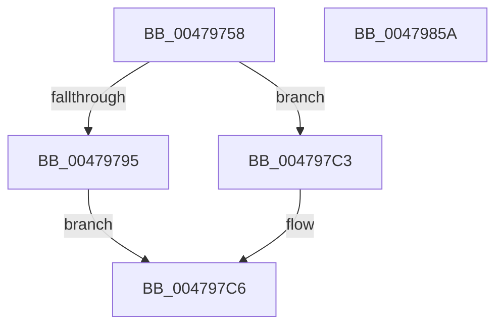

# MiFaultGetFileExtents

- RVA: `0x00479758`–`0x0047985B` (길이 `259` bytes)
- VA: `0x0000000140479758`
- 실행 섹션: `.text`
- PDB 이름 있음: `예`; PDB Function 태그: `아니요`
- unwind 정보 RVA: `0x000ACFA4`
- 디코드: `69`개 명령, `259/259` bytes 표시
- 미해석 바이트: `0` (있으면 어셈블리에 `.byte`로 보존)

> 이 문서는 커널 이미지의 기계어와 PDB 기호를 분석해 생성했습니다. 4번과 5번은 함수 원형과 자료형을 바이너리 사용 방식에서 추정한 C 해석이며 원본 소스 복구 결과는 아닙니다.

## 1. Dependencies

- 직접 호출 지점: **10**; 고유 호출 대상: **10**
- 직접 호출자로 확인된 함수: **1**
- RIP 상대 이미지 참조: **0**

### Outgoing calls
- `0x0047979C` → [MiGetSessionIdForVa](../34/MiGetSessionIdForVa_function_00346C60.md) (function, `0x00346C60`)
- `0x004797AC` → [MiGetSharedProtos](../34/MiGetSharedProtos_function_00348D58.md) (function, `0x00348D58`)
- `0x004797C9` → [MiRetainSubsection](MiRetainSubsection_function_00479864.md) (function, `0x00479864`)
- `0x004797D2` → [ExAcquireSpinLockExclusiveAtDpcLevel](../24/ExAcquireSpinLockExclusiveAtDpcLevel_function_00248E80.md) (function, `0x00248E80`)
- `0x004797E3` → [ExReleaseSpinLockExclusiveFromDpcLevel](../24/ExReleaseSpinLockExclusiveFromDpcLevel_function_002497E0.md) (function, `0x002497E0`)
- `0x004797F1` → [MiReleaseFaultState](../27/MiReleaseFaultState_function_0027D290.md) (function, `0x0027D290`)
- `0x0047981A` → [MiAllocateFileExtents](../../page/AB/MiAllocateFileExtents_function_00ABDF54.md) (function, `0x00ABDF54`)
- `0x00479824` → [MiFreeInPageSupportBlock](../2B/MiFreeInPageSupportBlock_function_002B5900.md) (function, `0x002B5900`)
- `0x0047982C` → [MiDereferenceControlArea](MiDereferenceControlArea_function_00479A20.md) (function, `0x00479A20`)
- `0x00479834` → [MiReleaseFaultCharges](MiReleaseFaultCharges_function_004798C8.md) (function, `0x004798C8`)

### Direct callers
- [sub_0027F36E](../27/Unknown_function_0027F36E.md) at `0x0027F4AC`

### Static image references
- 디코드된 RIP-relative 메모리 참조가 없습니다.

## 2. Other-region calls and transfers

- 다른 실행 섹션으로 향하는 call: **1**
  - `0x0047981A` → [MiAllocateFileExtents](../../page/AB/MiAllocateFileExtents_function_00ABDF54.md) (`.text` → `PAGE`)
- 별도 외부 분기/꼬리 이동을 확인하지 못했습니다.

## 3. Assembly (complete function range)

```asm
00479758  48 8B C4                        mov rax, rsp
0047975B  48 89 58 08                     mov qword ptr [rax + 8], rbx
0047975F  48 89 68 10                     mov qword ptr [rax + 0x10], rbp
00479763  48 89 70 18                     mov qword ptr [rax + 0x18], rsi
00479767  48 89 78 20                     mov qword ptr [rax + 0x20], rdi
0047976B  41 55                           push r13
0047976D  41 56                           push r14
0047976F  41 57                           push r15
00479771  48 83 EC 30                     sub rsp, 0x30
00479775  48 8B B2 D0 00 00 00            mov rsi, qword ptr [rdx + 0xd0]
0047977C  48 8B EA                        mov rbp, rdx
0047977F  48 8B BA E8 00 00 00            mov rdi, qword ptr [rdx + 0xe8]
00479786  4C 8B E9                        mov r13, rcx
00479789  8B 46 20                        mov eax, dword ptr [rsi + 0x20]
0047978C  4C 8B 36                        mov r14, qword ptr [rsi]
0047978F  0F BA E0 11                     bt eax, 0x11
00479793  73 2E                           jae 0x1404797c3
00479795  48 8B 8A E0 00 00 00            mov rcx, qword ptr [rdx + 0xe0]
0047979C  E8 BF D4 EC FF                  call 0x140346c60
004797A1  8B D0                           mov edx, eax
004797A3  49 8B CE                        mov rcx, r14
004797A6  4C 8B C6                        mov r8, rsi
004797A9  44 8B F8                        mov r15d, eax
004797AC  E8 A7 F5 EC FF                  call 0x140348d58
004797B1  48 8B 4E 08                     mov rcx, qword ptr [rsi + 8]
004797B5  48 2B 78 48                     sub rdi, qword ptr [rax + 0x48]
004797B9  48 C1 FF 03                     sar rdi, 3
004797BD  48 8D 3C F9                     lea rdi, [rcx + rdi*8]
004797C1  EB 03                           jmp 0x1404797c6
004797C3  45 33 FF                        xor r15d, r15d
004797C6  48 8B CE                        mov rcx, rsi
004797C9  E8 96 00 00 00                  call 0x140479864
004797CE  49 8D 4E 48                     lea rcx, [r14 + 0x48]
004797D2  E8 A9 F6 DC FF                  call 0x140248e80
004797D7  49 FF 46 28                     inc qword ptr [r14 + 0x28]
004797DB  49 8D 4E 48                     lea rcx, [r14 + 0x48]
004797DF  49 FF 46 30                     inc qword ptr [r14 + 0x30]
004797E3  E8 F8 FF DC FF                  call 0x1402497e0
004797E8  49 8D 4D 38                     lea rcx, [r13 + 0x38]
004797EC  45 33 C0                        xor r8d, r8d
004797EF  B2 11                           mov dl, 0x11
004797F1  E8 9A 3A E0 FF                  call 0x14027d290
004797F6  48 8B D7                        mov rdx, rdi
004797F9  44 89 7C 24 28                  mov dword ptr [rsp + 0x28], r15d
004797FE  48 2B 56 08                     sub rdx, qword ptr [rsi + 8]
00479802  41 B9 01 00 00 00               mov r9d, 1
00479808  48 C1 FA 03                     sar rdx, 3
0047980C  4C 8B C7                        mov r8, rdi
0047980F  48 8B CE                        mov rcx, rsi
00479812  C7 44 24 20 02 00 00 00         mov dword ptr [rsp + 0x20], 2
0047981A  E8 35 47 64 00                  call 0x140abdf54
0047981F  48 8B CD                        mov rcx, rbp
00479822  8B D8                           mov ebx, eax
00479824  E8 D7 C0 E3 FF                  call 0x1402b5900
00479829  49 8B CE                        mov rcx, r14
0047982C  E8 EF 01 00 00                  call 0x140479a20
00479831  48 8B CE                        mov rcx, rsi
00479834  E8 8F 00 00 00                  call 0x1404798c8
00479839  48 8B 6C 24 58                  mov rbp, qword ptr [rsp + 0x58]
0047983E  8B C3                           mov eax, ebx
00479840  48 8B 5C 24 50                  mov rbx, qword ptr [rsp + 0x50]
00479845  48 8B 74 24 60                  mov rsi, qword ptr [rsp + 0x60]
0047984A  48 8B 7C 24 68                  mov rdi, qword ptr [rsp + 0x68]
0047984F  48 83 C4 30                     add rsp, 0x30
00479853  41 5F                           pop r15
00479855  41 5E                           pop r14
00479857  41 5D                           pop r13
00479859  C3                              ret
0047985A  CC                              int3
```

## 4. C-style interpretation (structured pseudocode)

```c
__int64 __fastcall MiFaultGetFileExtents(__int64 a1, __int64 a2)
{
    __int64 result;
    __int64 v_r15;
    __int64 v_rdi;
    __int64 v_rsp;
    unsigned int v_stack_m20;
    unsigned int v_stack_m28;
    unsigned __int64 v_stack_p10;
    unsigned __int64 v_stack_p18;
    unsigned __int64 v_stack_p20;
    unsigned __int64 v_stack_p8;

    *(unsigned __int64 *)(v_rsp + 8) = v_rbx;
    *(unsigned __int64 *)(v_rsp + 16) = v_rbp;
    *(unsigned __int64 *)(v_rsp + 24) = v_rsi;
    *(unsigned __int64 *)(v_rsp + 32) = v_rdi;
    v_rsp = (v_rsp) - (48);
    if (condition_is_above_or_equal) goto loc_004797C3;
    result = MiGetSessionIdForVa(*(unsigned __int64 *)(a2 + 224), a2, a3, a4);
    result = MiGetSharedProtos(*(unsigned __int64 *)(*(unsigned __int64 *)(a2 + 208)), (unsigned int)((unsigned int)(result)), *(unsigned __int64 *)(a2 + 208), a4);
    v_rdi = (*(unsigned __int64 *)(a2 + 232)) - (*(unsigned __int64 *)(result + 72));
    v_rdi = (v_rdi) >> (3);
    goto loc_004797C6;
loc_004797C3:
    v_r15 = 0;
loc_004797C6:
    result = MiRetainSubsection(*(unsigned __int64 *)(a2 + 208), (unsigned int)((unsigned int)(result)), *(unsigned __int64 *)(a2 + 208), a4);
    result = ExAcquireSpinLockExclusiveAtDpcLevel(*(unsigned __int64 *)(*(unsigned __int64 *)(a2 + 208)) + 72, (unsigned int)((unsigned int)(result)), *(unsigned __int64 *)(a2 + 208), a4);
    result = ExReleaseSpinLockExclusiveFromDpcLevel(*(unsigned __int64 *)(*(unsigned __int64 *)(a2 + 208)) + 72, (unsigned int)((unsigned int)(result)), *(unsigned __int64 *)(a2 + 208), a4);
    a3 = 0;
    result = MiReleaseFaultState(a1 + 56, 17, a3, a4);
    v_stack_m20 = 0;
    a2 = (*(unsigned __int64 *)(*(unsigned __int64 *)(a2 + 208) + 8) + v_rdi * 8) - (*(unsigned __int64 *)(*(unsigned __int64 *)(a2 + 208) + 8));
    a2 = (a2) >> (3);
    v_stack_m28 = 2;
    result = MiAllocateFileExtents(*(unsigned __int64 *)(a2 + 208), a2, *(unsigned __int64 *)(*(unsigned __int64 *)(a2 + 208) + 8) + v_rdi * 8, 1);
    result = MiFreeInPageSupportBlock(a2, a2, *(unsigned __int64 *)(*(unsigned __int64 *)(a2 + 208) + 8) + v_rdi * 8, 1);
    result = MiDereferenceControlArea(*(unsigned __int64 *)(*(unsigned __int64 *)(a2 + 208)), a2, *(unsigned __int64 *)(*(unsigned __int64 *)(a2 + 208) + 8) + v_rdi * 8, 1);
    result = MiReleaseFaultCharges(*(unsigned __int64 *)(a2 + 208), a2, *(unsigned __int64 *)(*(unsigned __int64 *)(a2 + 208) + 8) + v_rdi * 8, 1);
    v_rsp = (v_rsp) + (48);
    return (unsigned int)((unsigned int)((unsigned int)((unsigned int)(result))));
}
```

## 5. (Beta) C Style

```c
int64_t MiFaultGetFileExtents(void *Arg1, void *Arg2)
{
    uint8_t *arg1 = (uint8_t *)Arg1;
    uint8_t *arg2 = (uint8_t *)Arg2;

    int64_t result;
    int64_t local_r15;
    int64_t local_rdi;
    int64_t local_rsp;
    uint32_t v_stack_m20;
    uint32_t v_stack_m28;
    uint64_t v_stack_p10;
    uint64_t v_stack_p18;
    uint64_t v_stack_p20;
    uint64_t v_stack_p8;

    *(uint64_t *)(local_rsp + 0x8) = local_rbx;
    *(uint64_t *)(local_rsp + 0x10) = local_rbp;
    *(uint64_t *)(local_rsp + 0x18) = local_rsi;
    *(uint64_t *)(local_rsp + 0x20) = local_rdi;
    local_rsp = (local_rsp) - (48);
    if (condition_is_above_or_equal) goto loc_004797C3;
    result = MiGetSessionIdForVa(*(uint64_t *)(arg2 + 0xE0), Arg2, a3, a4);
    result = MiGetSharedProtos(*(uint64_t *)(*(uint64_t *)(arg2 + 0xD0)), (uint32_t)((uint32_t)(result)), *(uint64_t *)(arg2 + 0xD0), a4);
    local_rdi = (*(uint64_t *)(arg2 + 0xE8)) - (*(uint64_t *)(result + 0x48));
    local_rdi = (local_rdi) >> (3);
    goto loc_004797C6;
loc_004797C3:
    local_r15 = 0;
loc_004797C6:
    result = MiRetainSubsection(*(uint64_t *)(arg2 + 0xD0), (uint32_t)((uint32_t)(result)), *(uint64_t *)(arg2 + 0xD0), a4);
    result = ExAcquireSpinLockExclusiveAtDpcLevel(*(uint64_t *)(*(uint64_t *)(arg2 + 0xD0)) + 72, (uint32_t)((uint32_t)(result)), *(uint64_t *)(arg2 + 0xD0), a4);
    result = ExReleaseSpinLockExclusiveFromDpcLevel(*(uint64_t *)(*(uint64_t *)(arg2 + 0xD0)) + 72, (uint32_t)((uint32_t)(result)), *(uint64_t *)(arg2 + 0xD0), a4);
    a3 = 0;
    result = MiReleaseFaultState(Arg1 + 56, 17, a3, a4);
    v_stack_m20 = 0;
    Arg2 = (*(uint64_t *)(*(uint64_t *)(arg2 + 0xD0) + 0x8) + local_rdi * 8) - (*(uint64_t *)(*(uint64_t *)(arg2 + 0xD0) + 0x8));
    Arg2 = (Arg2) >> (3);
    v_stack_m28 = 2;
    result = MiAllocateFileExtents(*(uint64_t *)(arg2 + 0xD0), Arg2, *(uint64_t *)(*(uint64_t *)(arg2 + 0xD0) + 0x8) + local_rdi * 8, 1);
    result = MiFreeInPageSupportBlock(Arg2, Arg2, *(uint64_t *)(*(uint64_t *)(arg2 + 0xD0) + 0x8) + local_rdi * 8, 1);
    result = MiDereferenceControlArea(*(uint64_t *)(*(uint64_t *)(arg2 + 0xD0)), Arg2, *(uint64_t *)(*(uint64_t *)(arg2 + 0xD0) + 0x8) + local_rdi * 8, 1);
    result = MiReleaseFaultCharges(*(uint64_t *)(arg2 + 0xD0), Arg2, *(uint64_t *)(*(uint64_t *)(arg2 + 0xD0) + 0x8) + local_rdi * 8, 1);
    local_rsp = (local_rsp) + (48);
    return (uint32_t)((uint32_t)((uint32_t)((uint32_t)(result))));
}
```

### 관측된 메모리 오프셋

구조체 형식이 확인되지 않은 접근은 인자 기준의 오프셋으로만 기록했습니다.

| 기준 인자 | 오프셋 표현 | 폭 (bit) | 접근 |
|---|---:|---:|---|
| `Arg1` | `+ 0x38` | `64` | `R` |
| `Arg2` | `+ 0xD0` | `64` | `R` |
| `Arg2` | `+ 0xE0` | `64` | `R` |
| `Arg2` | `+ 0xE8` | `64` | `R` |

## 6. Execution-region graph

[열기: 2D/3D 그래프와 함수 탐색 컨트롤 패널](../../../control-panel.html?section=text&rva=0x00479758&view=graph)

- 2D 그래프는 위에서 아래로 흐르고, 3D 그래프는 빈 공간을 드래그해 회전합니다. Shift+드래그는 이동, 휠은 확대·축소, 함수 노드 선택은 대상 보고서 이동입니다.

### Static fallback


