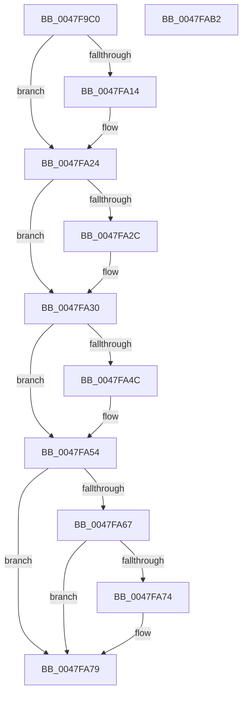

# MiFinishResume

- RVA: `0x0047F9C0`–`0x0047FAB3` (길이 `243` bytes)
- VA: `0x000000014047F9C0`
- 실행 섹션: `.text`
- PDB 이름 있음: `예`; PDB Function 태그: `아니요`
- unwind 정보 RVA: `0x0006B074`
- 디코드: `63`개 명령, `243/243` bytes 표시
- 미해석 바이트: `0` (있으면 어셈블리에 `.byte`로 보존)

> 이 문서는 커널 이미지의 기계어와 PDB 기호를 분석해 생성했습니다. 4번과 5번은 함수 원형과 자료형을 바이너리 사용 방식에서 추정한 C 해석이며 원본 소스 복구 결과는 아닙니다.

## 1. Dependencies

- 직접 호출 지점: **7**; 고유 호출 대상: **7**
- 직접 호출자로 확인된 함수: **0**
- RIP 상대 이미지 참조: **5**

### Outgoing calls
- `0x0047F9FB` → [KeAbPreAcquire](../21/KeAbPreAcquire_function_00210230.md) (function, `0x00210230`)
- `0x0047FA1F` → [ExfAcquirePushLockSharedEx](../21/ExfAcquirePushLockSharedEx_function_0021044C.md) (function, `0x0021044C`)
- `0x0047FA39` → [MiIterateOverPartitions](MiIterateOverPartitions_function_0047FC14.md) (function, `0x0047FC14`)
- `0x0047FA4F` → [ExfReleasePushLockShared](../26/ExfReleasePushLockShared_function_00263440.md) (function, `0x00263440`)
- `0x0047FA57` → [KeAbPostRelease](../2E/KeAbPostRelease_function_002E1600.md) (function, `0x002E1600`)
- `0x0047FA74` → [KiCheckForKernelApcDelivery](../2E/KiCheckForKernelApcDelivery_function_002E2C80.md) (function, `0x002E2C80`)
- `0x0047FA94` → [KeSetEvent](../33/KeSetEvent_function_0033F310.md) (function, `0x0033F310`)

### Direct callers
- 이 함수 시작 RVA로 연결되는 직접 call은 확인되지 않았습니다. 간접 호출은 완전히 역산할 수 없습니다.

### Static image references
- `0x0047F9E1` → RVA `0x00E30048` (`.data`; read)
- `0x0047FA32` → RVA `0x004BEFA0` (`MiMirrorPurgePartitionPages`; read)
- `0x0047FA79` → RVA `0x00E37610` (`.data`; read/write)
- `0x0047FA80` → RVA `0x00E30150` (`.data`; read)
- `0x0047FA87` → RVA `0x00E30180` (`.data`; read/write)

## 2. Other-region calls and transfers

- 다른 실행 섹션으로 향하는 call: **0**
- 별도 외부 분기/꼬리 이동을 확인하지 못했습니다.

## 3. Assembly (complete function range)

```asm
0047F9C0  48 89 5C 24 10                  mov qword ptr [rsp + 0x10], rbx
0047F9C5  48 89 6C 24 18                  mov qword ptr [rsp + 0x18], rbp
0047F9CA  48 89 74 24 20                  mov qword ptr [rsp + 0x20], rsi
0047F9CF  57                              push rdi
0047F9D0  41 56                           push r14
0047F9D2  41 57                           push r15
0047F9D4  48 83 EC 20                     sub rsp, 0x20
0047F9D8  65 48 8B 1C 25 88 01 00 00      mov rbx, qword ptr gs:[0x188]
0047F9E1  48 8D 2D 60 06 9B 00            lea rbp, [rip + 0x9b0660]
0047F9E8  48 8B F1                        mov rsi, rcx
0047F9EB  45 33 C0                        xor r8d, r8d
0047F9EE  33 D2                           xor edx, edx
0047F9F0  48 8B CD                        mov rcx, rbp
0047F9F3  66 FF 8B E6 01 00 00            dec word ptr [rbx + 0x1e6]
0047F9FA  90                              nop
0047F9FB  E8 30 08 D9 FF                  call 0x140210230
0047FA00  48 8B F8                        mov rdi, rax
0047FA03  33 C0                           xor eax, eax
0047FA05  44 8D 78 11                     lea r15d, [rax + 0x11]
0047FA09  F0 4C 0F B1 3D 36 06 9B 00      lock cmpxchg qword ptr [rip + 0x9b0636], r15
0047FA12  74 10                           je 0x14047fa24
0047FA14  4C 8B CD                        mov r9, rbp
0047FA17  4C 8B C7                        mov r8, rdi
0047FA1A  33 D2                           xor edx, edx
0047FA1C  48 8B CD                        mov rcx, rbp
0047FA1F  E8 28 0A D9 FF                  call 0x14021044c
0047FA24  45 33 F6                        xor r14d, r14d
0047FA27  48 85 FF                        test rdi, rdi
0047FA2A  74 04                           je 0x14047fa30
0047FA2C  C6 47 0A 01                     mov byte ptr [rdi + 0xa], 1
0047FA30  8B D6                           mov edx, esi
0047FA32  48 8D 0D 67 F5 03 00            lea rcx, [rip + 0x3f567]
0047FA39  E8 D6 01 00 00                  call 0x14047fc14
0047FA3E  49 8B C7                        mov rax, r15
0047FA41  F0 4C 0F B1 35 FE 05 9B 00      lock cmpxchg qword ptr [rip + 0x9b05fe], r14
0047FA4A  74 08                           je 0x14047fa54
0047FA4C  48 8B CD                        mov rcx, rbp
0047FA4F  E8 EC 39 DE FF                  call 0x140263440
0047FA54  48 8B CD                        mov rcx, rbp
0047FA57  E8 A4 1B E6 FF                  call 0x1402e1600
0047FA5C  90                              nop
0047FA5D  66 83 83 E6 01 00 00 01         add word ptr [rbx + 0x1e6], 1
0047FA65  75 12                           jne 0x14047fa79
0047FA67  48 8D 83 98 00 00 00            lea rax, [rbx + 0x98]
0047FA6E  90                              nop
0047FA6F  48 39 00                        cmp qword ptr [rax], rax
0047FA72  74 05                           je 0x14047fa79
0047FA74  E8 07 32 E6 FF                  call 0x1402e2c80
0047FA79  F0 FF 0D 90 7B 9B 00            lock dec dword ptr [rip + 0x9b7b90]
0047FA80  48 8D 0D C9 06 9B 00            lea rcx, [rip + 0x9b06c9]
0047FA87  48 83 0D F1 06 9B 00 FF         or qword ptr [rip + 0x9b06f1], 0xffffffffffffffff
0047FA8F  45 33 C0                        xor r8d, r8d
0047FA92  33 D2                           xor edx, edx
0047FA94  E8 77 F8 EB FF                  call 0x14033f310
0047FA99  48 8B 5C 24 48                  mov rbx, qword ptr [rsp + 0x48]
0047FA9E  48 8B 6C 24 50                  mov rbp, qword ptr [rsp + 0x50]
0047FAA3  48 8B 74 24 58                  mov rsi, qword ptr [rsp + 0x58]
0047FAA8  48 83 C4 20                     add rsp, 0x20
0047FAAC  41 5F                           pop r15
0047FAAE  41 5E                           pop r14
0047FAB0  5F                              pop rdi
0047FAB1  C3                              ret
0047FAB2  CC                              int3
```

## 4. C-style interpretation (structured pseudocode)

```c
__int64 __fastcall MiFinishResume(__int64 a1, int a2, int a3)
{
    __int64 result;
    __int64 v_r14;
    __int64 v_rsp;
    unsigned __int64 v_stack_p10;
    unsigned __int64 v_stack_p18;
    unsigned __int64 v_stack_p20;

    v_stack_p10 = v_rbx;
    v_stack_p18 = v_rbp;
    v_stack_p20 = v_rsi;
    v_rsp = (v_rsp) - (32);
    a3 = 0;
    a2 = 0;
    result = KeAbPreAcquire(v_rip + 10159712, a2, a3, a4);
    result = 0;
    if (!(condition_is_equal)) {
        a4 = v_rip + 10159712;
        a3 = 0;
        a2 = 0;
        a1 = v_rip + 10159712;
        result = ExfAcquirePushLockSharedEx(a1, a2, a3, a4);
    }
    v_r14 = 0;
    if (result != 0) {
        *(unsigned __int8 *)(result + 10) = 1;
    }
    result = MiIterateOverPartitions(v_rip + 259431, (unsigned int)((unsigned int)(a1)), a3, a4);
    result = result + 17;
    if (result != 0) {
        a1 = v_rip + 10159712;
        result = ExfReleasePushLockShared(a1, (unsigned int)((unsigned int)(a1)), a3, a4);
    }
    result = KeAbPostRelease(v_rip + 10159712, (unsigned int)((unsigned int)(a1)), a3, a4);
    if (result != 0) goto loc_0047FA79;
    result = *(unsigned __int64 *)(gs_base + (0 + 392)) + 152;
    if ((*(unsigned __int64 *)(*(unsigned __int64 *)(gs_base + (0 + 392)) + 152)) != (*(unsigned __int64 *)(gs_base + (0 + 392)) + 152)) {
        result = KiCheckForKernelApcDelivery(v_rip + 10159712, (unsigned int)((unsigned int)(a1)), a3, a4);
    }
    a3 = 0;
    a2 = 0;
    result = KeSetEvent(v_rip + 10159817, a2, a3, a4);
    v_rsp = (v_rsp) + (32);
    return result;
}
```

## 5. (Beta) C Style

```c
int64_t MiFinishResume(int64_t Arg1, int32_t Arg2, int32_t Arg3)
{
    int64_t result;
    int64_t local_r14;
    int64_t local_rsp;
    uint64_t v_stack_p10;
    uint64_t v_stack_p18;
    uint64_t v_stack_p20;

    v_stack_p10 = local_rbx;
    v_stack_p18 = local_rbp;
    v_stack_p20 = local_rsi;
    local_rsp = (local_rsp) - (32);
    Arg3 = 0;
    Arg2 = 0;
    result = KeAbPreAcquire(v_rip + 10159712, Arg2, Arg3, a4);
    result = 0;
    if (!(condition_is_equal)) {
        a4 = v_rip + 10159712;
        Arg3 = 0;
        Arg2 = 0;
        Arg1 = v_rip + 10159712;
        result = ExfAcquirePushLockSharedEx(Arg1, Arg2, Arg3, a4);
    }
    local_r14 = 0;
    if (result != 0) {
        *(uint8_t *)(result + 0xA) = 1;
    }
    result = MiIterateOverPartitions(v_rip + 259431, (uint32_t)((uint32_t)(Arg1)), Arg3, a4);
    result = result + 17;
    if (result != 0) {
        Arg1 = v_rip + 10159712;
        result = ExfReleasePushLockShared(Arg1, (uint32_t)((uint32_t)(Arg1)), Arg3, a4);
    }
    result = KeAbPostRelease(v_rip + 10159712, (uint32_t)((uint32_t)(Arg1)), Arg3, a4);
    if (result != 0) goto loc_0047FA79;
    result = *(uint64_t *)(gs_base + (0 + 0x188)) + 152;
    if ((*(uint64_t *)(*(uint64_t *)(gs_base + (0 + 0x188)) + 0x98)) != (*(uint64_t *)(gs_base + (0 + 0x188)) + 152)) {
        result = KiCheckForKernelApcDelivery(v_rip + 10159712, (uint32_t)((uint32_t)(Arg1)), Arg3, a4);
    }
    Arg3 = 0;
    Arg2 = 0;
    result = KeSetEvent(v_rip + 10159817, Arg2, Arg3, a4);
    local_rsp = (local_rsp) + (32);
    return result;
}
```

## 6. Execution-region graph

[열기: 2D/3D 그래프와 함수 탐색 컨트롤 패널](../../../control-panel.html?section=text&rva=0x0047F9C0&view=graph)

- 2D 그래프는 위에서 아래로 흐르고, 3D 그래프는 빈 공간을 드래그해 회전합니다. Shift+드래그는 이동, 휠은 확대·축소, 함수 노드 선택은 대상 보고서 이동입니다.

### Static fallback


