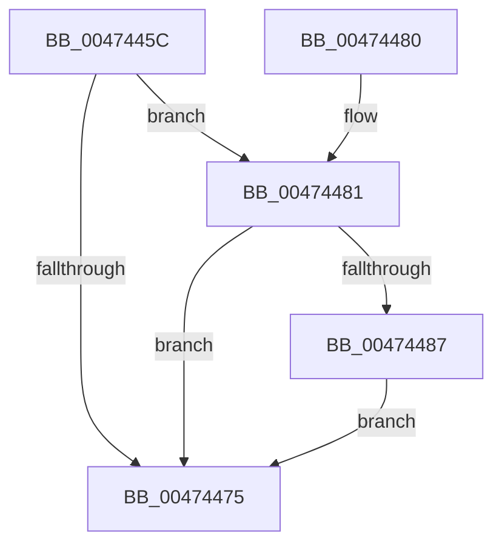

# MiFlushZeroPageHeatBatch

- RVA: `0x0047445C`–`0x004744B0` (길이 `84` bytes)
- VA: `0x000000014047445C`
- 실행 섹션: `.text`
- PDB 이름 있음: `예`; PDB Function 태그: `아니요`
- unwind 정보 RVA: `0x0006015C`
- 디코드: `25`개 명령, `84/84` bytes 표시
- 미해석 바이트: `0` (있으면 어셈블리에 `.byte`로 보존)

> 이 문서는 커널 이미지의 기계어와 PDB 기호를 분석해 생성했습니다. 4번과 5번은 함수 원형과 자료형을 바이너리 사용 방식에서 추정한 C 해석이며 원본 소스 복구 결과는 아닙니다.

## 1. Dependencies

- 직접 호출 지점: **3**; 고유 호출 대상: **2**
- 직접 호출자로 확인된 함수: **2**
- RIP 상대 이미지 참조: **0**

### Outgoing calls
- `0x0047448E` → [MiSetZeroPageThreadPriority](../31/MiSetZeroPageThreadPriority_function_0031E620.md) (function, `0x0031E620`)
- `0x0047449C` → [MiIssuePageHeatList](../44/MiIssuePageHeatList_function_0044615C.md) (function, `0x0044615C`)
- `0x004744A9` → [MiSetZeroPageThreadPriority](../31/MiSetZeroPageThreadPriority_function_0031E620.md) (function, `0x0031E620`)

### Direct callers
- [MiZeroThreadContextPrepareToWait](../31/MiZeroThreadContextPrepareToWait_function_0031E6D8.md) at `0x0031E6F0`
- [sub_006E182C](../6E/Unknown_function_006E182C.md) at `0x006E18A3`

### Static image references
- 디코드된 RIP-relative 메모리 참조가 없습니다.

## 2. Other-region calls and transfers

- 다른 실행 섹션으로 향하는 call: **0**
- 별도 외부 분기/꼬리 이동을 확인하지 못했습니다.

## 3. Assembly (complete function range)

```asm
0047445C  48 89 5C 24 08                  mov qword ptr [rsp + 8], rbx
00474461  57                              push rdi
00474462  48 83 EC 20                     sub rsp, 0x20
00474466  48 8B 81 A0 02 00 00            mov rax, qword ptr [rcx + 0x2a0]
0047446D  48 8B F9                        mov rdi, rcx
00474470  48 85 C0                        test rax, rax
00474473  75 0C                           jne 0x140474481
00474475  48 8B 5C 24 30                  mov rbx, qword ptr [rsp + 0x30]
0047447A  48 83 C4 20                     add rsp, 0x20
0047447E  5F                              pop rdi
0047447F  C3                              ret
00474480  CC                              int3
00474481  83 78 04 00                     cmp dword ptr [rax + 4], 0
00474485  74 EE                           je 0x140474475
00474487  45 33 C0                        xor r8d, r8d
0047448A  41 8D 50 01                     lea edx, [r8 + 1]
0047448E  E8 8D A1 EA FF                  call 0x14031e620
00474493  48 8B 8F A0 02 00 00            mov rcx, qword ptr [rdi + 0x2a0]
0047449A  8B D8                           mov ebx, eax
0047449C  E8 BB 1C FD FF                  call 0x14044615c
004744A1  45 33 C0                        xor r8d, r8d
004744A4  8B D3                           mov edx, ebx
004744A6  48 8B CF                        mov rcx, rdi
004744A9  E8 72 A1 EA FF                  call 0x14031e620
004744AE  EB C5                           jmp 0x140474475
```

## 4. C-style interpretation (structured pseudocode)

```c
__int64 __fastcall MiFlushZeroPageHeatBatch(__int64 a1, __int64 a2, int a3)
{
    __int64 result;
    __int64 v_rsp;
    unsigned __int64 v_stack_p8;

    v_stack_p8 = v_rbx;
    v_rsp = (v_rsp) - (32);
    if (*(unsigned __int64 *)(a1 + 672) != 0) goto loc_00474481;
loc_00474475:
    v_rsp = (v_rsp) + (32);
    return *(unsigned __int64 *)(a1 + 672);
loc_00474481:
    if ((*(unsigned int *)(*(unsigned __int64 *)(a1 + 672) + 4)) == 0) goto loc_00474475;
    a3 = 0;
    result = MiSetZeroPageThreadPriority(a1, a3 + 1, a3, a4);
    result = MiIssuePageHeatList(*(unsigned __int64 *)(a1 + 672), a3 + 1, a3, a4);
    a3 = 0;
    result = MiSetZeroPageThreadPriority(a1, (unsigned int)((unsigned int)((unsigned int)((unsigned int)(result)))), a3, a4);
    goto loc_00474475;
}
```

## 5. (Beta) C Style

```c
int64_t MiFlushZeroPageHeatBatch(void *Arg1, int64_t Arg2, int32_t Arg3)
{
    uint8_t *arg1 = (uint8_t *)Arg1;

    int64_t result;
    int64_t local_rsp;
    uint64_t v_stack_p8;

    v_stack_p8 = local_rbx;
    local_rsp = (local_rsp) - (32);
    if (*(uint64_t *)(arg1 + 0x2A0) != 0) goto loc_00474481;
loc_00474475:
    local_rsp = (local_rsp) + (32);
    return *(uint64_t *)(arg1 + 0x2A0);
loc_00474481:
    if ((*(uint32_t *)(*(uint64_t *)(arg1 + 0x2A0) + 0x4)) == 0) goto loc_00474475;
    Arg3 = 0;
    result = MiSetZeroPageThreadPriority(Arg1, Arg3 + 1, Arg3, a4);
    result = MiIssuePageHeatList(*(uint64_t *)(arg1 + 0x2A0), Arg3 + 1, Arg3, a4);
    Arg3 = 0;
    result = MiSetZeroPageThreadPriority(Arg1, (uint32_t)((uint32_t)((uint32_t)((uint32_t)(result)))), Arg3, a4);
    goto loc_00474475;
}
```

### 관측된 메모리 오프셋

구조체 형식이 확인되지 않은 접근은 인자 기준의 오프셋으로만 기록했습니다.

| 기준 인자 | 오프셋 표현 | 폭 (bit) | 접근 |
|---|---:|---:|---|
| `Arg1` | `+ 0x2A0` | `64` | `R` |

## 6. Execution-region graph

[열기: 2D/3D 그래프와 함수 탐색 컨트롤 패널](../../../control-panel.html?section=text&rva=0x0047445C&view=graph)

- 2D 그래프는 위에서 아래로 흐르고, 3D 그래프는 빈 공간을 드래그해 회전합니다. Shift+드래그는 이동, 휠은 확대·축소, 함수 노드 선택은 대상 보고서 이동입니다.

### Static fallback


