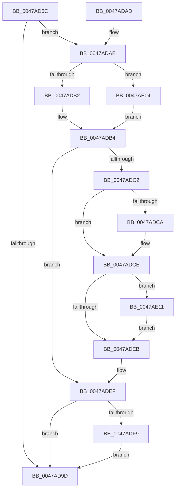

# MiImageUnused

- RVA: `0x0047AD6C`–`0x0047AE27` (길이 `187` bytes)
- VA: `0x000000014047AD6C`
- 실행 섹션: `.text`
- PDB 이름 있음: `예`; PDB Function 태그: `아니요`
- unwind 정보 RVA: `0x0009A108`
- 디코드: `59`개 명령, `187/187` bytes 표시
- 미해석 바이트: `0` (있으면 어셈블리에 `.byte`로 보존)

> 이 문서는 커널 이미지의 기계어와 PDB 기호를 분석해 생성했습니다. 4번과 5번은 함수 원형과 자료형을 바이너리 사용 방식에서 추정한 C 해석이며 원본 소스 복구 결과는 아닙니다.

## 1. Dependencies

- 직접 호출 지점: **2**; 고유 호출 대상: **2**
- 직접 호출자로 확인된 함수: **2**
- RIP 상대 이미지 참조: **0**

### Outgoing calls
- `0x0047ADFD` → [MiReleaseSpinLockExclusive](../24/MiReleaseSpinLockExclusive_function_002482C0.md) (function, `0x002482C0`)
- `0x0047AE08` → [ExAcquireSpinLockExclusive](../24/ExAcquireSpinLockExclusive_function_00248690.md) (function, `0x00248690`)

### Direct callers
- [MiCheckControlArea](../28/MiCheckControlArea_function_002861B0.md) at `0x00286279`
- [MiCheckControlArea](../28/MiCheckControlArea_function_002861B0.md) at `0x0028656E`
- [MiRelocateImageAgain](../../page/98/MiRelocateImageAgain_function_009885C8.md) at `0x0098877D`

### Static image references
- 디코드된 RIP-relative 메모리 참조가 없습니다.

## 2. Other-region calls and transfers

- 다른 실행 섹션으로 향하는 call: **0**
- 별도 외부 분기/꼬리 이동을 확인하지 못했습니다.

## 3. Assembly (complete function range)

```asm
0047AD6C  48 89 5C 24 08                  mov qword ptr [rsp + 8], rbx
0047AD71  48 89 74 24 10                  mov qword ptr [rsp + 0x10], rsi
0047AD76  57                              push rdi
0047AD77  48 83 EC 20                     sub rsp, 0x20
0047AD7B  48 8B D9                        mov rbx, rcx
0047AD7E  49 8B F8                        mov rdi, r8
0047AD81  33 C9                           xor ecx, ecx
0047AD83  49 89 48 08                     mov qword ptr [r8 + 8], rcx
0047AD87  49 89 48 10                     mov qword ptr [r8 + 0x10], rcx
0047AD8B  48 8B 43 60                     mov rax, qword ptr [rbx + 0x60]
0047AD8F  49 83 08 FF                     or qword ptr [r8], 0xffffffffffffffff
0047AD93  48 83 E0 F8                     and rax, 0xfffffffffffffff8
0047AD97  48 39 48 20                     cmp qword ptr [rax + 0x20], rcx
0047AD9B  75 11                           jne 0x14047adae
0047AD9D  48 8B 5C 24 30                  mov rbx, qword ptr [rsp + 0x30]
0047ADA2  48 8B 74 24 38                  mov rsi, qword ptr [rsp + 0x38]
0047ADA7  48 83 C4 20                     add rsp, 0x20
0047ADAB  5F                              pop rdi
0047ADAC  C3                              ret
0047ADAD  CC                              int3
0047ADAE  85 D2                           test edx, edx
0047ADB0  74 52                           je 0x14047ae04
0047ADB2  B2 11                           mov dl, 0x11
0047ADB4  8B 43 58                        mov eax, dword ptr [rbx + 0x58]
0047ADB7  41 B8 FF FF FF FF               mov r8d, 0xffffffff
0047ADBD  41 3B C0                        cmp eax, r8d
0047ADC0  74 2D                           je 0x14047adef
0047ADC2  48 89 07                        mov qword ptr [rdi], rax
0047ADC5  49 3B C0                        cmp rax, r8
0047ADC8  75 04                           jne 0x14047adce
0047ADCA  48 83 0F FF                     or qword ptr [rdi], 0xffffffffffffffff
0047ADCE  8B 4B 5C                        mov ecx, dword ptr [rbx + 0x5c]
0047ADD1  0F B7 C1                        movzx eax, cx
0047ADD4  89 47 08                        mov dword ptr [rdi + 8], eax
0047ADD7  8B C1                           mov eax, ecx
0047ADD9  C1 E8 14                        shr eax, 0x14
0047ADDC  83 E0 03                        and eax, 3
0047ADDF  89 47 10                        mov dword ptr [rdi + 0x10], eax
0047ADE2  8B 43 38                        mov eax, dword ptr [rbx + 0x38]
0047ADE5  0F BA E0 1D                     bt eax, 0x1d
0047ADE9  72 26                           jb 0x14047ae11
0047ADEB  44 89 43 58                     mov dword ptr [rbx + 0x58], r8d
0047ADEF  0F BA 73 5C 16                  btr dword ptr [rbx + 0x5c], 0x16
0047ADF4  80 FA 11                        cmp dl, 0x11
0047ADF7  74 A4                           je 0x14047ad9d
0047ADF9  48 8D 4B 48                     lea rcx, [rbx + 0x48]
0047ADFD  E8 BE D4 DC FF                  call 0x1402482c0
0047AE02  EB 99                           jmp 0x14047ad9d
0047AE04  48 8D 4B 48                     lea rcx, [rbx + 0x48]
0047AE08  E8 83 D8 DC FF                  call 0x140248690
0047AE0D  8A D0                           mov dl, al
0047AE0F  EB A3                           jmp 0x14047adb4
0047AE11  0F BA F0 1D                     btr eax, 0x1d
0047AE15  C1 E9 10                        shr ecx, 0x10
0047AE18  80 E1 01                        and cl, 1
0047AE1B  89 43 38                        mov dword ptr [rbx + 0x38], eax
0047AE1E  88 4F 0D                        mov byte ptr [rdi + 0xd], cl
0047AE21  C6 47 0C 01                     mov byte ptr [rdi + 0xc], 1
0047AE25  EB C4                           jmp 0x14047adeb
```

## 4. C-style interpretation (structured pseudocode)

```c
__int64 __fastcall MiImageUnused(__int64 a1, int a2, __int64 a3)
{
    __int64 result;
    __int64 v_rsp;
    unsigned __int64 v_stack_p10;
    unsigned __int64 v_stack_p8;

    v_stack_p8 = v_rbx;
    v_stack_p10 = v_rsi;
    v_rsp = (v_rsp) - (32);
    a1 = 0;
    *(unsigned __int64 *)(a3 + 8) = 0;
    *(unsigned __int64 *)(a3 + 16) = 0;
    result = (*(unsigned __int64 *)(a1 + 96)) & (-8);
    if ((*(unsigned __int64 *)(result + 32)) != 0) goto loc_0047ADAE;
loc_0047AD9D:
    v_rsp = (v_rsp) + (32);
    return result;
loc_0047ADAE:
    if (a2 == 0) goto loc_0047AE04;
loc_0047ADB4:
    if (((unsigned int)((unsigned int)(*(unsigned int *)(v_stack_p8 + 88)))) == ((unsigned int)((unsigned int)(0xFFFFFFFFULL)))) goto loc_0047ADEF;
    *(unsigned __int64 *)(a3) = (unsigned int)(*(unsigned int *)(v_stack_p8 + 88));
    if (((unsigned int)(*(unsigned int *)(v_stack_p8 + 88))) == ((unsigned int)(0xFFFFFFFFULL))) {
    }
    *(unsigned int *)(a3 + 8) = (unsigned int)((unsigned __int16)((unsigned int)(*(unsigned int *)(v_stack_p8 + 92))));
    result = (unsigned int)(((unsigned int)((unsigned int)((unsigned int)(*(unsigned int *)(v_stack_p8 + 92))))) >> (20));
    result = (unsigned int)((result) & (3));
    *(unsigned int *)(a3 + 16) = (unsigned int)(result);
    if (condition_is_below) goto loc_0047AE11;
loc_0047ADEB:
    *(unsigned int *)(v_stack_p8 + 88) = (unsigned int)((unsigned int)(0xFFFFFFFFULL));
loc_0047ADEF:
    if (17 == 17) goto loc_0047AD9D;
    result = MiReleaseSpinLockExclusive(v_stack_p8 + 72, 17, (unsigned int)(0xFFFFFFFFULL), a4);
    goto loc_0047AD9D;
loc_0047AE04:
    result = ExAcquireSpinLockExclusive(v_stack_p8 + 72, 17, (unsigned int)(0xFFFFFFFFULL), a4);
    goto loc_0047ADB4;
loc_0047AE11:
    a1 = (unsigned int)((v_stack_p8 + 72) >> (16));
    a1 = (unsigned __int8)((a1) & (1));
    *(unsigned int *)(v_stack_p8 + 56) = (unsigned int)(result);
    *(unsigned __int8 *)(a3 + 13) = (unsigned __int8)(a1);
    *(unsigned __int8 *)(a3 + 12) = 1;
    goto loc_0047ADEB;
}
```

## 5. (Beta) C Style

```c
int64_t MiImageUnused(void *Arg1, int32_t Arg2, void *Arg3)
{
    uint8_t *arg1 = (uint8_t *)Arg1;
    uint8_t *arg3 = (uint8_t *)Arg3;

    int64_t result;
    int64_t local_rsp;
    uint64_t v_stack_p10;
    uint64_t v_stack_p8;

    v_stack_p8 = local_rbx;
    v_stack_p10 = local_rsi;
    local_rsp = (local_rsp) - (32);
    Arg1 = 0;
    *(uint64_t *)(arg3 + 0x8) = 0;
    *(uint64_t *)(arg3 + 0x10) = 0;
    result = (*(uint64_t *)(arg1 + 0x60)) & (-8);
    if ((*(uint64_t *)(result + 0x20)) != 0) goto loc_0047ADAE;
loc_0047AD9D:
    local_rsp = (local_rsp) + (32);
    return result;
loc_0047ADAE:
    if (Arg2 == 0) goto loc_0047AE04;
loc_0047ADB4:
    if (((uint32_t)((uint32_t)(*(uint32_t *)(v_stack_p8 + 0x58)))) == ((uint32_t)((uint32_t)(0xFFFFFFFFULL)))) goto loc_0047ADEF;
    *(uint64_t *)(arg3) = (uint32_t)(*(uint32_t *)(v_stack_p8 + 0x58));
    if (((uint32_t)(*(uint32_t *)(v_stack_p8 + 0x58))) == ((uint32_t)(0xFFFFFFFFULL))) {
    }
    *(uint32_t *)(arg3 + 0x8) = (uint32_t)((uint16_t)((uint32_t)(*(uint32_t *)(v_stack_p8 + 0x5C))));
    result = (uint32_t)(((uint32_t)((uint32_t)((uint32_t)(*(uint32_t *)(v_stack_p8 + 0x5C))))) >> (20));
    result = (uint32_t)((result) & (3));
    *(uint32_t *)(arg3 + 0x10) = (uint32_t)(result);
    if (condition_is_below) goto loc_0047AE11;
loc_0047ADEB:
    *(uint32_t *)(v_stack_p8 + 0x58) = (uint32_t)((uint32_t)(0xFFFFFFFFULL));
loc_0047ADEF:
    if (17 == 17) goto loc_0047AD9D;
    result = MiReleaseSpinLockExclusive(v_stack_p8 + 72, 17, (uint32_t)(0xFFFFFFFFULL), a4);
    goto loc_0047AD9D;
loc_0047AE04:
    result = ExAcquireSpinLockExclusive(v_stack_p8 + 72, 17, (uint32_t)(0xFFFFFFFFULL), a4);
    goto loc_0047ADB4;
loc_0047AE11:
    Arg1 = (uint32_t)((v_stack_p8 + 72) >> (16));
    Arg1 = (uint8_t)((Arg1) & (1));
    *(uint32_t *)(v_stack_p8 + 0x38) = (uint32_t)(result);
    *(uint8_t *)(arg3 + 0xD) = (uint8_t)(Arg1);
    *(uint8_t *)(arg3 + 0xC) = 1;
    goto loc_0047ADEB;
}
```

### 관측된 메모리 오프셋

구조체 형식이 확인되지 않은 접근은 인자 기준의 오프셋으로만 기록했습니다.

| 기준 인자 | 오프셋 표현 | 폭 (bit) | 접근 |
|---|---:|---:|---|
| `Arg1` | `+ 0x38` | `32` | `R` |
| `Arg1` | `+ 0x38` | `32` | `W` |
| `Arg1` | `+ 0x48` | `64` | `R` |
| `Arg1` | `+ 0x58` | `32` | `R` |
| `Arg1` | `+ 0x58` | `32` | `W` |
| `Arg1` | `+ 0x5C` | `32` | `R` |
| `Arg1` | `+ 0x5C` | `32` | `R/W` |
| `Arg1` | `+ 0x60` | `64` | `R` |
| `Arg3` | `+ 0x0` | `64` | `R/W` |
| `Arg3` | `+ 0x0` | `64` | `W` |
| `Arg3` | `+ 0x8` | `32` | `W` |
| `Arg3` | `+ 0x8` | `64` | `W` |
| `Arg3` | `+ 0xC` | `8` | `W` |
| `Arg3` | `+ 0xD` | `8` | `W` |
| `Arg3` | `+ 0x10` | `32` | `W` |
| `Arg3` | `+ 0x10` | `64` | `W` |

## 6. Execution-region graph

[열기: 2D/3D 그래프와 함수 탐색 컨트롤 패널](../../../control-panel.html?section=text&rva=0x0047AD6C&view=graph)

- 2D 그래프는 위에서 아래로 흐르고, 3D 그래프는 빈 공간을 드래그해 회전합니다. Shift+드래그는 이동, 휠은 확대·축소, 함수 노드 선택은 대상 보고서 이동입니다.

### Static fallback


