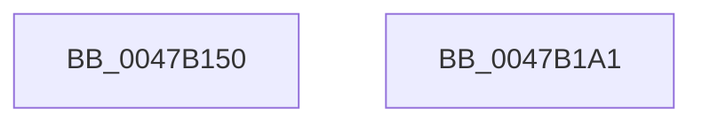

# MiInitializePageAccessLogging

- RVA: `0x0047B150`–`0x0047B1A2` (길이 `82` bytes)
- VA: `0x000000014047B150`
- 실행 섹션: `.text`
- PDB 이름 있음: `예`; PDB Function 태그: `아니요`
- unwind 정보 RVA: `0x000DB714`
- 디코드: `21`개 명령, `82/82` bytes 표시
- 미해석 바이트: `0` (있으면 어셈블리에 `.byte`로 보존)

> 이 문서는 커널 이미지의 기계어와 PDB 기호를 분석해 생성했습니다. 4번과 5번은 함수 원형과 자료형을 바이너리 사용 방식에서 추정한 C 해석이며 원본 소스 복구 결과는 아닙니다.

## 1. Dependencies

- 직접 호출 지점: **0**; 고유 호출 대상: **0**
- 직접 호출자로 확인된 함수: **1**
- RIP 상대 이미지 참조: **0**

### Outgoing calls
- 직접 디코드된 call 명령이 없습니다.

### Direct callers
- [MiGetCcAccessLog](../../page/93/MiGetCcAccessLog_function_0093E364.md) at `0x0093E447`

### Static image references
- 디코드된 RIP-relative 메모리 참조가 없습니다.

## 2. Other-region calls and transfers

- 다른 실행 섹션으로 향하는 call: **0**
- 별도 외부 분기/꼬리 이동을 확인하지 못했습니다.

## 3. Assembly (complete function range)

```asm
0047B150  45 33 C9                        xor r9d, r9d
0047B153  48 8D 42 40                     lea rax, [rdx + 0x40]
0047B157  48 89 42 20                     mov qword ptr [rdx + 0x20], rax
0047B15B  49 8D 40 F8                     lea rax, [r8 - 8]
0047B15F  48 03 C2                        add rax, rdx
0047B162  44 89 4A 08                     mov dword ptr [rdx + 8], r9d
0047B166  4C 89 08                        mov qword ptr [rax], r9
0047B169  48 89 42 30                     mov qword ptr [rdx + 0x30], rax
0047B16D  48 83 C0 F8                     add rax, -8
0047B171  48 89 42 28                     mov qword ptr [rdx + 0x28], rax
0047B175  4C 89 0A                        mov qword ptr [rdx], r9
0047B178  8B 81 B8 00 00 00               mov eax, dword ptr [rcx + 0xb8]
0047B17E  A8 0F                           test al, 0xf
0047B180  48 8D 81 00 FC FF FF            lea rax, [rcx - 0x400]
0047B187  49 0F 45 C1                     cmovne rax, r9
0047B18B  48 89 42 38                     mov qword ptr [rdx + 0x38], rax
0047B18F  48 B8 20 03 00 00 80 F7 FF FF   movabs rax, 0xfffff78000000320
0047B199  48 8B 00                        mov rax, qword ptr [rax]
0047B19C  48 89 42 10                     mov qword ptr [rdx + 0x10], rax
0047B1A0  C3                              ret
0047B1A1  CC                              int3
```

## 4. C-style interpretation (structured pseudocode)

```c
__int64 __fastcall MiInitializePageAccessLogging(__int64 a1, __int64 a2, __int64 a3, int a4)
{
    __int64 result;

    a4 = 0;
    *(unsigned __int64 *)(a2 + 32) = a2 + 64;
    result = (a3 - 8) + (a2);
    *(unsigned int *)(a2 + 8) = 0;
    *(unsigned __int64 *)(result) = 0;
    *(unsigned __int64 *)(a2 + 48) = result;
    result = (result) + (-8);
    *(unsigned __int64 *)(a2 + 40) = result;
    *(unsigned __int64 *)(a2) = 0;
    result = a1 - 1024;
    if ((((unsigned __int8)((unsigned int)(*(unsigned int *)(a1 + 184)))) & (15)) != 0) { result = 0; }
    *(unsigned __int64 *)(a2 + 56) = result;
    *(unsigned __int64 *)(a2 + 16) = *(unsigned __int64 *)(result);
    return *(unsigned __int64 *)(result);
}
```

## 5. (Beta) C Style

```c
int64_t MiInitializePageAccessLogging(void *Arg1, void *Arg2, void *Arg3, int32_t Arg4)
{
    uint8_t *arg1 = (uint8_t *)Arg1;
    uint8_t *arg2 = (uint8_t *)Arg2;
    uint8_t *arg3 = (uint8_t *)Arg3;

    int64_t result;

    Arg4 = 0;
    *(void **)(arg2 + 0x20) = Arg2 + 64;
    result = (Arg3 - 8) + (Arg2);
    *(uint32_t *)(arg2 + 0x8) = 0;
    *(uint64_t *)(result) = 0;
    *(uint64_t *)(arg2 + 0x30) = result;
    result = (result) + (-8);
    *(uint64_t *)(arg2 + 0x28) = result;
    *(uint64_t *)(arg2) = 0;
    result = Arg1 - 1024;
    if ((((uint8_t)((uint32_t)(*(uint32_t *)(arg1 + 0xB8)))) & (15)) != 0) { result = 0; }
    *(uint64_t *)(arg2 + 0x38) = result;
    *(uint64_t *)(arg2 + 0x10) = *(uint64_t *)(result);
    return *(uint64_t *)(result);
}
```

### 관측된 메모리 오프셋

구조체 형식이 확인되지 않은 접근은 인자 기준의 오프셋으로만 기록했습니다.

| 기준 인자 | 오프셋 표현 | 폭 (bit) | 접근 |
|---|---:|---:|---|
| `Arg1` | `- 0x400` | `64` | `R` |
| `Arg1` | `+ 0xB8` | `32` | `R` |
| `Arg2` | `+ 0x0` | `64` | `W` |
| `Arg2` | `+ 0x8` | `32` | `W` |
| `Arg2` | `+ 0x10` | `64` | `W` |
| `Arg2` | `+ 0x20` | `64` | `W` |
| `Arg2` | `+ 0x28` | `64` | `W` |
| `Arg2` | `+ 0x30` | `64` | `W` |
| `Arg2` | `+ 0x38` | `64` | `W` |
| `Arg2` | `+ 0x40` | `64` | `R` |
| `Arg3` | `- 0x8` | `64` | `R` |
| `Arg3` | `+ 0x0` | `64` | `W` |

## 6. Execution-region graph

[열기: 2D/3D 그래프와 함수 탐색 컨트롤 패널](../../../control-panel.html?section=text&rva=0x0047B150&view=graph)

- 2D 그래프는 위에서 아래로 흐르고, 3D 그래프는 빈 공간을 드래그해 회전합니다. Shift+드래그는 이동, 휠은 확대·축소, 함수 노드 선택은 대상 보고서 이동입니다.

### Static fallback


