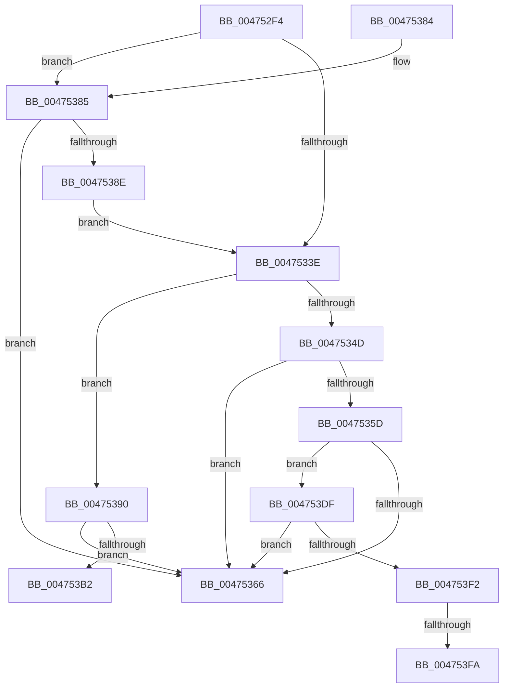

# MiIssuePageExtendRequest

- RVA: `0x004752F4`–`0x0047540D` (길이 `281` bytes)
- VA: `0x00000001404752F4`
- 실행 섹션: `.text`
- PDB 이름 있음: `예`; PDB Function 태그: `예`
- unwind 정보 RVA: `0x000ACB0C`
- 디코드: `75`개 명령, `281/281` bytes 표시
- 미해석 바이트: `0` (있으면 어셈블리에 `.byte`로 보존)

> 이 문서는 커널 이미지의 기계어와 PDB 기호를 분석해 생성했습니다. 4번과 5번은 함수 원형과 자료형을 바이너리 사용 방식에서 추정한 C 해석이며 원본 소스 복구 결과는 아닙니다.

## 1. Dependencies

- 직접 호출 지점: **1**; 고유 호출 대상: **1**
- 직접 호출자로 확인된 함수: **6**
- RIP 상대 이미지 참조: **2**

### Outgoing calls
- `0x00475328` → [memset](../6C/memset_function_006C6C40.md) (function, `0x006C6C40`)

### Direct callers
- [MiChargeCommit](../28/MiChargeCommit_function_00286EB0.md) at `0x002871F6`
- [MiChargeCommit](../28/MiChargeCommit_function_00286EB0.md) at `0x002873A2`
- [MiChargeCommit](../28/MiChargeCommit_function_00286EB0.md) at `0x0028743E`
- [MiChargeCommit](../28/MiChargeCommit_function_00286EB0.md) at `0x00287516`
- [MmResourcesAvailable](../43/MmResourcesAvailable_function_00434FF0.md) at `0x004350BB`
- [MiExtendPageFilesIfNecessary](MiExtendPageFilesIfNecessary_function_00475264.md) at `0x004752E4`
- [MiPageFileNoFreeSpace](MiPageFileNoFreeSpace_function_0047E45C.md) at `0x0047E5BC`
- [MiExtendWorkingSetSwapPagefile](../../page/70/MiExtendWorkingSetSwapPagefile_function_007026D4.md) at `0x007026EC`
- [MiCreatePagingFile](../../page/7F/MiCreatePagingFile_function_007FEFF4.md) at `0x007FFB05`

### Static image references
- `0x00475341` → RVA `0x0001A208` (`.rdata`; read)
- `0x0047534D` → RVA `0x00464890` (`MiDereferenceSegmentThread`; read)

## 2. Other-region calls and transfers

- 다른 실행 섹션으로 향하는 call: **0**
- call이 아닌 외부 분기/꼬리 이동: **3**
  - `0x004753DA` → [sub_006F421A + 0x145](../6F/Unknown_function_006F421A.md) (`tail-transfer`)
  - `0x004753F4` → [sub_006F421A](../6F/Unknown_function_006F421A.md) (`tail-transfer`)
  - `0x00475408` → [sub_006F421A](../6F/Unknown_function_006F421A.md) (`tail-transfer`)

## 3. Assembly (complete function range)

```asm
004752F4  48 89 5C 24 08                  mov qword ptr [rsp + 8], rbx
004752F9  48 89 74 24 10                  mov qword ptr [rsp + 0x10], rsi
004752FE  55                              push rbp
004752FF  57                              push rdi
00475300  41 54                           push r12
00475302  41 56                           push r14
00475304  41 57                           push r15
00475306  48 8D 6C 24 C9                  lea rbp, [rsp - 0x37]
0047530B  48 81 EC 90 00 00 00            sub rsp, 0x90
00475312  48 8B F2                        mov rsi, rdx
00475315  45 8B E0                        mov r12d, r8d
00475318  33 D2                           xor edx, edx
0047531A  48 8B F9                        mov rdi, rcx
0047531D  48 8D 4D D7                     lea rcx, [rbp - 0x29]
00475321  45 8B F9                        mov r15d, r9d
00475324  44 8D 42 58                     lea r8d, [rdx + 0x58]
00475328  E8 13 19 25 00                  call 0x1406c6c40
0047532D  65 48 8B 04 25 88 01 00 00      mov rax, qword ptr gs:[0x188]
00475336  41 8B CC                        mov ecx, r12d
00475339  83 E1 08                        and ecx, 8
0047533C  75 47                           jne 0x140475385
0047533E  41 B1 02                        mov r9b, 2
00475341  4C 8D 1D C0 4E BA FF            lea r11, [rip - 0x45b140]
00475348  45 84 E1                        test r9b, r12b
0047534B  75 43                           jne 0x140475390
0047534D  48 8D 15 3C F5 FE FF            lea rdx, [rip - 0x10ac4]
00475354  48 39 90 60 05 00 00            cmp qword ptr [rax + 0x560], rdx
0047535B  74 09                           je 0x140475366
0047535D  44 0F 20 C0                     mov rax, cr8
00475361  41 3A C1                        cmp al, r9b
00475364  72 79                           jb 0x1404753df
00475366  33 C0                           xor eax, eax
00475368  4C 8D 9C 24 90 00 00 00         lea r11, [rsp + 0x90]
00475370  49 8B 5B 30                     mov rbx, qword ptr [r11 + 0x30]
00475374  49 8B 73 38                     mov rsi, qword ptr [r11 + 0x38]
00475378  49 8B E3                        mov rsp, r11
0047537B  41 5F                           pop r15
0047537D  41 5E                           pop r14
0047537F  41 5C                           pop r12
00475381  5F                              pop rdi
00475382  5D                              pop rbp
00475383  C3                              ret
00475384  CC                              int3
00475385  80 BF 29 08 00 00 00            cmp byte ptr [rdi + 0x829], 0
0047538C  74 D8                           je 0x140475366
0047538E  EB AE                           jmp 0x14047533e
00475390  F7 D9                           neg ecx
00475392  48 8D 9F E0 01 00 00            lea rbx, [rdi + 0x1e0]
00475399  48 1B C0                        sbb rax, rax
0047539C  25 38 05 00 00                  and eax, 0x538
004753A1  48 03 D8                        add rbx, rax
004753A4  33 C0                           xor eax, eax
004753A6  44 8D 70 01                     lea r14d, [rax + 1]
004753AA  F0 44 0F B1 73 48               lock cmpxchg dword ptr [rbx + 0x48], r14d
004753B0  75 B4                           jne 0x140475366
004753B2  8A 4B 4F                        mov cl, byte ptr [rbx + 0x4f]
004753B5  48 81 C6 FF 0F 00 00            add rsi, 0xfff
004753BC  8A C1                           mov al, cl
004753BE  48 81 E6 00 F0 FF FF            and rsi, 0xfffffffffffff000
004753C5  41 0A CE                        or cl, r14b
004753C8  24 FE                           and al, 0xfe
004753CA  41 F6 C4 04                     test r12b, 4
004753CE  0F B6 C9                        movzx ecx, cl
004753D1  0F B6 C0                        movzx eax, al
004753D4  0F 44 C8                        cmove ecx, eax
004753D7  88 4B 4F                        mov byte ptr [rbx + 0x4f], cl
004753DA  E9 80 EF 27 00                  jmp 0x1406f435f
004753DF  65 8B 04 25 3C 3A 00 00         mov eax, dword ptr gs:[0x3a3c]
004753E7  A9 01 00 01 00                  test eax, 0x10001
004753EC  0F 85 74 FF FF FF               jne 0x140475366
004753F2  85 C9                           test ecx, ecx
004753F4  0F 84 20 EE 27 00               je 0x1406f421a
004753FA  48 81 C6 FF FF 00 00            add rsi, 0xffff
00475401  48 81 E6 00 00 FF FF            and rsi, 0xffffffffffff0000
00475408  E9 0D EE 27 00                  jmp 0x1406f421a
```

## 4. C-style interpretation (structured pseudocode)

```c
__int64 __fastcall MiIssuePageExtendRequest(__int64 a1, __int64 a2, int a3, int a4)
{
    __int64 result;
    __int64 v_rbx;
    __int64 v_rsi;
    __int64 v_rsp;
    unsigned __int64 v_stack_m28;
    unsigned __int64 v_stack_m5F;
    unsigned __int64 v_stack_m88;
    unsigned __int64 v_stack_p10;
    unsigned __int64 v_stack_p8;

    v_stack_p8 = v_rbx;
    v_stack_p10 = v_rsi;
    v_rsp = (v_rsp) - (144);
    a2 = 0;
    result = memset(v_stack_m88, a2, a2 + 88, a4);
    a1 = (unsigned int)(((unsigned int)((unsigned int)((unsigned int)(a3)))) & (8));
    if (condition_is_not_equal) goto loc_00475385;
loc_0047533E:
    if (((2) & ((unsigned __int8)((unsigned int)(a3)))) != 0) goto loc_00475390;
    if ((*(unsigned __int64 *)(*(unsigned __int64 *)(gs_base + (0 + 392)) + 1376)) == (v_rip - 68292)) goto loc_00475366;
    if (((unsigned __int8)(v_cr8)) < 2) goto loc_004753DF;
loc_00475366:
    result = 0;
    return result;
loc_00475385:
    if ((*(unsigned __int8 *)(a1 + 2089)) == 0) goto loc_00475366;
    goto loc_0047533E;
loc_00475390:
    a1 = (unsigned int)(-(a1));
    result = (unsigned int)((result) & (0x538ULL));
    v_rbx = (a1 + 480) + (result);
    result = 0;
    if (condition_is_not_equal) goto loc_00475366;
    v_rsi = (*(unsigned __int64 *)(v_stack_m28 + 56)) + (0xFFFULL);
    v_rsi = (v_rsi) & (0xFFFFFFFFFFFFF000ULL);
    a1 = (unsigned __int8)((*(unsigned __int8 *)(v_rbx + 79)) | ((unsigned __int8)(result + 1)));
    result = (unsigned __int8)(((unsigned __int8)(*(unsigned __int8 *)(v_rbx + 79))) & (254));
    a1 = (unsigned __int8)(a1);
    if ((((unsigned __int8)((unsigned int)(a3))) & (4)) == 0) { a1 = (unsigned int)((unsigned __int8)(result)); }
    *(unsigned __int8 *)(v_rbx + 79) = (unsigned __int8)(a1);
loc_004753DF:
    if ((((unsigned int)((unsigned int)(*(unsigned int *)(gs_base + (0 + 14908))))) & (0x10001ULL)) != 0) goto loc_00475366;
    v_rsi = (v_rsi) + (0xFFFFULL);
    v_rsi = (v_rsi) & (0xFFFFFFFFFFFF0000ULL);
}
```

## 5. (Beta) C Style

```c
int64_t MiIssuePageExtendRequest(void *Arg1, int64_t Arg2, int32_t Arg3, int32_t Arg4)
{
    uint8_t *arg1 = (uint8_t *)Arg1;

    int64_t result;
    int64_t local_rbx;
    int64_t local_rsi;
    int64_t local_rsp;
    uint64_t v_stack_m28;
    uint64_t v_stack_m5F;
    uint64_t v_stack_m88;
    uint64_t v_stack_p10;
    uint64_t v_stack_p8;

    v_stack_p8 = local_rbx;
    v_stack_p10 = local_rsi;
    local_rsp = (local_rsp) - (144);
    Arg2 = 0;
    result = memset(v_stack_m88, Arg2, Arg2 + 88, Arg4);
    Arg1 = (uint32_t)(((uint32_t)((uint32_t)((uint32_t)(Arg3)))) & (8));
    if (condition_is_not_equal) goto loc_00475385;
loc_0047533E:
    if (((2) & ((uint8_t)((uint32_t)(Arg3)))) != 0) goto loc_00475390;
    if ((*(uint64_t *)(*(uint64_t *)(gs_base + (0 + 0x188)) + 0x560)) == (v_rip - 68292)) goto loc_00475366;
    if (((uint8_t)(v_cr8)) < 2) goto loc_004753DF;
loc_00475366:
    result = 0;
    return result;
loc_00475385:
    if ((*(uint8_t *)(arg1 + 0x829)) == 0) goto loc_00475366;
    goto loc_0047533E;
loc_00475390:
    Arg1 = (uint32_t)(-(Arg1));
    result = (uint32_t)((result) & (0x538ULL));
    local_rbx = (Arg1 + 480) + (result);
    result = 0;
    if (condition_is_not_equal) goto loc_00475366;
    local_rsi = (*(uint64_t *)(v_stack_m28 + 0x38)) + (0xFFFULL);
    local_rsi = (local_rsi) & (0xFFFFFFFFFFFFF000ULL);
    Arg1 = (uint8_t)((*(uint8_t *)(local_rbx + 0x4F)) | ((uint8_t)(result + 1)));
    result = (uint8_t)(((uint8_t)(*(uint8_t *)(local_rbx + 0x4F))) & (254));
    Arg1 = (uint8_t)(Arg1);
    if ((((uint8_t)((uint32_t)(Arg3))) & (4)) == 0) { Arg1 = (uint32_t)((uint8_t)(result)); }
    *(uint8_t *)(local_rbx + 0x4F) = (uint8_t)(Arg1);
loc_004753DF:
    if ((((uint32_t)((uint32_t)(*(uint32_t *)(gs_base + (0 + 0x3A3C))))) & (0x10001ULL)) != 0) goto loc_00475366;
    local_rsi = (local_rsi) + (0xFFFFULL);
    local_rsi = (local_rsi) & (0xFFFFFFFFFFFF0000ULL);
}
```

### 관측된 메모리 오프셋

구조체 형식이 확인되지 않은 접근은 인자 기준의 오프셋으로만 기록했습니다.

| 기준 인자 | 오프셋 표현 | 폭 (bit) | 접근 |
|---|---:|---:|---|
| `Arg1` | `+ 0x48` | `32` | `R` |
| `Arg1` | `+ 0x4F` | `8` | `R` |
| `Arg1` | `+ 0x4F` | `8` | `W` |
| `Arg1` | `+ 0x1E0` | `64` | `R` |
| `Arg1` | `+ 0x829` | `8` | `R` |

## 6. Execution-region graph

[열기: 2D/3D 그래프와 함수 탐색 컨트롤 패널](../../../control-panel.html?section=text&rva=0x004752F4&view=graph)

- 2D 그래프는 위에서 아래로 흐르고, 3D 그래프는 빈 공간을 드래그해 회전합니다. Shift+드래그는 이동, 휠은 확대·축소, 함수 노드 선택은 대상 보고서 이동입니다.

### Static fallback


