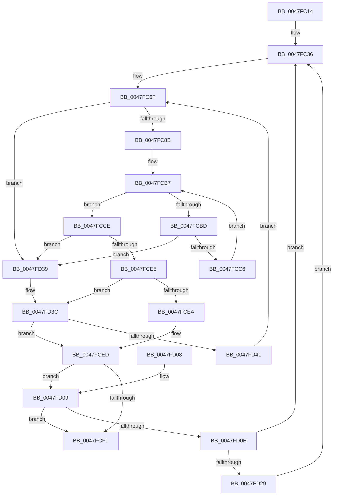

# MiIterateOverPartitions

- RVA: `0x0047FC14`–`0x0047FD57` (길이 `323` bytes)
- VA: `0x000000014047FC14`
- 실행 섹션: `.text`
- PDB 이름 있음: `예`; PDB Function 태그: `아니요`
- unwind 정보 RVA: `0x000AE274`
- 디코드: `103`개 명령, `323/323` bytes 표시
- 미해석 바이트: `0` (있으면 어셈블리에 `.byte`로 보존)

> 이 문서는 커널 이미지의 기계어와 PDB 기호를 분석해 생성했습니다. 4번과 5번은 함수 원형과 자료형을 바이너리 사용 방식에서 추정한 C 해석이며 원본 소스 복구 결과는 아닙니다.

## 1. Dependencies

- 직접 호출 지점: **1**; 고유 호출 대상: **1**
- 직접 호출자로 확인된 함수: **7**
- RIP 상대 이미지 참조: **2**

### Outgoing calls
- `0x0047FD2F` → [guard_dispatch_icall](../6B/guard_dispatch_icall_function_006BAAD0.md) (function, `0x006BAAD0`)

### Direct callers
- [MiFinishResume](MiFinishResume_function_0047F9C0.md) at `0x0047FA39`
- [MiSendParkedCoreUpdateToAllChildPartitions](MiSendParkedCoreUpdateToAllChildPartitions_function_0047FAC0.md) at `0x0047FB3D`
- [MiLockAllMemoryLists](MiLockAllMemoryLists_function_0047FBD8.md) at `0x0047FBE8`
- [MiMirrorBlackPhase](../67/MiMirrorBlackPhase_function_00678B4C.md) at `0x00678B98`
- [MiMirrorBlackPhase](../67/MiMirrorBlackPhase_function_00678B4C.md) at `0x00678BCC`
- [MiMirrorBlackPhase](../67/MiMirrorBlackPhase_function_00678B4C.md) at `0x00678BF2`
- [MiResumeFromHibernate](../67/MiResumeFromHibernate_function_00678EC0.md) at `0x00678ECD`
- [MiUnlockAllMemoryLists](../68/MiUnlockAllMemoryLists_function_0068B820.md) at `0x0068B845`
- [MmEnumerateBadPages](../../page/7F/MmEnumerateBadPages_function_007FDE28.md) at `0x007FDED4`

### Static image references
- `0x0047FC36` → RVA `0x00E30068` (`.data`; read)
- `0x0047FD0E` → RVA `0x00E30088` (`.data`; read)

## 2. Other-region calls and transfers

- 다른 실행 섹션으로 향하는 call: **0**
- 별도 외부 분기/꼬리 이동을 확인하지 못했습니다.

## 3. Assembly (complete function range)

```asm
0047FC14  48 89 5C 24 08                  mov qword ptr [rsp + 8], rbx
0047FC19  48 89 6C 24 10                  mov qword ptr [rsp + 0x10], rbp
0047FC1E  56                              push rsi
0047FC1F  57                              push rdi
0047FC20  41 54                           push r12
0047FC22  41 56                           push r14
0047FC24  41 57                           push r15
0047FC26  48 83 EC 20                     sub rsp, 0x20
0047FC2A  33 DB                           xor ebx, ebx
0047FC2C  4C 8B F2                        mov r14, rdx
0047FC2F  41 83 CC FF                     or r12d, 0xffffffff
0047FC33  4C 8B F9                        mov r15, rcx
0047FC36  48 8B 05 2B 04 9B 00            mov rax, qword ptr [rip + 0x9b042b]
0047FC3D  44 8B 18                        mov r11d, dword ptr [rax]
0047FC40  48 8B 78 08                     mov rdi, qword ptr [rax + 8]
0047FC44  48 8B D7                        mov rdx, rdi
0047FC47  83 E2 04                        and edx, 4
0047FC4A  8B C2                           mov eax, edx
0047FC4C  45 8D 43 FF                     lea r8d, [r11 - 1]
0047FC50  48 F7 D8                        neg rax
0047FC53  45 1B D2                        sbb r10d, r10d
0047FC56  41 83 E2 20                     and r10d, 0x20
0047FC5A  41 3B DB                        cmp ebx, r11d
0047FC5D  45 1B C9                        sbb r9d, r9d
0047FC60  44 23 CB                        and r9d, ebx
0047FC63  48 F7 DA                        neg rdx
0047FC66  48 1B C0                        sbb rax, rax
0047FC69  83 E0 04                        and eax, 4
0047FC6C  48 2B F8                        sub rdi, rax
0047FC6F  83 64 24 60 00                  and dword ptr [rsp + 0x60], 0
0047FC74  43 8D 34 02                     lea esi, [r10 + r8]
0047FC78  8B C6                           mov eax, esi
0047FC7A  43 8D 0C 0A                     lea ecx, [r10 + r9]
0047FC7E  2B C1                           sub eax, ecx
0047FC80  FF C0                           inc eax
0047FC82  83 F8 01                        cmp eax, 1
0047FC85  0F 82 AE 00 00 00               jb 0x14047fd39
0047FC8B  8B C6                           mov eax, esi
0047FC8D  41 B8 01 00 00 00               mov r8d, 1
0047FC93  48 C1 E8 06                     shr rax, 6
0047FC97  48 8D 2C C7                     lea rbp, [rdi + rax*8]
0047FC9B  8B C1                           mov eax, ecx
0047FC9D  48 C1 E8 06                     shr rax, 6
0047FCA1  80 E1 3F                        and cl, 0x3f
0047FCA4  49 D3 E0                        shl r8, cl
0047FCA7  49 FF C8                        dec r8
0047FCAA  48 8D 14 C7                     lea rdx, [rdi + rax*8]
0047FCAE  48 8B 02                        mov rax, qword ptr [rdx]
0047FCB1  48 F7 D0                        not rax
0047FCB4  4C 0B C0                        or r8, rax
0047FCB7  49 83 F8 FF                     cmp r8, -1
0047FCBB  75 11                           jne 0x14047fcce
0047FCBD  48 83 C2 08                     add rdx, 8
0047FCC1  48 3B D5                        cmp rdx, rbp
0047FCC4  77 73                           ja 0x14047fd39
0047FCC6  4C 8B 02                        mov r8, qword ptr [rdx]
0047FCC9  49 F7 D0                        not r8
0047FCCC  EB E9                           jmp 0x14047fcb7
0047FCCE  48 2B D7                        sub rdx, rdi
0047FCD1  49 F7 D0                        not r8
0047FCD4  48 C1 FA 03                     sar rdx, 3
0047FCD8  49 0F BC C0                     bsf rax, r8
0047FCDC  C1 E2 06                        shl edx, 6
0047FCDF  03 D0                           add edx, eax
0047FCE1  3B D6                           cmp edx, esi
0047FCE3  77 54                           ja 0x14047fd39
0047FCE5  41 3B D4                        cmp edx, r12d
0047FCE8  74 52                           je 0x14047fd3c
0047FCEA  41 2B D2                        sub edx, r10d
0047FCED  3B D3                           cmp edx, ebx
0047FCEF  73 18                           jae 0x14047fd09
0047FCF1  48 8B 5C 24 50                  mov rbx, qword ptr [rsp + 0x50]
0047FCF6  48 8B 6C 24 58                  mov rbp, qword ptr [rsp + 0x58]
0047FCFB  48 83 C4 20                     add rsp, 0x20
0047FCFF  41 5F                           pop r15
0047FD01  41 5E                           pop r14
0047FD03  41 5C                           pop r12
0047FD05  5F                              pop rdi
0047FD06  5E                              pop rsi
0047FD07  C3                              ret
0047FD08  CC                              int3
0047FD09  41 3B D4                        cmp edx, r12d
0047FD0C  74 E3                           je 0x14047fcf1
0047FD0E  48 8B 05 73 03 9B 00            mov rax, qword ptr [rip + 0x9b0373]
0047FD15  8D 5A 01                        lea ebx, [rdx + 1]
0047FD18  8B CA                           mov ecx, edx
0047FD1A  48 8B 0C C8                     mov rcx, qword ptr [rax + rcx*8]
0047FD1E  8B 41 04                        mov eax, dword ptr [rcx + 4]
0047FD21  A8 02                           test al, 2
0047FD23  0F 84 0D FF FF FF               je 0x14047fc36
0047FD29  49 8B D6                        mov rdx, r14
0047FD2C  49 8B C7                        mov rax, r15
0047FD2F  E8 9C AD 23 00                  call 0x1406baad0
0047FD34  E9 FD FE FF FF                  jmp 0x14047fc36
0047FD39  41 8B D4                        mov edx, r12d
0047FD3C  45 85 C9                        test r9d, r9d
0047FD3F  74 AC                           je 0x14047fced
0047FD41  44 8D 43 01                     lea r8d, [rbx + 1]
0047FD45  45 3B C3                        cmp r8d, r11d
0047FD48  45 0F 47 C3                     cmova r8d, r11d
0047FD4C  45 03 C4                        add r8d, r12d
0047FD4F  45 33 C9                        xor r9d, r9d
0047FD52  E9 18 FF FF FF                  jmp 0x14047fc6f
```

## 4. C-style interpretation (structured pseudocode)

```c
__int64 __fastcall MiIterateOverPartitions(__int64 a1, __int64 a2, __int64 a3, int a4)
{
    __int64 result;
    __int64 v_r10;
    __int64 v_r12;
    __int64 v_rbx;
    __int64 v_rdi;
    __int64 v_rsp;
    unsigned __int64 v_stack_p10;
    unsigned int v_stack_p18;
    unsigned __int64 v_stack_p8;

    v_stack_p8 = v_rbx;
    v_stack_p10 = v_rbp;
    v_rsp = (v_rsp) - (32);
    v_rbx = 0;
    v_r12 = (unsigned int)((v_r12) | (0xFFFFFFFFULL));
loc_0047FC36:
    a2 = (unsigned int)((*(unsigned __int64 *)(*(unsigned __int64 *)(v_rip + 10159147) + 8)) & (4));
    result = -((unsigned int)((unsigned int)(a2)));
    v_r10 = (unsigned int)((v_r10) & (32));
    a4 = (unsigned int)((a4) & (0));
    a2 = -(a2);
    result = (unsigned int)((result) & (4));
    v_rdi = (*(unsigned __int64 *)(*(unsigned __int64 *)(v_rip + 10159147) + 8)) - (result);
loc_0047FC6F:
    result = (unsigned int)(((unsigned int)((unsigned int)(v_r10 + (unsigned int)(*(unsigned int *)(*(unsigned __int64 *)(v_rip + 10159147))) - 1 * 1))) - ((unsigned int)(v_r10 + a4 * 1)));
    result = (unsigned int)((result) + 1);
    if (((unsigned int)(result)) < 1) goto loc_0047FD39;
    result = ((unsigned int)((unsigned int)(v_r10 + (unsigned int)(*(unsigned int *)(*(unsigned __int64 *)(v_rip + 10159147))) - 1 * 1))) >> (6);
    result = ((unsigned int)((unsigned int)(v_r10 + a4 * 1))) >> (6);
    a1 = (unsigned __int8)((v_r10 + a4 * 1) & (63));
    a3 = (1) << ((unsigned __int8)(a1));
    a3 = (a3) - 1;
    result = ~(*(unsigned __int64 *)(v_rdi + result * 8));
    a3 = (a3) | (result);
loc_0047FCB7:
    if (a3 != -1) goto loc_0047FCCE;
    a2 = (v_rdi + result * 8) + (8);
    if (a2 > (v_rdi + result * 8)) goto loc_0047FD39;
    a3 = ~(*(unsigned __int64 *)(a2));
    goto loc_0047FCB7;
loc_0047FCCE:
    a2 = (a2) - (v_rdi);
    a3 = ~(a3);
    a2 = (a2) >> (3);
    a2 = (unsigned int)((a2) << (6));
    a2 = (unsigned int)((a2) + ((unsigned int)(result)));
    if (((unsigned int)(a2)) > ((unsigned int)(v_r10 + (unsigned int)(*(unsigned int *)(*(unsigned __int64 *)(v_rip + 10159147))) - 1 * 1))) goto loc_0047FD39;
    if (((unsigned int)(a2)) == ((unsigned int)(v_r12))) goto loc_0047FD3C;
    a2 = (unsigned int)((a2) - ((unsigned int)(v_r10)));
loc_0047FCED:
    if (((unsigned int)(a2)) >= 0) goto loc_0047FD09;
loc_0047FCF1:
    v_rsp = (v_rsp) + (32);
    return result;
loc_0047FD09:
    if (((unsigned int)(a2)) == ((unsigned int)(v_r12))) goto loc_0047FCF1;
    if ((((unsigned __int8)((unsigned int)(*(unsigned int *)(*(unsigned __int64 *)(*(unsigned __int64 *)(v_rip + 10158963) + (unsigned int)((unsigned int)(a2)) * 8) + 4)))) & (2)) == 0) goto loc_0047FC36;
    result = guard_dispatch_icall(*(unsigned __int64 *)(*(unsigned __int64 *)(v_rip + 10158963) + (unsigned int)((unsigned int)(a2)) * 8), a2, a3, a4);
    goto loc_0047FC36;
loc_0047FD39:
loc_0047FD3C:
    if (a4 == 0) goto loc_0047FCED;
    a3 = a2 + 1 + 1;
    if (((unsigned int)(a2 + 1 + 1)) > ((unsigned int)((unsigned int)(*(unsigned int *)(*(unsigned __int64 *)(v_rip + 10159147)))))) { a3 = (unsigned int)((unsigned int)(*(unsigned int *)(*(unsigned __int64 *)(v_rip + 10159147)))); }
    a3 = (unsigned int)((a3) + ((unsigned int)(v_r12)));
    a4 = 0;
    goto loc_0047FC6F;
}
```

## 5. (Beta) C Style

```c
int64_t MiIterateOverPartitions(int64_t Arg1, int64_t Arg2, int64_t Arg3, int32_t Arg4)
{
    int64_t result;
    int64_t local_r10;
    int64_t local_r12;
    int64_t local_rbx;
    int64_t local_rdi;
    int64_t local_rsp;
    uint64_t v_stack_p10;
    uint32_t v_stack_p18;
    uint64_t v_stack_p8;

    v_stack_p8 = local_rbx;
    v_stack_p10 = local_rbp;
    local_rsp = (local_rsp) - (32);
    local_rbx = 0;
    local_r12 = (uint32_t)((local_r12) | (0xFFFFFFFFULL));
loc_0047FC36:
    Arg2 = (uint32_t)((*(uint64_t *)(*(uint64_t *)(v_rip + 0x9B042B) + 0x8)) & (4));
    result = -((uint32_t)((uint32_t)(Arg2)));
    local_r10 = (uint32_t)((local_r10) & (32));
    Arg4 = (uint32_t)((Arg4) & (0));
    Arg2 = -(Arg2);
    result = (uint32_t)((result) & (4));
    local_rdi = (*(uint64_t *)(*(uint64_t *)(v_rip + 0x9B042B) + 0x8)) - (result);
loc_0047FC6F:
    result = (uint32_t)(((uint32_t)((uint32_t)(local_r10 + (uint32_t)(*(uint32_t *)(*(uint64_t *)(v_rip + 0x9B042B))) - 1 * 1))) - ((uint32_t)(local_r10 + Arg4 * 1)));
    result = (uint32_t)((result) + 1);
    if (((uint32_t)(result)) < 1) goto loc_0047FD39;
    result = ((uint32_t)((uint32_t)(local_r10 + (uint32_t)(*(uint32_t *)(*(uint64_t *)(v_rip + 0x9B042B))) - 1 * 1))) >> (6);
    result = ((uint32_t)((uint32_t)(local_r10 + Arg4 * 1))) >> (6);
    Arg1 = (uint8_t)((local_r10 + Arg4 * 1) & (63));
    Arg3 = (1) << ((uint8_t)(Arg1));
    Arg3 = (Arg3) - 1;
    result = ~(*(uint64_t *)(local_rdi + result * 8));
    Arg3 = (Arg3) | (result);
loc_0047FCB7:
    if (Arg3 != -1) goto loc_0047FCCE;
    Arg2 = (local_rdi + result * 8) + (8);
    if (Arg2 > (local_rdi + result * 8)) goto loc_0047FD39;
    Arg3 = ~(*(uint64_t *)(Arg2));
    goto loc_0047FCB7;
loc_0047FCCE:
    Arg2 = (Arg2) - (local_rdi);
    Arg3 = ~(Arg3);
    Arg2 = (Arg2) >> (3);
    Arg2 = (uint32_t)((Arg2) << (6));
    Arg2 = (uint32_t)((Arg2) + ((uint32_t)(result)));
    if (((uint32_t)(Arg2)) > ((uint32_t)(local_r10 + (uint32_t)(*(uint32_t *)(*(uint64_t *)(v_rip + 0x9B042B))) - 1 * 1))) goto loc_0047FD39;
    if (((uint32_t)(Arg2)) == ((uint32_t)(local_r12))) goto loc_0047FD3C;
    Arg2 = (uint32_t)((Arg2) - ((uint32_t)(local_r10)));
loc_0047FCED:
    if (((uint32_t)(Arg2)) >= 0) goto loc_0047FD09;
loc_0047FCF1:
    local_rsp = (local_rsp) + (32);
    return result;
loc_0047FD09:
    if (((uint32_t)(Arg2)) == ((uint32_t)(local_r12))) goto loc_0047FCF1;
    if ((((uint8_t)((uint32_t)(*(uint32_t *)(*(uint64_t *)(*(uint64_t *)(v_rip + 0x9B0373) + (uint32_t)((uint32_t)(Arg2)) * 8) + 0x4)))) & (2)) == 0) goto loc_0047FC36;
    result = guard_dispatch_icall(*(uint64_t *)(*(uint64_t *)(v_rip + 0x9B0373) + (uint32_t)((uint32_t)(Arg2)) * 8), Arg2, Arg3, Arg4);
    goto loc_0047FC36;
loc_0047FD39:
loc_0047FD3C:
    if (Arg4 == 0) goto loc_0047FCED;
    Arg3 = Arg2 + 1 + 1;
    if (((uint32_t)(Arg2 + 1 + 1)) > ((uint32_t)((uint32_t)(*(uint32_t *)(*(uint64_t *)(v_rip + 0x9B042B)))))) { Arg3 = (uint32_t)((uint32_t)(*(uint32_t *)(*(uint64_t *)(v_rip + 0x9B042B)))); }
    Arg3 = (uint32_t)((Arg3) + ((uint32_t)(local_r12)));
    Arg4 = 0;
    goto loc_0047FC6F;
}
```

## 6. Execution-region graph

[열기: 2D/3D 그래프와 함수 탐색 컨트롤 패널](../../../control-panel.html?section=text&rva=0x0047FC14&view=graph)

- 2D 그래프는 위에서 아래로 흐르고, 3D 그래프는 빈 공간을 드래그해 회전합니다. Shift+드래그는 이동, 휠은 확대·축소, 함수 노드 선택은 대상 보고서 이동입니다.

### Static fallback


