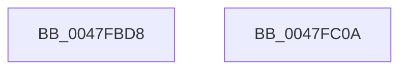

# MiLockAllMemoryLists

- RVA: `0x0047FBD8`–`0x0047FC0B` (길이 `51` bytes)
- VA: `0x000000014047FBD8`
- 실행 섹션: `.text`
- PDB 이름 있음: `예`; PDB Function 태그: `아니요`
- unwind 정보 RVA: `0x0005C788`
- 디코드: `11`개 명령, `51/51` bytes 표시
- 미해석 바이트: `0` (있으면 어셈블리에 `.byte`로 보존)

> 이 문서는 커널 이미지의 기계어와 PDB 기호를 분석해 생성했습니다. 4번과 5번은 함수 원형과 자료형을 바이너리 사용 방식에서 추정한 C 해석이며 원본 소스 복구 결과는 아닙니다.

## 1. Dependencies

- 직접 호출 지점: **3**; 고유 호출 대상: **2**
- 직접 호출자로 확인된 함수: **1**
- RIP 상대 이미지 참조: **3**

### Outgoing calls
- `0x0047FBE8` → [MiIterateOverPartitions](MiIterateOverPartitions_function_0047FC14.md) (function, `0x0047FC14`)
- `0x0047FBF4` → [ExAcquireSpinLockExclusiveAtDpcLevel](../24/ExAcquireSpinLockExclusiveAtDpcLevel_function_00248E80.md) (function, `0x00248E80`)
- `0x0047FC00` → [ExAcquireSpinLockExclusiveAtDpcLevel](../24/ExAcquireSpinLockExclusiveAtDpcLevel_function_00248E80.md) (function, `0x00248E80`)

### Direct callers
- [MmDuplicateMemory](../../pagelk/B7/MmDuplicateMemory_function_00B74158.md) at `0x00B743ED`

### Static image references
- `0x0047FBE1` → RVA `0x004BB470` (`MiLockMemoryLists`; read)
- `0x0047FBED` → RVA `0x00E2FF30` (`.data`; read)
- `0x0047FBF9` → RVA `0x00E2FF20` (`.data`; read)

## 2. Other-region calls and transfers

- 다른 실행 섹션으로 향하는 call: **0**
- 별도 외부 분기/꼬리 이동을 확인하지 못했습니다.

## 3. Assembly (complete function range)

```asm
0047FBD8  48 83 EC 28                     sub rsp, 0x28
0047FBDC  BA 01 00 00 00                  mov edx, 1
0047FBE1  48 8D 0D 88 B8 03 00            lea rcx, [rip + 0x3b888]
0047FBE8  E8 27 00 00 00                  call 0x14047fc14
0047FBED  48 8D 0D 3C 03 9B 00            lea rcx, [rip + 0x9b033c]
0047FBF4  E8 87 92 DC FF                  call 0x140248e80
0047FBF9  48 8D 0D 20 03 9B 00            lea rcx, [rip + 0x9b0320]
0047FC00  E8 7B 92 DC FF                  call 0x140248e80
0047FC05  48 83 C4 28                     add rsp, 0x28
0047FC09  C3                              ret
0047FC0A  CC                              int3
```

## 4. C-style interpretation (structured pseudocode)

```c
__int64 __fastcall MiLockAllMemoryLists(void)
{
    __int64 result;
    __int64 v_rsp;

    v_rsp = (v_rsp) - (40);
    result = MiIterateOverPartitions(v_rip + 243848, 1, a3, a4);
    result = ExAcquireSpinLockExclusiveAtDpcLevel(v_rip + 10158908, 1, a3, a4);
    result = ExAcquireSpinLockExclusiveAtDpcLevel(v_rip + 10158880, 1, a3, a4);
    v_rsp = (v_rsp) + (40);
    return result;
}
```

## 5. (Beta) C Style

```c
void MiLockAllMemoryLists(void)
{
    int64_t result;
    int64_t local_rsp;

    local_rsp = (local_rsp) - (40);
    result = MiIterateOverPartitions(v_rip + 243848, 1, a3, a4);
    result = ExAcquireSpinLockExclusiveAtDpcLevel(v_rip + 10158908, 1, a3, a4);
    result = ExAcquireSpinLockExclusiveAtDpcLevel(v_rip + 10158880, 1, a3, a4);
    local_rsp = (local_rsp) + (40);
    return result;
}
```

## 6. Execution-region graph

[열기: 2D/3D 그래프와 함수 탐색 컨트롤 패널](../../../control-panel.html?section=text&rva=0x0047FBD8&view=graph)

- 2D 그래프는 위에서 아래로 흐르고, 3D 그래프는 빈 공간을 드래그해 회전합니다. Shift+드래그는 이동, 휠은 확대·축소, 함수 노드 선택은 대상 보고서 이동입니다.

### Static fallback


