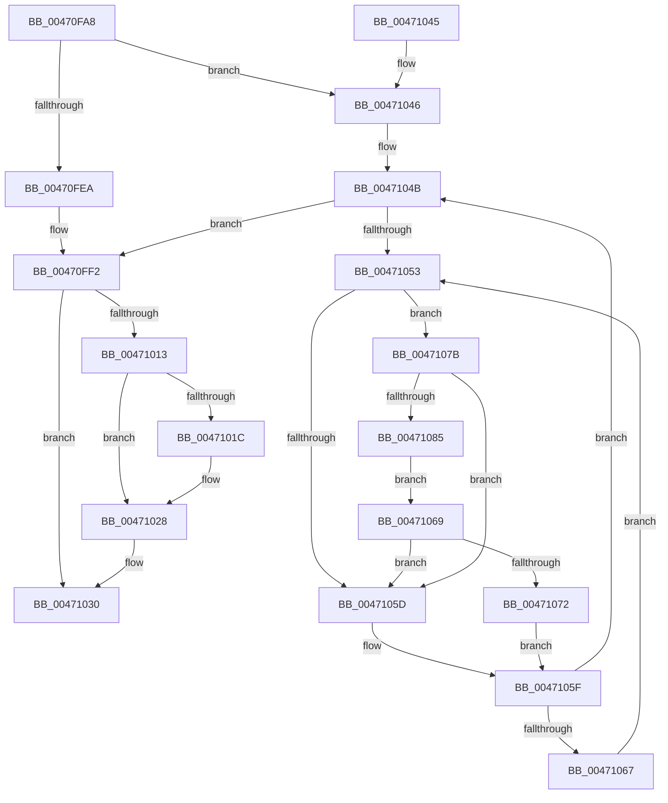

# MiLockAndInsertPageInFreeList

- RVA: `0x00470FA8`–`0x00471087` (길이 `223` bytes)
- VA: `0x0000000140470FA8`
- 실행 섹션: `.text`
- PDB 이름 있음: `예`; PDB Function 태그: `아니요`
- unwind 정보 RVA: `0x000ABDCC`
- 디코드: `60`개 명령, `223/223` bytes 표시
- 미해석 바이트: `0` (있으면 어셈블리에 `.byte`로 보존)

> 이 문서는 커널 이미지의 기계어와 PDB 기호를 분석해 생성했습니다. 4번과 5번은 함수 원형과 자료형을 바이너리 사용 방식에서 추정한 C 해석이며 원본 소스 복구 결과는 아닙니다.

## 1. Dependencies

- 직접 호출 지점: **5**; 고유 호출 대상: **5**
- 직접 호출자로 확인된 함수: **6**
- RIP 상대 이미지 참조: **3**

### Outgoing calls
- `0x00470FEA` → [MiLockPageInline](../31/MiLockPageInline_function_0031A340.md) (function, `0x0031A340`)
- `0x00470FFA` → [MiInsertPageInFreeOrZeroedList](../33/MiInsertPageInFreeOrZeroedList_function_00334D20.md) (function, `0x00334D20`)
- `0x00471023` → [KiLowerIrqlProcessIrqlFlags](../4F/KiLowerIrqlProcessIrqlFlags_function_004F5698.md) (function, `0x004F5698`)
- `0x00471069` → [KiCheckVpBackingLongSpinWaitHypercall](../30/KiCheckVpBackingLongSpinWaitHypercall_function_0030F490.md) (function, `0x0030F490`)
- `0x00471074` → [HvlNotifyLongSpinWait](../30/HvlNotifyLongSpinWait_function_0030F460.md) (function, `0x0030F460`)

### Direct callers
- [MiBuildForkPte](../22/MiBuildForkPte_function_0022E32C.md) at `0x0022F2F7`
- [MiTradePage](../28/MiTradePage_function_0028D160.md) at `0x0028D552`
- [MiTradePage](../28/MiTradePage_function_0028D160.md) at `0x0028D8BE`
- [MiMakePageAvoidRead](../2B/MiMakePageAvoidRead_function_002B7DE0.md) at `0x002B82A5`
- [MiMakePageAvoidRead](../2B/MiMakePageAvoidRead_function_002B7DE0.md) at `0x002B848D`
- [MiComputeCacheAttributeSpeeds](../69/MiComputeCacheAttributeSpeeds_function_006999E8.md) at `0x00699D66`
- [MiFreeBootPageTable](../../init/C5/MiFreeBootPageTable_function_00C5FC10.md) at `0x00C5FD1F`
- [MiFreeEmptyBootPageTable](../../init/C6/MiFreeEmptyBootPageTable_function_00C62370.md) at `0x00C6246A`

### Static image references
- `0x00471013` → RVA `0x00FC6D20` (`ALMOSTRO`; read)
- `0x00471055` → RVA `0x00FC52AC` (`ALMOSTRO`; reference)
- `0x0047107B` → RVA `0x00FC6AB8` (`ALMOSTRO`; read)

## 2. Other-region calls and transfers

- 다른 실행 섹션으로 향하는 call: **0**
- 별도 외부 분기/꼬리 이동을 확인하지 못했습니다.

## 3. Assembly (complete function range)

```asm
00470FA8  48 89 5C 24 08                  mov qword ptr [rsp + 8], rbx
00470FAD  48 89 6C 24 10                  mov qword ptr [rsp + 0x10], rbp
00470FB2  48 89 74 24 18                  mov qword ptr [rsp + 0x18], rsi
00470FB7  57                              push rdi
00470FB8  48 83 EC 20                     sub rsp, 0x20
00470FBC  48 B8 00 00 00 00 00 DE FF FF   movabs rax, 0xffffde0000000000
00470FC6  48 8B E9                        mov rbp, rcx
00470FC9  48 2B E8                        sub rbp, rax
00470FCC  48 B8 AB AA AA AA AA AA AA AA   movabs rax, 0xaaaaaaaaaaaaaaab
00470FD6  48 C1 FD 04                     sar rbp, 4
00470FDA  48 0F AF E8                     imul rbp, rax
00470FDE  44 0F 20 C0                     mov rax, cr8
00470FE2  48 8D 59 18                     lea rbx, [rcx + 0x18]
00470FE6  3C 02                           cmp al, 2
00470FE8  74 5C                           je 0x140471046
00470FEA  E8 51 93 EA FF                  call 0x14031a340
00470FEF  40 8A F8                        mov dil, al
00470FF2  BA 02 00 00 00                  mov edx, 2
00470FF7  48 8B CD                        mov rcx, rbp
00470FFA  E8 21 3D EC FF                  call 0x140334d20
00470FFF  48 B8 FF FF FF FF FF FF FF 7F   movabs rax, 0x7fffffffffffffff
00471009  F0 48 21 03                     lock and qword ptr [rbx], rax
0047100D  40 80 FF 02                     cmp dil, 2
00471011  73 1D                           jae 0x140471030
00471013  83 3D 06 5D B5 00 00            cmp dword ptr [rip + 0xb55d06], 0
0047101A  74 0C                           je 0x140471028
0047101C  44 0F 20 C1                     mov rcx, cr8
00471020  40 8A D7                        mov dl, dil
00471023  E8 70 46 08 00                  call 0x1404f5698
00471028  40 0F B6 C7                     movzx eax, dil
0047102C  44 0F 22 C0                     mov cr8, rax
00471030  48 8B 5C 24 30                  mov rbx, qword ptr [rsp + 0x30]
00471035  48 8B 6C 24 38                  mov rbp, qword ptr [rsp + 0x38]
0047103A  48 8B 74 24 40                  mov rsi, qword ptr [rsp + 0x40]
0047103F  48 83 C4 20                     add rsp, 0x20
00471043  5F                              pop rdi
00471044  C3                              ret
00471045  CC                              int3
00471046  40 B7 11                        mov dil, 0x11
00471049  33 F6                           xor esi, esi
0047104B  F0 48 0F BA 2B 3F               lock bts qword ptr [rbx], 0x3f
00471051  73 9F                           jae 0x140470ff2
00471053  FF C6                           inc esi
00471055  85 35 51 42 B5 00               test dword ptr [rip + 0xb54251], esi
0047105B  74 1E                           je 0x14047107b
0047105D  F3 90                           pause
0047105F  48 8B 03                        mov rax, qword ptr [rbx]
00471062  48 85 C0                        test rax, rax
00471065  79 E4                           jns 0x14047104b
00471067  EB EA                           jmp 0x140471053
00471069  E8 22 E4 E9 FF                  call 0x14030f490
0047106E  84 C0                           test al, al
00471070  74 EB                           je 0x14047105d
00471072  8B CE                           mov ecx, esi
00471074  E8 E7 E3 E9 FF                  call 0x14030f460
00471079  EB E4                           jmp 0x14047105f
0047107B  8B 05 37 5A B5 00               mov eax, dword ptr [rip + 0xb55a37]
00471081  A8 40                           test al, 0x40
00471083  74 D8                           je 0x14047105d
00471085  EB E2                           jmp 0x140471069
```

## 4. C-style interpretation (structured pseudocode)

```c
__int64 __fastcall MiLockAndInsertPageInFreeList(__int64 a1)
{
    __int64 result;
    __int64 v_rbp;
    __int64 v_rsi;
    __int64 v_rsp;
    unsigned __int64 v_stack_p10;
    unsigned __int64 v_stack_p18;
    unsigned __int64 v_stack_p8;

    v_stack_p8 = v_rbx;
    v_stack_p10 = v_rbp;
    v_stack_p18 = v_rsi;
    v_rsp = (v_rsp) - (32);
    v_rbp = (a1) - (result);
    v_rbp = (v_rbp) >> (4);
    v_rbp = (v_rbp) * (result);
    if (((unsigned __int8)(v_cr8)) == 2) goto loc_00471046;
    result = MiLockPageInline(a1, a2, a3, a4);
loc_00470FF2:
    result = MiInsertPageInFreeOrZeroedList(v_rbp, 2, a3, a4);
    if (((unsigned __int8)((unsigned __int8)(result))) >= 2) goto loc_00471030;
    if ((*(unsigned int *)(v_rip + 11885830)) != 0) {
        a1 = v_cr8;
        a2 = (unsigned __int8)((unsigned __int8)(result));
        result = KiLowerIrqlProcessIrqlFlags(a1, a2, a3, a4);
    }
loc_00471030:
    v_rsp = (v_rsp) + (32);
    return (unsigned __int8)((unsigned __int8)(result));
loc_00471046:
    v_rsi = 0;
loc_0047104B:
    if (condition_is_above_or_equal) goto loc_00470FF2;
loc_00471053:
    v_rsi = (unsigned int)((v_rsi) + 1);
    if (((*(unsigned int *)(v_rip + 11878993)) & ((unsigned int)(v_rsi))) == 0) goto loc_0047107B;
loc_0047105D:
loc_0047105F:
    if (!sign_flag) goto loc_0047104B;
    goto loc_00471053;
loc_00471069:
    result = KiCheckVpBackingLongSpinWaitHypercall(a1, a2, a3, a4);
    if ((unsigned __int8)(result) == 0) goto loc_0047105D;
    result = HvlNotifyLongSpinWait((unsigned int)((unsigned int)(v_rsi)), a2, a3, a4);
    goto loc_0047105F;
loc_0047107B:
    if ((((unsigned __int8)((unsigned int)(*(unsigned int *)(v_rip + 11885111)))) & (64)) == 0) goto loc_0047105D;
    goto loc_00471069;
}
```

## 5. (Beta) C Style

```c
int64_t MiLockAndInsertPageInFreeList(void *Arg1)
{
    uint8_t *arg1 = (uint8_t *)Arg1;

    int64_t result;
    int64_t local_rbp;
    int64_t local_rsi;
    int64_t local_rsp;
    uint64_t v_stack_p10;
    uint64_t v_stack_p18;
    uint64_t v_stack_p8;

    v_stack_p8 = local_rbx;
    v_stack_p10 = local_rbp;
    v_stack_p18 = local_rsi;
    local_rsp = (local_rsp) - (32);
    local_rbp = (Arg1) - (result);
    local_rbp = (local_rbp) >> (4);
    local_rbp = (local_rbp) * (result);
    if (((uint8_t)(v_cr8)) == 2) goto loc_00471046;
    result = MiLockPageInline(Arg1, a2, a3, a4);
loc_00470FF2:
    result = MiInsertPageInFreeOrZeroedList(local_rbp, 2, a3, a4);
    if (((uint8_t)((uint8_t)(result))) >= 2) goto loc_00471030;
    if ((*(uint32_t *)(v_rip + 0xB55D06)) != 0) {
        Arg1 = v_cr8;
        a2 = (uint8_t)((uint8_t)(result));
        result = KiLowerIrqlProcessIrqlFlags(Arg1, a2, a3, a4);
    }
loc_00471030:
    local_rsp = (local_rsp) + (32);
    return (uint8_t)((uint8_t)(result));
loc_00471046:
    local_rsi = 0;
loc_0047104B:
    if (condition_is_above_or_equal) goto loc_00470FF2;
loc_00471053:
    local_rsi = (uint32_t)((local_rsi) + 1);
    if (((*(uint32_t *)(v_rip + 0xB54251)) & ((uint32_t)(local_rsi))) == 0) goto loc_0047107B;
loc_0047105D:
loc_0047105F:
    if (!sign_flag) goto loc_0047104B;
    goto loc_00471053;
loc_00471069:
    result = KiCheckVpBackingLongSpinWaitHypercall(Arg1, a2, a3, a4);
    if ((uint8_t)(result) == 0) goto loc_0047105D;
    result = HvlNotifyLongSpinWait((uint32_t)((uint32_t)(local_rsi)), a2, a3, a4);
    goto loc_0047105F;
loc_0047107B:
    if ((((uint8_t)((uint32_t)(*(uint32_t *)(v_rip + 0xB55A37)))) & (64)) == 0) goto loc_0047105D;
    goto loc_00471069;
}
```

### 관측된 메모리 오프셋

구조체 형식이 확인되지 않은 접근은 인자 기준의 오프셋으로만 기록했습니다.

| 기준 인자 | 오프셋 표현 | 폭 (bit) | 접근 |
|---|---:|---:|---|
| `Arg1` | `+ 0x0` | `64` | `R` |
| `Arg1` | `+ 0x0` | `64` | `R/W` |
| `Arg1` | `+ 0x18` | `64` | `R` |

## 6. Execution-region graph

[열기: 2D/3D 그래프와 함수 탐색 컨트롤 패널](../../../control-panel.html?section=text&rva=0x00470FA8&view=graph)

- 2D 그래프는 위에서 아래로 흐르고, 3D 그래프는 빈 공간을 드래그해 회전합니다. Shift+드래그는 이동, 휠은 확대·축소, 함수 노드 선택은 대상 보고서 이동입니다.

### Static fallback


