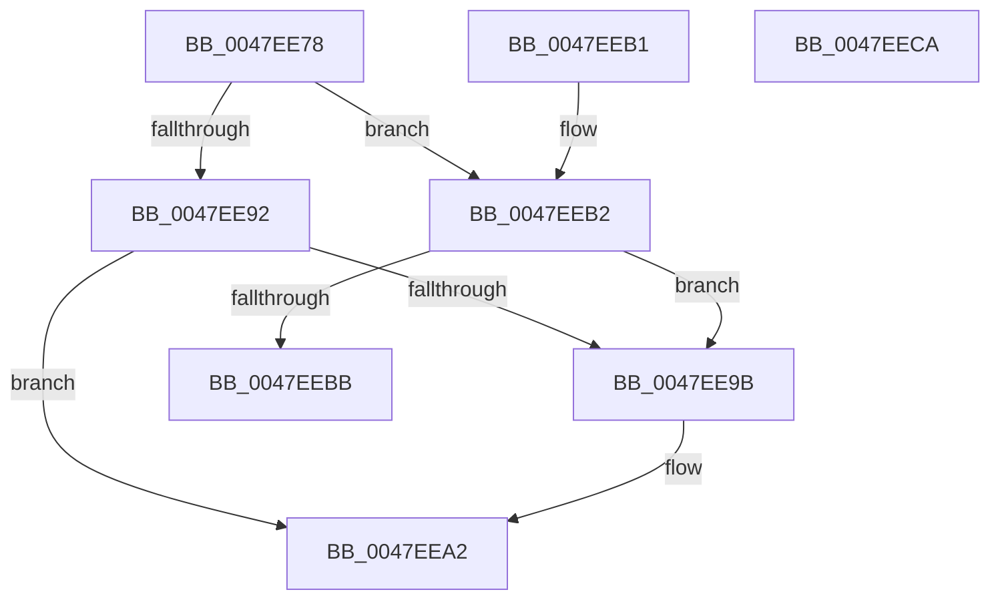

# MiMakePagefileWriterEntryAvailable

- RVA: `0x0047EE78`–`0x0047EECB` (길이 `83` bytes)
- VA: `0x000000014047EE78`
- 실행 섹션: `.text`
- PDB 이름 있음: `예`; PDB Function 태그: `아니요`
- unwind 정보 RVA: `0x000DB714`
- 디코드: `25`개 명령, `83/83` bytes 표시
- 미해석 바이트: `0` (있으면 어셈블리에 `.byte`로 보존)

> 이 문서는 커널 이미지의 기계어와 PDB 기호를 분석해 생성했습니다. 4번과 5번은 함수 원형과 자료형을 바이너리 사용 방식에서 추정한 C 해석이며 원본 소스 복구 결과는 아닙니다.

## 1. Dependencies

- 직접 호출 지점: **0**; 고유 호출 대상: **0**
- 직접 호출자로 확인된 함수: **4**
- RIP 상대 이미지 참조: **0**

### Outgoing calls
- 직접 디코드된 call 명령이 없습니다.

### Direct callers
- [MiGatherPagefilePages](../37/MiGatherPagefilePages_function_00372B08.md) at `0x00373301`
- [MiWriteComplete](../40/MiWriteComplete_function_004069B0.md) at `0x00406D14`
- [MiPageFileNoFreeSpace](MiPageFileNoFreeSpace_function_0047E45C.md) at `0x0047E4BC`
- [MiModifiedPageWriter](MiModifiedPageWriter_function_0047E5F0.md) at `0x0047EA59`

### Static image references
- 디코드된 RIP-relative 메모리 참조가 없습니다.

## 2. Other-region calls and transfers

- 다른 실행 섹션으로 향하는 call: **0**
- 별도 외부 분기/꼬리 이동을 확인하지 못했습니다.

## 3. Assembly (complete function range)

```asm
0047EE78  48 8B 41 40                     mov rax, qword ptr [rcx + 0x40]
0047EE7C  4C 8B 41 38                     mov r8, qword ptr [rcx + 0x38]
0047EE80  49 81 C0 B8 03 00 00            add r8, 0x3b8
0047EE87  66 0F BA A0 AC 00 00 00 0B      bt word ptr [rax + 0xac], 0xb
0047EE90  72 20                           jb 0x14047eeb2
0047EE92  49 8B 40 08                     mov rax, qword ptr [r8 + 8]
0047EE96  4C 39 00                        cmp qword ptr [rax], r8
0047EE99  74 07                           je 0x14047eea2
0047EE9B  B9 03 00 00 00                  mov ecx, 3
0047EEA0  CD 29                           int 0x29
0047EEA2  4C 89 01                        mov qword ptr [rcx], r8
0047EEA5  48 89 41 08                     mov qword ptr [rcx + 8], rax
0047EEA9  48 89 08                        mov qword ptr [rax], rcx
0047EEAC  49 89 48 08                     mov qword ptr [r8 + 8], rcx
0047EEB0  C3                              ret
0047EEB1  CC                              int3
0047EEB2  49 8B 00                        mov rax, qword ptr [r8]
0047EEB5  4C 39 40 08                     cmp qword ptr [rax + 8], r8
0047EEB9  75 E0                           jne 0x14047ee9b
0047EEBB  48 89 01                        mov qword ptr [rcx], rax
0047EEBE  4C 89 41 08                     mov qword ptr [rcx + 8], r8
0047EEC2  48 89 48 08                     mov qword ptr [rax + 8], rcx
0047EEC6  49 89 08                        mov qword ptr [r8], rcx
0047EEC9  C3                              ret
0047EECA  CC                              int3
```

## 4. C-style interpretation (structured pseudocode)

```c
__int64 __fastcall MiMakePagefileWriterEntryAvailable(__int64 a1)
{
    a3 = (*(unsigned __int64 *)(a1 + 56)) + (952);
    if (condition_is_below) goto loc_0047EEB2;
    if ((*(unsigned __int64 *)(*(unsigned __int64 *)(a3 + 8))) != a3) {
        a1 = 3;
    }
    *(unsigned __int64 *)(a1) = a3;
    *(unsigned __int64 *)(a1 + 8) = *(unsigned __int64 *)(a3 + 8);
    *(unsigned __int64 *)(*(unsigned __int64 *)(a3 + 8)) = a1;
    *(unsigned __int64 *)(a3 + 8) = a1;
    return *(unsigned __int64 *)(a3 + 8);
loc_0047EEB2:
    if ((*(unsigned __int64 *)(*(unsigned __int64 *)(a3) + 8)) != a3) goto loc_0047EE9B;
    *(unsigned __int64 *)(a1) = *(unsigned __int64 *)(a3);
    *(unsigned __int64 *)(a1 + 8) = a3;
    *(unsigned __int64 *)(*(unsigned __int64 *)(a3) + 8) = a1;
    *(unsigned __int64 *)(a3) = a1;
    return *(unsigned __int64 *)(a3);
}
```

## 5. (Beta) C Style

```c
int64_t MiMakePagefileWriterEntryAvailable(void *Arg1)
{
    uint8_t *arg1 = (uint8_t *)Arg1;

    a3 = (*(uint64_t *)(arg1 + 0x38)) + (952);
    if (condition_is_below) goto loc_0047EEB2;
    if ((*(uint64_t *)(*(uint64_t *)(a3 + 0x8))) != a3) {
        Arg1 = 3;
    }
    *(uint64_t *)(arg1) = a3;
    *(uint64_t *)(arg1 + 0x8) = *(uint64_t *)(a3 + 0x8);
    *(void **)(*(uint64_t *)(a3 + 0x8)) = Arg1;
    *(void **)(a3 + 0x8) = Arg1;
    return *(uint64_t *)(a3 + 0x8);
loc_0047EEB2:
    if ((*(uint64_t *)(*(uint64_t *)(a3) + 0x8)) != a3) goto loc_0047EE9B;
    *(uint64_t *)(arg1) = *(uint64_t *)(a3);
    *(uint64_t *)(arg1 + 0x8) = a3;
    *(void **)(*(uint64_t *)(a3) + 0x8) = Arg1;
    *(void **)(a3) = Arg1;
    return *(uint64_t *)(a3);
}
```

### 관측된 메모리 오프셋

구조체 형식이 확인되지 않은 접근은 인자 기준의 오프셋으로만 기록했습니다.

| 기준 인자 | 오프셋 표현 | 폭 (bit) | 접근 |
|---|---:|---:|---|
| `Arg1` | `+ 0x0` | `64` | `W` |
| `Arg1` | `+ 0x8` | `64` | `W` |
| `Arg1` | `+ 0x38` | `64` | `R` |
| `Arg1` | `+ 0x40` | `64` | `R` |

## 6. Execution-region graph

[열기: 2D/3D 그래프와 함수 탐색 컨트롤 패널](../../../control-panel.html?section=text&rva=0x0047EE78&view=graph)

- 2D 그래프는 위에서 아래로 흐르고, 3D 그래프는 빈 공간을 드래그해 회전합니다. Shift+드래그는 이동, 휠은 확대·축소, 함수 노드 선택은 대상 보고서 이동입니다.

### Static fallback


