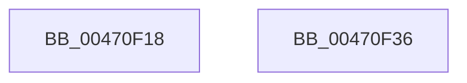

# MiMaximumCommitmentAvailable

- RVA: `0x00470F18`–`0x00470F37` (길이 `31` bytes)
- VA: `0x0000000140470F18`
- 실행 섹션: `.text`
- PDB 이름 있음: `예`; PDB Function 태그: `아니요`
- unwind 정보 RVA: `0x000DB714`
- 디코드: `9`개 명령, `31/31` bytes 표시
- 미해석 바이트: `0` (있으면 어셈블리에 `.byte`로 보존)

> 이 문서는 커널 이미지의 기계어와 PDB 기호를 분석해 생성했습니다. 4번과 5번은 함수 원형과 자료형을 바이너리 사용 방식에서 추정한 C 해석이며 원본 소스 복구 결과는 아닙니다.

## 1. Dependencies

- 직접 호출 지점: **0**; 고유 호출 대상: **0**
- 직접 호출자로 확인된 함수: **1**
- RIP 상대 이미지 참조: **2**

### Outgoing calls
- 직접 디코드된 call 명령이 없습니다.

### Direct callers
- [ExpQuerySystemPerformanceInformation](../../page/9D/ExpQuerySystemPerformanceInformation_function_009D648C.md) at `0x009D67D8`

### Static image references
- `0x00470F18` → RVA `0x00E3CEC8` (`.data`; read)
- `0x00470F1F` → RVA `0x00E3D840` (`.data`; read)

## 2. Other-region calls and transfers

- 다른 실행 섹션으로 향하는 call: **0**
- 별도 외부 분기/꼬리 이동을 확인하지 못했습니다.

## 3. Assembly (complete function range)

```asm
00470F18  48 8B 15 A9 BF 9C 00            mov rdx, qword ptr [rip + 0x9cbfa9]
00470F1F  48 8B 05 1A C9 9C 00            mov rax, qword ptr [rip + 0x9cc91a]
00470F26  48 8B CA                        mov rcx, rdx
00470F29  48 2B C8                        sub rcx, rax
00470F2C  48 3B C2                        cmp rax, rdx
00470F2F  48 1B C0                        sbb rax, rax
00470F32  48 23 C1                        and rax, rcx
00470F35  C3                              ret
00470F36  CC                              int3
```

## 4. C-style interpretation (structured pseudocode)

```c
__int64 __fastcall MiMaximumCommitmentAvailable(void)
{
    __int64 result;

    a1 = (*(unsigned __int64 *)(v_rip + 10272681)) - (*(unsigned __int64 *)(v_rip + 10275098));
    result = (*(unsigned __int64 *)(v_rip + 10275098)) & (a1);
    return result;
}
```

## 5. (Beta) C Style

```c
void MiMaximumCommitmentAvailable(void)
{
    int64_t result;

    a1 = (*(uint64_t *)(v_rip + 0x9CBFA9)) - (*(uint64_t *)(v_rip + 0x9CC91A));
    result = (*(uint64_t *)(v_rip + 0x9CC91A)) & (a1);
    return result;
}
```

## 6. Execution-region graph

[열기: 2D/3D 그래프와 함수 탐색 컨트롤 패널](../../../control-panel.html?section=text&rva=0x00470F18&view=graph)

- 2D 그래프는 위에서 아래로 흐르고, 3D 그래프는 빈 공간을 드래그해 회전합니다. Shift+드래그는 이동, 휠은 확대·축소, 함수 노드 선택은 대상 보고서 이동입니다.

### Static fallback


