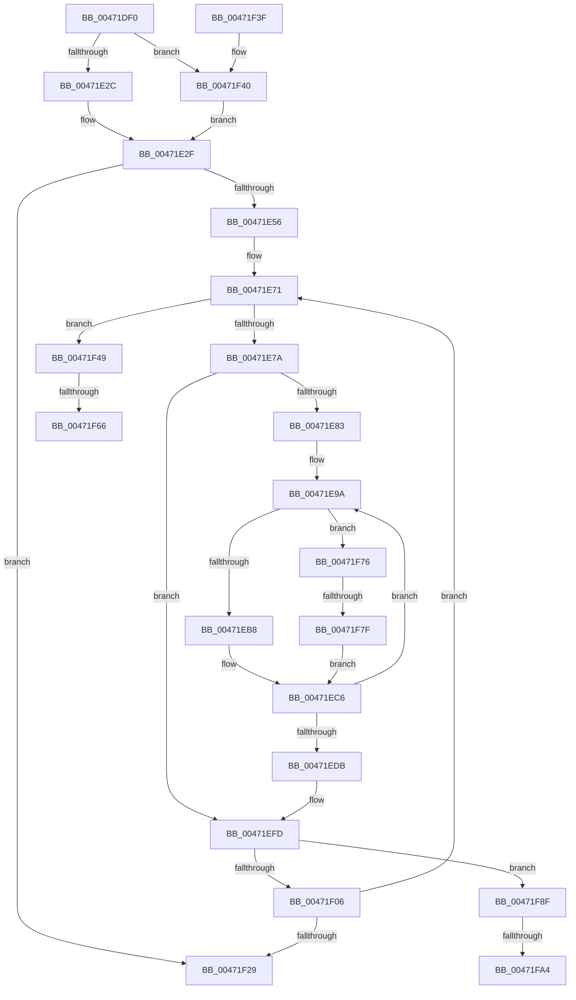

# MiMirrorZeroFreeListsCallback

- RVA: `0x00471DF0`–`0x00471FB6` (길이 `454` bytes)
- VA: `0x0000000140471DF0`
- 실행 섹션: `.text`
- PDB 이름 있음: `예`; PDB Function 태그: `예`
- unwind 정보 RVA: `0x000AC458`
- 디코드: `105`개 명령, `454/454` bytes 표시
- 미해석 바이트: `0` (있으면 어셈블리에 `.byte`로 보존)

> 이 문서는 커널 이미지의 기계어와 PDB 기호를 분석해 생성했습니다. 4번과 5번은 함수 원형과 자료형을 바이너리 사용 방식에서 추정한 C 해석이며 원본 소스 복구 결과는 아닙니다.

## 1. Dependencies

- 직접 호출 지점: **5**; 고유 호출 대상: **5**
- 직접 호출자로 확인된 함수: **0**
- RIP 상대 이미지 참조: **2**

### Outgoing calls
- `0x00471EC1` → [MiMirrorOmitPagesFromCopy](../2B/MiMirrorOmitPagesFromCopy_function_002B7AF0.md) (function, `0x002B7AF0`)
- `0x00471F6B` → [KiRaiseIrqlProcessIrqlFlags](../4F/KiRaiseIrqlProcessIrqlFlags_function_004F56FC.md) (function, `0x004F56FC`)
- `0x00471F85` → [MiMirrorAddPagesToBrownList](../3B/MiMirrorAddPagesToBrownList_function_003B648C.md) (function, `0x003B648C`)
- `0x00471F92` → [ExReleaseSpinLockExclusiveFromDpcLevel](../24/ExReleaseSpinLockExclusiveFromDpcLevel_function_002497E0.md) (function, `0x002497E0`)
- `0x00471FAB` → [KiLowerIrqlProcessIrqlFlags](../4F/KiLowerIrqlProcessIrqlFlags_function_004F5698.md) (function, `0x004F5698`)

### Direct callers
- 이 함수 시작 RVA로 연결되는 직접 call은 확인되지 않았습니다. 간접 호출은 완전히 역산할 수 없습니다.

### Static image references
- `0x00471E2F` → RVA `0x00011C60` (`.rdata`; read)
- `0x00471F59` → RVA `0x00FC6D20` (`ALMOSTRO`; read)

## 2. Other-region calls and transfers

- 다른 실행 섹션으로 향하는 call: **0**
- call이 아닌 외부 분기/꼬리 이동: **5**
  - `0x00471F60` → [sub_006F3CFE](../6F/Unknown_function_006F3CFE.md) (`tail-transfer`)
  - `0x00471F71` → [sub_006F3CFE](../6F/Unknown_function_006F3CFE.md) (`tail-transfer`)
  - `0x00471F79` → [sub_006F3CFE + 0xE](../6F/Unknown_function_006F3CFE.md) (`tail-transfer`)
  - `0x00471F9E` → [sub_006F3CFE + 0x47](../6F/Unknown_function_006F3CFE.md) (`tail-transfer`)
  - `0x00471FB1` → [sub_006F3CFE + 0x47](../6F/Unknown_function_006F3CFE.md) (`tail-transfer`)

## 3. Assembly (complete function range)

```asm
00471DF0  44 89 4C 24 20                  mov dword ptr [rsp + 0x20], r9d
00471DF5  53                              push rbx
00471DF6  55                              push rbp
00471DF7  56                              push rsi
00471DF8  57                              push rdi
00471DF9  41 54                           push r12
00471DFB  41 55                           push r13
00471DFD  41 56                           push r14
00471DFF  41 57                           push r15
00471E01  48 83 EC 48                     sub rsp, 0x48
00471E05  41 0F B7 70 0A                  movzx esi, word ptr [r8 + 0xa]
00471E0A  45 8B F9                        mov r15d, r9d
00471E0D  48 8B 82 88 3A 00 00            mov rax, qword ptr [rdx + 0x3a88]
00471E14  83 E6 03                        and esi, 3
00471E17  44 8B 71 08                     mov r14d, dword ptr [rcx + 8]
00471E1B  4C 8B 29                        mov r13, qword ptr [rcx]
00471E1E  48 89 44 24 30                  mov qword ptr [rsp + 0x30], rax
00471E23  45 85 F6                        test r14d, r14d
00471E26  0F 85 14 01 00 00               jne 0x140471f40
00471E2C  45 33 E4                        xor r12d, r12d
00471E2F  48 8D 0D 2A FE B9 FF            lea rcx, [rip - 0x4601d6]
00471E36  40 B5 11                        mov bpl, 0x11
00471E39  48 8B 0C F1                     mov rcx, qword ptr [rcx + rsi*8]
00471E3D  48 89 8C 24 A0 00 00 00         mov qword ptr [rsp + 0xa0], rcx
00471E45  48 89 AC 24 90 00 00 00         mov qword ptr [rsp + 0x90], rbp
00471E4D  45 85 C9                        test r9d, r9d
00471E50  0F 84 D3 00 00 00               je 0x140471f29
00471E56  49 8D 58 20                     lea rbx, [r8 + 0x20]
00471E5A  B8 02 00 00 00                  mov eax, 2
00471E5F  48 89 9C 24 98 00 00 00         mov qword ptr [rsp + 0x98], rbx
00471E67  48 BF FF FF FF FF 3F 00 00 00   movabs rdi, 0x3fffffffff
00471E71  45 85 F6                        test r14d, r14d
00471E74  0F 84 CF 00 00 00               je 0x140471f49
00471E7A  48 8B 43 F0                     mov rax, qword ptr [rbx - 0x10]
00471E7E  48 3B C7                        cmp rax, rdi
00471E81  74 7A                           je 0x140471efd
00471E83  4C 8B BC 24 A0 00 00 00         mov r15, qword ptr [rsp + 0xa0]
00471E8B  48 BB FF FF FF FF 3F 00 00 00   movabs rbx, 0x3fffffffff
00471E95  48 8B 6C 24 30                  mov rbp, qword ptr [rsp + 0x30]
00471E9A  48 8D 3C 40                     lea rdi, [rax + rax*2]
00471E9E  48 C1 E7 04                     shl rdi, 4
00471EA2  48 B9 00 00 00 00 00 DE FF FF   movabs rcx, 0xffffde0000000000
00471EAC  48 03 F9                        add rdi, rcx
00471EAF  45 85 F6                        test r14d, r14d
00471EB2  0F 84 BE 00 00 00               je 0x140471f76
00471EB8  4D 8B C7                        mov r8, r15
00471EBB  48 8B D0                        mov rdx, rax
00471EBE  49 8B CC                        mov rcx, r12
00471EC1  E8 2A 5C E4 FF                  call 0x1402b7af0
00471EC6  48 8B 07                        mov rax, qword ptr [rdi]
00471EC9  48 B9 FF FF FF FF FF 00 00 00   movabs rcx, 0xffffffffff
00471ED3  48 23 C1                        and rax, rcx
00471ED6  48 3B C3                        cmp rax, rbx
00471ED9  75 BF                           jne 0x140471e9a
00471EDB  48 8B 9C 24 98 00 00 00         mov rbx, qword ptr [rsp + 0x98]
00471EE3  48 BF FF FF FF FF 3F 00 00 00   movabs rdi, 0x3fffffffff
00471EED  48 8B AC 24 90 00 00 00         mov rbp, qword ptr [rsp + 0x90]
00471EF5  44 8B BC 24 A8 00 00 00         mov r15d, dword ptr [rsp + 0xa8]
00471EFD  45 85 F6                        test r14d, r14d
00471F00  0F 84 89 00 00 00               je 0x140471f8f
00471F06  48 83 C3 58                     add rbx, 0x58
00471F0A  B8 02 00 00 00                  mov eax, 2
00471F0F  41 83 C7 FF                     add r15d, -1
00471F13  48 89 9C 24 98 00 00 00         mov qword ptr [rsp + 0x98], rbx
00471F1B  44 89 BC 24 A8 00 00 00         mov dword ptr [rsp + 0xa8], r15d
00471F23  0F 85 48 FF FF FF               jne 0x140471e71
00471F29  B8 01 00 00 00                  mov eax, 1
00471F2E  48 83 C4 48                     add rsp, 0x48
00471F32  41 5F                           pop r15
00471F34  41 5E                           pop r14
00471F36  41 5D                           pop r13
00471F38  41 5C                           pop r12
00471F3A  5F                              pop rdi
00471F3B  5E                              pop rsi
00471F3C  5D                              pop rbp
00471F3D  5B                              pop rbx
00471F3E  C3                              ret
00471F3F  CC                              int3
00471F40  4D 8B 65 00                     mov r12, qword ptr [r13]
00471F44  E9 E6 FE FF FF                  jmp 0x140471e2f
00471F49  44 0F 20 C5                     mov rbp, cr8
00471F4D  48 89 AC 24 90 00 00 00         mov qword ptr [rsp + 0x90], rbp
00471F55  44 0F 22 C0                     mov cr8, rax
00471F59  83 3D C0 4D B5 00 00            cmp dword ptr [rip + 0xb54dc0], 0
00471F60  0F 84 98 1D 28 00               je 0x1406f3cfe
00471F66  8A D0                           mov dl, al
00471F68  40 8A CD                        mov cl, bpl
00471F6B  E8 8C 37 08 00                  call 0x1404f56fc
00471F70  90                              nop
00471F71  E9 88 1D 28 00                  jmp 0x1406f3cfe
00471F76  4D 85 ED                        test r13, r13
00471F79  0F 84 8D 1D 28 00               je 0x1406f3d0c
00471F7F  49 8B D7                        mov rdx, r15
00471F82  48 8B C8                        mov rcx, rax
00471F85  E8 02 45 F4 FF                  call 0x1403b648c
00471F8A  E9 37 FF FF FF                  jmp 0x140471ec6
00471F8F  48 8B CB                        mov rcx, rbx
00471F92  E8 49 78 DD FF                  call 0x1402497e0
00471F97  83 3D 82 4D B5 00 00            cmp dword ptr [rip + 0xb54d82], 0
00471F9E  0F 84 A1 1D 28 00               je 0x1406f3d45
00471FA4  44 0F 20 C1                     mov rcx, cr8
00471FA8  40 8A D5                        mov dl, bpl
00471FAB  E8 E8 36 08 00                  call 0x1404f5698
00471FB0  90                              nop
00471FB1  E9 8F 1D 28 00                  jmp 0x1406f3d45
```

## 4. C-style interpretation (structured pseudocode)

```c
__int64 __fastcall MiMirrorZeroFreeListsCallback(__int64 a1, __int64 a2, __int64 a3, int a4)
{
    __int64 result;
    __int64 v_r12;
    __int64 v_r15;
    __int64 v_rbx;
    __int64 v_rdi;
    __int64 v_rsi;
    __int64 v_rsp;
    unsigned __int64 v_stack_m58;
    unsigned __int64 v_stack_p10;
    unsigned __int64 v_stack_p18;
    unsigned int v_stack_p20;
    unsigned __int64 v_stack_p8;
    unsigned __int64 v_stack_p90;

    v_stack_p20 = a4;
    v_rsp = (v_rsp) - (72);
    v_rsi = (unsigned int)((*(unsigned __int16 *)(a3 + 10)) & (3));
    v_stack_m58 = *(unsigned __int64 *)(a2 + 14984);
    if ((unsigned int)((unsigned int)(*(unsigned int *)(a1 + 8))) != 0) goto loc_00471F40;
    v_r12 = 0;
loc_00471E2F:
    v_stack_p18 = *(unsigned __int64 *)(v_rip - 4587990 + v_rsi * 8);
    v_stack_p8 = 17;
    if (a4 == 0) goto loc_00471F29;
    v_stack_p10 = a3 + 32;
loc_00471E71:
    if ((unsigned int)((unsigned int)(*(unsigned int *)(a1 + 8))) == 0) goto loc_00471F49;
    if ((*(unsigned __int64 *)(a3 + 32 - 16)) == v_rdi) goto loc_00471EFD;
loc_00471E9A:
    v_rdi = (*(unsigned __int64 *)(a3 + 32 - 16) + *(unsigned __int64 *)(a3 + 32 - 16) * 2) << (4);
    v_rdi = (v_rdi) + (*(unsigned __int64 *)(v_rip - 4587990 + v_rsi * 8));
    if ((unsigned int)((unsigned int)(*(unsigned int *)(a1 + 8))) == 0) goto loc_00471F76;
    result = MiMirrorOmitPagesFromCopy(0, *(unsigned __int64 *)(a3 + 32 - 16), v_stack_p18, a4);
loc_00471EC6:
    result = (*(unsigned __int64 *)(v_rdi)) & (0);
    if (result != (a3 + 32)) goto loc_00471E9A;
loc_00471EFD:
    if ((unsigned int)((unsigned int)(*(unsigned int *)(a1 + 8))) == 0) goto loc_00471F8F;
    v_rbx = (v_stack_p10) + (88);
    v_r15 = (unsigned int)(((unsigned int)(v_stack_p20)) + (-1));
    v_stack_p10 = v_rbx;
    v_stack_p20 = (unsigned int)(v_r15);
    if (condition_is_not_equal) goto loc_00471E71;
loc_00471F29:
    v_rsp = (v_rsp) + (72);
    return 1;
loc_00471F40:
    goto loc_00471E2F;
loc_00471F49:
    v_stack_p90 = v_cr8;
    result = KiRaiseIrqlProcessIrqlFlags((unsigned __int8)(v_cr8), 1, v_stack_p18, a4);
loc_00471F76:
    result = MiMirrorAddPagesToBrownList(result, v_r15, v_stack_p18, a4);
    goto loc_00471EC6;
loc_00471F8F:
    result = ExReleaseSpinLockExclusiveFromDpcLevel(v_rbx, v_r15, v_stack_p18, a4);
    result = KiLowerIrqlProcessIrqlFlags(1, (unsigned __int8)(v_cr8), v_stack_p18, a4);
}
```

## 5. (Beta) C Style

```c
int64_t MiMirrorZeroFreeListsCallback(void *Arg1, void *Arg2, void *Arg3, int32_t Arg4)
{
    uint8_t *arg1 = (uint8_t *)Arg1;
    uint8_t *arg2 = (uint8_t *)Arg2;
    uint8_t *arg3 = (uint8_t *)Arg3;

    int64_t result;
    int64_t local_r12;
    int64_t local_r15;
    int64_t local_rbx;
    int64_t local_rdi;
    int64_t local_rsi;
    int64_t local_rsp;
    uint64_t v_stack_m58;
    uint64_t v_stack_p10;
    uint64_t v_stack_p18;
    uint32_t v_stack_p20;
    uint64_t v_stack_p8;
    uint64_t v_stack_p90;

    v_stack_p20 = Arg4;
    local_rsp = (local_rsp) - (72);
    local_rsi = (uint32_t)((*(uint16_t *)(arg3 + 0xA)) & (3));
    v_stack_m58 = *(uint64_t *)(arg2 + 0x3A88);
    if ((uint32_t)((uint32_t)(*(uint32_t *)(arg1 + 0x8))) != 0) goto loc_00471F40;
    local_r12 = 0;
loc_00471E2F:
    v_stack_p18 = *(uint64_t *)(v_rip - 0x4601D6 + local_rsi * 8);
    v_stack_p8 = 17;
    if (Arg4 == 0) goto loc_00471F29;
    v_stack_p10 = Arg3 + 32;
loc_00471E71:
    if ((uint32_t)((uint32_t)(*(uint32_t *)(arg1 + 0x8))) == 0) goto loc_00471F49;
    if ((*(uint64_t *)(arg3 + 0x20 - 0x10)) == local_rdi) goto loc_00471EFD;
loc_00471E9A:
    local_rdi = (*(uint64_t *)(arg3 + 0x20 - 0x10) + *(uint64_t *)(arg3 + 0x20 - 0x10) * 2) << (4);
    local_rdi = (local_rdi) + (*(uint64_t *)(v_rip - 0x4601D6 + local_rsi * 8));
    if ((uint32_t)((uint32_t)(*(uint32_t *)(arg1 + 0x8))) == 0) goto loc_00471F76;
    result = MiMirrorOmitPagesFromCopy(0, *(uint64_t *)(arg3 + 0x20 - 0x10), v_stack_p18, Arg4);
loc_00471EC6:
    result = (*(uint64_t *)(local_rdi)) & (0);
    if (result != (Arg3 + 32)) goto loc_00471E9A;
loc_00471EFD:
    if ((uint32_t)((uint32_t)(*(uint32_t *)(arg1 + 0x8))) == 0) goto loc_00471F8F;
    local_rbx = (v_stack_p10) + (88);
    local_r15 = (uint32_t)(((uint32_t)(v_stack_p20)) + (-1));
    v_stack_p10 = local_rbx;
    v_stack_p20 = (uint32_t)(local_r15);
    if (condition_is_not_equal) goto loc_00471E71;
loc_00471F29:
    local_rsp = (local_rsp) + (72);
    return 1;
loc_00471F40:
    goto loc_00471E2F;
loc_00471F49:
    v_stack_p90 = v_cr8;
    result = KiRaiseIrqlProcessIrqlFlags((uint8_t)(v_cr8), 1, v_stack_p18, Arg4);
loc_00471F76:
    result = MiMirrorAddPagesToBrownList(result, local_r15, v_stack_p18, Arg4);
    goto loc_00471EC6;
loc_00471F8F:
    result = ExReleaseSpinLockExclusiveFromDpcLevel(local_rbx, local_r15, v_stack_p18, Arg4);
    result = KiLowerIrqlProcessIrqlFlags(1, (uint8_t)(v_cr8), v_stack_p18, Arg4);
}
```

### 관측된 메모리 오프셋

구조체 형식이 확인되지 않은 접근은 인자 기준의 오프셋으로만 기록했습니다.

| 기준 인자 | 오프셋 표현 | 폭 (bit) | 접근 |
|---|---:|---:|---|
| `Arg1` | `+ 0x0` | `64` | `R` |
| `Arg1` | `+ 0x8` | `32` | `R` |
| `Arg2` | `+ 0x3A88` | `64` | `R` |
| `Arg3` | `+ 0xA` | `16` | `R` |
| `Arg3` | `+ 0x20` | `64` | `R` |

## 6. Execution-region graph

[열기: 2D/3D 그래프와 함수 탐색 컨트롤 패널](../../../control-panel.html?section=text&rva=0x00471DF0&view=graph)

- 2D 그래프는 위에서 아래로 흐르고, 3D 그래프는 빈 공간을 드래그해 회전합니다. Shift+드래그는 이동, 휠은 확대·축소, 함수 노드 선택은 대상 보고서 이동입니다.

### Static fallback


