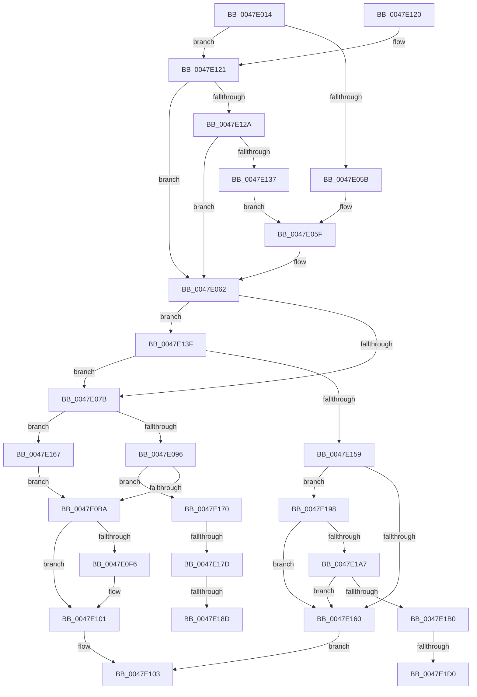

# MiObtainMdlCharges

- RVA: `0x0047E014`–`0x0047E1DF` (길이 `459` bytes)
- VA: `0x000000014047E014`
- 실행 섹션: `.text`
- PDB 이름 있음: `예`; PDB Function 태그: `예`
- unwind 정보 RVA: `0x000ADC38`
- 디코드: `120`개 명령, `459/459` bytes 표시
- 미해석 바이트: `0` (있으면 어셈블리에 `.byte`로 보존)

> 이 문서는 커널 이미지의 기계어와 PDB 기호를 분석해 생성했습니다. 4번과 5번은 함수 원형과 자료형을 바이너리 사용 방식에서 추정한 C 해석이며 원본 소스 복구 결과는 아닙니다.

## 1. Dependencies

- 직접 호출 지점: **3**; 고유 호출 대상: **3**
- 직접 호출자로 확인된 함수: **1**
- RIP 상대 이미지 참조: **0**

### Outgoing calls
- `0x0047E0A9` → [MiAllocatePool](../35/MiAllocatePool_function_0035B540.md) (function, `0x0035B540`)
- `0x0047E14C` → [MiAcquireNonPagedResources](../28/MiAcquireNonPagedResources_function_00286C60.md) (function, `0x00286C60`)
- `0x0047E18D` → [MiReleaseNonPagedResourcesNotExposed](../3F/MiReleaseNonPagedResourcesNotExposed_function_003F8258.md) (function, `0x003F8258`)

### Direct callers
- [MiAllocatePagesForMdl](../3E/MiAllocatePagesForMdl_function_003EABEC.md) at `0x003EACB4`

### Static image references
- 디코드된 RIP-relative 메모리 참조가 없습니다.

## 2. Other-region calls and transfers

- 다른 실행 섹션으로 향하는 call: **0**
- call이 아닌 외부 분기/꼬리 이동: **5**
  - `0x0047E177` → [sub_006F4BF6 + 0x5](../6F/Unknown_function_006F4BF6.md) (`tail-transfer`)
  - `0x0047E187` → [sub_006F4BF6](../6F/Unknown_function_006F4BF6.md) (`tail-transfer`)
  - `0x0047E193` → [sub_006F4BF6 + 0x5](../6F/Unknown_function_006F4BF6.md) (`tail-transfer`)
  - `0x0047E1CA` → [sub_006F4BF6 + 0xF](../6F/Unknown_function_006F4BF6.md) (`tail-transfer`)
  - `0x0047E1DA` → [sub_006F4BF6 + 0xF](../6F/Unknown_function_006F4BF6.md) (`tail-transfer`)

## 3. Assembly (complete function range)

```asm
0047E014  48 89 5C 24 08                  mov qword ptr [rsp + 8], rbx
0047E019  48 89 6C 24 10                  mov qword ptr [rsp + 0x10], rbp
0047E01E  48 89 74 24 18                  mov qword ptr [rsp + 0x18], rsi
0047E023  57                              push rdi
0047E024  41 54                           push r12
0047E026  41 55                           push r13
0047E028  41 56                           push r14
0047E02A  41 57                           push r15
0047E02C  48 83 EC 20                     sub rsp, 0x20
0047E030  48 8B 79 20                     mov rdi, qword ptr [rcx + 0x20]
0047E034  45 33 ED                        xor r13d, r13d
0047E037  48 8B F7                        mov rsi, rdi
0047E03A  48 8B D9                        mov rbx, rcx
0047E03D  8B 49 38                        mov ecx, dword ptr [rcx + 0x38]
0047E040  45 8B E5                        mov r12d, r13d
0047E043  48 C1 EE 04                     shr rsi, 4
0047E047  48 85 F6                        test rsi, rsi
0047E04A  41 8D 6D 01                     lea ebp, [r13 + 1]
0047E04E  48 0F 44 F5                     cmove rsi, rbp
0047E052  F6 C1 40                        test cl, 0x40
0047E055  0F 84 C6 00 00 00               je 0x14047e121
0047E05B  48 8B 73 18                     mov rsi, qword ptr [rbx + 0x18]
0047E05F  44 8B E5                        mov r12d, ebp
0047E062  44 8B B3 94 00 00 00            mov r14d, dword ptr [rbx + 0x94]
0047E069  41 83 E6 08                     and r14d, 8
0047E06D  41 83 CE 02                     or r14d, 2
0047E071  0F BA E1 0A                     bt ecx, 0xa
0047E075  0F 83 C4 00 00 00               jae 0x14047e13f
0047E07B  8B 8B 94 00 00 00               mov ecx, dword ptr [rbx + 0x94]
0047E081  33 D2                           xor edx, edx
0047E083  48 8B C7                        mov rax, rdi
0047E086  48 F7 73 30                     div qword ptr [rbx + 0x30]
0047E08A  48 8B E8                        mov rbp, rax
0047E08D  F6 C1 01                        test cl, 1
0047E090  0F 85 D1 00 00 00               jne 0x14047e167
0047E096  48 8D 14 C5 30 00 00 00         lea rdx, [rax*8 + 0x30]
0047E09E  B9 40 00 00 00                  mov ecx, 0x40
0047E0A3  41 B8 4D 6D 64 69               mov r8d, 0x69646d4d
0047E0A9  E8 92 D4 ED FF                  call 0x14035b540
0047E0AE  48 8B C8                        mov rcx, rax
0047E0B1  48 85 C0                        test rax, rax
0047E0B4  0F 84 B6 00 00 00               je 0x14047e170
0047E0BA  48 C1 E5 0C                     shl rbp, 0xc
0047E0BE  4C 89 29                        mov qword ptr [rcx], r13
0047E0C1  48 8B C5                        mov rax, rbp
0047E0C4  48 C1 E8 0C                     shr rax, 0xc
0047E0C8  66 83 C0 06                     add ax, 6
0047E0CC  66 44 89 69 0A                  mov word ptr [rcx + 0xa], r13w
0047E0D1  66 C1 E0 03                     shl ax, 3
0047E0D5  66 89 41 08                     mov word ptr [rcx + 8], ax
0047E0D9  4C 89 69 20                     mov qword ptr [rcx + 0x20], r13
0047E0DD  44 89 69 2C                     mov dword ptr [rcx + 0x2c], r13d
0047E0E1  89 69 28                        mov dword ptr [rcx + 0x28], ebp
0047E0E4  8B 83 94 00 00 00               mov eax, dword ptr [rbx + 0x94]
0047E0EA  48 89 7B 20                     mov qword ptr [rbx + 0x20], rdi
0047E0EE  48 89 4B 40                     mov qword ptr [rbx + 0x40], rcx
0047E0F2  A8 10                           test al, 0x10
0047E0F4  75 0B                           jne 0x14047e101
0047E0F6  48 8B 03                        mov rax, qword ptr [rbx]
0047E0F9  F0 48 01 B8 C0 4C 00 00         lock add qword ptr [rax + 0x4cc0], rdi
0047E101  33 C0                           xor eax, eax
0047E103  48 8B 5C 24 50                  mov rbx, qword ptr [rsp + 0x50]
0047E108  48 8B 6C 24 58                  mov rbp, qword ptr [rsp + 0x58]
0047E10D  48 8B 74 24 60                  mov rsi, qword ptr [rsp + 0x60]
0047E112  48 83 C4 20                     add rsp, 0x20
0047E116  41 5F                           pop r15
0047E118  41 5E                           pop r14
0047E11A  41 5D                           pop r13
0047E11C  41 5C                           pop r12
0047E11E  5F                              pop rdi
0047E11F  C3                              ret
0047E120  CC                              int3
0047E121  F6 C1 20                        test cl, 0x20
0047E124  0F 84 38 FF FF FF               je 0x14047e062
0047E12A  48 8B 43 18                     mov rax, qword ptr [rbx + 0x18]
0047E12E  48 85 C0                        test rax, rax
0047E131  0F 84 2B FF FF FF               je 0x14047e062
0047E137  48 8B F0                        mov rsi, rax
0047E13A  E9 20 FF FF FF                  jmp 0x14047e05f
0047E13F  4C 8B 43 28                     mov r8, qword ptr [rbx + 0x28]
0047E143  45 8B CE                        mov r9d, r14d
0047E146  48 8B 0B                        mov rcx, qword ptr [rbx]
0047E149  48 8B D7                        mov rdx, rdi
0047E14C  E8 0F 8B E0 FF                  call 0x140286c60
0047E151  85 C0                           test eax, eax
0047E153  0F 89 22 FF FF FF               jns 0x14047e07b
0047E159  8B 43 38                        mov eax, dword ptr [rbx + 0x38]
0047E15C  A8 04                           test al, 4
0047E15E  74 38                           je 0x14047e198
0047E160  B8 9A 00 00 C0                  mov eax, 0xc000009a
0047E165  EB 9C                           jmp 0x14047e103
0047E167  48 8B 4B 40                     mov rcx, qword ptr [rbx + 0x40]
0047E16B  E9 4A FF FF FF                  jmp 0x14047e0ba
0047E170  F7 43 38 00 04 00 00            test dword ptr [rbx + 0x38], 0x400
0047E177  0F 85 7E 6A 27 00               jne 0x1406f4bfb
0047E17D  48 8B 0B                        mov rcx, qword ptr [rbx]
0047E180  48 8B D7                        mov rdx, rdi
0047E183  41 F6 C6 08                     test r14b, 8
0047E187  0F 84 69 6A 27 00               je 0x1406f4bf6
0047E18D  E8 C6 A0 F7 FF                  call 0x1403f8258
0047E192  90                              nop
0047E193  E9 63 6A 27 00                  jmp 0x1406f4bfb
0047E198  48 8B 03                        mov rax, qword ptr [rbx]
0047E19B  48 8B 88 40 49 00 00            mov rcx, qword ptr [rax + 0x4940]
0047E1A2  48 85 C9                        test rcx, rcx
0047E1A5  7E B9                           jle 0x14047e160
0047E1A7  48 8B 43 28                     mov rax, qword ptr [rbx + 0x28]
0047E1AB  48 3B C8                        cmp rcx, rax
0047E1AE  76 B0                           jbe 0x14047e160
0047E1B0  48 2B C8                        sub rcx, rax
0047E1B3  48 8B 03                        mov rax, qword ptr [rbx]
0047E1B6  4C 8B 80 40 4B 00 00            mov r8, qword ptr [rax + 0x4b40]
0047E1BD  48 8B 03                        mov rax, qword ptr [rbx]
0047E1C0  48 8B 90 98 4C 00 00            mov rdx, qword ptr [rax + 0x4c98]
0047E1C7  4C 3B C2                        cmp r8, rdx
0047E1CA  0F 83 35 6A 27 00               jae 0x1406f4c05
0047E1D0  49 2B D0                        sub rdx, r8
0047E1D3  48 3B D1                        cmp rdx, rcx
0047E1D6  48 0F 42 CA                     cmovb rcx, rdx
0047E1DA  E9 26 6A 27 00                  jmp 0x1406f4c05
```

## 4. C-style interpretation (structured pseudocode)

```c
__int64 __fastcall MiObtainMdlCharges(__int64 a1, int a2)
{
    __int64 result;
    __int64 v_r13;
    __int64 v_r14;
    __int64 v_rbp;
    __int64 v_rsi;
    __int64 v_rsp;
    unsigned __int64 v_stack_p10;
    unsigned __int64 v_stack_p18;
    unsigned __int64 v_stack_p8;

    v_stack_p8 = v_rbx;
    v_stack_p10 = v_rbp;
    v_stack_p18 = v_rsi;
    v_rsp = (v_rsp) - (32);
    v_r13 = 0;
    v_rsi = (*(unsigned __int64 *)(a1 + 32)) >> (4);
    if (v_rsi == 0) { v_rsi = v_r13 + 1; }
    if ((((unsigned __int8)((unsigned int)(*(unsigned int *)(a1 + 56)))) & (64)) == 0) goto loc_0047E121;
loc_0047E05F:
loc_0047E062:
    v_r14 = (unsigned int)(((unsigned int)(*(unsigned int *)(a1 + 148))) & (8));
    v_r14 = (unsigned int)((v_r14) | (2));
    if (condition_is_above_or_equal) goto loc_0047E13F;
loc_0047E07B:
    a2 = 0;
    if ((((unsigned __int8)((unsigned int)(*(unsigned int *)(a1 + 148)))) & (1)) != 0) goto loc_0047E167;
    result = MiAllocatePool(64, *(unsigned __int64 *)(a1 + 32) * 8 + 48, (unsigned int)(0x69646D4DULL), a4);
    if (result == 0) goto loc_0047E170;
loc_0047E0BA:
    v_rbp = (*(unsigned __int64 *)(a1 + 32)) << (12);
    *(unsigned __int64 *)(result) = 0;
    result = (v_rbp) >> (12);
    result = (unsigned __int16)((result) + (6));
    *(unsigned __int16 *)(result + 10) = 0;
    result = (unsigned __int16)((result) << (3));
    *(unsigned __int16 *)(result + 8) = (unsigned __int16)(result);
    *(unsigned __int64 *)(result + 32) = 0;
    *(unsigned int *)(result + 44) = 0;
    *(unsigned int *)(result + 40) = (unsigned int)(v_rbp);
    *(unsigned __int64 *)(a1 + 32) = *(unsigned __int64 *)(a1 + 32);
    *(unsigned __int64 *)(a1 + 64) = result;
    result = (unsigned int)(*(unsigned int *)(a1 + 148));
    if ((((unsigned __int8)((unsigned int)(*(unsigned int *)(a1 + 148)))) & (16)) == 0) {
        result = *(unsigned __int64 *)(a1);
    }
    result = 0;
loc_0047E103:
    v_rsp = (v_rsp) + (32);
    return result;
loc_0047E121:
    if (((0) & (32)) == 0) goto loc_0047E062;
    if (*(unsigned __int64 *)(v_stack_p8 + 24) == 0) goto loc_0047E062;
    goto loc_0047E05F;
loc_0047E13F:
    result = MiAcquireNonPagedResources(*(unsigned __int64 *)(v_stack_p8), *(unsigned __int64 *)(a1 + 32), *(unsigned __int64 *)(v_stack_p8 + 40), (unsigned int)((unsigned int)(v_r14)));
    if (!sign_flag) goto loc_0047E07B;
    if ((((unsigned __int8)((unsigned int)(*(unsigned int *)(v_stack_p8 + 56)))) & (4)) == 0) goto loc_0047E198;
loc_0047E160:
    goto loc_0047E103;
loc_0047E167:
    goto loc_0047E0BA;
loc_0047E170:
    result = MiReleaseNonPagedResourcesNotExposed(*(unsigned __int64 *)(v_stack_p8), *(unsigned __int64 *)(a1 + 32), *(unsigned __int64 *)(v_stack_p8 + 40), (unsigned int)((unsigned int)(v_r14)));
loc_0047E198:
    if (condition_is_less_or_equal) goto loc_0047E160;
    if ((*(unsigned __int64 *)(*(unsigned __int64 *)(v_stack_p8) + 18752)) <= (*(unsigned __int64 *)(v_stack_p8 + 40))) goto loc_0047E160;
    a1 = (*(unsigned __int64 *)(*(unsigned __int64 *)(v_stack_p8) + 18752)) - (*(unsigned __int64 *)(v_stack_p8 + 40));
    a2 = (*(unsigned __int64 *)(*(unsigned __int64 *)(v_stack_p8) + 19608)) - (*(unsigned __int64 *)(*(unsigned __int64 *)(v_stack_p8) + 19264));
    if (a2 < a1) { a1 = a2; }
}
```

## 5. (Beta) C Style

```c
int64_t MiObtainMdlCharges(void *Arg1, int32_t Arg2)
{
    uint8_t *arg1 = (uint8_t *)Arg1;

    int64_t result;
    int64_t local_r13;
    int64_t local_r14;
    int64_t local_rbp;
    int64_t local_rsi;
    int64_t local_rsp;
    uint64_t v_stack_p10;
    uint64_t v_stack_p18;
    uint64_t v_stack_p8;

    v_stack_p8 = local_rbx;
    v_stack_p10 = local_rbp;
    v_stack_p18 = local_rsi;
    local_rsp = (local_rsp) - (32);
    local_r13 = 0;
    local_rsi = (*(uint64_t *)(arg1 + 0x20)) >> (4);
    if (local_rsi == 0) { local_rsi = local_r13 + 1; }
    if ((((uint8_t)((uint32_t)(*(uint32_t *)(arg1 + 0x38)))) & (64)) == 0) goto loc_0047E121;
loc_0047E05F:
loc_0047E062:
    local_r14 = (uint32_t)(((uint32_t)(*(uint32_t *)(arg1 + 0x94))) & (8));
    local_r14 = (uint32_t)((local_r14) | (2));
    if (condition_is_above_or_equal) goto loc_0047E13F;
loc_0047E07B:
    Arg2 = 0;
    if ((((uint8_t)((uint32_t)(*(uint32_t *)(arg1 + 0x94)))) & (1)) != 0) goto loc_0047E167;
    result = MiAllocatePool(64, *(uint64_t *)(arg1 + 0x20) * 8 + 48, (uint32_t)(0x69646D4DULL), a4);
    if (result == 0) goto loc_0047E170;
loc_0047E0BA:
    local_rbp = (*(uint64_t *)(arg1 + 0x20)) << (12);
    *(uint64_t *)(result) = 0;
    result = (local_rbp) >> (12);
    result = (uint16_t)((result) + (6));
    *(uint16_t *)(result + 0xA) = 0;
    result = (uint16_t)((result) << (3));
    *(uint16_t *)(result + 0x8) = (uint16_t)(result);
    *(uint64_t *)(result + 0x20) = 0;
    *(uint32_t *)(result + 0x2C) = 0;
    *(uint32_t *)(result + 0x28) = (uint32_t)(local_rbp);
    *(uint64_t *)(arg1 + 0x20) = *(uint64_t *)(arg1 + 0x20);
    *(uint64_t *)(arg1 + 0x40) = result;
    result = (uint32_t)(*(uint32_t *)(arg1 + 0x94));
    if ((((uint8_t)((uint32_t)(*(uint32_t *)(arg1 + 0x94)))) & (16)) == 0) {
        result = *(uint64_t *)(arg1);
    }
    result = 0;
loc_0047E103:
    local_rsp = (local_rsp) + (32);
    return result;
loc_0047E121:
    if (((0) & (32)) == 0) goto loc_0047E062;
    if (*(uint64_t *)(v_stack_p8 + 0x18) == 0) goto loc_0047E062;
    goto loc_0047E05F;
loc_0047E13F:
    result = MiAcquireNonPagedResources(*(uint64_t *)(v_stack_p8), *(uint64_t *)(arg1 + 0x20), *(uint64_t *)(v_stack_p8 + 0x28), (uint32_t)((uint32_t)(local_r14)));
    if (!sign_flag) goto loc_0047E07B;
    if ((((uint8_t)((uint32_t)(*(uint32_t *)(v_stack_p8 + 0x38)))) & (4)) == 0) goto loc_0047E198;
loc_0047E160:
    goto loc_0047E103;
loc_0047E167:
    goto loc_0047E0BA;
loc_0047E170:
    result = MiReleaseNonPagedResourcesNotExposed(*(uint64_t *)(v_stack_p8), *(uint64_t *)(arg1 + 0x20), *(uint64_t *)(v_stack_p8 + 0x28), (uint32_t)((uint32_t)(local_r14)));
loc_0047E198:
    if (condition_is_less_or_equal) goto loc_0047E160;
    if ((*(uint64_t *)(*(uint64_t *)(v_stack_p8) + 0x4940)) <= (*(uint64_t *)(v_stack_p8 + 0x28))) goto loc_0047E160;
    Arg1 = (*(uint64_t *)(*(uint64_t *)(v_stack_p8) + 0x4940)) - (*(uint64_t *)(v_stack_p8 + 0x28));
    Arg2 = (*(uint64_t *)(*(uint64_t *)(v_stack_p8) + 0x4C98)) - (*(uint64_t *)(*(uint64_t *)(v_stack_p8) + 0x4B40));
    if (Arg2 < Arg1) { Arg1 = Arg2; }
}
```

### 관측된 메모리 오프셋

구조체 형식이 확인되지 않은 접근은 인자 기준의 오프셋으로만 기록했습니다.

| 기준 인자 | 오프셋 표현 | 폭 (bit) | 접근 |
|---|---:|---:|---|
| `Arg1` | `+ 0x0` | `64` | `R` |
| `Arg1` | `+ 0x18` | `64` | `R` |
| `Arg1` | `+ 0x20` | `64` | `R` |
| `Arg1` | `+ 0x20` | `64` | `W` |
| `Arg1` | `+ 0x28` | `64` | `R` |
| `Arg1` | `+ 0x30` | `64` | `R` |
| `Arg1` | `+ 0x38` | `32` | `R` |
| `Arg1` | `+ 0x40` | `64` | `R` |
| `Arg1` | `+ 0x40` | `64` | `W` |
| `Arg1` | `+ 0x94` | `32` | `R` |

## 6. Execution-region graph

[열기: 2D/3D 그래프와 함수 탐색 컨트롤 패널](../../../control-panel.html?section=text&rva=0x0047E014&view=graph)

- 2D 그래프는 위에서 아래로 흐르고, 3D 그래프는 빈 공간을 드래그해 회전합니다. Shift+드래그는 이동, 휠은 확대·축소, 함수 노드 선택은 대상 보고서 이동입니다.

### Static fallback


