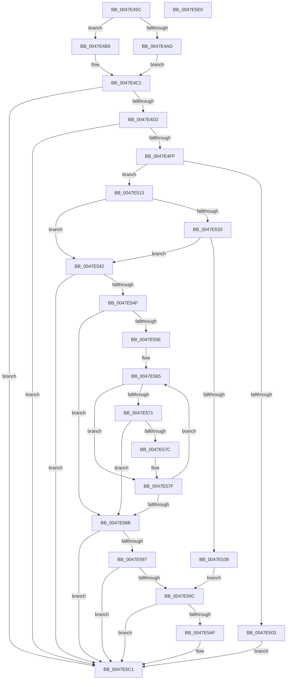

# MiPageFileNoFreeSpace

- RVA: `0x0047E45C`–`0x0047E5E1` (길이 `389` bytes)
- VA: `0x000000014047E45C`
- 실행 섹션: `.text`
- PDB 이름 있음: `예`; PDB Function 태그: `아니요`
- unwind 정보 RVA: `0x0005FEF8`
- 디코드: `102`개 명령, `389/389` bytes 표시
- 미해석 바이트: `0` (있으면 어셈블리에 `.byte`로 보존)

> 이 문서는 커널 이미지의 기계어와 PDB 기호를 분석해 생성했습니다. 4번과 5번은 함수 원형과 자료형을 바이너리 사용 방식에서 추정한 C 해석이며 원본 소스 복구 결과는 아닙니다.

## 1. Dependencies

- 직접 호출 지점: **7**; 고유 호출 대상: **7**
- 직접 호출자로 확인된 함수: **1**
- RIP 상대 이미지 참조: **0**

### Outgoing calls
- `0x0047E48D` → [MiFreeModifiedReservations](../4F/MiFreeModifiedReservations_function_004FA318.md) (function, `0x004FA318`)
- `0x0047E4A1` → [ExAcquireSpinLockExclusive](../24/ExAcquireSpinLockExclusive_function_00248690.md) (function, `0x00248690`)
- `0x0047E4BC` → [MiMakePagefileWriterEntryAvailable](MiMakePagefileWriterEntryAvailable_function_0047EE78.md) (function, `0x0047EE78`)
- `0x0047E4C4` → [MiReleaseSpinLockExclusive](../24/MiReleaseSpinLockExclusive_function_002482C0.md) (function, `0x002482C0`)
- `0x0047E509` → [MiStoreExtendVirtualPagefile](../4F/MiStoreExtendVirtualPagefile_function_004F73AC.md) (function, `0x004F73AC`)
- `0x0047E53B` → [MiCauseOverCommitPopup](../48/MiCauseOverCommitPopup_function_0048B2C4.md) (function, `0x0048B2C4`)
- `0x0047E5BC` → [MiIssuePageExtendRequest](MiIssuePageExtendRequest_function_004752F4.md) (function, `0x004752F4`)

### Direct callers
- [MiGatherPagefilePages](../37/MiGatherPagefilePages_function_00372B08.md) at `0x0037327B`
- [MiGatherPagefilePages](../37/MiGatherPagefilePages_function_00372B08.md) at `0x00373466`

### Static image references
- 디코드된 RIP-relative 메모리 참조가 없습니다.

## 2. Other-region calls and transfers

- 다른 실행 섹션으로 향하는 call: **0**
- 별도 외부 분기/꼬리 이동을 확인하지 못했습니다.

## 3. Assembly (complete function range)

```asm
0047E45C  48 8B C4                        mov rax, rsp
0047E45F  48 89 58 08                     mov qword ptr [rax + 8], rbx
0047E463  48 89 68 10                     mov qword ptr [rax + 0x10], rbp
0047E467  48 89 70 18                     mov qword ptr [rax + 0x18], rsi
0047E46B  48 89 78 20                     mov qword ptr [rax + 0x20], rdi
0047E46F  41 54                           push r12
0047E471  41 56                           push r14
0047E473  41 57                           push r15
0047E475  48 83 EC 20                     sub rsp, 0x20
0047E479  48 8B 99 D8 00 00 00            mov rbx, qword ptr [rcx + 0xd8]
0047E480  4C 8B E2                        mov r12, rdx
0047E483  BF 01 00 00 00                  mov edi, 1
0047E488  48 8B E9                        mov rbp, rcx
0047E48B  8B D7                           mov edx, edi
0047E48D  E8 86 BE 07 00                  call 0x1404fa318
0047E492  4C 8D BD C8 00 00 00            lea r15, [rbp + 0xc8]
0047E499  33 F6                           xor esi, esi
0047E49B  49 8B CF                        mov rcx, r15
0047E49E  44 8B F6                        mov r14d, esi
0047E4A1  E8 EA A1 DC FF                  call 0x140248690
0047E4A6  8A D0                           mov dl, al
0047E4A8  39 75 0C                        cmp dword ptr [rbp + 0xc], esi
0047E4AB  75 0C                           jne 0x14047e4b9
0047E4AD  40 08 BD AE 00 00 00            or byte ptr [rbp + 0xae], dil
0047E4B4  44 8B F7                        mov r14d, edi
0047E4B7  EB 08                           jmp 0x14047e4c1
0047E4B9  49 8B CC                        mov rcx, r12
0047E4BC  E8 B7 09 00 00                  call 0x14047ee78
0047E4C1  49 8B CF                        mov rcx, r15
0047E4C4  E8 F7 9D DC FF                  call 0x1402482c0
0047E4C9  45 85 F6                        test r14d, r14d
0047E4CC  0F 84 EF 00 00 00               je 0x14047e5c1
0047E4D2  B8 11 77 88 99                  mov eax, 0x99887711
0047E4D7  49 89 04 24                     mov qword ptr [r12], rax
0047E4DB  48 8B 93 40 4B 00 00            mov rdx, qword ptr [rbx + 0x4b40]
0047E4E2  4C 8B 83 98 4C 00 00            mov r8, qword ptr [rbx + 0x4c98]
0047E4E9  4C 8B 8B C8 41 00 00            mov r9, qword ptr [rbx + 0x41c8]
0047E4F0  0F B7 85 AC 00 00 00            movzx eax, word ptr [rbp + 0xac]
0047E4F7  A8 10                           test al, 0x10
0047E4F9  0F 85 C2 00 00 00               jne 0x14047e5c1
0047E4FF  A8 40                           test al, 0x40
0047E501  74 10                           je 0x14047e513
0047E503  48 8B D5                        mov rdx, rbp
0047E506  48 8B CB                        mov rcx, rbx
0047E509  E8 9E 8E 07 00                  call 0x1404f73ac
0047E50E  E9 AE 00 00 00                  jmp 0x14047e5c1
0047E513  49 3B D0                        cmp rdx, r8
0047E516  49 8B C8                        mov rcx, r8
0047E519  48 B8 CD CC CC CC CC CC CC CC   movabs rax, 0xcccccccccccccccd
0047E523  48 0F 46 CA                     cmovbe rcx, rdx
0047E527  49 F7 E0                        mul r8
0047E52A  48 83 E2 F8                     and rdx, 0xfffffffffffffff8
0047E52E  48 3B CA                        cmp rcx, rdx
0047E531  76 0F                           jbe 0x14047e542
0047E533  4D 3B C1                        cmp r8, r9
0047E536  73 0A                           jae 0x14047e542
0047E538  48 8B CB                        mov rcx, rbx
0047E53B  E8 84 CD 00 00                  call 0x14048b2c4
0047E540  EB 5A                           jmp 0x14047e59c
0047E542  48 81 BB A0 4C 00 00 00 10 00 00  cmp qword ptr [rbx + 0x4ca0], 0x1000
0047E54D  72 72                           jb 0x14047e5c1
0047E54F  44 8B 8B 58 48 00 00            mov r9d, dword ptr [rbx + 0x4858]
0047E556  44 8B C6                        mov r8d, esi
0047E559  45 85 C9                        test r9d, r9d
0047E55C  74 2D                           je 0x14047e58b
0047E55E  48 8D 93 60 48 00 00            lea rdx, [rbx + 0x4860]
0047E565  48 8B 0A                        mov rcx, qword ptr [rdx]
0047E568  F6 81 AC 00 00 00 50            test byte ptr [rcx + 0xac], 0x50
0047E56F  75 0E                           jne 0x14047e57f
0047E571  8B 41 0C                        mov eax, dword ptr [rcx + 0xc]
0047E574  48 03 C6                        add rax, rsi
0047E577  48 3B C6                        cmp rax, rsi
0047E57A  72 0F                           jb 0x14047e58b
0047E57C  48 8B F0                        mov rsi, rax
0047E57F  44 03 C7                        add r8d, edi
0047E582  48 83 C2 08                     add rdx, 8
0047E586  45 3B C1                        cmp r8d, r9d
0047E589  72 DA                           jb 0x14047e565
0047E58B  48 8B BB A0 4C 00 00            mov rdi, qword ptr [rbx + 0x4ca0]
0047E592  48 3B FE                        cmp rdi, rsi
0047E595  76 2A                           jbe 0x14047e5c1
0047E597  48 2B FE                        sub rdi, rsi
0047E59A  74 25                           je 0x14047e5c1
0047E59C  48 8B 8B 98 4C 00 00            mov rcx, qword ptr [rbx + 0x4c98]
0047E5A3  48 8B 83 C8 41 00 00            mov rax, qword ptr [rbx + 0x41c8]
0047E5AA  48 3B C8                        cmp rcx, rax
0047E5AD  73 12                           jae 0x14047e5c1
0047E5AF  45 33 C9                        xor r9d, r9d
0047E5B2  48 8B D7                        mov rdx, rdi
0047E5B5  48 8B CB                        mov rcx, rbx
0047E5B8  45 8D 41 06                     lea r8d, [r9 + 6]
0047E5BC  E8 33 6D FF FF                  call 0x1404752f4
0047E5C1  48 8B 5C 24 40                  mov rbx, qword ptr [rsp + 0x40]
0047E5C6  48 8B 6C 24 48                  mov rbp, qword ptr [rsp + 0x48]
0047E5CB  48 8B 74 24 50                  mov rsi, qword ptr [rsp + 0x50]
0047E5D0  48 8B 7C 24 58                  mov rdi, qword ptr [rsp + 0x58]
0047E5D5  48 83 C4 20                     add rsp, 0x20
0047E5D9  41 5F                           pop r15
0047E5DB  41 5E                           pop r14
0047E5DD  41 5C                           pop r12
0047E5DF  C3                              ret
0047E5E0  CC                              int3
```

## 4. C-style interpretation (structured pseudocode)

```c
__int64 __fastcall MiPageFileNoFreeSpace(__int64 a1, __int64 a2)
{
    __int64 result;
    __int64 v_rdi;
    __int64 v_rsi;
    __int64 v_rsp;
    unsigned __int64 v_stack_p10;
    unsigned __int64 v_stack_p18;
    unsigned __int64 v_stack_p20;
    unsigned __int64 v_stack_p8;

    *(unsigned __int64 *)(v_rsp + 8) = v_rbx;
    *(unsigned __int64 *)(v_rsp + 16) = v_rbp;
    *(unsigned __int64 *)(v_rsp + 24) = v_rsi;
    *(unsigned __int64 *)(v_rsp + 32) = v_rdi;
    v_rsp = (v_rsp) - (32);
    result = MiFreeModifiedReservations(a1, 1, a3, a4);
    v_rsi = 0;
    result = ExAcquireSpinLockExclusive(a1 + 200, 1, a3, a4);
    if ((*(unsigned int *)(a1 + 12)) != 0) goto loc_0047E4B9;
    goto loc_0047E4C1;
loc_0047E4B9:
    result = MiMakePagefileWriterEntryAvailable(a2, (unsigned __int8)(result), a3, a4);
loc_0047E4C1:
    result = MiReleaseSpinLockExclusive(a1 + 200, (unsigned __int8)(result), a3, a4);
    if (1 == 0) goto loc_0047E5C1;
    *(unsigned __int64 *)(a2) = (unsigned int)(0x99887711ULL);
    if ((((unsigned __int8)(*(unsigned __int16 *)(a1 + 172))) & (16)) != 0) goto loc_0047E5C1;
    if ((((unsigned __int8)(*(unsigned __int16 *)(a1 + 172))) & (64)) == 0) goto loc_0047E513;
    result = MiStoreExtendVirtualPagefile(*(unsigned __int64 *)(a1 + 216), a1, *(unsigned __int64 *)(*(unsigned __int64 *)(a1 + 216) + 19608), *(unsigned __int64 *)(*(unsigned __int64 *)(a1 + 216) + 16840));
    goto loc_0047E5C1;
loc_0047E513:
    a1 = *(unsigned __int64 *)(*(unsigned __int64 *)(a1 + 216) + 19608);
    if (a1 <= (*(unsigned __int64 *)(*(unsigned __int64 *)(a1 + 216) + 19608))) { a1 = a1; }
    a2 = (a1) & (-8);
    if (a1 <= a2) goto loc_0047E542;
    if ((*(unsigned __int64 *)(*(unsigned __int64 *)(a1 + 216) + 19608)) >= (*(unsigned __int64 *)(*(unsigned __int64 *)(a1 + 216) + 16840))) goto loc_0047E542;
    result = MiCauseOverCommitPopup(*(unsigned __int64 *)(a1 + 216), a2, *(unsigned __int64 *)(*(unsigned __int64 *)(a1 + 216) + 19608), *(unsigned __int64 *)(*(unsigned __int64 *)(a1 + 216) + 16840));
    goto loc_0047E59C;
loc_0047E542:
    if ((*(unsigned __int64 *)(*(unsigned __int64 *)(a1 + 216) + 19616)) < 0x1000ULL) goto loc_0047E5C1;
    if ((unsigned int)((unsigned int)(*(unsigned int *)(*(unsigned __int64 *)(a1 + 216) + 18520))) == 0) goto loc_0047E58B;
loc_0047E565:
    if (((*(unsigned __int8 *)(*(unsigned __int64 *)(*(unsigned __int64 *)(a1 + 216) + 18528) + 172)) & (80)) != 0) goto loc_0047E57F;
    result = ((unsigned int)(*(unsigned int *)(*(unsigned __int64 *)(*(unsigned __int64 *)(a1 + 216) + 18528) + 12))) + (0);
    if (result < 0) goto loc_0047E58B;
loc_0047E57F:
    a3 = (unsigned int)((0) + (1));
    a2 = (*(unsigned __int64 *)(a1 + 216) + 18528) + (8);
    if (((unsigned int)(a3)) < ((unsigned int)((unsigned int)(*(unsigned int *)(*(unsigned __int64 *)(a1 + 216) + 18520))))) goto loc_0047E565;
loc_0047E58B:
    if ((*(unsigned __int64 *)(*(unsigned __int64 *)(a1 + 216) + 19616)) <= result) goto loc_0047E5C1;
    v_rdi = (*(unsigned __int64 *)(*(unsigned __int64 *)(a1 + 216) + 19616)) - (result);
    if (condition_is_equal) goto loc_0047E5C1;
loc_0047E59C:
    result = *(unsigned __int64 *)(*(unsigned __int64 *)(a1 + 216) + 16840);
    if ((*(unsigned __int64 *)(*(unsigned __int64 *)(a1 + 216) + 19608)) < (*(unsigned __int64 *)(*(unsigned __int64 *)(a1 + 216) + 16840))) {
        a4 = 0;
        a2 = v_rdi;
        a1 = *(unsigned __int64 *)(a1 + 216);
        a3 = a4 + 6;
        result = MiIssuePageExtendRequest(a1, a2, a3, a4);
    }
    v_rsp = (v_rsp) + (32);
    return result;
}
```

## 5. (Beta) C Style

```c
int64_t MiPageFileNoFreeSpace(void *Arg1, void *Arg2)
{
    uint8_t *arg1 = (uint8_t *)Arg1;
    uint8_t *arg2 = (uint8_t *)Arg2;

    int64_t result;
    int64_t local_rdi;
    int64_t local_rsi;
    int64_t local_rsp;
    uint64_t v_stack_p10;
    uint64_t v_stack_p18;
    uint64_t v_stack_p20;
    uint64_t v_stack_p8;

    *(uint64_t *)(local_rsp + 0x8) = local_rbx;
    *(uint64_t *)(local_rsp + 0x10) = local_rbp;
    *(uint64_t *)(local_rsp + 0x18) = local_rsi;
    *(uint64_t *)(local_rsp + 0x20) = local_rdi;
    local_rsp = (local_rsp) - (32);
    result = MiFreeModifiedReservations(Arg1, 1, a3, a4);
    local_rsi = 0;
    result = ExAcquireSpinLockExclusive(Arg1 + 200, 1, a3, a4);
    if ((*(uint32_t *)(arg1 + 0xC)) != 0) goto loc_0047E4B9;
    goto loc_0047E4C1;
loc_0047E4B9:
    result = MiMakePagefileWriterEntryAvailable(Arg2, (uint8_t)(result), a3, a4);
loc_0047E4C1:
    result = MiReleaseSpinLockExclusive(Arg1 + 200, (uint8_t)(result), a3, a4);
    if (1 == 0) goto loc_0047E5C1;
    *(uint64_t *)(arg2) = (uint32_t)(0x99887711ULL);
    if ((((uint8_t)(*(uint16_t *)(arg1 + 0xAC))) & (16)) != 0) goto loc_0047E5C1;
    if ((((uint8_t)(*(uint16_t *)(arg1 + 0xAC))) & (64)) == 0) goto loc_0047E513;
    result = MiStoreExtendVirtualPagefile(*(uint64_t *)(arg1 + 0xD8), Arg1, *(uint64_t *)(*(uint64_t *)(arg1 + 0xD8) + 0x4C98), *(uint64_t *)(*(uint64_t *)(arg1 + 0xD8) + 0x41C8));
    goto loc_0047E5C1;
loc_0047E513:
    Arg1 = *(uint64_t *)(*(uint64_t *)(arg1 + 0xD8) + 0x4C98);
    if (Arg1 <= (*(uint64_t *)(*(uint64_t *)(arg1 + 0xD8) + 0x4C98))) { Arg1 = Arg1; }
    Arg2 = (Arg1) & (-8);
    if (Arg1 <= Arg2) goto loc_0047E542;
    if ((*(uint64_t *)(*(uint64_t *)(arg1 + 0xD8) + 0x4C98)) >= (*(uint64_t *)(*(uint64_t *)(arg1 + 0xD8) + 0x41C8))) goto loc_0047E542;
    result = MiCauseOverCommitPopup(*(uint64_t *)(arg1 + 0xD8), Arg2, *(uint64_t *)(*(uint64_t *)(arg1 + 0xD8) + 0x4C98), *(uint64_t *)(*(uint64_t *)(arg1 + 0xD8) + 0x41C8));
    goto loc_0047E59C;
loc_0047E542:
    if ((*(uint64_t *)(*(uint64_t *)(arg1 + 0xD8) + 0x4CA0)) < 0x1000ULL) goto loc_0047E5C1;
    if ((uint32_t)((uint32_t)(*(uint32_t *)(*(uint64_t *)(arg1 + 0xD8) + 0x4858))) == 0) goto loc_0047E58B;
loc_0047E565:
    if (((*(uint8_t *)(*(uint64_t *)(*(uint64_t *)(arg1 + 0xD8) + 0x4860) + 0xAC)) & (80)) != 0) goto loc_0047E57F;
    result = ((uint32_t)(*(uint32_t *)(*(uint64_t *)(*(uint64_t *)(arg1 + 0xD8) + 0x4860) + 0xC))) + (0);
    if (result < 0) goto loc_0047E58B;
loc_0047E57F:
    a3 = (uint32_t)((0) + (1));
    Arg2 = (*(uint64_t *)(arg1 + 0xD8) + 18528) + (8);
    if (((uint32_t)(a3)) < ((uint32_t)((uint32_t)(*(uint32_t *)(*(uint64_t *)(arg1 + 0xD8) + 0x4858))))) goto loc_0047E565;
loc_0047E58B:
    if ((*(uint64_t *)(*(uint64_t *)(arg1 + 0xD8) + 0x4CA0)) <= result) goto loc_0047E5C1;
    local_rdi = (*(uint64_t *)(*(uint64_t *)(arg1 + 0xD8) + 0x4CA0)) - (result);
    if (condition_is_equal) goto loc_0047E5C1;
loc_0047E59C:
    result = *(uint64_t *)(*(uint64_t *)(arg1 + 0xD8) + 0x41C8);
    if ((*(uint64_t *)(*(uint64_t *)(arg1 + 0xD8) + 0x4C98)) < (*(uint64_t *)(*(uint64_t *)(arg1 + 0xD8) + 0x41C8))) {
        a4 = 0;
        Arg2 = local_rdi;
        Arg1 = *(uint64_t *)(arg1 + 0xD8);
        a3 = a4 + 6;
        result = MiIssuePageExtendRequest(Arg1, Arg2, a3, a4);
    }
    local_rsp = (local_rsp) + (32);
    return result;
}
```

### 관측된 메모리 오프셋

구조체 형식이 확인되지 않은 접근은 인자 기준의 오프셋으로만 기록했습니다.

| 기준 인자 | 오프셋 표현 | 폭 (bit) | 접근 |
|---|---:|---:|---|
| `Arg1` | `+ 0xC` | `32` | `R` |
| `Arg1` | `+ 0xAC` | `16` | `R` |
| `Arg1` | `+ 0xAE` | `8` | `R/W` |
| `Arg1` | `+ 0xC8` | `64` | `R` |
| `Arg1` | `+ 0xD8` | `64` | `R` |
| `Arg2` | `+ 0x0` | `64` | `W` |

## 6. Execution-region graph

[열기: 2D/3D 그래프와 함수 탐색 컨트롤 패널](../../../control-panel.html?section=text&rva=0x0047E45C&view=graph)

- 2D 그래프는 위에서 아래로 흐르고, 3D 그래프는 빈 공간을 드래그해 회전합니다. Shift+드래그는 이동, 휠은 확대·축소, 함수 노드 선택은 대상 보고서 이동입니다.

### Static fallback


