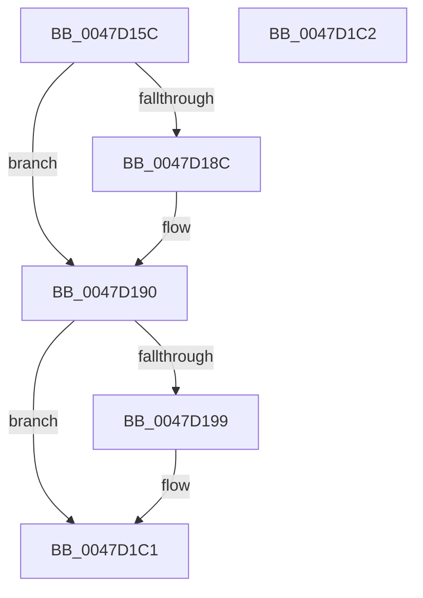

# MiPurgeValidPage

- RVA: `0x0047D15C`–`0x0047D1C3` (길이 `103` bytes)
- VA: `0x000000014047D15C`
- 실행 섹션: `.text`
- PDB 이름 있음: `예`; PDB Function 태그: `아니요`
- unwind 정보 RVA: `0x000DB714`
- 디코드: `25`개 명령, `103/103` bytes 표시
- 미해석 바이트: `0` (있으면 어셈블리에 `.byte`로 보존)

> 이 문서는 커널 이미지의 기계어와 PDB 기호를 분석해 생성했습니다. 4번과 5번은 함수 원형과 자료형을 바이너리 사용 방식에서 추정한 C 해석이며 원본 소스 복구 결과는 아닙니다.

## 1. Dependencies

- 직접 호출 지점: **0**; 고유 호출 대상: **0**
- 직접 호출자로 확인된 함수: **1**
- RIP 상대 이미지 참조: **0**

### Outgoing calls
- 직접 디코드된 call 명령이 없습니다.

### Direct callers
- [MiPurgeSubsection](../37/MiPurgeSubsection_function_003712F0.md) at `0x00371A27`

### Static image references
- 디코드된 RIP-relative 메모리 참조가 없습니다.

## 2. Other-region calls and transfers

- 다른 실행 섹션으로 향하는 call: **0**
- 별도 외부 분기/꼬리 이동을 확인하지 못했습니다.

## 3. Assembly (complete function range)

```asm
0047D15C  48 C1 EA 0C                     shr rdx, 0xc
0047D160  48 B8 FF FF FF FF FF 00 00 00   movabs rax, 0xffffffffff
0047D16A  48 23 D0                        and rdx, rax
0047D16D  4C 8D 0C 52                     lea r9, [rdx + rdx*2]
0047D171  49 C1 E1 04                     shl r9, 4
0047D175  48 B8 00 00 00 00 00 DE FF FF   movabs rax, 0xffffde0000000000
0047D17F  4C 03 C8                        add r9, rax
0047D182  41 8B 41 20                     mov eax, dword ptr [r9 + 0x20]
0047D186  66 83 F8 02                     cmp ax, 2
0047D18A  76 04                           jbe 0x14047d190
0047D18C  49 FF 40 18                     inc qword ptr [r8 + 0x18]
0047D190  48 F7 C2 FF 01 00 00            test rdx, 0x1ff
0047D197  75 28                           jne 0x14047d1c1
0047D199  49 8B 01                        mov rax, qword ptr [r9]
0047D19C  49 8B 50 10                     mov rdx, qword ptr [r8 + 0x10]
0047D1A0  48 C1 EA 03                     shr rdx, 3
0047D1A4  48 8B CA                        mov rcx, rdx
0047D1A7  4D 89 48 10                     mov qword ptr [r8 + 0x10], r9
0047D1AB  48 33 C8                        xor rcx, rax
0047D1AE  48 B8 01 00 00 00 00 F0 FF FF   movabs rax, 0xfffff00000000001
0047D1B8  48 23 C8                        and rcx, rax
0047D1BB  48 33 CA                        xor rcx, rdx
0047D1BE  49 89 09                        mov qword ptr [r9], rcx
0047D1C1  C3                              ret
0047D1C2  CC                              int3
```

## 4. C-style interpretation (structured pseudocode)

```c
__int64 __fastcall MiPurgeValidPage(__int64 a1, __int64 a2, __int64 a3)
{
    __int64 result;

    a2 = (a2) >> (12);
    a2 = (a2) & (result);
    a4 = (a2 + a2 * 2) << (4);
    a4 = (a4) + (result);
    if (((unsigned __int16)((unsigned int)(*(unsigned int *)(a4 + 32)))) >= = 2) {
    }
    result = (unsigned int)(*(unsigned int *)(a4 + 32));
    if (((a2) & (511)) == 0) {
        result = *(unsigned __int64 *)(a4);
        a2 = *(unsigned __int64 *)(a3 + 16);
        a2 = (a2) >> (3);
        a1 = a2;
        *(unsigned __int64 *)(a3 + 16) = a4;
        a1 = (a1) ^ (result);
        a1 = (a1) & (result);
        a1 = (a1) ^ (a2);
        *(unsigned __int64 *)(a4) = a1;
    }
    return result;
}
```

## 5. (Beta) C Style

```c
int64_t MiPurgeValidPage(int64_t Arg1, int64_t Arg2, void *Arg3)
{
    uint8_t *arg3 = (uint8_t *)Arg3;

    int64_t result;

    Arg2 = (Arg2) >> (12);
    Arg2 = (Arg2) & (result);
    a4 = (Arg2 + Arg2 * 2) << (4);
    a4 = (a4) + (result);
    if (((uint16_t)((uint32_t)(*(uint32_t *)(a4 + 0x20)))) >= = 2) {
    }
    result = (uint32_t)(*(uint32_t *)(a4 + 0x20));
    if (((Arg2) & (511)) == 0) {
        result = *(uint64_t *)(a4);
        Arg2 = *(uint64_t *)(arg3 + 0x10);
        Arg2 = (Arg2) >> (3);
        Arg1 = Arg2;
        *(uint64_t *)(arg3 + 0x10) = a4;
        Arg1 = (Arg1) ^ (result);
        Arg1 = (Arg1) & (result);
        Arg1 = (Arg1) ^ (Arg2);
        *(uint64_t *)(a4) = Arg1;
    }
    return result;
}
```

### 관측된 메모리 오프셋

구조체 형식이 확인되지 않은 접근은 인자 기준의 오프셋으로만 기록했습니다.

| 기준 인자 | 오프셋 표현 | 폭 (bit) | 접근 |
|---|---:|---:|---|
| `Arg3` | `+ 0x10` | `64` | `R` |
| `Arg3` | `+ 0x10` | `64` | `W` |
| `Arg3` | `+ 0x18` | `64` | `R/W` |

## 6. Execution-region graph

[열기: 2D/3D 그래프와 함수 탐색 컨트롤 패널](../../../control-panel.html?section=text&rva=0x0047D15C&view=graph)

- 2D 그래프는 위에서 아래로 흐르고, 3D 그래프는 빈 공간을 드래그해 회전합니다. Shift+드래그는 이동, 휠은 확대·축소, 함수 노드 선택은 대상 보고서 이동입니다.

### Static fallback


